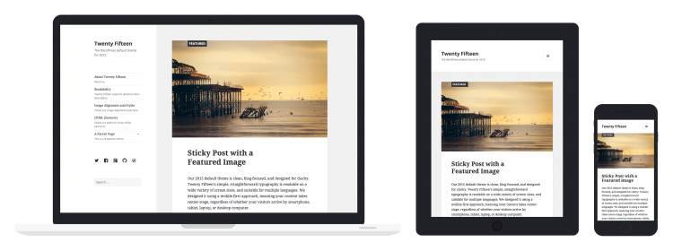
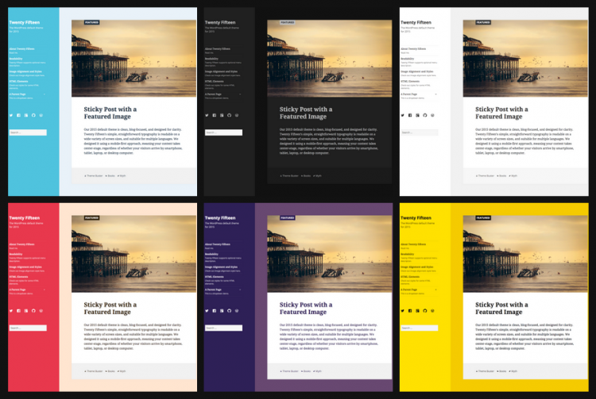
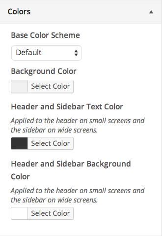
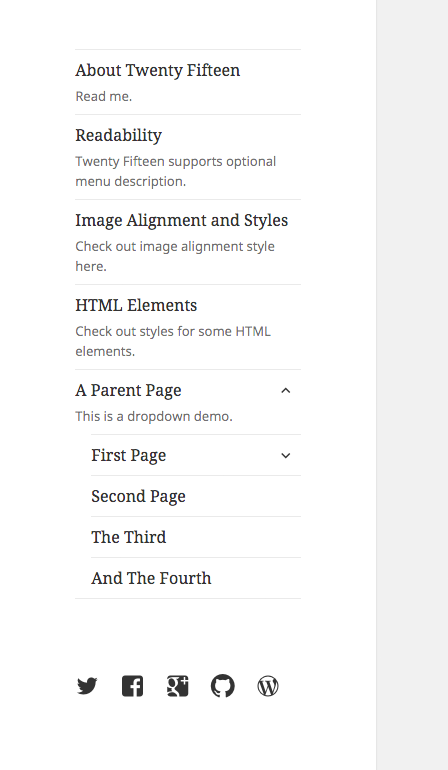
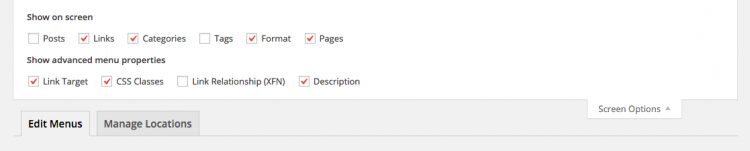
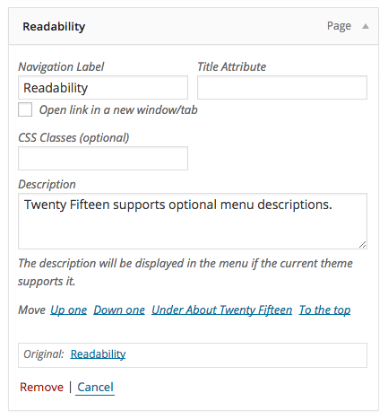
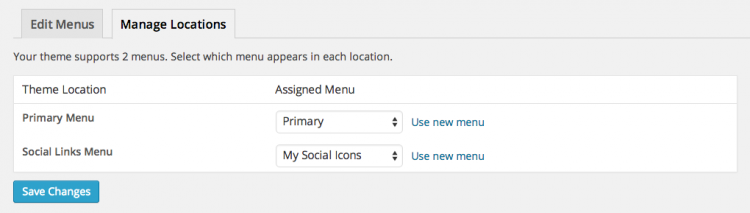
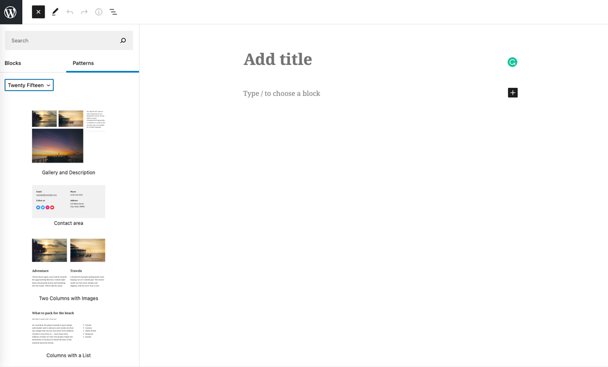
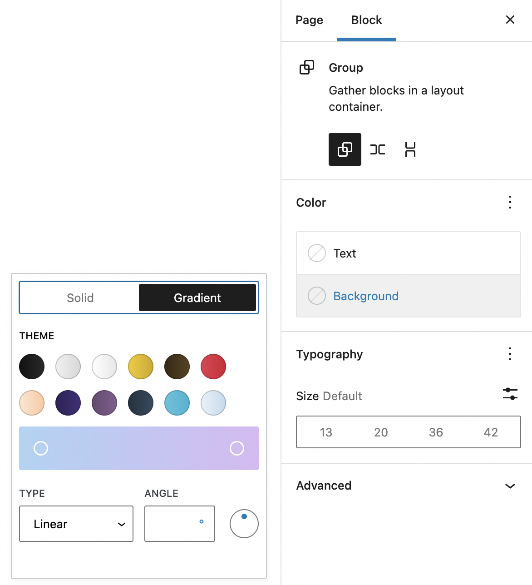

# Twenty Fifteen

[Twenty Fifteen](https://wordpress.org/themes/twentyfifteen) is the default theme for WordPress in 2015. It is super-clean, content-focused, and designed to bring a little more simplicity to our blogs. Its careful attention to typography, featuring the expertly-designed [Noto font set](http://www.google.com/get/noto/) in elegant and harmonious margins, makes it beautiful in multiple languages around the world.

Twenty Fifteen looks great on devices of all sizes, from desktop to mobile and everything in between. The theme adapts to any screen without sacrificing usability or design integrity.

> **Quick Specs (all measurements in pixels)**

There are a few ways that you can customize Twenty Fifteen, all from WordPress’ Customizer. This short guide will show you how to:

-   choose a featured color scheme
-   add descriptions to your menus
-   add social icons in your menu
-   add block patterns

## Choose a featured color scheme

Twenty Fifteen has six color schemes you can use to change the look of your blog. The Default color scheme is a light gray, but you can also choose from Dark, Yellow, Pink, Purple, and Blue.

To choose your color scheme, go to **Appearance > Customize**.

Under “Colors”, select your preferred color scheme from the drop down:

You’ll see the color scheme change in the preview pane to the right.

When you’re done, click **Save and Publish**.

## Add Menu descriptions

Twenty Fifteen has a menu design that’s easy to navigate, especially when you add menu descriptions.

To start adding descriptions to your menus, go to **Appearance > Menus** and **click the Screen Options tab** in the upper right of the screen.

In the “Show advanced menu properties” section, **check the box** next to Description.

Now you can begin adding descriptions to any link in a menu.

When you’re done, click **Save Menu**.

## Add social icons

Twenty Fifteen also allows you to display links to your social media profiles with crisp, perfectly-sized icons.

You can see these icons at the bottom of the menu displayed in the previous section.

The first step is to go to **Appearance > Menus** and **create a new menu** – you can name your menu anything you like.

You will then add the URL for each social profile to your menu as a custom link.

When you have added all desired links, **click Save Menu**.

Now that you have created your menu and added your social links, **go to the Manage Locations tab** and next to “Social Links Menu”, select the social icons menu you just created from the drop down.

**Click Save Changes** when you’re done.

**Available icons**

Linking to any of the following sites will automatically display its icon in your menu:

-   CodePen
-   Digg
-   Dribbble
-   Dropbox
-   Email (mailto: links)
-   Facebook
-   Flickr
-   Foursquare
-   GitHub
-   Google+
-   Instagram
-   LinkedIn
-   Path
-   Pinterest
-   Pocket
-   Polldaddy
-   Reddit
-   RSS Feed (URLs with /feed/
-   Spotify
-   Skype
-   StumbleUpon
-   Tumblr
-   Twitch
-   Twitter
-   Vimeo
-   WordPress
-   YouTube

## Add Block Patterns

Twenty Fifteen comes bundled with a set of [block patterns](../../../editing-and-design/block-editor/patterns/block-pattern.md).

You can access the block patterns from the Block Editor.

1.  Click the + icon to add a new block.
2.  Click on the *Patterns* tab.
3.  Select *Twenty Fifteen* from the drop down menu.
4.  Click on the pattern you wish to insert and the pattern is inserted in the document at the location of your cursor.

*Block patterns in Twenty Fifteen*

## What else can you do?

You can also use the Customizer to make the following changes to your website:

-   Change your Custom Header image
-   Featured Images: works best with images that are 825px wide by 510px high
-   Change the background image or color
-   Set a static front page

You can also select a gradient option for certain blocks that fit the theme color scheme:

## Links

-   [Twenty Fifteen Demo and Download](https://wordpress.org/themes/twentyfifteen/)
-   [Twenty Fifteen Changelog](twenty-fifteen-changelog.md)
