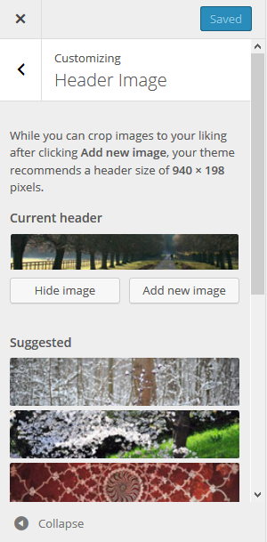
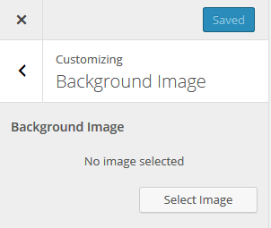
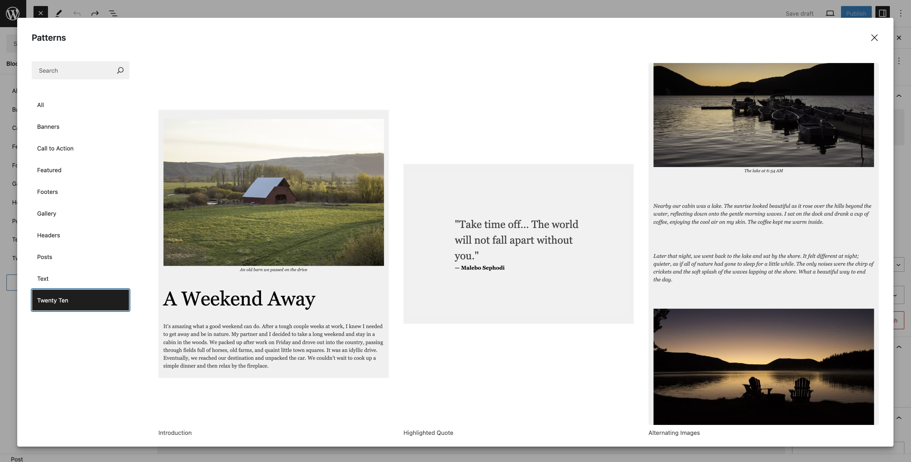

# Twenty Ten

The [Twenty Ten](https://wordpress.org/themes/twentyten/) is the default theme for WordPress in 2010, introduced with [WordPress version 3.0.](https://wordpress.org/documentation/wordpress-version/version-3-0/)

It is stylish, customizable, simple, and readable. Twenty Ten supports six widgetized areas (two in the sidebar, four in the footer) and featured images (thumbnails for gallery posts and custom header images for posts and pages). Twenty Ten has editor styles, one and two- column page templates, and supports Aside and Gallery post formats.

Twenty Ten was created by [Ian Stewart](https://profiles.wordpress.org/iandstewart/) and [Matt Miklic](https://profiles.wordpress.org/mattmiklic/), based on the theme “Kirby”.

## Quick Specs

1.  Content and one sidebar: The main column width is 640px with one sidebar of 200px.
2.  Full-width layout: The main column is 640px.
3.  Header image is 940px in width and 198px in height.

## Customizing

There are a few ways that you can customize Twenty Ten, either from the [Customizer](../../widgets-menus-and-customizer/customizer.md) or through the WordPress admin screen. This short guide will use the Customizer to:

-   Change the custom header
-   Add a custom background

### Change the Custom Header

The theme has eight header images to choose from, and you can add your own image.

To change you custom header, go to **Appearance > Customize**. Navigate to the link named “Custom Header” and click on the link.

Click either

-   the “Hide image” button to remove any custom header image in your theme,
-   the “Add new image” button to upload your own image for your theme’s header area, or
-   either of the suggested images bundled with this theme.

After you’ve changed the header image, click on the “Save and Publish” button at the top of the customizer and wait till the text in the button changes to “Saved”.

Click on the “X” at the top of the Customizer to close the panel.

### Add a Custom Background

To add a custom background, go to **Appearance > Customize** then navigate to the link named “Custom Background” and click on the link.

Upload the image you want as your custom background and a new screen will show up with the following options.

-   Background Image
    -   “Remove” button
    -   “Change Image” button

-   Background
    -   Repeat
    -   No Repeat
    -   Tile
    -   Tile Horizontally
    -   Tile Vertically

-   Background Position
    -   Left
    -   Center
    -   Right

-   Background Attachment
    -   Scroll
    -   Fixed

Select the options and then navigate to the top of the Customizer and click on the “Save and Publish” button. Wait till the text in the button changes to “Saved”.

Click on the “X” at the top of the Customizer to close the panel.

## Custom Templates

Twenty Ten has one custom page template that shows the content in one column, without sidebar. 
You can set the page template by editing the page, opening the Page panel, and clicking on the template name. 
The template are available for pages, not for posts.

## Post Formats

Twenty Ten supports standard, aside, and gallery [post formats](https://developer.wordpress.org/advanced-administration/wordpress/post-formats/). In archive pages, the aside format hides the post title, and the gallery post format shows the gallery.

## Patterns

The theme has three custom [patterns](../../../editing-and-design/block-editor/patterns/block-pattern.md): Introduction, Highlighted Quote, and Alternating images.

You can access the patterns from the Block Editor.

1.  Click the + icon to add a new block.
2.  Click on the Patterns tab.
3.  Select Twenty Ten from the list of categories.
4.  Click on the pattern you wish to insert and the pattern is inserted in the document at the location of your cursor.

## Support & resources

Get community help with Twenty Ten in its [forum](https://wordpress.org/support/theme/twentyten/).

You can also read [the theme’s changelog](twenty-ten-changelog.md).
