# Manage Plugins

## What are plugins?

[WordPress Plugins](https://wordpress.org/plugins/) are PHP scripts that extend the functionality of WordPress. They enhance the features of WordPress or add entirely new features to your site. Plugins are often developed by volunteers and are usually free to the public.

Plugins are available via the [WordPress Plugin Directory](https://wordpress.org/plugins/). Although plugins you find here are thoroughly tested and considered safe to use, they are of varying quality and are often works in progress.

### How do they relate to WordPress core?

The WordPress content management system software, or WordPress core, provides the primary functionality for publishing content and managing users. Each WordPress plugin is an additional piece of software that can be easily installed to extend the functionality of WordPress core.

This allows you to customize your WordPress site with your desired functionality. Since so much functionality is provided through plugins, WordPress core is full-featured and customizable, without having to include everything for everyone.

### What are some examples?

Some of the more popular plugins in the [WordPress Plugin Directory](https://wordpress.org/plugins/) fall into these categories:

-   Spam control
-   SEO
-   Data import and export
-   E-commerce
-   Security
-   Caching

This is just a small sample. There are thousands of plugins available in the directory, so there’s a good chance you’ll find some that are useful to you.

## Finding and Installing Plugins

### Finding Plugins

You can browse and search for plugins in the [WordPress Plugin Directory](https://wordpress.org/plugins/). Each plugin listed there is available for download as a zip file you can upload to your WordPress site.

An alternative way to find and install plugins is from within the WordPress admin screens. Navigate to **Plugins > Add New**, and you can browse and search for plugins from within your dashboard.

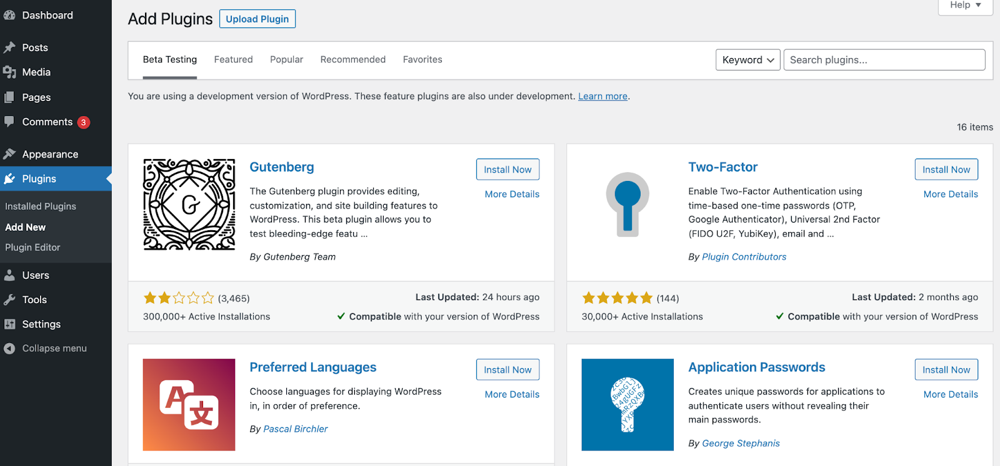

Each plugin listed there has an “Install Now” button so you can easily add it to your site.

### Plugin Compatibility

If a plugin hasn’t been updated since the most recent update to WordPress core, it may be incompatible, or its compatibility may be unknown. You can view compatibility information about plugins from the Add Plugins page, or from the Installed Plugins list.

#### Compatibility of New Plugins

To learn about the compatibility of a plugin before you install it, navigate to **Plugins > Add New.** Each plugin description on this page includes a note that reads “Compatible with your version of WordPress” or “Untested with your version of WordPress.” You can click the “More Details” link to see information about this plugin’s compatibility.

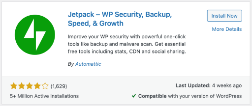

#### Compatibility of Installed Plugins

To learn about the compatibility of plugins you’ve already installed, click the “Plugins” link in the left nav of your site’s dashboard. Each item on this list should contain a “View details” link. Click this to see information about this plugin’s compatibility with different versions of WordPress.

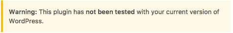

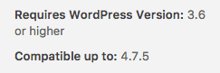

## Installing Plugins

There are 3 ways to install WordPress plugins.

**Automatic Plugin Installation.** Any plugin available in the WordPress Plugins Directory can be installed via the built-in plugin installer.

**Upload via WordPress Admin.** You can easily add a new plugin by uploading a zip archive of the plugin from your local computer.

**Manual Plugin Installation.** In some cases, you may need to manually upload a plugin directly using an SFTP client.

### Automatic Plugin Installation

This is the simplest method of installing a plugin. To add a plugin using the built-in plugin installer:

1.  Navigate to **Plugins > Add New**.

2.  Use the search form in the top-right to search by keyword, author, or tag.

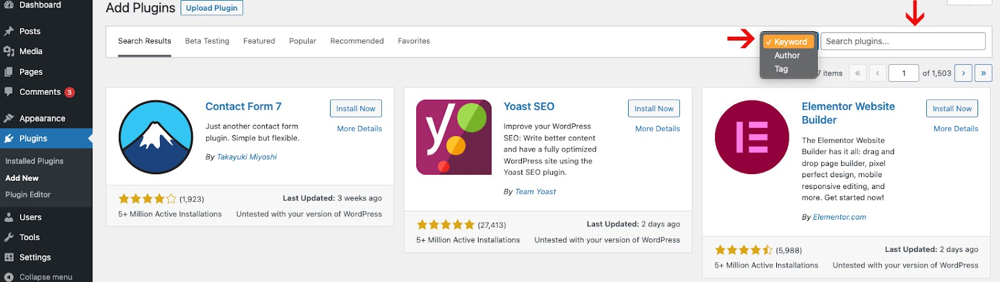

3.  On the search results that appear, click a plugin’s title or the link ‘More Details’ to read more about it, including installation notes, plugin documentation, or other useful information.
4.  Click the **Install Now** button to install the plugin.
5.  Once the plugin installation is complete, click **Activate** to activate the plugin.

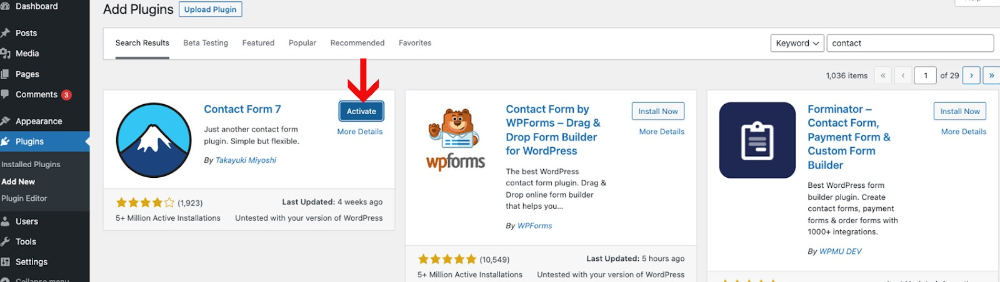

### Upload via WordPress Admin

If you have a copy of the plugin as a zip file, you can manually upload it and install it through the Plugins admin screen.

1.  Navigate to **Plugins > Add New**.
2.  Click the **Upload Plugin** button at the top of the screen.

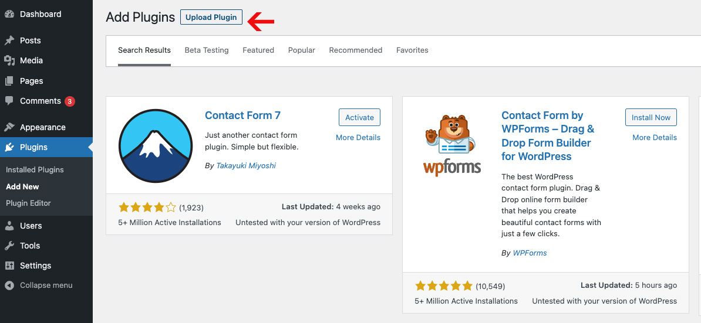

3.  Select the zip file from your local filesystem.

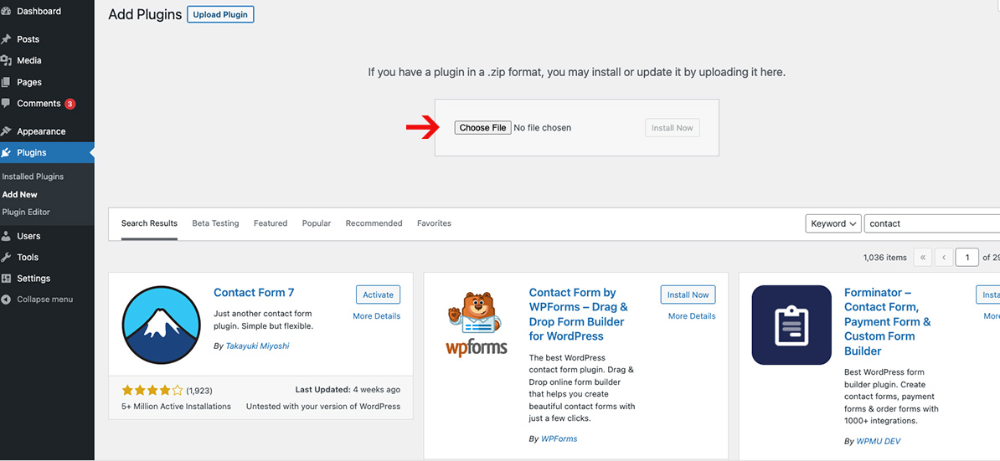

4.  Click the **Install Now** button.

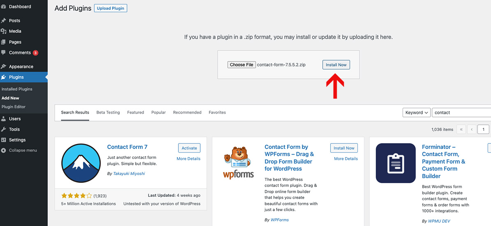

5.  When the installation is complete, you’ll see “Plugin installed successfully.” Click the **Activate Plugin** button.

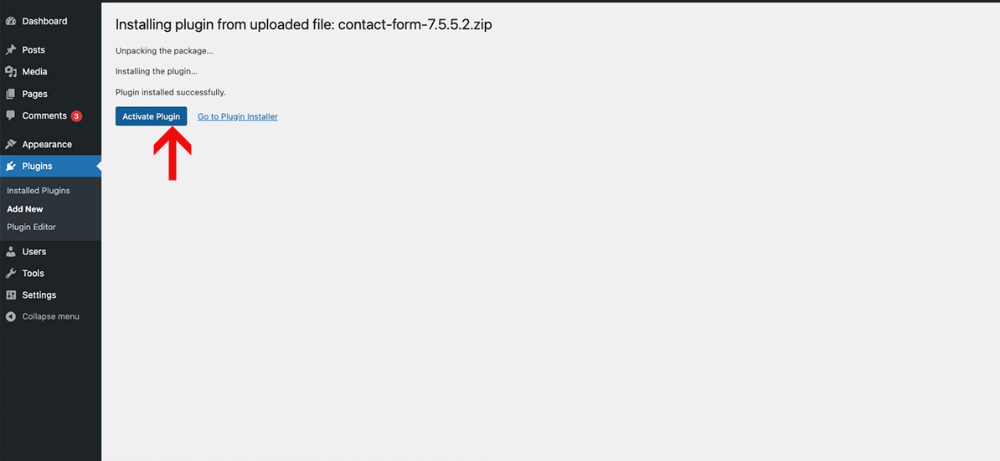

### Manual Plugin Installation

In rare cases, you may need to install a plugin by manually transferring the files onto the server. This is recommended only when absolutely necessary, for example when your server is not configured to allow automatic installations.

This procedure requires you to be familiar with the process of transferring files using an SFTP client. It is recommended for advanced users and developers.

Here are the detailed instructions to manually install a WordPress plugin by transferring the files onto the webserver.

1.  Download the plugin zip file from the [WordPress Plugin Directory](https://wordpress.org/plugins/) and unzip it locally. For example, in the case of Gutenberg plugin, download as gutenberg.X.Y.Z.zip (X.Y.Z is version) and unzip it to get the gutenberg/ folder.
2.  Transfer the extracted folder to the wp-content/plugins directory of your WordPress site via SFTP or remote file manager.
3.  From the Plugins menu in the Administration Screen, click Activate for the transferred plugin.

## Plugin Favorites

You can add a plugin to your list of favorites, and you can view and easily install another WordPress.org user’s favorite plugins.

### Favorite a Plugin

1.  Log in to the [WordPress Plugins Directory](https://wordpress.org/plugins) using your WordPress.org ID.
2.  Find the plugin you want to like and go to the plugin’s page.
3.  Click the heart icon next to the Download button.

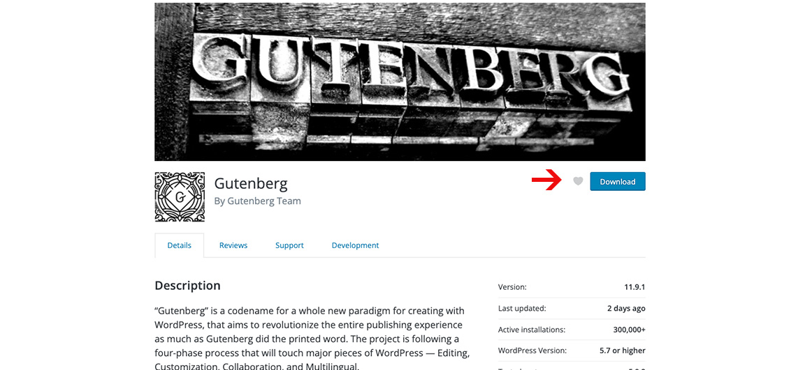

4.  Once you have favorited a plugin, it will show up in your WordPress.org public profile. If you have published a review of the plugin, your rating of the plugin will also appear here.

### View a User’s Favorite Plugins

To see a WordPress.org user’s favorite plugins (including your own):

1.  Browse to the Add Plugins admin screen (**Plugins > Add New**).
2.  Click the Favorites tab.

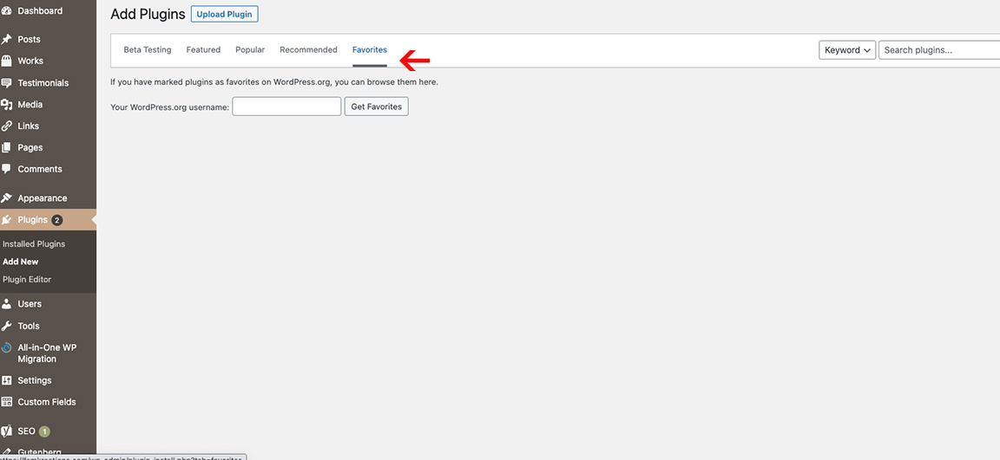

3.  Type the user’s name in the “Your WordPress.org username” field.

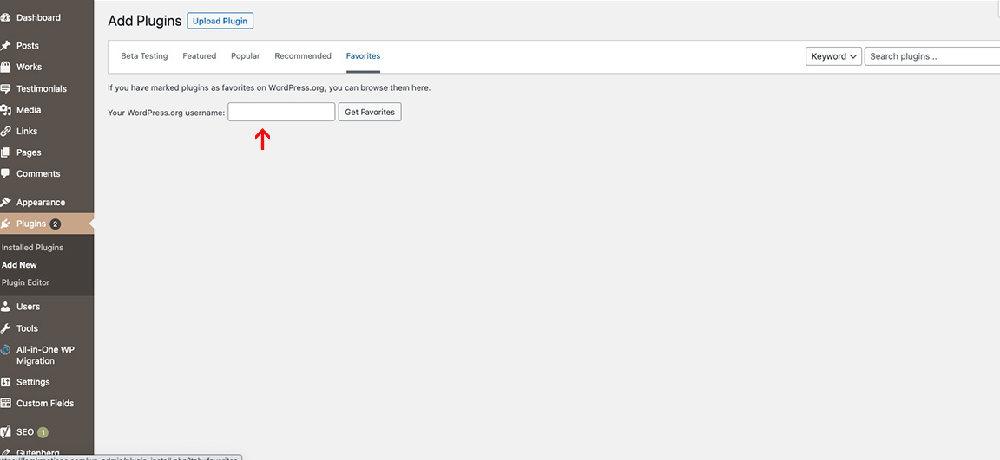

4.  Click Get Favorites.
5.  Each of the plugins listed here has an ‘Install Now’ button that you can use to add the plugin to your site.

## Updating Plugins

Plugin developers update their plugins occasionally by adding new features, improving code quality, and keeping them secure. To ensure that these changes are applied on your site immediately, you should keep your WordPress plugins up to date. This helps to improve your site’s WordPress security and performance.

### Manual Plugin Update From The Dashboard

Your WordPress Dashboard automatically notifies you when a plugin needs to be updated — you can view this notification under the **Dashboard->Updates** tab.

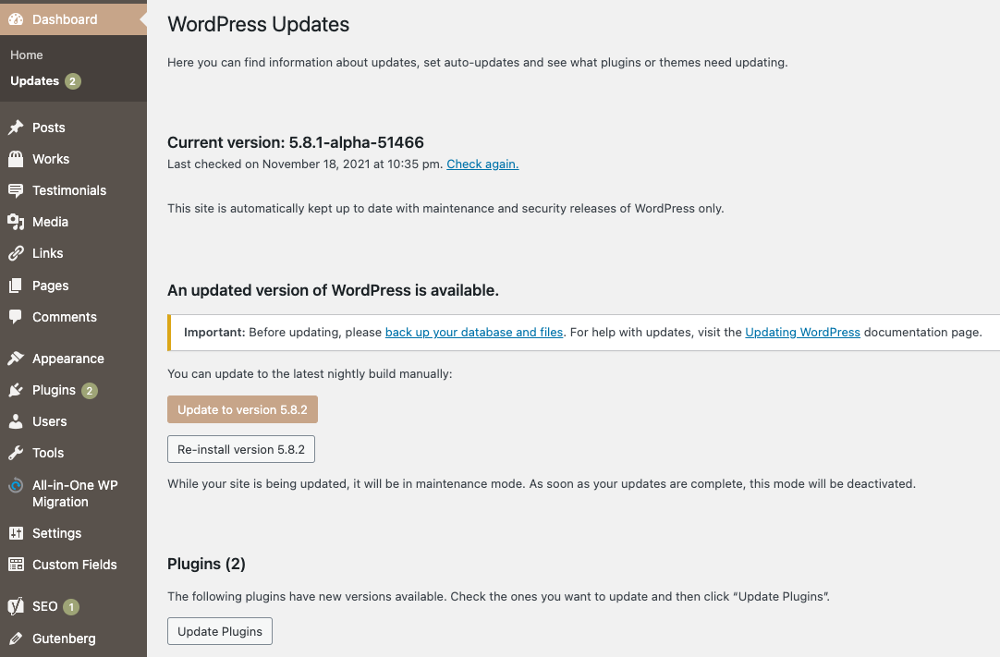

1.  Scroll down to the Plugins section.

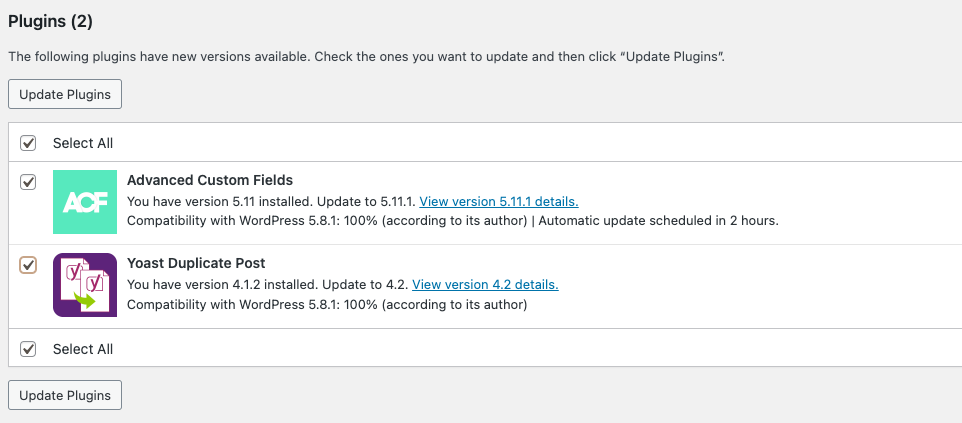

2.  Select the checkbox for the plugins you want to update and then click  ‘Update Plugins’ button.

**NOTE:** Always make sure you have a current backup of your site before updating your plugins. Sometimes problems can happen during the update process.

### Manual Plugin Update From The Plugins Page

You can find the plugins that need to be updated on your site’s Plugins page.

To find any plugins installed on your site that need to be updated:

1.  Click the “Plugins” link in the left nav of your site’s dashboard.
2.  Look down the list of installed plugins for any that include a line reading “There is a new version…”
3.  Click the “View version…” link in that note to view details about the plugin’s update.
4.  Click the “update now” link to update the plugin.

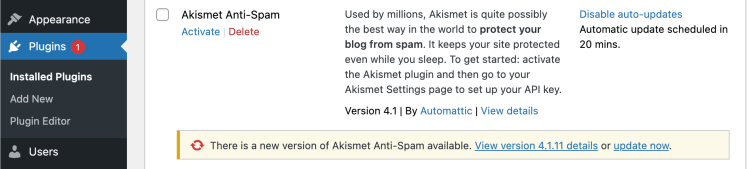

**NOTE:** Always make sure you have a current backup of your site before updating your plugins. Sometimes problems can happen during the update process.

### Enable Automatic Plugin Update

WordPress introduced automatic updates for WordPress plugins in WordPress 5.5. This allows you to enable automatic updates for individual WordPress plugins directly from the Plugins Page in the WordPress dashboard.

1.  Go to **Plugins -> Installed Plugins** page inside WordPres Admin area. Here you’ll see the list of all your installed plugins.  Each plugin in the list has a link ‘Enable auto-updates’ in the right-most column (under Automatic Updates).
2.  Select the checkbox for the plugins you want to enable auto-update and click the link  ‘Enable auto-updates’ for the selected plugin. This will enable automatic updates for the selected plugin.

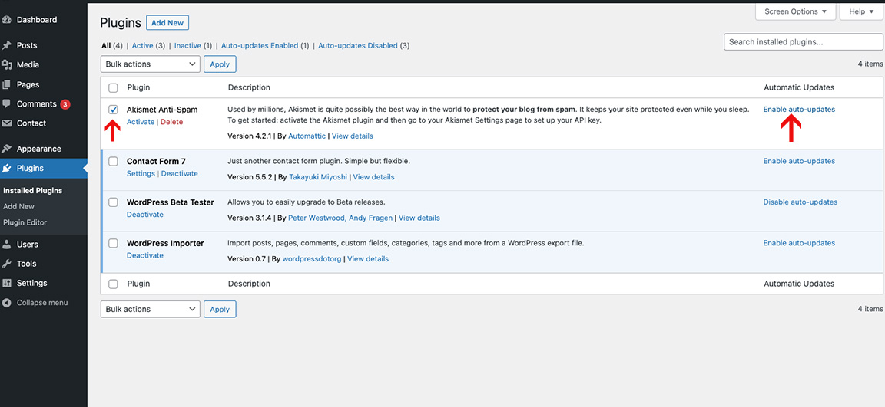

### Disable Automatic Plugin Update

To stop your plugins from updating automatically, do the following:

1.  Go to **Plugins -> Installed Plugins** page inside WordPres Admin area. Here you’ll see the list of all your installed plugins.
2.  Each plugin in the list that has auto-update enabled will have a link ‘Disable auto-updates’ in the right-most column (under Automatic Updates).
3.  Select the checkbox for the plugin you want to disable auto-update and click the link  Disable auto-updates’ for the selected plugin. This will disable automatic updates for the selected plugin.

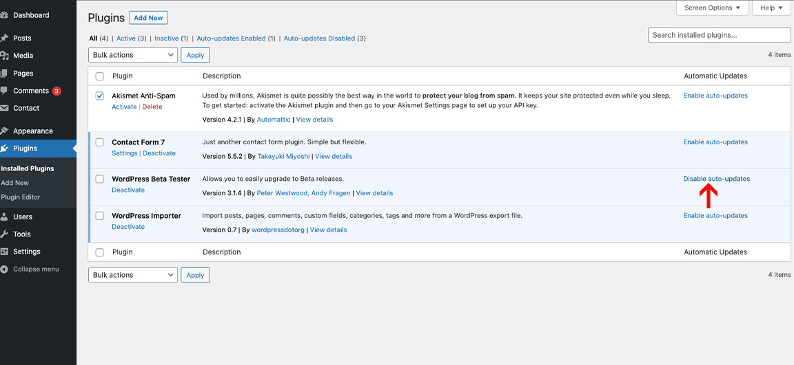

### Bulk Update WordPress Plugins

If you have several plugins on your website that need an update, then you can bulk update those plugins.  It is always recommended to do a quick review of all the plugins before updating.

1.  Go to the Plugins page and click on the ‘Update Available’ link. This will show you the list of all plugins that have updates available.

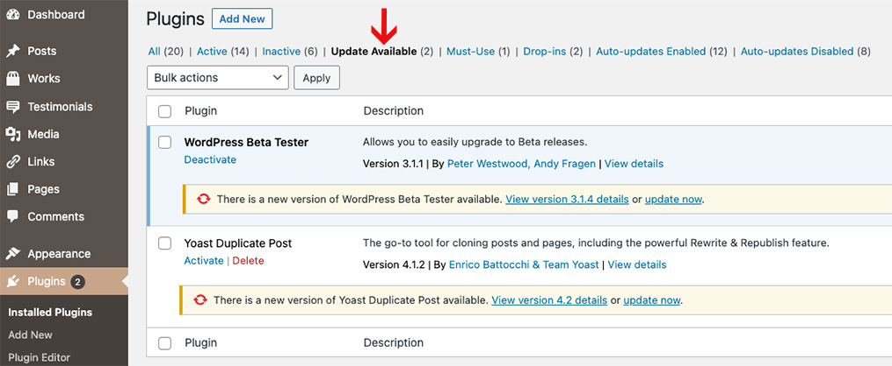

2.  Click the checkbox to select all the plugins you want to update.

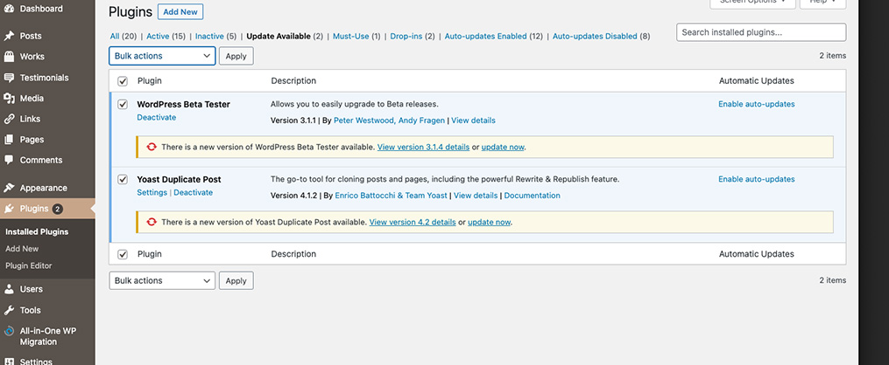

3.  From the ‘Bulk Actions’ drop down, select ‘Update’ and click ‘Apply’.

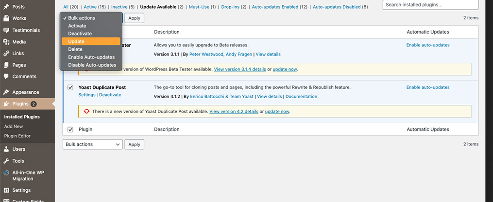

If all goes well with the updates, you will see a message saying that the updates were completed successfully.

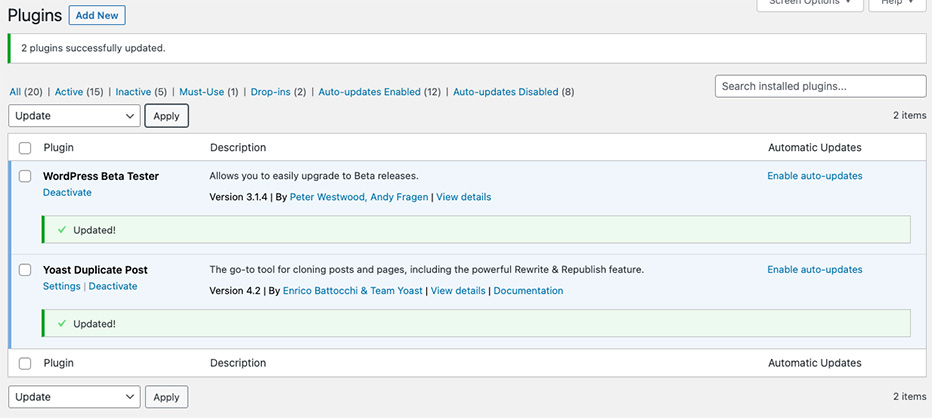

## Uninstalling Plugins

Plugins have a safe and easy-to-use uninstaller. If that is not available, you can also manually uninstall the plugins.

### Automatic Uninstallation

The safe and easy way to uninstall a plugin is via the WordPress admin screen.

1.  Navigate to your **Plugins** admin screen and locate the plugin to be uninstalled.
2.  Select the checkbox next to the plugin name and click the “Deactivate” link.

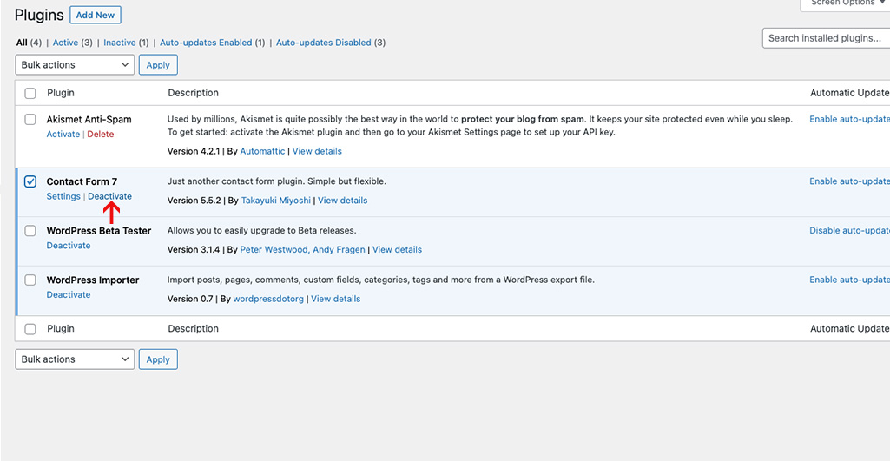

3.  Once the plugin is successfully deactivated, click the plugin’s “Delete” link.

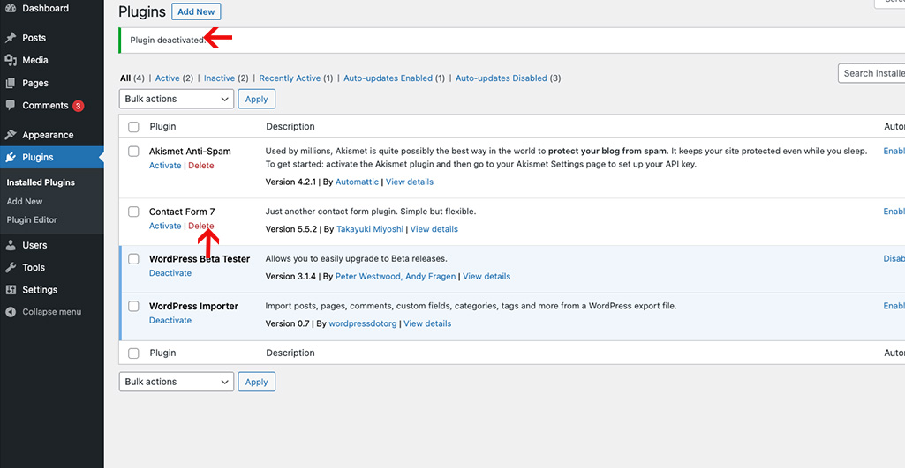

### Manual Uninstallation

In rare cases, you may need to uninstall a plugin by manually deleting the files from the server. This is recommended only when absolutely necessary, for example when your server is not configured to allow automatic uninstallation.

1.  From the Plugins menu in the Administration Screen, click Deactivate for your plugin.
2.  Access to your WordPress site via remote file manager.
3.  Go to wp-content/plugins directory.
4.  Remove your plugin folder.

## Reinstalling Plugins

To reinstall the plugin, refer to the documentation above, remove it once, and then install it.

## Troubleshooting

Occasionally, a WordPress Plugin may not work as expected. This section provides helpful resources and steps you can take for troubleshooting plugin issues.

### Resources To Help Diagnose The Issue

-   Review the plugin’s documentation to confirm that you’ve followed the instructions. You can find this information in the Plugins page under the name of each Plugin > View details.

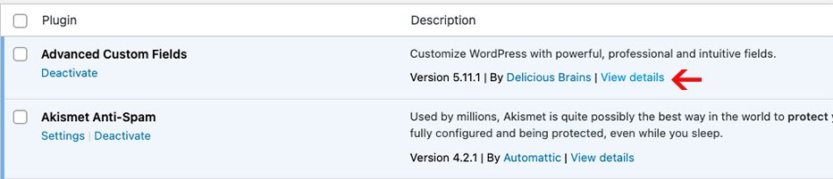

NOTE: If you have access to the plugin files, you can also find this information in the Plugin’s folder inside readme.txt.

-   Search the [WordPress Support Forums](https://wordpress.org/support/forums/) for the name of the Plugin and keywords associated with the problem you are experiencing or the specific error message that is displayed.
-   Search the [WordPress Plugins Directory](https://wordpress.org/plugins/) for the name of the Plugin. On the Plugins page, select the Support tab to read about issues reported in the Support Forums for that plugin.

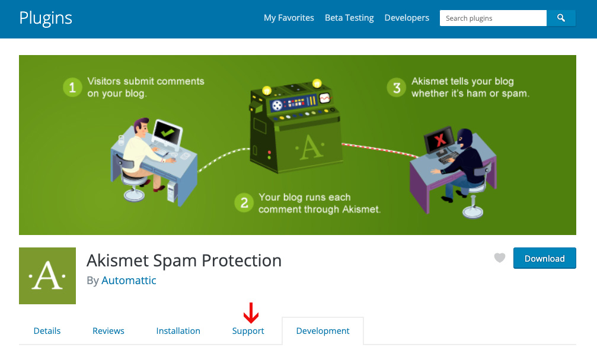

-   Go to the website of the plugin author and check their blog and Plugin page for known issues or advice.

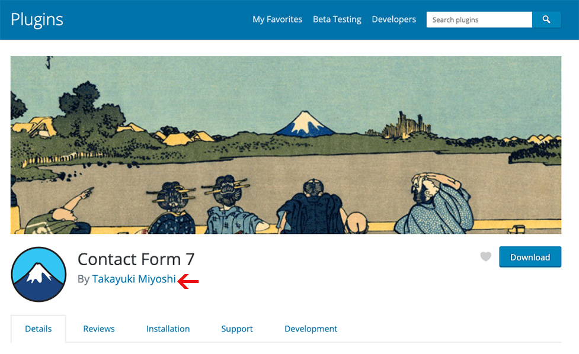

-   Search the web with the name of the Plugin and keywords associated with the problem you are experiencing or the specific error message that is displayed.
-   Post a question in the [WordPress Support Forums](https://wordpress.org/support/forums/) with the name of the Plugin and keywords associated with the problem you are experiencing or the specific error message that is displayed. Make sure to include the problem in the title of the question. For advice on how to improve your chances of getting help, see [Finding WordPress Help](../../wordpress-overview/where-to-start/where-to-find-wordpress-help.md).

### Possible Resolutions

#### Make sure that the plugin is activated after it is installed.

1.  Go to the **Plugins** > **Installed Plugins** from the WordPress admin screen.
2.  Find the Plugin and click ‘Activate’.

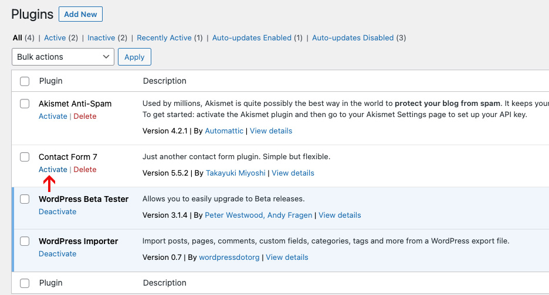

#### If you know which plugin is causing the issue:

1.  Deactivate that plugin and activate it again to see if this helps.

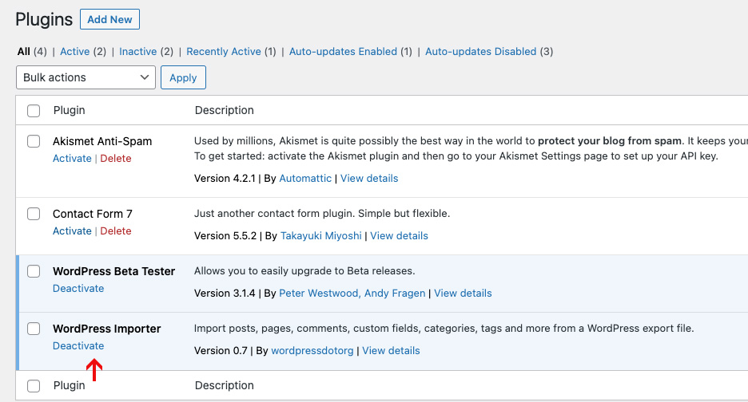

2.  In some cases, the plugin may be buggy or incompatible. Deactivate the plugin. Search for other similar plugins, install and activate it and see it this revolves the issue.

#### If you don’t know which plugin is causing the issue:

Sometimes problems may be caused by a conflict with different WordPress plugins. There are a few different ways you can tell which plugin is causing the issue.

-   You installed a single plugin and experienced issues with your site soon after that.
-   You updated a single plugin and experienced issues with your site soon after that.
-   There’s an error message telling you exactly which plugin file is causing the issue.
-   Try deactivating plugins one at a time until you find the one that’s causing the issue.
-   Once you find the plugin that is causing the issue, you can either deactivate and activate it again to see if this helps. Or you can find other similar plugins from the [WordPress Plugins Directory](https://wordpress.org/plugins/), install and activate it and see if this resolves the issue.

## Plugin Management

Plugins are managed from the Plugins admin screen of your WordPress site.

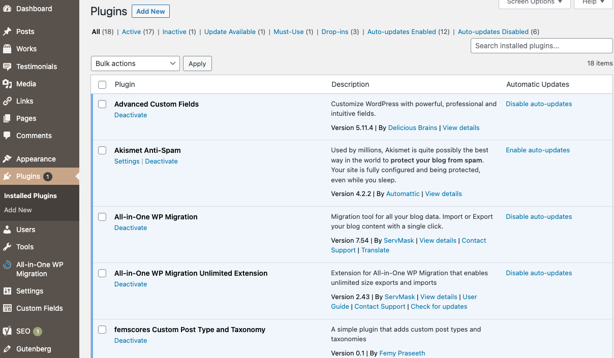

Here you will find a list of all installed plugins, whether they are active or inactive. From this screen, you can activate, deactivate and delete plugins.

Plugins listed in bold are currently active.

Each plugin on the list also contains links to further information about the plugin.

### Must-Use Plugins

Must-use plugins (a.k.a. mu-plugins) are plugins installed in a special directory inside the content folder and which are automatically enabled.

Must-use plugins do not show in the default list of plugins on the Plugins page and cannot be disabled except by removing the plugin file from the must-use directory, which is found in wp-content/mu-plugins by default.

For more details, please refer [Must Use Plugins](https://developer.wordpress.org/advanced-administration/plugins/mu-plugins/).

## Developing Plugins

The WordPress community relies on plugin developers to maintain a healthy and growing collection of plugins. A large part of what makes WordPress valuable is the extensive and freely available plugins.

You can help WordPress users by creating your own plugins for distribution through the WordPress plugin directory.

You can get started with the WordPress plugin development using the resources in the [WordPress Plugin Developer Handbook](https://developer.wordpress.org/plugins/).
