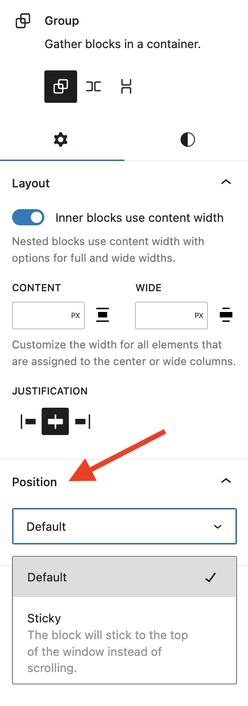

# Position Settings overview

The position settings in [blocks](../block-editor/blocks-list.md) allow you to set how an element is positioned in your site. These settings can only be found in a few blocks when they are placed at the root of site.

The position settings are available when you use the [block editor](../../support-guides/dashboard/wordpress-block-editor.md). If you are new to the block editor, [this guide](../block-editor/work-with-blocks.md) will show you how to work with blocks.

## How to access position settings

To access the position settings, either add a Group, Row, or Stack block to the root of your content, meaning not placed within another block. In the block settings sidebar of the block you added, you will find the **Position** section as shown below.

## Type of settings

Each supported block comes with two different position settings. Automatically, blocks will use the “Default” option. You can switch between these two options as you’d like. If you do not see these settings, it’s because the block either doesn’t support the positioning option or, if it’s one of the blocks listed under blocks that include these settings, the block is not placed in the root of your site, meaning not placed within another block.

### Default

This is the option chosen automatically. It allows a block to be positioned as it usually is in relation to other blocks.

### Sticky

This option allows you to keep top-level blocks fixed to the top of a page as visitors scroll. This matches the CSS property of the same name.

## Blocks that include position settings

As a reminder, this setting will only show for the following blocks when that block is placed at the root of your site, meaning not placed within another block.

-   Group
-   Row
-   Stack

## Demonstration

**Making a Header Template Part sticky**

A common use case for the sticky positioning option is having a header that sticks to the top of the page as a visitor scrolls. To accomplish this, follow these steps:

1.  **Open [List View](../block-editor/list-view.md)** and select the Header Template Part block. Ensure this Header Template Part block is not placed within another block.
2.  Select the three dot menu either in List View or the block toolbar and choose the option to **Group**. This will wrap the Header Template Part block in a Group block.
3.  Select the Group block that was just created and **open the Block Settings sidebar**.
4.  Add a background color to the Group block under the Styles tab in the Block Settings. This ensures that when a visitor is scrolling, the items in the Header Template part aren’t interfering with the rest of the blocks on the page.
5.  Scroll down to the Position settings and choose **Sticky**.

<video controls preload="metadata" src="https://wordpress.org/documentation/files/2023/03/Sticky-positioning-for-a-header-template-part.mp4"></video>

## Changelog

-   Created 2023-03-27
