# Styles overview

Styles is a feature that allows you to set the overall aesthetics and layout of your site at a global level, instead of editing individual blocks or pages. It is included in [block themes](block-themes.md) and requires WordPress 5.9 or higher.

You can set the colors, typography, layout, spacing, and more across the entire site, giving your website a cohesive look that showcases your brand.

You can also edit the default appearance of blocks to streamline the look and feel of your website — add your unique colors to create a branded Button block, or adjust the Heading block to your preferred font size.

<a id="how-styles-works"></a>

## How styles work

The styles you set from within the **Styles** interface impact your entire site. For example, if you change the background color here, it changes the background color of all your posts, pages, and templates.

In the **Styles** panel, you will find the styles and default settings provided by your theme and the ones that come with WordPress.

You can override these settings with your own choices through **Styles**. For example, you can add your own custom colors to the color palette, change the layout dimensions, and more.

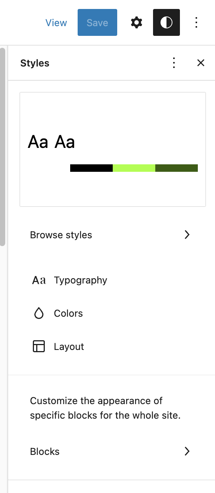

*Styles sidebar*

You can also customize the appearance of specific blocks for the entire site. For example, you can choose a background color and set the font size and line height for all the Quote blocks on your site, using **Styles** > **Blocks**.

<a id="how-to-find-styles"></a>

## How to use the styles panel

To access this feature, you will need to install and activate a [block theme](https://wordpress.org/themes/tags/full-site-editing/) and be using WordPress 5.9 or higher.

Go to **Appearance** > **Editor**. Select the half-shaded circle icon at the top right-hand corner of the screen, above the block settings sidebar, to access the **Styles** panel. The **Styles** icon is available in the [Site Editor](site-editor.md), and when editing the [template](../block-editor/template-editor.md) or [template parts](../theme-blocks/template-part-block.md).

In the **Styles** panel, you will see sections for **Typography**, **Colors,** and **Layout**. Any changes made from here will affect the entire site.

You will also find a section for **Blocks**. Clicking on the **Blocks** section will show you a list of all the blocks. You can select any block type and customize the appearance of that particular block across the whole site.

### The Styles welcome guide

When you open the **Styles** panel for the first time, you will be taken to a **Welcome Guide** dialog. You can click through the guide using the **Next** and **Previous** links at the bottom or close the dialog by clicking the **X** icon at the top right corner of the dialog.

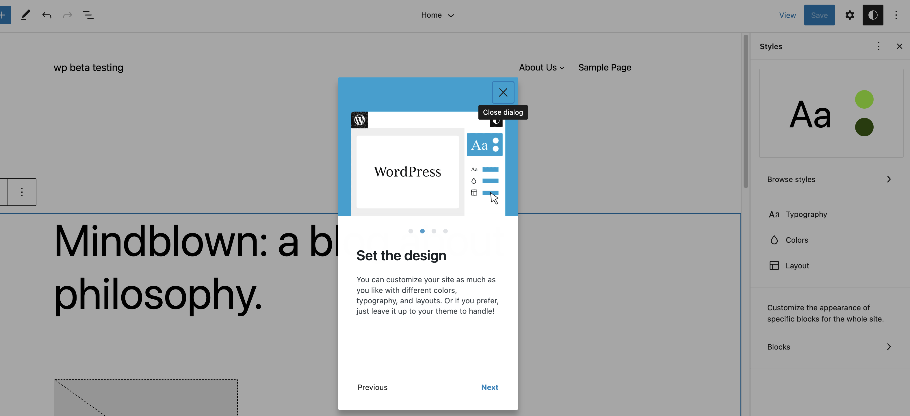

*Welcome guide*

If you want to access the **Welcome Guide** in the future, you can find it by clicking on the three vertical dots icon in the upper right-hand corner and selecting **Welcome Guide**.

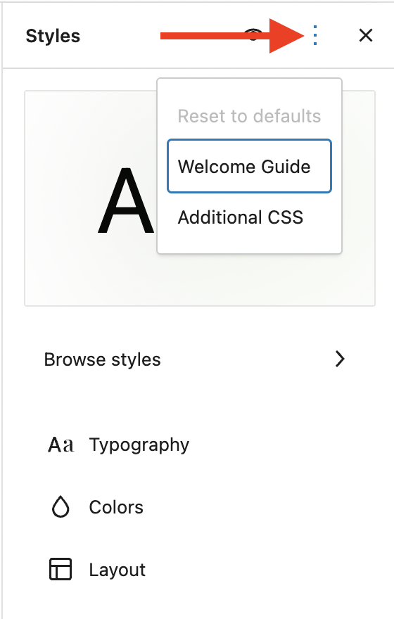

### Style variations

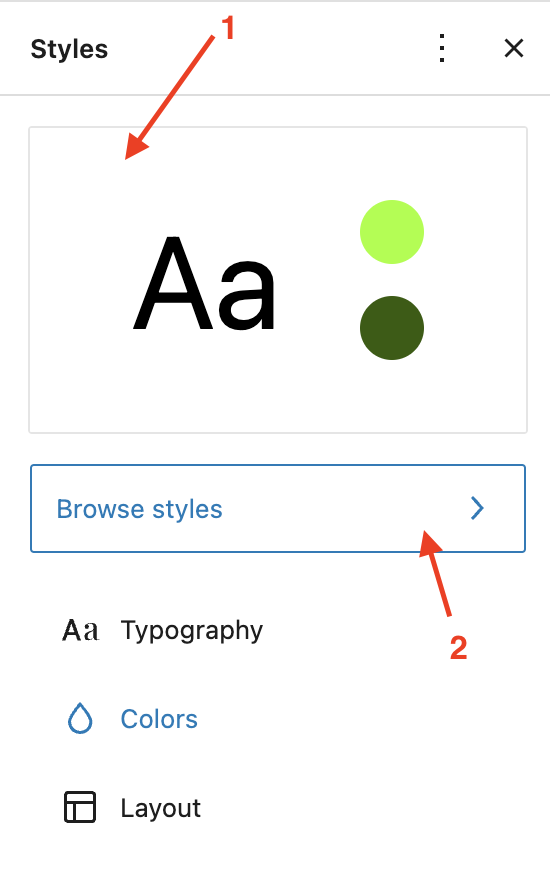

Style variations are a new feature of [block themes](block-themes.md) that were introduced in WordPress 6.0.

With these style variations, you are presented with alternate versions of your [block theme](block-themes.md) with different combinations of colors, fonts, typography, spacing, block settings, and more. You can easily swap the style variations and change the look and feel of your site without changing your theme.

1.  In the **Styles** panel, you can find a screenshot of the Style variation that your site is currently using.
2.  Select **Browse styles** at the bottom of the screenshot to explore the different style variations available with your [block theme](block-themes.md). From the available choices, you can pick a different style combination and instantly see how your site looks with this style variation in the Editor.
3.  Click the left arrow icon to go back to the **Styles** panel.

<video controls preload="metadata" src="https://wordpress.org/documentation/files/2022/10/Screen-Recording-2022-10-13-at-12.13.07-PM.mp4"></video>

*Video showing how to use the style variations*

### Color and typography style variations

Color and typography variations are subsets of the existing global style variations system that were introduced in WordPress 6.6. Color and typography variations are limited in scope to—as their names imply—colors and typography.

When they are available, these variations appear as new options in the Appearance > Editor > Styles sidebar panel and elsewhere:

<video controls preload="metadata" src="https://wordpress.org/documentation/files/2023/03/color-typography-variation-6.6.mp4"></video>

*Video showing how to switch Color and Typography variations*

### Typography

This section allows you to manage the various typography settings for the different elements – text, links, headings, and buttons – for the entire site.

-   Click **Typography** to open the Typography panel. Select the element you want to customize, and it will open up the **Typography** panel for that element.

Preset typography options are now available in the Styles interface. These presets, defined by the theme, provide a curated set of font sizes, line heights, and other typographic values that help maintain consistency across your site.

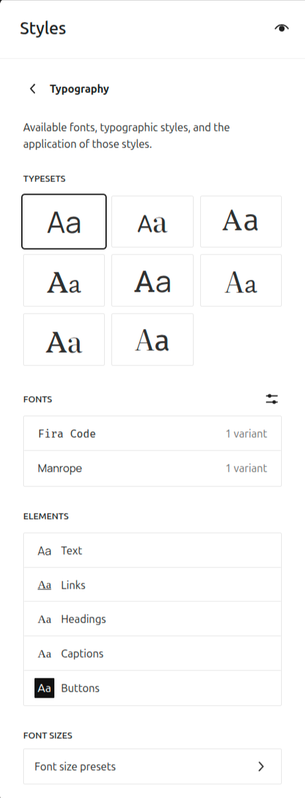

-   You can change the typography settings, including font type, font size, appearance, line height, and text decoration. As you pick your choices, you can see a preview of how it looks.

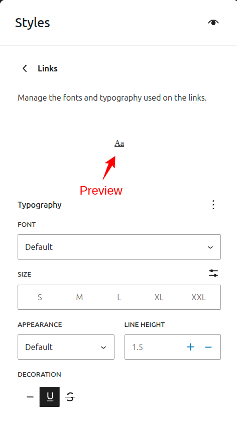

-   As you attempt to change the font type, each option in the dropdown shows a preview of the font.

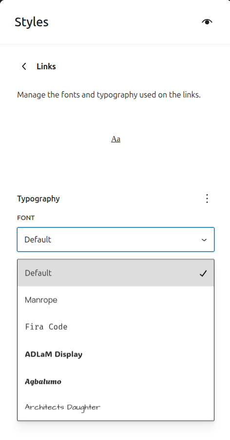

-   You can choose a font size from the preset options: S, M, L, XL, and XXL, or define a custom size using units like px, em, or rem.

<video controls preload="metadata" src="https://wordpress.org/documentation/files/2023/03/typography-selection-6.8.mp4"></video>

*Video showing how to change the font size*

-   You can change the typography settings for heading elements from `H1` through `H6`.

<video controls preload="metadata" src="https://wordpress.org/documentation/files/2023/03/typography-heading-6.8.mp4"></video>

*Video showing how to use the Typography settings in Styles*

-   You can customize typography settings for heading elements from H1 to H6, including:

1.  **Font Family**: Choose from a range of available fonts, each with a live preview.
2.  **Font Size**: Select from preset sizes (S, M, L, XL, XXL) or define custom values and units.
3.  **Font Style**: Choose from Default (inherited from general typography settings), Regular, Bold, Italic, or Bold Italic.
4.  **Line Height & Letter Spacing**: Adjust both with customizable units.
5.  **Text Decoration**: Apply styles such as None, Underline, or Strikethrough.
6.  **Text Orientation & Letter Case**: Modify text direction and transform casing as needed.

#### Font size presets

Font size presets provide a set of predefined size options that can be applied consistently across blocks and elements. These presets are defined by the theme and appear in the typography controls as labeled choices such as Small, Medium, Large, Extra Large, and Extra Extra Large, making it easier for users to select appropriate font sizes without manually entering values.

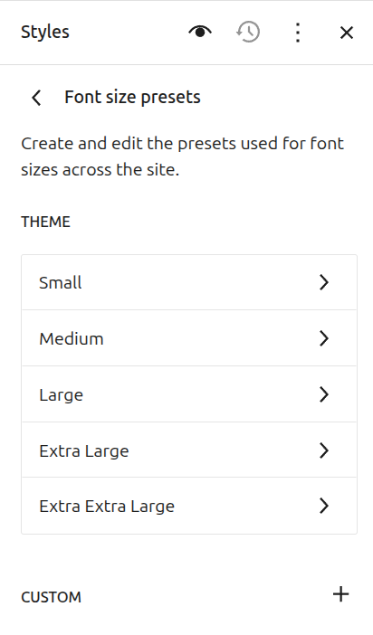

You can modify a font size preset by clicking on the one you want to change. In this example, we’ll adjust the preset named Small. You’ll see a live preview along with options to set a custom size using various units such as px, em, rem, vw, and vh. You can use the slider to adjust the value or enter a specific size manually.

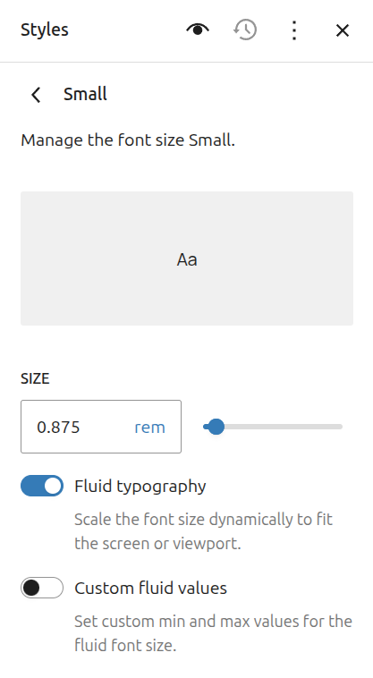

Note: The standard size input will be disabled if you enable **Custom fluid values**.

When using custom fluid values, you can define both a minimum and maximum size, with the same range of supported units as the standard size option.

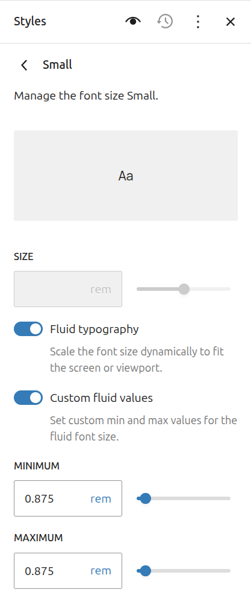

### Colors

This section allows you to manage the color palettes and the default color of different global elements on the site. This includes your site’s background color, and the colors for texts, links, headings, and buttons.

-   Click **Colors** to open the **Color** panel. At the top, you will find the color palette used by the style variation of your active block theme. You will also find the list of elements whose default global color can be customized through the Color settings panel.

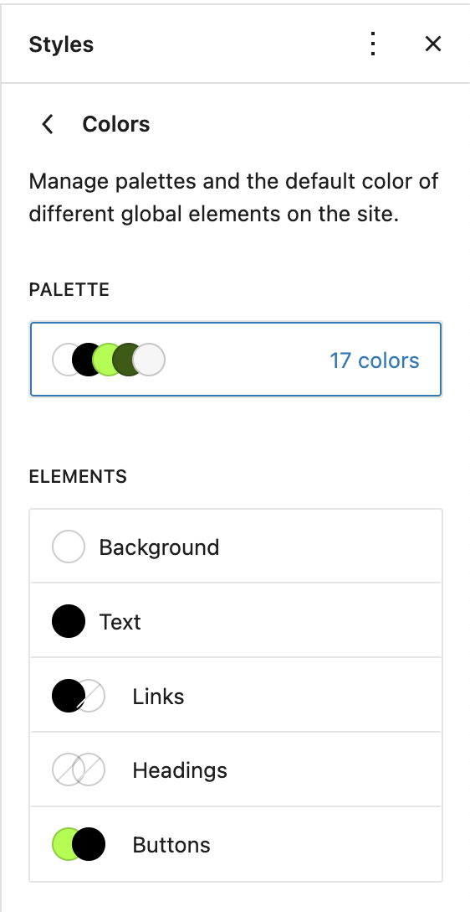

NOTE: In case your theme doesn’t have any color palettes, you will see the **Add custom colors** button. Click on it to start creating your custom palette.

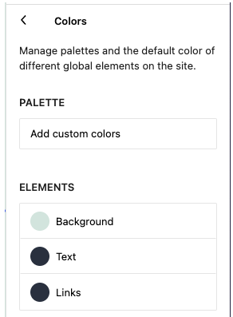

#### Customize the colors in the theme palette

1.  From the **Color** settings panel, click **Palette** to open the Palettes panel. Here you can set the color options that are available by default for blocks across your website. The **Theme** colors under the **Solid** tab can be used throughout your theme’s settings. The **Default** colors can be used in the blocks you use on your pages and posts.

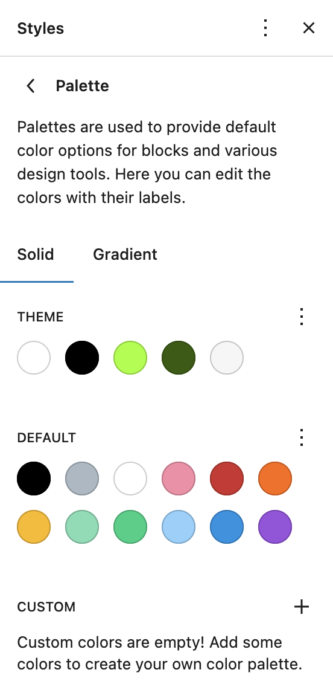

2.  Click the three vertical dots icon in the top right corner of **Theme** or **Default** and select **Edit colors** to change the color of each circle.

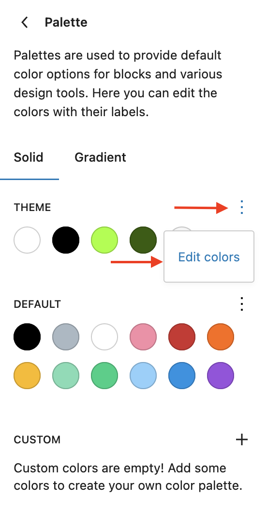

> [!NOTE]
> The **Default** colors will not be shown if your theme specifically opts out of it.

3.  A list will appear that includes all the colors currently in that palette. Click on one to edit it.

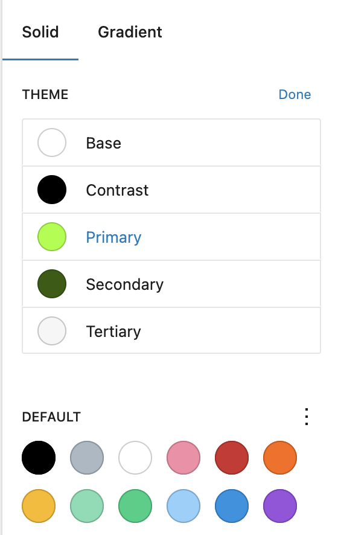

4.  You can either choose a color from the color picker or enter the HEX, RGB, or HSL color values based on your brand. Click the two rectangle boxes next to the color slider to copy the HEX, RGB, or HSL color values.

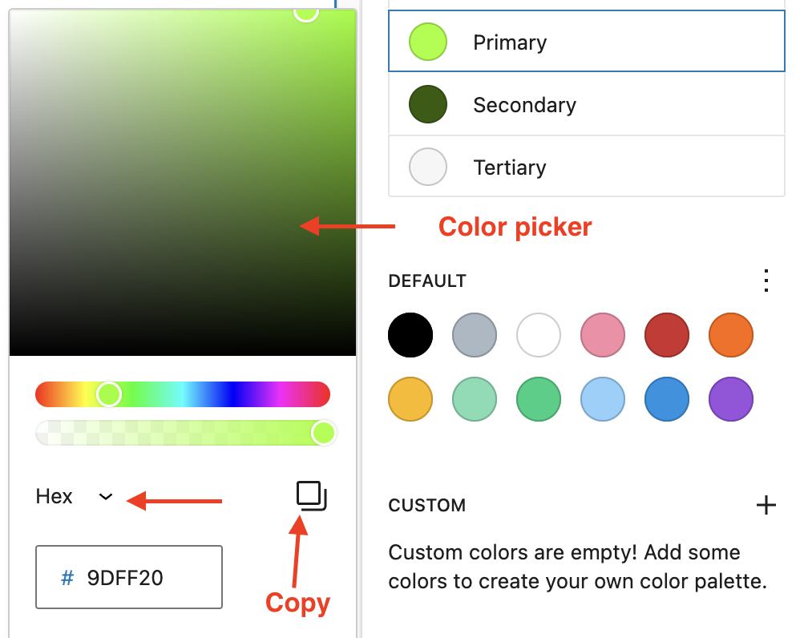

5.  Once you are done picking the colors, you can click **Done** in the upper right corner to save the color choices.

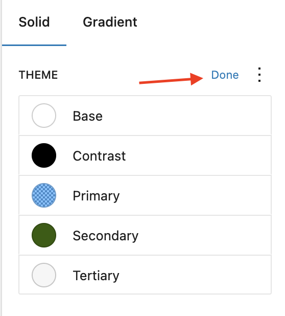

6.  To revert the changes you made, click the three vertical dots icon and select **Reset colors**. This will reset the color palette to the theme’s original style variation choices.

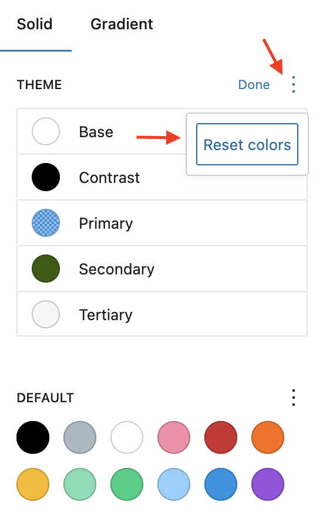

<video controls preload="metadata" src="https://wordpress.org/documentation/files/2022/10/Screen-Recording-2022-10-13-at-4.48.34-PM-1.mp4"></video>

*Video showing how to customize the theme palette*

#### Add custom color to the theme palette

You can also create a custom palette from the **Custom** section in the **Palette** panel.

-   Click the **+** icon in the upper right corner in the **Custom** section to add a color.
-   You can give a name to the new color.
-   You can either choose a color from the color picker or enter the HEX, RGB, or HSL color values for the new color.
-   Click the **–** icon to the right of a color to remove that color from the custom palette.
-   Click **Done** once you are done adding custom colors.
-   Click the three vertical dots icon in the upper right corner and select **Remove all colors** to remove the colors from the palette.

<video controls preload="metadata" src="https://wordpress.org/documentation/files/2022/10/Screen-Recording-2022-10-13-at-5.41.38-PM-1.mp4"></video>

*Video showing how to add custom colors to the palette*

#### Preset Color Palette

Starting with WordPress 6.7, the **Color** interface introduces a new preset color palette that provides a curated set of default colors designed to complement your theme’s design. These presets serve as a consistent foundation for applying color across blocks and global elements, helping to maintain visual harmony and accessibility throughout your site.

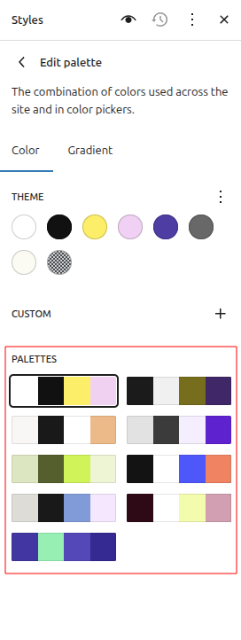

#### Customize the theme gradients

The **Palette** panel opens to the **Solid** tab by default. You can click the **Gradient** tab to add gradients to your theme. From the **Palette** panel, you can edit the **Default** gradients that came with the theme or add **Custom** gradients.

-   Click the three vertical dots icon in the upper right corner in the **Default** section and click **Edit gradients** to start customizing the gradients in the theme.

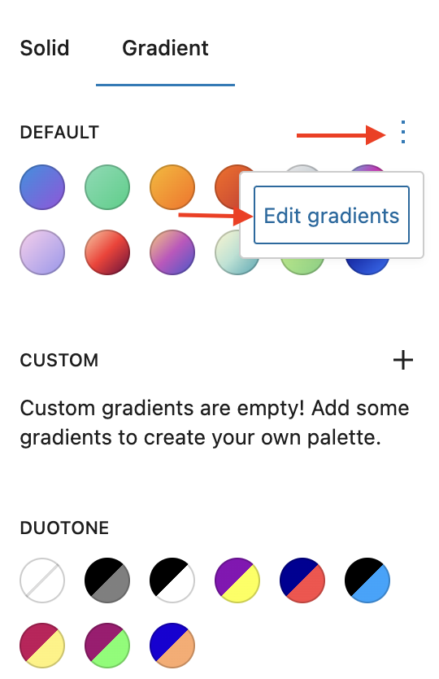

-   A list of all the gradients will appear. Click on any one of them to edit it.

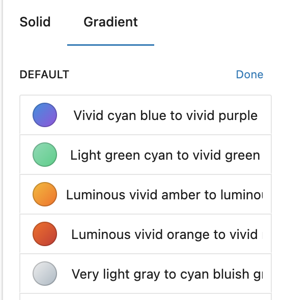

> [!NOTE]
> The **Default** gradients will not be shown if your theme specifically opts out of it.

-   A slider will appear that shows the two color points that make up the gradient.

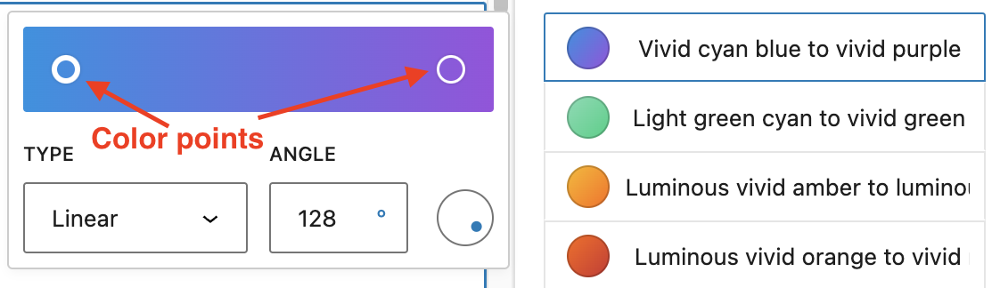

-   You can click on any of the two color points to display the color picker for changing the color value. You can either choose a color from the color picker or enter the HEX, RGB, or HSL color values.
-   You can add additional color points if you like by clicking the **+** icon that appears when you hover over the gradient slider.

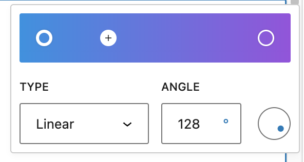

-   Under **Type,** choose from **Linear** (transitions in a straight line) or **Radial** (transitions in a circle). You can also edit the angle of your gradient.
-   Once you are happy with your color choices for the gradient, click **Done** in the upper right corner.
-   To revert back to the colors that came with the theme, click the three vertical dots icon in the upper right corner and click **Reset gradient**.

<video controls preload="metadata" src="https://wordpress.org/documentation/files/2022/10/Screen-Recording-2022-10-13-at-8.39.44-PM.mp4"></video>

*Video showing how to customize the theme gradients*

#### Add custom gradient

You can add custom gradients from the **Custom** section in the **Gradient** tab.

-   Click the **+** icon in the upper right corner to add a new gradient.
-   Click on the gradient in the list to set the two color points, add additional color points, and set the **Type** and **Angle** for the custom gradient.
-   You can change the name of the gradient to make them more intuitive.
-   Click the **–** icon next to the gradient in the list to delete a custom gradient.
-   Click **Done** once you are happy with the custom gradients you created.
-   Click the three vertical dots icon in the upper right corner and select **Remove all gradients** to delete all the custom gradients with one click.

<video controls preload="metadata" src="https://wordpress.org/documentation/files/2022/10/Screen-Recording-2022-10-13-at-9.05.28-PM-2.mp4"></video>

*Video showing how to add a custom gradient*

#### Customize the color of elements

From the **Colors** panel, under **Elements**, you can change the color of your site background, text, links, headings and buttons.

-   Click on the element you want to edit to open a new panel with the color options for that element.
-   As you make changes, you will see the design of your site update on the left.
-   You can click the **Clear** link at the bottom right corner in the element’s panel to clear the color choices you made for that element.
-   For the **Background**, you can set a solid color or gradient.

<video controls preload="metadata" src="https://wordpress.org/documentation/files/2022/10/Screen-Recording-2022-10-14-at-10.12.55-AM.mp4"></video>

*Video showing how to change the site’s background color*

-   For the **Text**, you can set a default color that will be used across the entire site. You can either choose a color from the color picker or enter the HEX, RGB, or HSL color values for the new color.

<video controls preload="metadata" src="https://wordpress.org/documentation/files/2022/10/Screen-Recording-2022-10-14-at-10.20.17-AM.mp4"></video>

*Video showing how to change the site’s text color*

-   For the **Links**, you can set the default color for links across the site. You can also set the hover state for the links.

<video controls preload="metadata" src="https://wordpress.org/documentation/files/2022/10/Screen-Recording-2022-10-14-at-10.28.24-AM.mp4"></video>

*Video showing how to change the link color and hover state*

-   For the **Headings**, select the heading level- `H1`, `H2`, `H3`, `H4`, `H5` and `H6` and then you can set the default color for that level across the site. You can also set the background color for the selected heading level to a solid or gradient color. Choosing **All** in the **heading level** tab will make the changes for all the heading levels at once.

<video controls preload="metadata" src="https://wordpress.org/documentation/files/2022/10/Screen-Recording-2022-10-14-at-10.54.05-AM.mp4"></video>

*Video showing how to change the text and background for heading levels*

-   For the **Buttons**, you can set the default text and background color for buttons across the site.

<video controls preload="metadata" src="https://wordpress.org/documentation/files/2022/10/Screen-Recording-2022-10-14-at-11.00.36-AM.mp4"></video>

*Video showing how to change the text and background for buttons*

### Layout

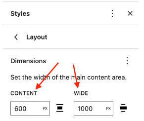

This section allows you to set the width of the main content area of your website globally.

You can set the **content** width and **wide** width in PX, %, EM, REM, VW and VH units. The content width set here will be the default width of the blocks when they set **Align** to **None** in the Block Toolbar. The wide width set here will be the width of the blocks when they set **Align** to **Wide width** in the Block Toolbar.

To reset the values for **Content** and **Wide**, click the three vertical dots icon and select **Content size** or **Wide size,** and the changes you made are reverted.

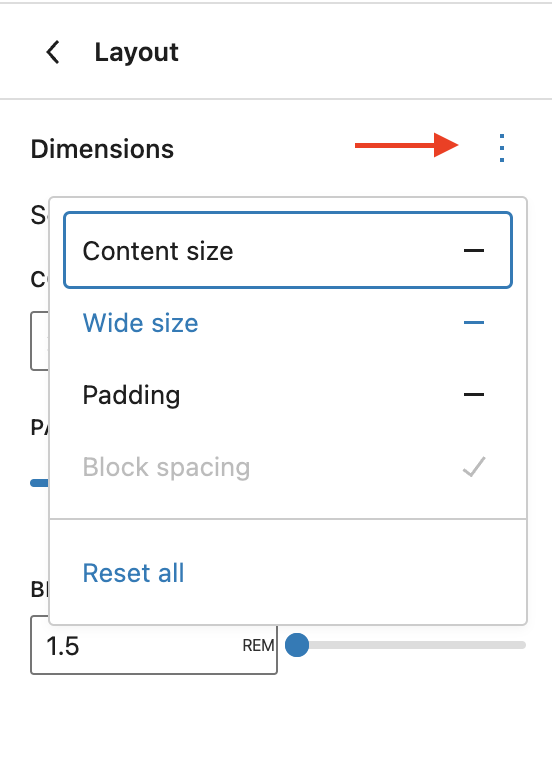

You can also set the **Padding** or the blank space around your website from the **Layout** panel.

-   You can set the padding on the four sides: top, right, bottom, and left.
-   By default, Padding is locked, which means that when you adjust the padding value, it applies to all four sides. If you click the link icon, it unlinks the sides, and you can set the **Padding** on each side individually.

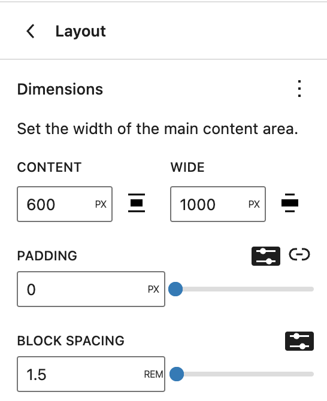

*Padding linked*

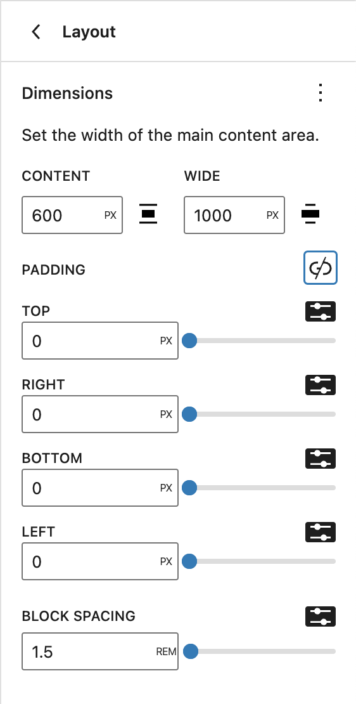

*Padding unlinked*

-   **Padding** can be set in PX, %, EM, REM, VW, and VH units.
-   You can add values to the text box or use the slider to adjust the values for **Padding**.

Built into the Styles experience are preset spacing values for padding. Your theme author can set baseline values for spacing, and when you use the Styles’ padding preset slider, you can create consistent spacing across the elements within the site.

-   Clicking the black slider icon in the right corner (next to the link icon) will show the padding space preset slider.

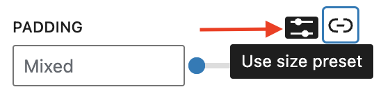

-   To reset the values for **Padding**, click the three vertical dots icon and select **Padding**, and the changes you made are reverted.

<video controls preload="metadata" src="https://wordpress.org/documentation/files/2022/10/Screen-Recording-2022-10-15-at-3.48.52-PM.mp4"></video>

*Video showing how to set Padding in Styles*

In the Layout panel, you can also set the **Block spacing,** which is the vertical spacing between the blocks.

-   **Block spacing** can be set in PX, %, EM, REM, VW, and VH units.
-   You can add values to the text box or use the slider to adjust the values for **Block spacing**.

Similar to padding, WordPress comes with preset spacing guidelines that your theme author can set baseline values for, and when you use the Styles block spacing preset slider, you can create consistent block spacing between the blocks.

-   Clicking the black slider icon in the right corner (next to the link icon) will show the block spacing preset slider.
-   To reset the values for **Block spacing**, click the three vertical dots icon, select **Block spacing,** and the changes you made are reverted.

<video controls preload="metadata" src="https://wordpress.org/documentation/files/2022/10/Screen-Recording-2022-10-15-at-4.25.33-PM.mp4"></video>

*Video showing how to use block spacing in Styles*

### Background

The Background section in Styles allows you to upload and apply a background image to your site.

<video controls preload="metadata" src="https://wordpress.org/documentation/files/2023/03/styles-background-6.8.mp4"></video>

*Add background image to the site*

### Blocks

In the **Blocks** panel, you will see a list of all the blocks that can be customized for the whole site. You can also search for a block by its name in the search box. Click on a block from the list to see the available options for that block.

The changes you make to the blocks’ appearances in the **Styles** panel affect every block of that type that does not have individual customizations. For example, if you’ve changed the color of one Button block on your home page, that color will stay, while other buttons on the site will follow your **Styles**. If you’d like to update all of your site’s Button blocks to match, click **Advanced** > **Apply Globally** from the button block, and choose which settings you’d like to apply site-wide.

As you make changes, as of WordPress 6.2, you will see a live preview of the impact of those changes you’re making, as shown below:

<video controls preload="metadata" src="https://wordpress.org/documentation/files/2022/01/Editing-block-global-styles.mp4"></video>

Each block has its own set of options to customize. For example, you can customize the border, radius, duotone, etc. for the [Image block](../media-blocks/image-block.md) or change the paddings, margins, colors, and fonts for the [Heading block](../text-blocks/heading-block.md).

#### Margin settings for blocks

**Padding** is the space between a block’s content and its border, whereas **Margin** is the space outside the border of a block.

The following blocks have **Margin** controls for Top, Right, Bottom, and Left in the **Blocks** section under **Layouts**.

-   Paragraph
-   Heading
-   Gallery
-   List
-   Archives
-   Audio
-   Categories List
-   Media & Text
-   Social Icons
-   Table
-   Tag Cloud
-   Poetry (formerly Verse)
-   Video
-   Site Logo
-   Site Title
-   Site Tagline
-   Avatar
-   Post Title
-   Post Excerpt
-   Post Featured image
-   Post Date
-   Post Author
-   Comment Author
-   Comment Date
-   Comment Edit Link
-   Comment Reply Link
-   Comment Title
-   Term Description
-   Query Title
-   Post Author Biography

The following blocks have a **Margin** control for **Top** and **Bottom** only in the **Blocks** section under **Layouts**.

-   Buttons
-   Code
-   Cover
-   Group
-   Columns
-   Separator
-   Spacer
-   Read More

By default, Margin is locked, which means that when you adjust the margin value, it applies to all sides. If you click the link icon, it unlinks the sides, and you can set the **Margin** on each side individually.

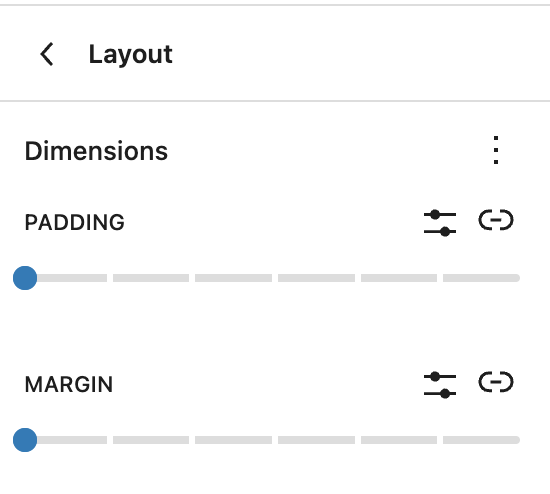

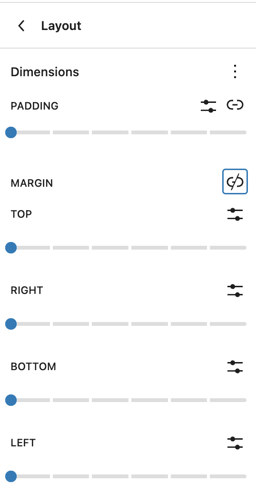

Your theme author can set baseline values for spacing, and when you use the Styles’ margin preset slider, you can create consistent spacing across the elements within the site.

Clicking the slider icon in the right corner (next to the link icon) will switch the **Margin** controls from the preset slider to the text box view. You can add values to the text box or use the slider to adjust the values for **Margin**. **Margin** can be set in PX, %, EM, REM, VW, and VH units.

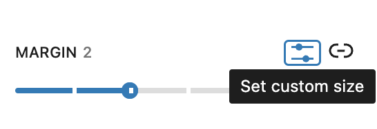

To reset the values for **Margin**, click the three vertical dots icon and select **Margin,** and the changes you made are reverted.

<video controls preload="metadata" src="https://wordpress.org/documentation/files/2022/10/Screen-Recording-2022-10-16-at-12.59.46-PM-1.mp4"></video>

*Video showing how to use the Margin controls*

#### Border and radius settings for blocks

The following blocks have a **Border** and **Radius** control in the **Blocks** section under **Layouts**.

-   Image
-   Code
-   Columns
-   Group
-   Pullquote
-   Search
-   Avatar
-   Post Featured Image
-   Read More
-   Comment Title

Using the **Border** controls, you can set the border around a block. You can choose the border color from the color picker. You can set the border width in PX, %, EM, REM, VW, or VH by entering the width in the text box or using the slider to adjust the values.

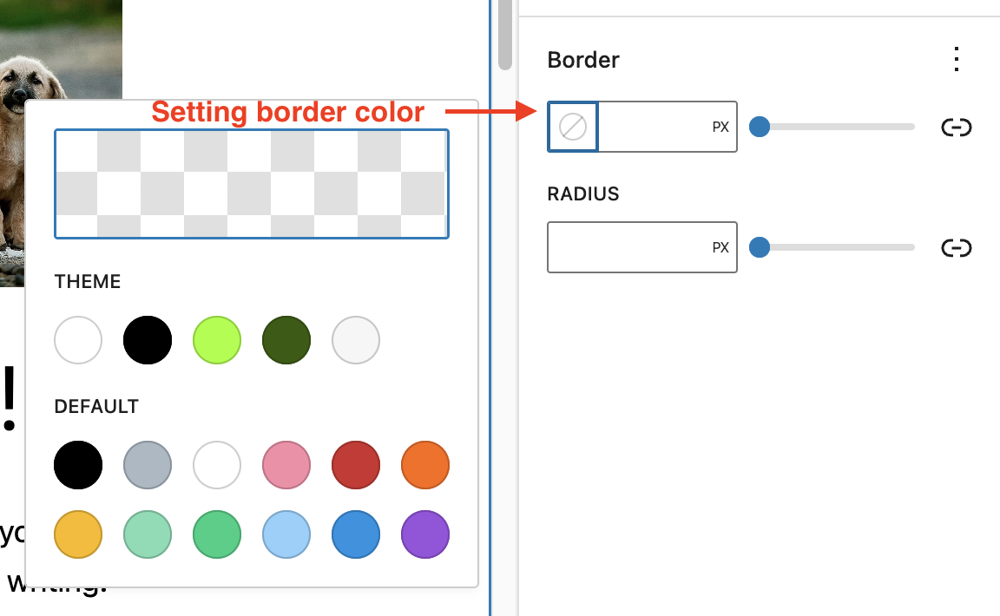

By default, border width is locked, which means that when you adjust the value, it applies to all sides. If you click the link icon, it unlinks the sides, and you can set the Border on each side individually.

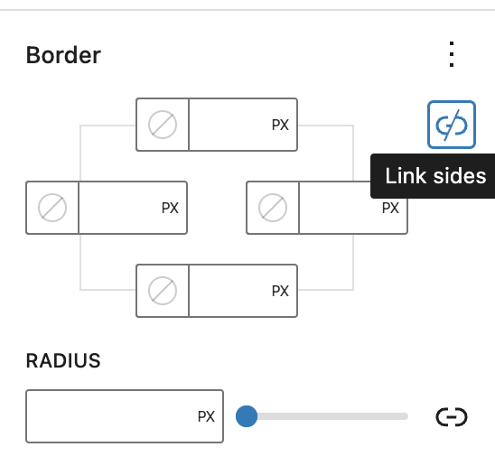

Using the **Radius** controls, you can round the corners of a block’s outer border. You can also set the border Radius in PX, %, EM, REM, VW, or VH by entering the value in the text box or by adjusting the slider.

By default, border radius is locked, which means that when you adjust the value, it applies to all four corners. If you click the link icon, it unlinks the corners, and you can set the radius on each corner individually – Top left, Top right, Bottom left, and Bottom right.

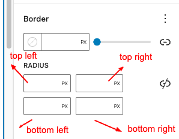

<video controls preload="metadata" src="https://wordpress.org/documentation/files/2022/10/Screen-Recording-2022-10-16-at-6.32.55-PM.mp4"></video>

*Video showing how to set the Border and Radius*

#### Horizontal block spacing settings for blocks

The following blocks have **Horizontal Block spacing** control in the **Blocks** section under **Layouts**.

-   Columns
-   Social Icons

By default, the **Block Spacing** control is locked, which means that when you adjust the value, it applies to both the horizontal and vertical. If you click the link icon, it unlinks, and you can set the **Block Spacing** for vertical and horizontal separately.

<video controls preload="metadata" src="https://wordpress.org/documentation/files/2022/10/Screen-Recording-2022-10-16-at-7.46.53-PM-1.mp4"></video>

*Video showing how to set the horizontal spacing*

#### Editing block variations

Some blocks come built in with variations, different options of the same block. When that’s the case, as of WordPress 6.2, you will see the option

#### Adding box shadows to button block

With WordPress 6.2, there are four shadow presets you can choose from by default. The following come by default for you to use:

-   Natural
-   Crisp
-   Sharp
-   Soft

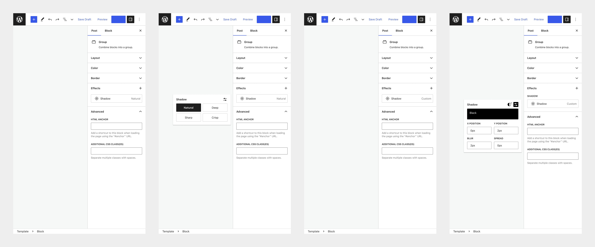

## Styling the site tagline

The Global Styles section lets users set and unset the Site Tagline. Users can also update the font and color of the site tagline through this section. This is an optional setting which the users can utilize as per their needs.

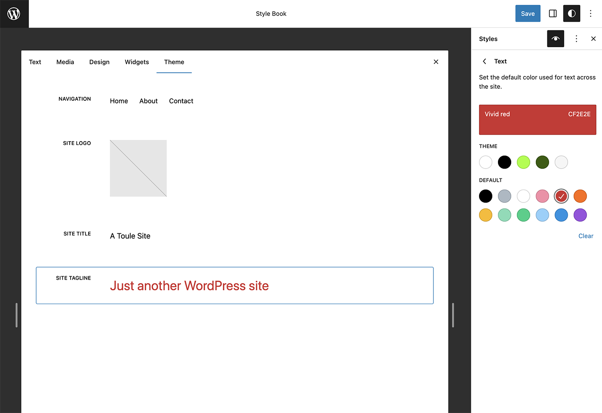

<a id="preview-with-style-book"></a>

## Preview your changes with style book

When making changes to the styles of your site, whether changing to a different style variation or tweaking an individual block, it’s imperative to see the cascading impact. You can see all of your blocks on your site as you make changes with this view that you can toggle on and off as you would like. This includes showing individual block variations that you can then customize, which are visible when you turn the style book on from the overall Styles view.

<video controls preload="metadata" src="https://wordpress.org/documentation/files/2023/03/Styles_-Exploring-the-Style-Book.mp4"></video>

## Applying Custom CSS

The Site Editor seeks to enable customization at every level across your site. In some cases, as features are being built, there are gaps in what’s possible. As a result, it’s recommended to start with the options available in Styles before adding custom CSS. For any current gaps, you can add Custom CSS. Note that any CSS changes you make *won’t* be overwritten by a theme update, but they *will* be cleared when you switch themes.

### Site-wide Custom CSS

A site-wide custom CSS editor is built into the Styles interface, as of WordPress 6.2. Click the three dot menu and select “Additional CSS.” Any CSS added here is applied across the entire site.

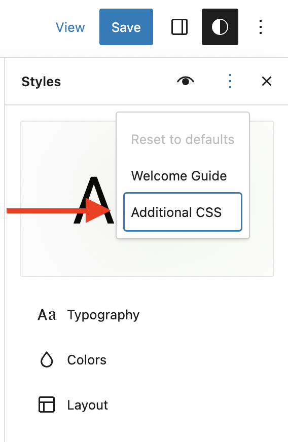

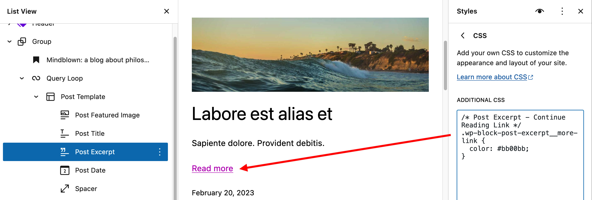

In 6.9, Additional CSS controls have been moved into the ellipsis menu in the header of the Styles page on either side of the screen

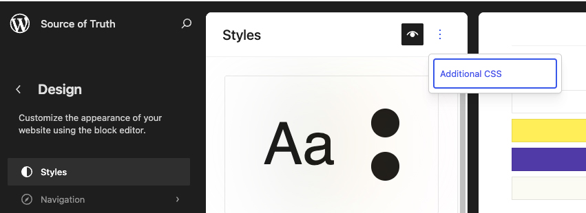

### Per-block CSS

As you navigate to each individual block under Styles > Blocks, you’ll find an “Additional block CSS” section. When you add CSS here, it applies only to that specific block type throughout the entire site.

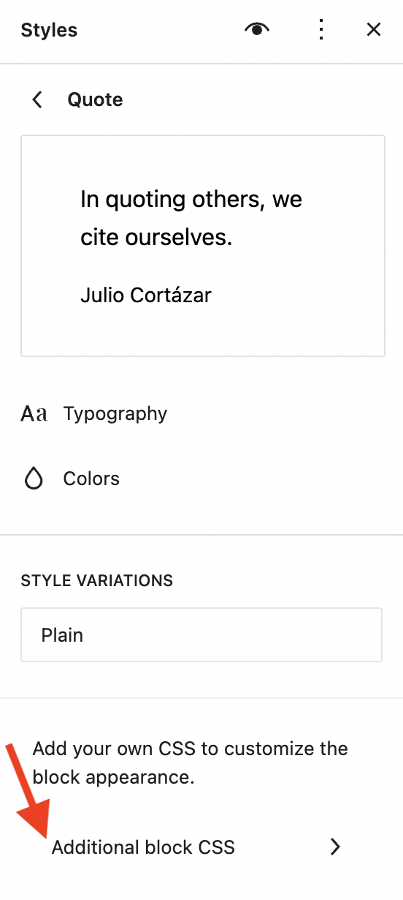

Because CSS added here is for a specific block type, you should not add a selector or curly braces. Follow the `property: value` format.

For example, if you wanted to display the quotation portion of the Quote block in italics, you could add this in the Quote block’s CSS editor:

```
font-style: italic;
```

Here’s how that looks in the editor:

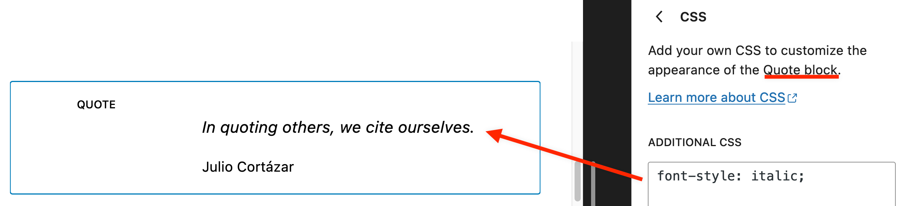

And this is how the CSS is output on the front end:

```
.wp-block-quote {
  font-style: italic;
}
```

Notice how WordPress automatically adds the `property: value` pair to the block’s selector.

By using CSS combinators like spaces and `<` or pseudo-classes and -elements, you can create more complex effects, including hover states. You can also use the ampersand (`&`) as in SASS/LESS, to target a nested element.

For example, here’s some CSS you could add in the Button block’s CSS editor to create a hover state for the Button block:

```
:hover {
  background: #bb00bb;
}
```

Note that in this case, you *do* need to include curly braces in the code. The resulting CSS on the front end is:

```
.wp-block-button .wp-block-button__link:hover {
  background: #bb00bb;
}
```

<a id="resources"></a>

## Reset your changes

To revert back to the theme styles you had before making changes, click on the three vertical dots icon in the upper right-hand corner of the **Styles** panel, and select **Reset to defaults**.

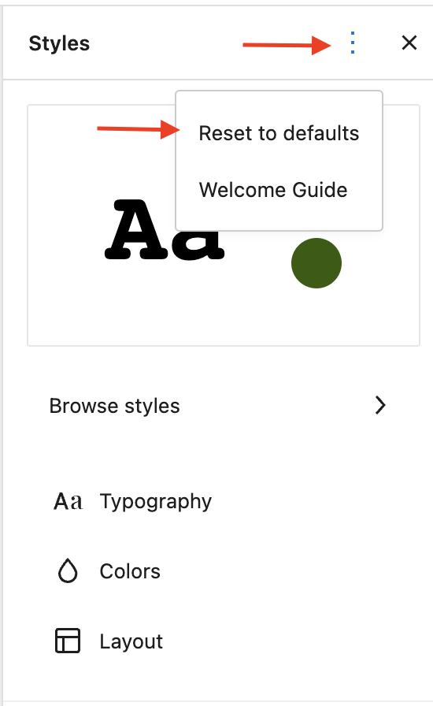

## Changelog:

-   Updated 2026-08-19
    -   Clarified Block Styles and added information on applying styles globally
-   Updated 2025-07-20
    -   Updated to include color palette presets and typesets
    -   Updated font size presets and how to modify or customize them
    -   Updated to include background support
-   Updated 2025-06-28
    -   Updated content for 6.8 adding font-family preview<br>
        Updated content for typography settings for heading elements<br>
        Updated screenshots including showcasing the font-family preview
-   Updated 2024-09-05
    -   Added Color and typography style variations section.
-   Updated 2023-03-27
    -   Removed references to 6.1
    -   Removed references to “beta” for the site editor.
    -   Updated content for 6.2 adding in Custom CSS, in-line block preview, and Style Book.
-   Updated 2022-10-15
    -   Added screenshots and videos for 6.1
    -   Updated content for 6.1
-   Created 2022-01-05
