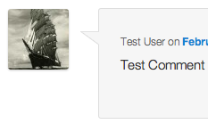
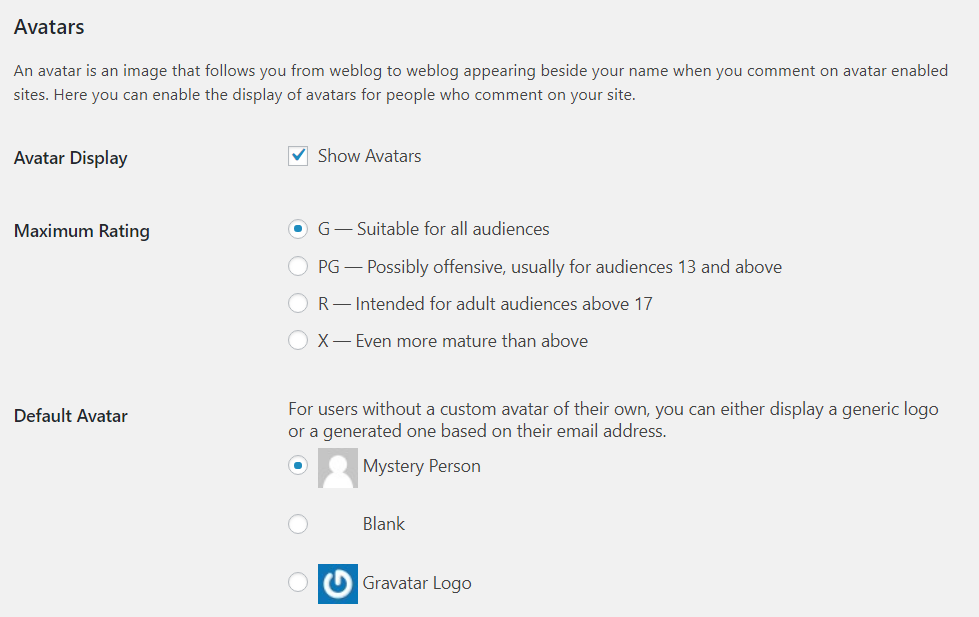

# Use Gravatars

## What is a Gravatar?

When browsing different web sites, you may notice that many users have a picture next to their name. These pictures are called “avatars.” WordPress, however, uses a specific type of avatar called “[Gravatars](https://en.gravatar.com/)“–short for “Globally Recognized Avatar.” Unlike standard avatars, Gravatars follow you around the web and automatically appear when you post a comment on a WordPress site.

<video controls preload="metadata" src="https://wordpress.org/documentation/files/2018/11/461026096-007711ac-d74c-4826-9e78-d0921e402f1d.mov"></video>

*A short introduction video presenting Gravatar*

WordPress integrates Gravatars into every WordPress site. Once [registered with Gravatar](https://en.gravatar.com/site/signup/), the service matches your WordPress profile information to the email address registered with Gravatar and displays your custom Gravatar image next to comments and (optionally) elsewhere on the WordPress site. If you choose not to sign up with Gravatar, the  [default icon set by the Administrator](#using-gravatars-on-your-site) appears next to your name.

## Why use Gravatars?

Providing your users with avatars has become a convention in web-publishing. Enabling Gravatars on your WordPress site simplifies the process for everyone involved. While it is possible to use a [WordPress Plugin](https://wordpress.org/plugins/) to manage user avatars on your WordPress-run site, using Gravatars on your site makes less work for both you and your site’s users.

### Benefits for Administrators

-   You can add user Gravatars with very little effort
-   You don’t need to maintain an additional Plugin
-   You don’t have to manage user accounts, or their images, for commenters to use Gravatars on your site

### Benefits for Users

-   You don’t need to register for every site you visit just to use a Gravatar
-   You can update the Gravatar you use across multiple sites by uploading a single image in a single place

## Using Gravatars on your Site

To [start using Gravatars](https://en.gravatar.com/site/signup) on your site:

1.  Log in as an administrator to your site
2.  Navigate to  [Settings](../../support-guides/dashboard/settings-discussion-screen.md) > [Discussion](../../support-guides/dashboard/settings-discussion-screen.md) and scroll down to the “Avatar” Section
3.  The “Avatar” section presents you with several options:
    -   **Avatar Display**: Toggle Gravatars on and off for your site.
    -   **Maximum Rating**: When users create a profile on Gravatar, they are given the opportunity to rate their Gravatar image as G, PG, R, X based on its appropriateness. Select the radio button for the maximum rating you would like displayed on your site.
    -   **Default Avatar**: WordPress allows for you to select what image you would like to display when a commenter does not have a Gravatar account. Selecting one of the “generated” icons give you and your users some of the benefits of a Gravatar without requiring them to [have a Gravatar account](https://en.gravatar.com/site/signup). The icons that say “generated” next to them take the email of the commenter and link it to an auto-generated image. Now, every time that commenter posts to your site, they will have the same unique image next to their name.

### Using Gravatar’s Hovercards

If you want to use Gravatar’s Hovercard feature, like on WordPress.com, you can install the [Jetpack](https://jetpack.me/) Plugin.

### Resources

-   [Introducing Gravatar](http://wordpress.tv/2009/07/26/introducing-gravatar-your-globally-recognized-avatar/)
-   [Gravatar Profiles](http://wordpress.tv/2010/05/01/beau-lebens-gravatar-profiles-sf10/)
-   [Gravatar Developer Resources](http://en.gravatar.com/site/implement/)
