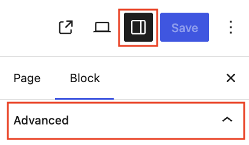
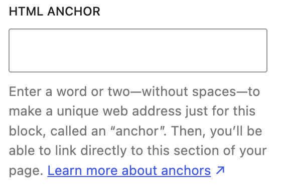
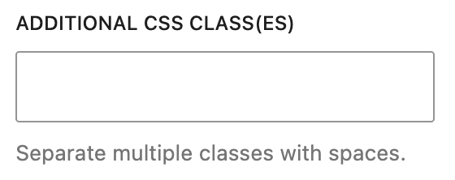
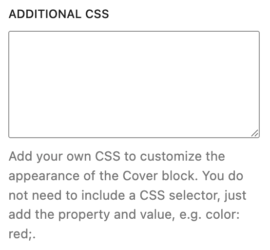
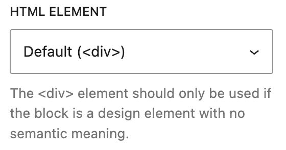
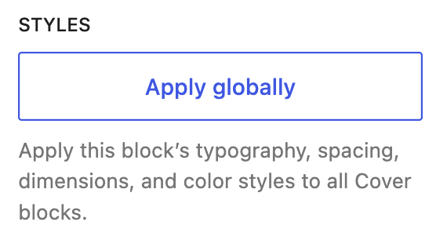
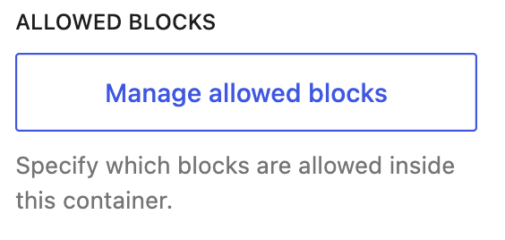

# Advanced Settings overview

Use Advanced Settings to further customize your block. While some of the options listed below apply to multiple blocks, others are block-specific. To learn more about a particular block, visit the [Blocks list page](blocks-list.md).

## How to access Advanced settings

If you don’t see the sidebar, click the **Settings** button next to Save/Publish. With your block selected in the editor, click the Advanced section in the Settings panel to expand its options.

> [!NOTE]
> [Read more about block settings.](work-with-blocks.md#block-settings)

## Common settings

### HTML anchor

HTML anchor allows you to [make a unique web address](page-jumps.md) for a particular block. Then, you’ll be able to link directly to a block on your page.

### Additional CSS class(es)

The Additional CSS class(es) lets you add CSS class(es) to your block, allowing you to write custom CSS and style the block as you see fit.

### Additional CSS

Additional CSS allows you to customize the appearance of the block. You do not need to include a CSS selector, just add the property and value. For example, adding: `color: red;` will set the text color to red.

> [!NOTE]
> The field is only visible to users with the `edit_css` capability. [Learn more about WordPress user roles and capabilities.](../../support-guides/dashboard/roles-and-capabilities.md)

### HTML element

Some blocks include a drop down to select the HTML element that wraps the block. This allows you to optimize your block content for screen readers and improve overall accessibility.

### Styles

You can also use the Apply globally button under styles to apply this block’s typography, spacing, dimensions, and color styles to all blocks of this type.

### Allowed blocks

Some blocks offer the option to specify which blocks are allowed inside of them. Click on the **Manage allowed blocks** button to make changes.

## Changelog

-   Updated 2026-05-23
    -   Added HTML element
    -   Updated screenshots
-   Created 2026-05-19
