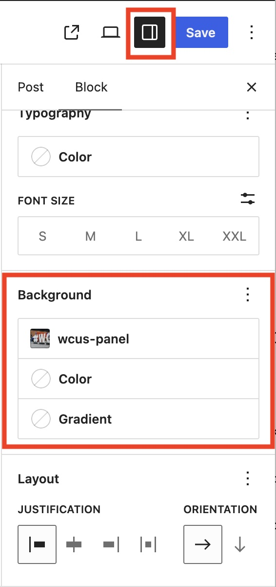
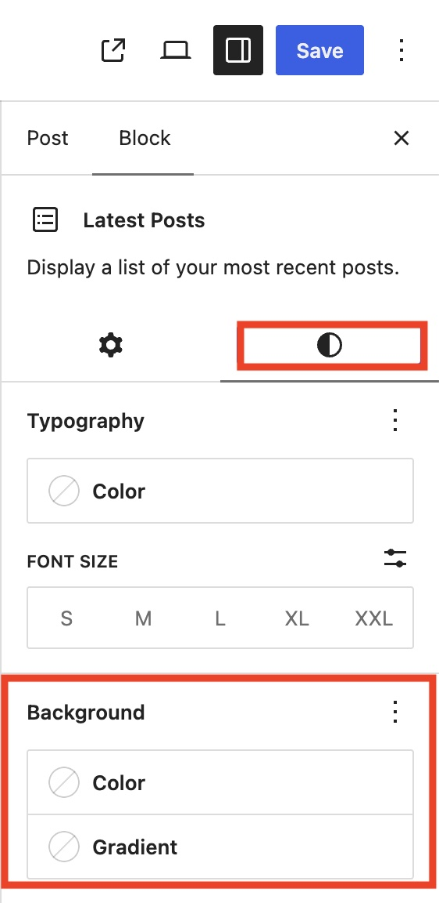
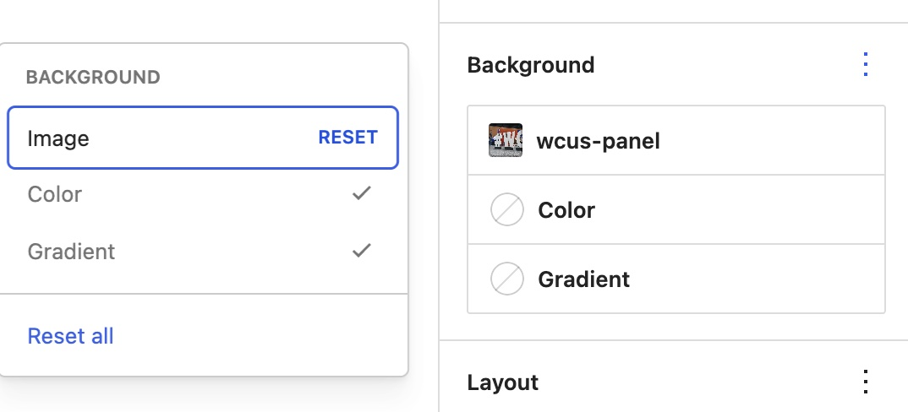
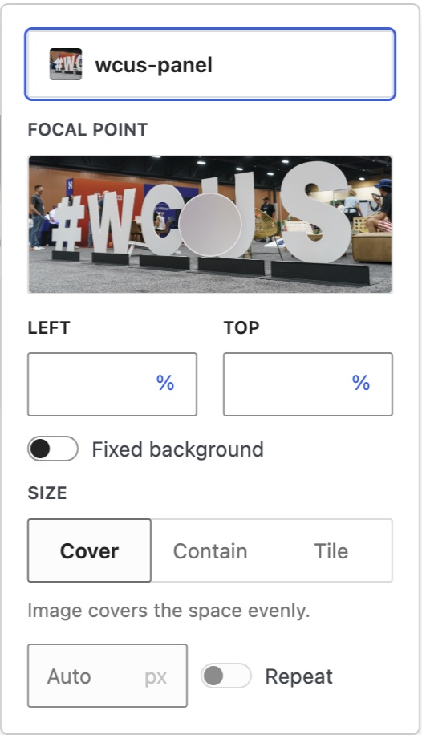

# Background Settings Overview

The Background settings allow you to customize the appearance of supported blocks using images, colors, and gradients.

You can use these settings to create more visually engaging content and draw attention to important information.

This article focuses on background images and explains how to add, replace, remove, and customize a background image.

## How to access background settings

Background settings can be configured for the entire site or for individual blocks. Site-wide background settings affect the appearance of the entire site.

### How to access background settings for your site

1.  Go to Appearance → Editor.
2.  Select Styles.
3.  Select Background.

### How to access background settings for an individual block

1.  Select the block you want to modify.
2.  Open the block settings sidebar by clicking the Settings icon next to the Publish or Save button.
3.  Find the Background section.
4.  or, in some blocks (for example, the Latest Posts block), the Background section is located in the Styles tab, represented by a black-and-white circle.

*Background settings of Row block*

*Background settings of Latest Posts block*

### Viewing all settings

In the Background section, click the three-dot menu to view all available background settings that are not displayed by default. Note that not every block supports all background settings.

*All background settings and Reset all*

### Resetting settings

If you make changes and want to return to the original settings, click the minus icon that appears when you hover over a setting.

Alternatively, click the three-dot menu and select Reset all. This resets the settings and removes all your changes.

## Image

### Add a background image

To add a background image:

1.  Click Image in the Background section.
2.  Choose an image from the Media Library or upload a new image.

Once selected, the image appears behind the block content.

### Change a background image

To replace an existing background image:

1.  Click Image in the Background section.
2.  Click the current image name.
3.  Choose a different image from the Media Library or upload a new one.

### Remove a background image

To remove a background image:

1.  Hover over the image in the Background section.
2.  Click the minus icon that appears.

### Image settings

*Background image settings*

#### Focal Point

Use Focal Point to specify which part of an image remains visible when the image is cropped.

#### Fixed Background

Enable Fixed Background to keep the image fixed while the page scrolls.

#### Size

The Size setting controls how the image is displayed.

##### Cover

The image is resized to cover the entire block area.

##### Contain

The image is resized so the entire image remains visible.

##### Tile

The image repeats to fill the available space.

When you select Tile, you can specify the image size and whether the image repeats.

## Color and Gradient

For information about Color and Gradient settings, see the [Colors Settings Overview](colors-settings-overview.md) article.

## Changelog

-   Created 2026-09-06
