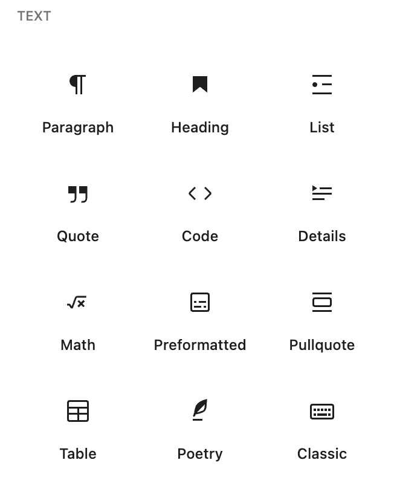
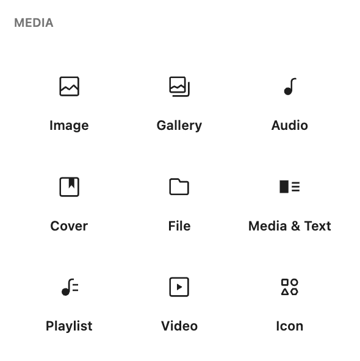
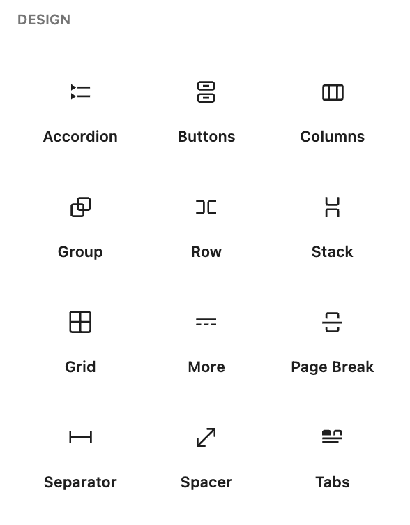
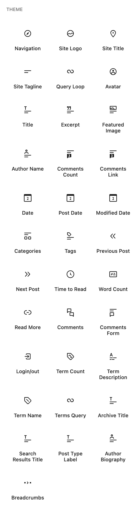
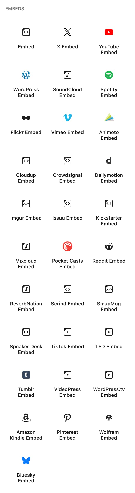
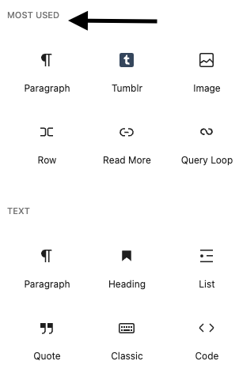

# Blocks list

Blocks are the components for adding content in the new [WordPress Block Editor](../../support-guides/dashboard/wordpress-block-editor.md). There are several blocks available within WordPress that you can easily [add](adding-a-new-block.md) to your post or page, [move](moving-blocks.md) within a post or page and [search for](adding-a-new-block.md#searching-for-blocks).

There are different ways to configure and [work with these blocks](work-with-blocks.md). You can also install additional third party blocks from the [WordPress block directory](block-directory.md).

Below is a list of the blocks that are currently available within WordPress. We will be adding to this list as more blocks are added with each release.

The Block Inserter categorizes the blocks into 6 different types: Text, Media, Design, Widgets, Theme and Embeds.

## [Text blocks](../text-blocks/README.md)

-   [Paragraph](../text-blocks/paragraph-block.md)
-   [Heading](../text-blocks/heading-block.md)
-   [List](../text-blocks/list-block.md)
-   [Quote](../text-blocks/quote-block.md)
-   [Code](../text-blocks/code-block.md)
-   [Details](../text-blocks/details-block.md)
-   [Math](../text-blocks/math-block.md)
-   [Preformatted](../text-blocks/preformatted-block.md)
-   [Pullquote](../text-blocks/pullquote-block.md)
-   [Table](../text-blocks/table-block.md)
-   [Poetry](../text-blocks/verse-block.md) (Renamed from Verse)
-   [Classic](../text-blocks/classic-block.md)

*Screenshot of the Text blocks under the Block Editor*

## [Media blocks](https://wordpress.org/support/category/formatting/)

-   [Image](../media-blocks/image-block.md)
-   [Gallery](../media-blocks/gallery-block.md)
-   [Audio](../media-blocks/audio-block.md)
-   [Cover](../media-blocks/cover-block.md)
-   [File](../media-blocks/file-block.md)
-   [Media & Text](../media-blocks/media-text-block.md)
-   [Playlist](../media-blocks/playlist-block.md) (new 7.1)
-   [Video](../media-blocks/video-block.md)
-   [Icon](../media-blocks/icon-block.md) (new 7.0)

*Screenshot of the Media blocks under the Block Editor*

## [Design blocks](https://wordpress.org/support/category/layout/)

-   [Accordion](../design-blocks/accordion-block.md)
-   [Buttons](../design-blocks/buttons-block.md)
-   [Columns](../design-blocks/columns-block.md)
-   [Group](../design-blocks/group-block.md)
-   [Row](../design-blocks/row-block.md)
-   [Stack](../design-blocks/stack-block.md)
-   [Grid](../design-blocks/grid-block.md)
-   [More](../design-blocks/more-block.md)
-   [Page Break](../design-blocks/page-break-block.md)
-   [Separator](../design-blocks/separator-block.md)
-   [Spacer](../design-blocks/spacer-block.md)
-   [Tabs](../design-blocks/tabs-block.md) (new 7.1)

*Screenshot of the Design blocks under the Block Editor*

## [Widgets blocks](https://wordpress.org/support/category/widget-blocks/)

-   [Archives](../widget-blocks/archives-block.md)
-   [Calendar](../widget-blocks/calendar-block.md)
-   Terms List
-   [Categories List](../widget-blocks/categories-list-block.md)
-   [Custom HTML](../widget-blocks/custom-html.md)
-   [Latest Comments](../widget-blocks/latest-comments-block.md)
-   [Latest Posts](../widget-blocks/latest-posts-block.md)
-   [Page List](../widget-blocks/page-list-block.md)
-   [RSS](../widget-blocks/rss-block.md)
-   [Search](../widget-blocks/search-block.md)
-   [Shortcode](../widget-blocks/shortcode-block.md)
-   [Social Icons](../widget-blocks/social-icons.md)
-   [Tag Cloud](../widget-blocks/tag-cloud-block.md)

*Screenshot of the Widget blocks under the Block Editor*

## [Theme blocks](../theme-blocks/README.md)

-   [Navigation](../theme-blocks/navigation-block.md)
    -   [Custom Link](../theme-blocks/custom-link-block.md)
    -   [Home Link](../theme-blocks/home-link-block.md)
    -   [Submenu](../theme-blocks/submenu-block.md)
-   [Site Logo](../theme-blocks/site-logo-block.md)
-   [Site Title](../theme-blocks/site-title-block.md)
-   [Site Tagline](../theme-blocks/site-tagline-block.md)
-   [Query Loop](../theme-blocks/query-loop-block.md)
    -   [Post Template](../theme-blocks/post-template-block.md)
    -   [Post Content](../theme-blocks/post-content-block.md)
    -   [Pagination](../theme-blocks/pagination-block.md)
    -   [Query Total](../theme-blocks/query-total-block.md)
-   [Avatar](../theme-blocks/avatar-block.md)
-   [Title](../theme-blocks/title-block.md) (Renamed from Post Title)
-   [Excerpt](../theme-blocks/post-excerpt-block.md) (Renamed from Post Excerpt)
-   [Featured Image](../theme-blocks/post-featured-image-block.md) (Renamed from Post Featured image)
-   [Author Name](../theme-blocks/post-author-name-block.md) (Renamed from Post Author Name)
-   Comments Count
-   Comments Link
-   [Date](../theme-blocks/date-block.md)
-   [Post Date](../theme-blocks/post-date-block.md)
-   [Modified Date](../theme-blocks/post-modified-date-block.md) (Renamed from Post Modified Date)
-   [Categories](../theme-blocks/categories-block.md)
-   [Tags](../theme-blocks/post-tags-block.md) (Renamed from Post Tags)
-   [Previous post](../theme-blocks/previous-post-block.md)
-   [Next Post](../theme-blocks/next-post-block.md)
-   [Time to Read](../theme-blocks/time-to-read-block.md)
-   [Word Count](../theme-blocks/time-to-read-block.md#word-count-variation) (Time to Read variation)
-   [Read More](../theme-blocks/read-more-block.md)
-   [Comments](../theme-blocks/comments-block.md)
    -   [Comments Title](../theme-blocks/comments-title-block.md)
    -   [Comment Template](../theme-blocks/comment-template-block.md)
    -   [Comment Author Name](../theme-blocks/comment-author-name-block.md)
    -   [Comment Date](../theme-blocks/comment-date-block.md)
    -   [Comment Content](../theme-blocks/comment-content-block.md)
    -   [Comment Reply Link](../theme-blocks/comment-reply-link-block.md)
    -   [Comment Edit Link](../theme-blocks/comment-edit-link-block.md)
    -   [Comment Pagination](../theme-blocks/comment-pagination-block.md)
-   [Comments Form](../theme-blocks/post-comments-form-block.md) (Renamed from Post Comments Form)
-   Login/out
-   Term Count
-   [Term Description](../theme-blocks/term-description-block.md)
-   Term Name
-   Terms Query
-   [Archive Title](../theme-blocks/archive-title-block.md)
-   [Search Results Title](../theme-blocks/search-results-title-block.md)
-   Post Types Label
-   [Author Biography](../theme-blocks/post-author-biography-block.md) (Renamed from Post Author Biography)
-   [Template Part](../theme-blocks/template-part-block.md)
-   [Query Title](../theme-blocks/query-title-block.md)
-   [Post Navigation Link](../theme-blocks/post-navigation-link-block.md)
-   [Breadcrumbs](../theme-blocks/breadcrumbs-block.md) (new in 7.0)

*Screenshot of the Theme blocks under the Block Editor*

## Embed Blocks

-   [Embed](../embed-blocks/embed-block.md)
-   [X](../embed-blocks/twitter-embed.md) (Renamed from Twitter)
-   [YouTube](../embed-blocks/youtube-embed.md)
-   [WordPress](../embed-blocks/wordpress-embed.md)
-   [SoundCloud](../embed-blocks/soundcloud-embed.md)
-   [Spotify](../embed-blocks/spotify-embed.md)
-   [Flickr](../embed-blocks/flickr-embed.md)
-   [Vimeo](../embed-blocks/vimeo-embed.md)
-   [Animoto](../embed-blocks/animoto-embed.md)
-   [CloudUp](../embed-blocks/cloudup-embed.md)
-   [Crowdsignal](../embed-blocks/crowdsignal-embed.md)
-   [Dailymotion](../embed-blocks/dailymotion-embed.md)
-   [Imgur](../embed-blocks/imgur-embed.md)
-   [Issuu](../embed-blocks/issuu-embed.md)
-   [Kickstarter](../embed-blocks/kickstarter-embed.md)
-   [Mixcloud](../embed-blocks/mixcloud-embed.md)
-   [Pocket Casts](../embed-blocks/pocket-casts-embed.md)
-   [Reddit](../embed-blocks/reddit-embed.md)
-   [ReverbNation](../embed-blocks/reverbnation-embed.md)
-   [Screencast](../embed-blocks/screencast-block.md)
-   [Scribd](../embed-blocks/scribd-embed.md)
-   [Slideshare](../embed-blocks/slideshare-embed.md)
-   [SmugMug](../embed-blocks/smugmug-embed.md)
-   [Speaker Deck](../embed-blocks/speaker-deck-embed.md)
-   [TikTok](../embed-blocks/tiktok-embed.md)
-   [TED](../embed-blocks/ted-embed.md)
-   [Tumblr](../embed-blocks/tumblr-embed.md)
-   [VideoPress](../embed-blocks/videopress-embed.md)
-   [WordPress.tv](../embed-blocks/wordpress-tv-embed-block.md)
-   [Amazon Kindle](../embed-blocks/amazon-kindle-embed.md)
-   [Pinterest](../embed-blocks/pinterest-embed.md)
-   [Wolfram](../embed-blocks/wolfram-embed.md)
-   [Bluesky](../embed-blocks/bluesky-embed.md)

*Screenshot of the Embed blocks under the Block Editor*

> [!NOTE]
> Learn more about the Embeds in this support article: [Embeds](../embed-blocks/embeds.md).

## Other Blocks

-   [Footnotes](../text-blocks/footnotes-block.md)

## Most Used Blocks

You will also find a Most Used blocks category which is not shown by default. This category will be visible only if you enable ‘Show most used blocks’ in your [Preferences](preferences-overview.md#blocks).

When enabled, the Most Used blocks category will be displayed right above the Text blocks category. It will list all the blocks that you used recently on your post or page.

> [!NOTE]
> The blocks that appear in the Most Used section will vary based on which blocks you used recently on your post or page.

## Deprecated blocks

The following blocks have been deprecated.

| **Deprecated block** | **Since** | **Replacement or change** |
| --- | --- | --- |
| Text Columns block | Before 5.0 | Replaced with the [Columns block](../design-blocks/columns-block.md) |
| [Button block](../design-blocks/button-block.md) | 5.4 | Became a child of the [Buttons block](../design-blocks/buttons-block.md) |
| [Facebook](../embed-blocks/facebook-embed.md) embed block | 5.6 | Removed |
| [Instagram](../embed-blocks/instagram-embed.md) embed block | 5.6 | Removed |
| Post Comments block | 6.0 | Replaced with Comments Query Loop block |
| Comments Query Loop block | 6.1 | Became or was merged into the [Comments block](../theme-blocks/comments-block.md) |
| Post Comment block |  | Replaced with the [Comments block](../theme-blocks/comments-block.md) |
| Comment Author Avatar block |  | Replaced with [Avatar block](../theme-blocks/avatar-block.md) |
| [Posts List block](../theme-blocks/posts-list-block.md) | 6.7 | Removed |
| [Post Author block](../theme-blocks/post-author-block.md) | 7.0 | Removed |

## Changelog

-   **Updated 2026-10-02**
    -   Deprecated Post Author block
-   **Updated 2026-08-20** (@awetz583)
    -   Added Playlist and Tabs blocks; Updated screenshots for 7.1
    -   Moved footnote under Other
-   **Updated 2026-07-28** (@kjoyner)
    -   Organized and updated the deprecation table to improve clarity.
-   **Updated 2026-07-08** (@awetz583)
    -   Added Date block
-   **Updated 2026-05-20** (@awetz583)
    -   Updated all screenshots to WP 7.0
    -   Added Breadcrumbs, Icon; renamed Verse to Poetry
-   **Updated 2025-12-12** (@estelaris)
    -   Updated all screenshots to WP 6.9.
    -   Renamed Post Title, Post Excerpt, Post Featured Image, Post Author, Post Author Name, Post Modified Date, Post Tags, Post Author Biography by removing the word “Post” from the title.
    -   Added reference to Stretchy Paragraph and Stretchy Heading
    -   Added missing blocks (still need link to articles): Terms List, Comments Count, Comments Link, Date, Time to Read, Word Count, Term Count, Term Name, Terms Query, Post Types Label, Bluesky
    -   Renamed Twitter to X
    -   Added to the Deprecated blocks list: Posts List, Post Comment (deprecated), Facebook (deprecated), Instagram (deprecated)
-   **Updated 2024-05-02**
    -   Correct “Post Modified Date” link
-   **Updated 2023-08-08**
    -   Remove reference to “Reusable Blocks”.
    -   Add link to “Pinterest” block.
    -   Add Details block page
    -   Add Post Modified Date block page
-   **Updated 2023-06-27**
    -   Updated link to the Avatar block page
-   **Updated 2023-06-02**
    -   Added link to the Previous Post block page
-   **Updated 2023-05-19**
    -   Added link to the Home Link block page
-   **Updated 2023-05-18**
    -   Added link to the Avatar block page
-   **Updated 2023-05-11**
    -   Added link to the Next Post block page
-   **Updated 2023-02-14**
    -   Added link to the Submenu block page
-   **Updated 2022-12-14**
    -   Added link to the Post Navigation Link block page
-   **Updated 2022-12-12**
    -   Added link to the Page List block page
    -   Added link to the Pagination block page
-   **Updated 2022-12-11**
    -   Added link to the Custom Link block page
    -   Fixed a formatting issue in the Comment block list
-   **Updated 2022-12-02**
    -   Added link to the Posts List block page
-   **Updated 2022-11-28**
    -   Added link to the Stack block page
-   **Updated 2022-11-25**
    -   Added link for Pocket Casts Embed block page
-   **Updated 2022-11-24**
    -   Added link for Row block page
-   **Updated 2022-11-23**
    -   Added link for Post Template block page
-   **Updated 2022-11-22**
    -   Added link to Post Comments Form page
    -   Added link to Comments Title page
-   **Updated 2022-11-21**
    -   Added link to Post Author page
-   **Updated 2022-11-17**
    -   Added link to Search Results Title page
-   **Updated 2022-11-11**
    -   Added link to the Amazon Kindle page
-   **Updated 2022-09-17**
    -   Added Post Author Biography block page
-   **Updated 2022-08-17**
    -   Added Comment Template, Comment Reply Link, and Comment Edit Link block pages.
-   **Updated 2022-08-16**
    -   Added Embed Block page and also linked to Embeds article.
-   **Updated 2022-08-09**
    -   Added a new section for the deprecated blocks
    -   Added button, text column, and post comment block under the deprecated list.
-   **Updated 2022-08-02**
    -   Added Comment Pagination Block page
    -   Added Comment Content Block page
-   **Updated 2022-07-25**
    -   Added Comments Date Block page
    -   Added Comments Author Name Block page
    -   Added list of blocks under Comments Query Loop block
-   **Updated 2022-07-21**
    -   Updated the block categories, images, and the list of blocks for 6.0
    -   Added Most Used blocks
    -   Added section for Reusable Blocks with image
-   **Updated 2022-07-18**
    -   Added Read More Block page
    -   Added Wolfram Block page
    -   Removed Meetup.com Block page
-   **Updated 2022-06-29**
    -   Linked to Site Title Block page
    -   Linked to Site Logo Block page
-   **Updated 2022-04-04**
    -   Linked to Site Tagline Block page
-   **Updated 2022-03-21**
    -   Linked to Post Content Block page
    -   Linked to Post Date Block page
    -   Linked to Post Tags Block page
    -   Linked to Post Categories Block page
    -   Linked to Post Excerpt Block page
-   **Updated 2022-03-17**
    -   Linked to Post Featured Image Block page
    -   Linked to Post Title Block page
-   **Updated 2022-03-10**
    -   Added Archive Title block
-   **Updated 2022-03-09**
    -   Added Term Description block
-   **Updated 2022-01-05**
    -   Added Navigation block link
    -   Added Template Part block link
-   **Updated 2021-10-15**
    -   Added Buttons Block link
-   **Updated 2021-07-07**
    -   Added Query Loop Block
-   **Updated 2021-03-15**
    -   Added Vimeo Embed Block link
-   **Updated 2020-11-25**
    -   Added Tumblr Block link
    -   Added Social Links Block
-   **Updated 2020-09-21**
    -   Added Group Embed Block link
-   **Updated 2020-09-04**
    -   Added Reddit Embed Block link
-   **Updated 2020-08-24**
    -   Added Cloudup Embed Block link
-   **Updated 2020-08-17**
    -   Added Tag Cloud block
-   **Updated 2020-08-13**
    -   Deleted Hulu, Funny or Die, and CollegeHumor Block listing
-   **Updated 2020-7-27**
    -   Added Dailymotion Embed block link
    -   Added Scribd Embed block link
    -   Added Speaker Dec Embed block link
    -   Added VideoPress Embed block link
-   **Updated 2020-7-25**
    -   Added Issuu Embed block link
-   **Updated 2020-7-24**
    -   Added WordPress.tv Embed block link
    -   Added Screencast Embed block link
-   **Updated 2020-7-05**
    -   Added MixCloud Embed block link
    -   Added TikTok Embed block link
    -   Added ReverbNation block link
    -   Added Crowdsignal block link
-   **Updated 2020-7-02**
    -   Added SmugMug Embed block link
    -   Added Animoto Embed block link
-   **Updated 2020-06-30**
    -   Added Flickr Embed block link
-   **Updated 2020-06-18**
    -   Added Slideshare Embed block link
-   **Updated 2020-06-04**
    -   Added TED Embed block link
    -   Added Spotify Embed block link
    -   Added Meetup Embed block link
    -   Added Instagram Embed Block link
    -   Added SoundCloud Embed Block link
-   **Updated 2020-05-25**
    -   Added WordPress Embed Block link
-   **Updated 2020-04-28**
    -   Added Links to Calendar Block and Category Widget Blocks
-   **Updated 2020-04-24**
    -   Added links to Block category headers
-   **Updated 2020-04-22**
    -   Added link to new Twitter embed page
-   **Updated 2020-04-21**
    -   Added link to new YouTube embed page
-   **Updated 2020-04-20**
    -   Changed date format from mm/dd/yyyy to yyyy-mm-dd
    -   Added link to new Facebook Embed page
    -   Added screenshots from Inserter Embed Category
-   **Updated 2020-04-18**
    -   Added new screenshots for Widget, Formatting and Common blocks
    -   updated the list of Widget and Layout blocks
-   **Updated 2020-01-16**
    -   added “Group” to the list of Layout Elements and graphic of the Inserter
-   **Updated 2019-11-23**
    -   added link to new RSS block page
-   **Created: 2019-03-07**
