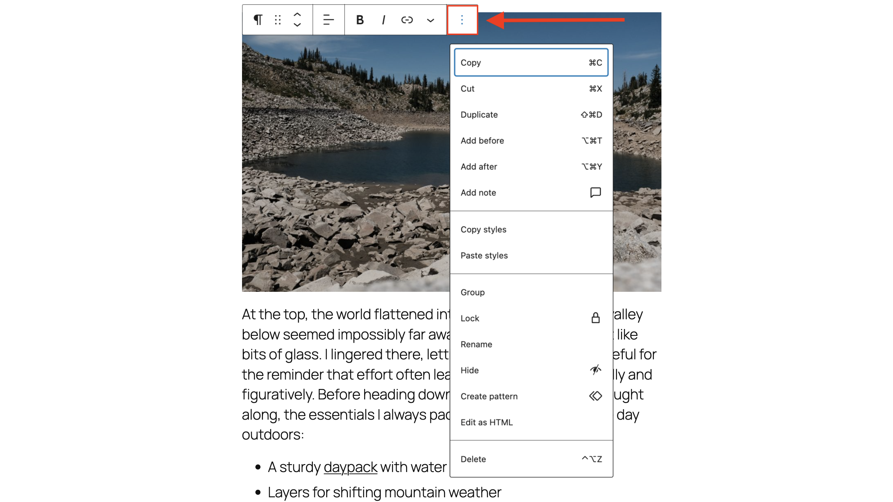
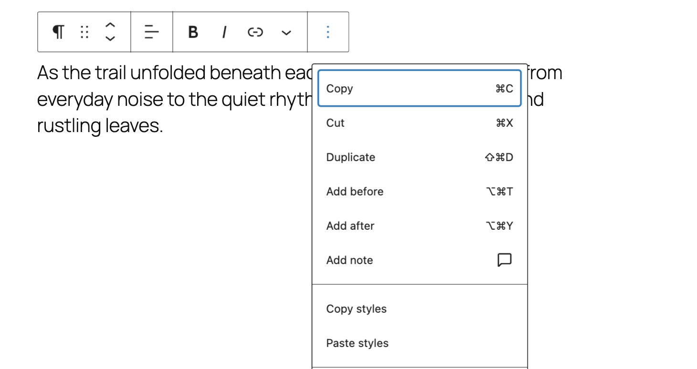
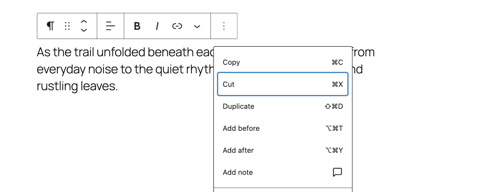
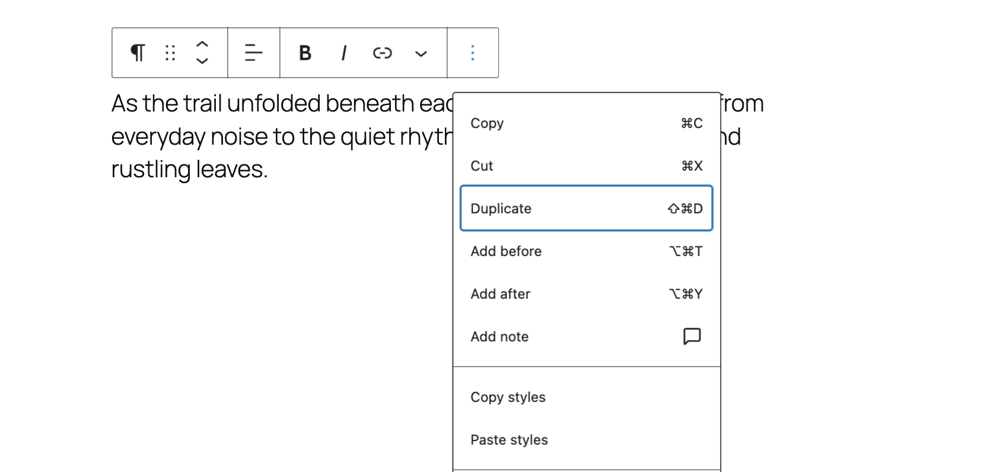
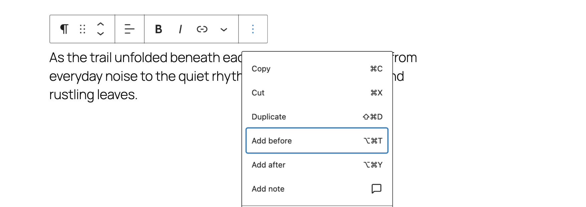
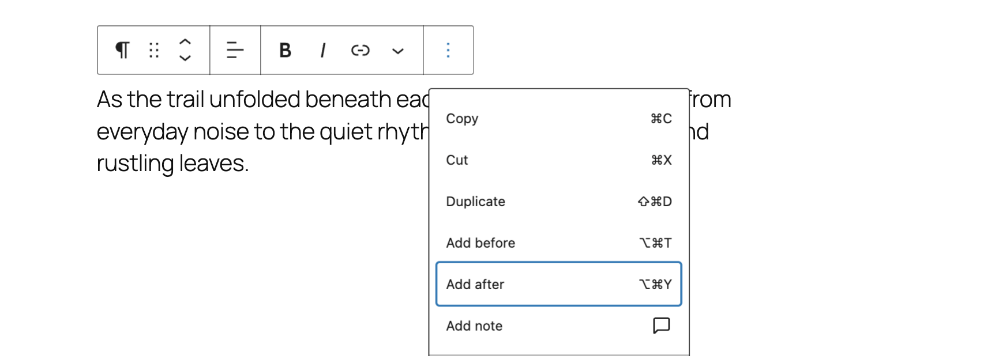
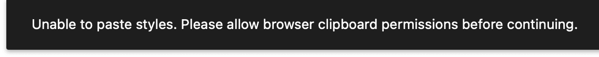
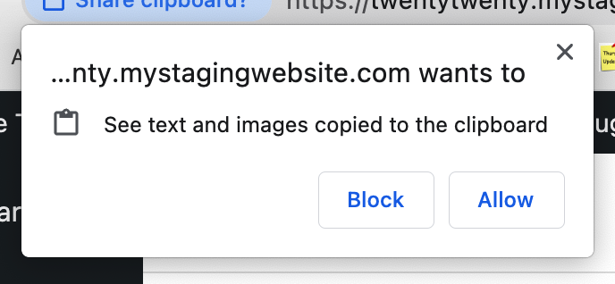
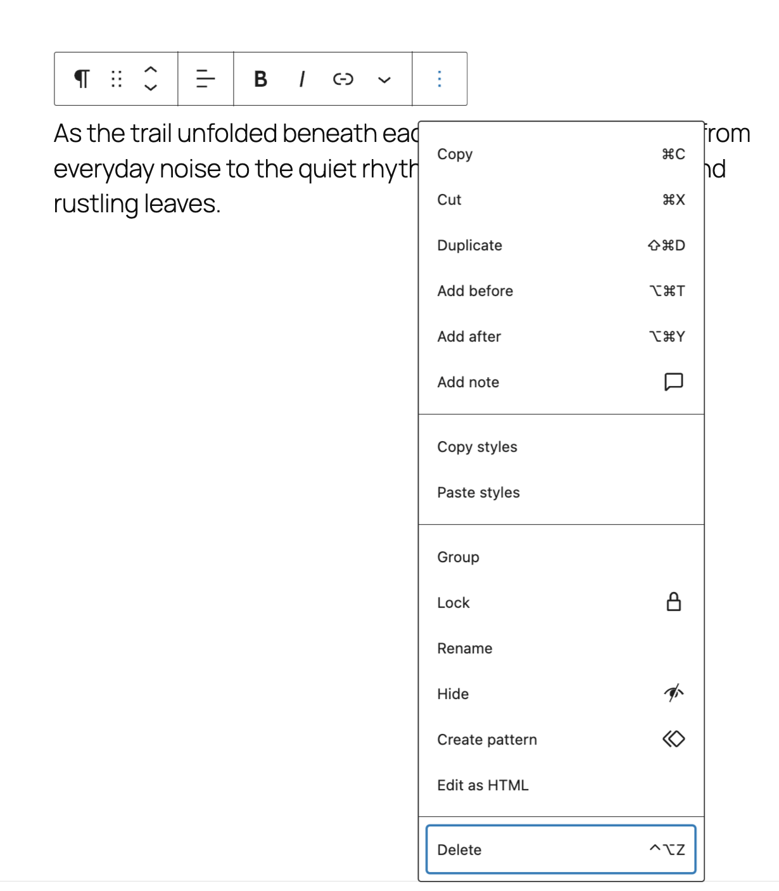

# More options

The **More options** menu in the block toolbar gives you additional options to customize your block. You can access these additional options by clicking on the ellipses (three dots) in the block toolbar.

## Copy

Use the **Copy** option to copy a selected block and paste it elsewhere in the editor or even on a different post/page. When you select the **Copy** option, the block will be copied to your clipboard. Then, you can use Ctrl + V (Command + V) to paste it anywhere on your post/page or other posts/pages.

## Cut

Use the **Cut** option to cut a selected block and paste it elsewhere in the editor or even on a different post/page. When you select the **Cut** option, the block will be copied to your clipboard. Then, you can use Ctrl + V (Command + V) to paste it anywhere on your post/page or other posts/pages.

## Duplicate

The **Duplicate** option clones the selected block right below the original. If you want to duplicate a block to paste it to a different page or post, use the **Copy block** option instead.

## Add before

Use this option to insert a new block before the selected block(s). This option will create an empty line to add a new block above your current one.

## Add after

Use this option to insert a new block after the selected block(s). It creates an empty line for adding a new block below your current one.

## Edit as HTML

<!-- VideoPress embed (iframe removed): https://videopress.com/embed/yRgqNToB -->

https://videopress.com/v/yRgqNToB

The **Edit as HTML** option allows you to edit the block using HTML code. You can click on **Edit visually** to exit this mode, but the block editor might no longer recognize the original block, depending on your code changes.

## Copy styles and Paste styles

<video controls preload="metadata" src="https://wordpress.org/documentation/files/2020/12/copy-and-paste-styles.mov"></video>

The **Copy styles** option copies all the style option to clipboard. You can go to another block and click **Paste styles** to apply the copied styles.

If you see a message like the one below, depending on what browser you are using, you may need to enable clipboard permissions in order to paste styles:

*Unable to paste styles. Please allow browser clipboard permissions before continuing.*

Each browser handles this differently, but you may see a message similar to this:

*website-name wants to: “See text and images copied to the clipboard”.*

## Lock

<video controls preload="metadata" src="https://wordpress.org/documentation/files/2020/12/lock-block.mov"></video>

Use the **Lock** option to lock the selected block, which will prevent the block from being removed, moved, or both.

If you try to lock a [group block](../design-blocks/group-block.md), you will see an option to also apply the same lock settings to all blocks nested inside.

<video controls preload="metadata" src="https://wordpress.org/documentation/files/2020/12/unlock.mp4"></video>

## Hide blocks

Available as of WordPress 6.9, you can now hide blocks, offering an easy option to explore different designs or to prepare content for a later launch. This option hides the block both in the editor and on the frontend. When a block is hidden, it’s also left out of the page’s code entirely, so screen readers won’t announce it and search engines won’t index it.

Starting in WordPress 7.0, you can also show or hide blocks by device type—desktop, tablet, or mobile. Blocks hidden on specific devices are still included in the page’s markup and rendered in the DOM—the hiding is handled with CSS.

<video controls preload="metadata" src="https://wordpress.org/documentation/files/2020/12/hide-block.mp4"></video>

## Create pattern

> [!NOTE]
> WordPress 6.3 renamed Reusable Blocks to Patterns. A synced pattern will behave in exactly the same way as a reusable block.

<video controls preload="metadata" src="https://wordpress.org/documentation/files/2020/12/create-pattern.mp4"></video>

*Save your block as a pattern so you can use them on other posts/pages*

The Create pattern option lets you add the selected block to a list of patterns, so you can use them on other posts or pages as well, and also remove a pattern from your list of patterns.

Optionally, you can set Synced option. Editing the synced pattern will update it anywhere it is used. After creating a synced pattern, you can detach it to a regular block, and edit the block without affecting your already saved synced pattern.

> [!NOTE]
> [Learn more about Synched patterns.](reusable-blocks.md)

## Group

<video controls preload="metadata" src="https://wordpress.org/documentation/files/2020/12/group.mp4"></video>

*Creating a group block will allow you to handle all the nested blocks in one go*

Select the **Group** option to group a collection of blocks and treat them as a unit. This is helpful if you want to, for instance, add a common background color to a collection of blocks. Also, you can **Ungroup** your blocks, if you don’t want them to be in a group.

> [!NOTE]
> [Learn more about the Group block.](../design-blocks/group-block.md)

## Delete

With the **Delete** option, you can delete the selected block from your content.

## Changelog

-   Updated 2026-05-05
    -   Updated video and description for hiding blocks based on devices.
-   Updated 2025-11-27
    -   Replaced and updated most screenshots and demos.
    -   Added in section for hiding blocks.
-   Updated 2025-06-05
    -   Updated “Cut” screenshot to match 6.8.1
    -   Deleted duplicate image in “Add after”
-   Updated 2025-04-15 (props to [@nikunj8866](https://profiles.wordpress.org/nikunj8866/))
    -   Removed **Select parent block (name)** and **Move to** sections.
    -   Add **Cut** section.
    -   Updated screenshots for Copy, Duplicate, Add before, Add after, and Delete sections.
    -   Replaced videos for Edit as HTML, Copy styles & Paste styles, Lock, Create pattern, and Group sections.
    -   Added missing ALT tags.
    -   Updated heading for Create pattern section.
-   Updated 2024-05-14
    -   Updated screenshots
-   Updated 2023-11-11
    -   Updated title to sentence case
-   Updated 2023-08-08
    -   WordPress 6.3 renamed Reusable Block to Patterns & update screenshots
-   Updated 2023-03-27
    -   Updated screenshots to match 6.2
    -   Added “Copy & Paste Styles” section.
-   Updated 2022-10-18
    -   Updated screenshots to match 6.1
    -   Added link to Reusable block & Group block articles
    -   Added Block Locking section
-   Updated 2022-02-04
    -   Screenshots and video as per WordPress 5.9
    -   added a quick tip about the name of the “Remove block” option
-   Created 2021-08-03
