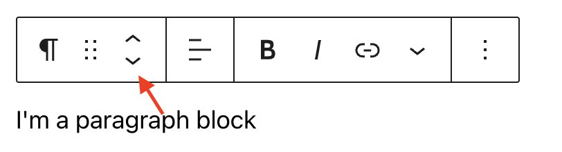
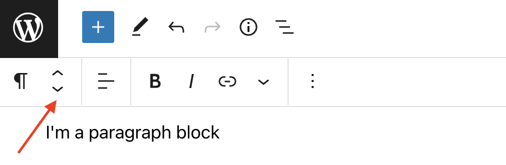
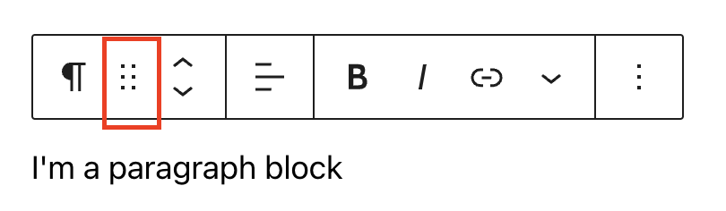

# Moving blocks

There are three different ways to move or change the position of a block within your post or page from the admin screen of the [WordPress Block Editor](../../support-guides/dashboard/wordpress-block-editor.md): using the move handles, drag & drop, or using the *Move to* option in the Block toolbar (under the More options three-dot menu).

## Using the move handles

The move handles are the up and down arrow handles in the Block toolbar of a selected block.

**NOTE**: If you set your WordPress Block Editor to display the Block toolbar pinned to the top of the WordPress block editor (right under the top toolbar) instead of appearing directly above the block, then the move handles will appear right under the top toolbar.

The up and down arrow icons in a Block toolbar can be used to move the selected block up and down in your post or page.

<video controls preload="metadata" src="https://wordpress.org/documentation/files/2022/07/168280683-b6cc0f74-15ae-4e0a-bb86-5fd9ff3cf09d.mp4"></video>

## Using the drag & drop

To drag and drop the selected block to a new location on the post or page, use the rectangle of dots in the Block toolbar of the selected block.

> [!NOTE]
> The drag and drop option is not available if you set your WordPress Block Editor to display the Block toolbar pinned to the top of the WordPress block editor (right under the top toolbar) instead of appearing directly above the block.

In 6.9 drag and drop is smarter. Blocks show live visual feedback as you reposition them, making layout building more intuitive and precise.

<video controls preload="metadata" src="https://wordpress.org/documentation/files/2020/08/drag-drop.mp4"></video>

## Using List View

List View displays all the blocks in your post or page in a structured list, making it easier to navigate and rearrange your content. To move a block using List View:

1.  Select the Document Overview icon in the top toolbar to open List View.
2.  Locate the block you want to move.
3.  Select and drag the block up or down in List View.
4.  Release the block when the insertion indicator appears in the location where you want to place it.

You can also use List View to move blocks into or out of nested structures such as Group, Columns, and Cover blocks. List View can be especially helpful when working with long or complex layouts where moving a block directly in the editor canvas is difficult.

For more information, see the [List View documentation](list-view.md).

#### Changelog

-   Updated 2026-09-02
    -   Removed “Move to” section as it’s no longer available on 7.1(@rollybueno, @kedarjoyner)
-   Updated 2025-11-29
    -   Added content and video for 6.9
-   Updated 2022-08-07
    -   Updated content and screenshots for 6.0
    -   Added ALT tags for the images
-   Updated 2022-02-16
    -   Updated screenshots and videos for 5.9
-   Created 2020-08-20
