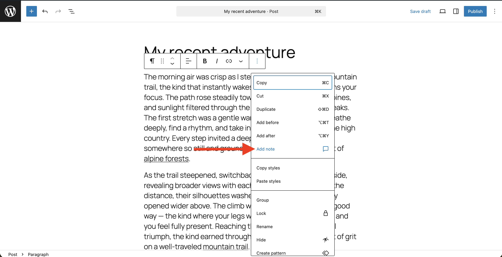
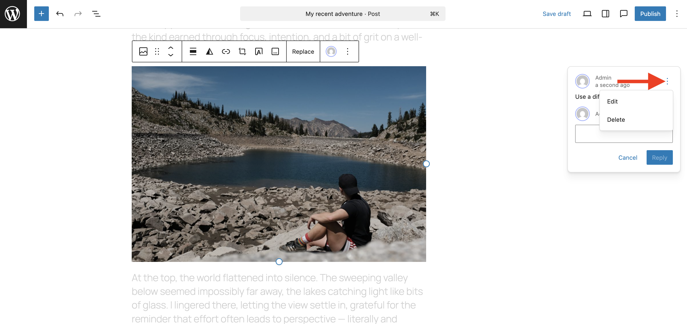

# Notes

Notes let you and your collaborators leave feedback directly on the content you are editing, without changing the content itself. You can attach a note to a whole block or to a specific span of selected text, keep several separate conversations on the same block, mention other users, use rich text when you leave a note, and mark notes as resolved once they have been addressed. Notes are visible only in the editor and never appear in your published content.

## What you need

-   Notes were introduced in WordPress 6.9 with more advanced features added in WordPress 7.1.
-   A user role that can edit the post or page (see “Permissions and visibility” below).

## Where Notes are available

-   Post and page editors.
-   Notes are not shown on the frontend and are not available in the Site Editor (templates, template parts).
-   Custom post types can support Notes if enabled by a theme or plugin author. If you don’t see Notes on a custom post type you use, please follow [these instructions](https://make.wordpress.org/core/2025/11/15/notes-feature-in-wordpress-6-9/) to add support.

## How to use notes

### Add a note

1.  Open a post or page in the block editor.
2.  Select the block you want to discuss.
3.  In the toolbar, select the three dot menu, and choose “Add Note”
4.  Type your message and submit to create the note.
5.  The block is marked with an indicator showing that it has a note attached.

### Add multiple note threads to a block

A single block can hold more than one independent note thread, so different people can raise separate points on the same block without replying to an existing conversation.

1.  Select a block that already has a note.
2.  In the toolbar, select the three dot menu, and choose “Add Note”. Instead of opening the reply field for the existing note, this starts a brand-new thread on the same block.
3.  Type and submit your note.

Each thread is listed separately in the sidebar, and deleting one thread leaves the others in place.

### Add a note to selected text (inline notes)

Inline notes let you attach feedback to a specific portion of text rather than to the whole block.

1.  In a text block (for example, a Paragraph), select the exact text you want to leave a note.
2.  Select the comment icon in the rich-text toolbar to add a note.
3.  Type and submit your note in the sidebar.

The selected text is highlighted in the editor to show that it has a note attached. The highlight stays anchored to the same text even as you continue editing around it: typing within the marked range expands or contracts the highlight with the text, and edits elsewhere in the block do not move the note off its target.

You can add several inline notes to different pieces of text within the same block. In the sidebar, notes for a block are ordered to match the top-to-bottom reading order of their highlights.

### Mention someone in a note

You can mention another user within a note to direct feedback to a specific person.

1.  Start a new note or reply to an existing one.
2.  Type `@` in the note field. A list of users appears.
3.  Continue typing to filter the list, and use the arrow keys and **Enter** (or the mouse) to choose a person. Press **Escape** to dismiss the list.
4.  The selected user is inserted as a styled mention chip that carries a link to their author page.

The mention is preserved when the note is saved and appears in both the floating thread and the “All notes” sidebar. You cannot mention yourself as the current user is left out of the suggestions.

### Reply to a note

Open the note thread attached to the block or from the Notes panel and add your reply. Replies stay threaded with the original note.

### Edit or delete your note

1.  Select the note you want to edit or delete.
2.  Select the three dot menu in the note.
3.  This will reveal two options: edit or delete.
4.  Select which option you want and proceed to edit or delete. Deleting a note removes it from the thread.

### Resolve and reopen a note

To resolve, follow these steps:

1.  Select the note you want to resolve.
2.  Select the check option. This will resolve the note.
3.  Resolved notes are hidden from active views but remain available in the post’s history for reference.

To reopen a resolved note, follow these steps:

1.  Select the dedicated Notes view in the top toolbar. This displays all notes, including any that were resolved.
2.  Select the note you want to reopen.
3.  Write a new note in the text field and then select “Reopen and reply”.
4.  This will reopen the note with your new message.

<video controls preload="metadata" src="https://wordpress.org/documentation/files/2025/11/reopen-note.mov"></video>

In the “All notes” view, a centered **Resolved** divider is shown directly above the resolved notes, so it is easy to see at a glance where the active notes end and the completed ones begin. The divider only appears when at least one note is resolved. Notes whose original block was deleted (orphaned notes) are grouped with the active notes above the divider, since they may still need attention.

### View notes for a block

1.  If a block has a note attached, you’ll see an indication in the block toolbar that shows the users avatar.
2.  Select the avatar and it will display related notes.

Otherwise, you can also select the dedicated Notes view in the top toolbar. This displays all notes, including any that were resolved, and you can select different notes to see their respective blocks.

<video controls preload="metadata" src="https://wordpress.org/documentation/files/2025/11/viewing-notes.mov"></video>

## Email notifications

By default, emails are sent in two circumstances:

-   When another user leaves a new note on their post, the post author receives an email.
-   When a user is mentioned in a note.

To change this behavior, go to Settings > Discussion and adjust “Email me whenever > Anyone posts a note.”

Site administrators can fine-tune notifications with plugins or custom code by [following these instructions](https://make.wordpress.org/core/2025/11/15/notes-feature-in-wordpress-6-9/). End users can ask an administrator if they need different notification behavior.

## Permissions and visibility

-   Only users who can edit a post can see or add notes on that post.
    -   Administrators and Editors: can view and add notes on all posts.
    -   Authors and Contributors: can view and add notes on their own posts.
    -   Subscribers: cannot view or add notes.
-   Notes are internal to your site and never appear to visitors.

## Tips for effective collaboration

-   Use a block-level note for feedback about a block as a whole, and an inline note when your comment applies to a specific phrase or sentence.
-   Start a new thread rather than replying when you are raising a separate point, so conversations stay easy to follow.
-   Mention a collaborator with `@` when a note needs a specific person’s attention.
-   Resolve notes as you finish with them to keep the active list short and scannable.
-   Use replies instead of creating new notes when continuing the same conversation.

## Demos

<video controls preload="metadata" src="https://wordpress.org/documentation/files/2025/11/6-9-notes-i0.mp4"></video>

<!-- VideoPress embed (iframe removed): https://videopress.com/embed/LU5RRu2J -->

https://videopress.com/v/LU5RRu2J

## Troubleshooting

**I don’t see Notes:**

-   Confirm the site is running WordPress 6.9 or later.
-   Make sure you’re editing a post or page (Notes are not available in templates in 6.9).
-   Verify you’re logged in and have permission to edit the post.
-   Open the Notes panel in the editor sidebar, or select a block and look for the Notes control in the toolbar.
-   Temporarily disable plugins or switch themes to rule out conflicts.

**Team members aren’t getting emails:**

-   Check Settings > Discussion: “Email me whenever > Anyone posts a note” must be enabled.
-   Verify the user is the post author or ask an administrator to customize notification behavior if different recipients are needed.

**Notes on my custom post type are missing:**

Please follow [these instructions](https://make.wordpress.org/core/2025/11/15/notes-feature-in-wordpress-6-9/) to add support.

**A mention isn’t being suggested:**

-   You cannot mention yourself; the current user is excluded from the suggestion list.
-   Keep typing after `@` to narrow the list to a matching name.

## Frequently asked questions

**Do notes show on the live site?**

No. Notes are only visible in the editor to users who can edit the post.

**Can I see all notes assigned to me?**

This currently isn’t possible.

**What happens to a note if I delete the block it was attached to?**

The note becomes an orphaned note. It is kept and grouped with the active notes above the Resolved divider, since it may still need attention.

## For site owners and developers

-   Notes are on by default for posts and pages. Custom post types can add support programmatically.
-   Notification and other behaviors can be customized with existing comment-related filters.
-   Technical details are available in the [WordPress 6.9 developer note](https://make.wordpress.org/core/2025/11/15/notes-feature-in-wordpress-6-9/).

## Changelog:

-   Updated 2026-08-18
    -   Documents multiple note threads per block, inline (selected-text) notes, stable inline highlight anchoring, stripping of highlights from published output, `@`-mention autocomplete, and clearer separation of resolved notes. Props @clk87 & @annezazu.
-   Created 2025-11-27
