# Template Editor

The Template Editor allows you to edit and create templates, using [blocks](blocks-list.md). These templates control the layout of the posts, pages, or page types on your site.

> [!NOTE]
> The Template Editor is **only** available if your site is using a [block theme](../appearance/block-themes.md) or a classic theme that has enabled the Template Editor on the backend.

## About Templates

WordPress uses templates to create the layout and structure for posts, pages, or specific page types on your site page. There are a few base templates that are generated when you select a theme. For example:

-   The **Front Page** template displays your site’s homepage, whether it is set to display [latest posts](../../support-guides/dashboard/settings-reading-screen.md#reading-settings)  or a static page.
-   The **Blog Home** template displays the latest posts as either the site homepage or as the “Posts page” as defined under reading settings. If it exists, the Front Page template overrides this template when posts are shown on the homepage.
-   The **All Archives** template displays any archive, including posts by a single author, category, tag, taxonomy, custom post type, and date. This template will serve as a fallback when more specific templates (example Category or Tag) cannot be found.
-   The **Pages** template displays a static page unless a custom template has been applied to that page or a dedicated template exists.
-   The **Single Posts** template displays a single post on your website unless a custom template has been applied to that post or a dedicated template exists.
-   The **Index** template is sometimes used to display the index page of all the blog posts. It is used as a fallback template for all pages when a more specific template is not defined.
-   Many block themes offer other built-in templates like the **Single Post** template to customize the layout of single blog posts, the **404** template to customize the layout of the 404 error page and the **Search** template to customize the layout of the search results page. To learn more, explore the templates in the [Twenty Twenty Five theme](https://wordpress.org/themes/twentytwentyfive/).

In the Template Editor, you can find all the templates on your site, including any custom templates you created and the ones that came bundled with your theme. You can edit these templates and create custom layouts using [blocks](blocks-list.md).

> [!NOTE]
> When you make changes to a template, the editor updates the blocks on all pages/posts that use the template. These changes take precedence over your theme’s bundled template files.

## What you need to use the Template Editor

To work with the Template Editor, you need to use a [block theme](../appearance/block-themes.md) on your site (or a classic theme that has enabled the Template Editor on the backend). A block theme is a theme that uses [blocks](blocks-list.md) for all parts of a site, including navigation menus, header, content, and site footer.

All [blocks](blocks-list.md) that are available in the [WordPress Block editor](../../support-guides/dashboard/wordpress-block-editor.md) can be used in the Template Editor. To find block themes, from the WordPress dashboard, go to **Appearance** > **Themes** and click **Add New**. In the **Add Themes** page, select **Block Themes** to find the growing list of [Block themes](../appearance/block-themes.md) in the [WordPress theme directory](https://wordpress.org/themes/tags/full-site-editing/).

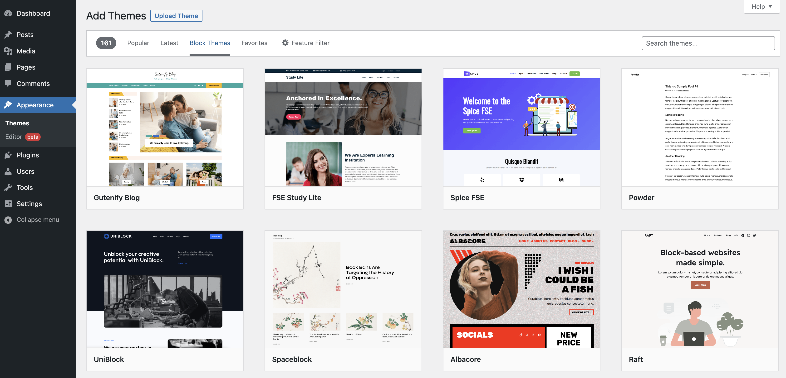

*How to find a block theme*

Once you install and activate a Block theme on your site, go to **Appearance** > **Editor** to open the Site Editor.

## Two ways to access the Template Editor

There are two different ways you can access the Template Editor depending on what type of theme you are using:

-   If you are using a [block theme](../appearance/block-themes.md), you can access the Template Editor when editing posts or pages via the [WordPress Block Editor](../../support-guides/dashboard/wordpress-block-editor.md) and also via the [Site Editor](../appearance/site-editor.md).
-   If you are using a classic theme that has enabled the Template Editor on the backend, you can access the Template Editor only when editing posts or pages via the [WordPress Block Editor](../../support-guides/dashboard/wordpress-block-editor.md).

### How to use the Template Editor via the WordPress Block Editor

#### Edit a template

1.  Click **Posts** > **Add New** to add a new post or **Pages** > **Add New** to add a new page.
2.  This opens the [WordPress Block Editor](../../support-guides/dashboard/wordpress-block-editor.md).
3.  Navigate to the [Post/Page Settings](page-post-settings-sidebar.md) sidebar tab.
4.  In the Post Settings tab, click the name of the template. A popup will appear. Click **Edit template**.

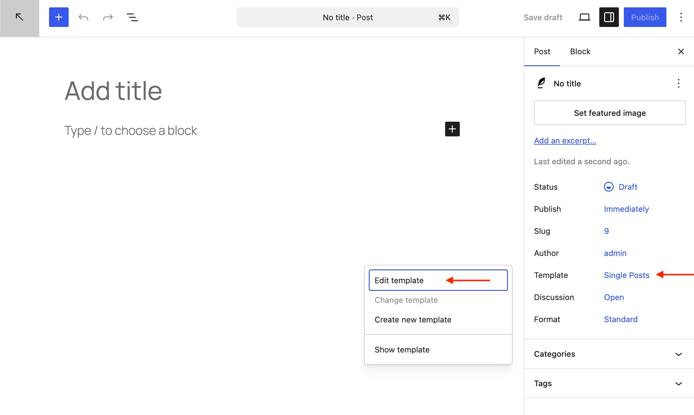

5.  This opens the Template Editor and takes you to the template editing mode where you can make changes to the selected template. To go back to the WordPress Block Editor and continue making content changes, click the **Back** link in the top panel of the editor.

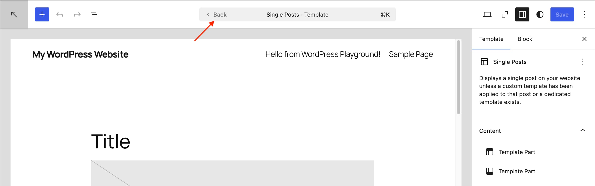

*Back link in the Template Editor*

6.  When you’re done making changes, select **Publish**. This will prompt you to save all the changes you made including the template and the post or page.
7.  Click **Save** to confirm the changes.

<!-- VideoPress embed (iframe removed): https://videopress.com/embed/uriQPJiZ -->

https://videopress.com/v/uriQPJiZ

> [!NOTE]
> When you make changes to a template, the editor updates the blocks on all pages/posts that use the template

#### Create a new custom template

1.  Click **Posts** > **Add New** to add a new post or **Pages** > **Add New** to add a new page.
2.  This opens the [WordPress Block Editor](../../support-guides/dashboard/wordpress-block-editor.md).
3.  Navigate to the [Post/Page Settings](page-post-settings-sidebar.md) sidebar tab.
4.  Under the Post/Page tab, click the name of the template. A popup will appear. Click the add template icon in the top right corner.

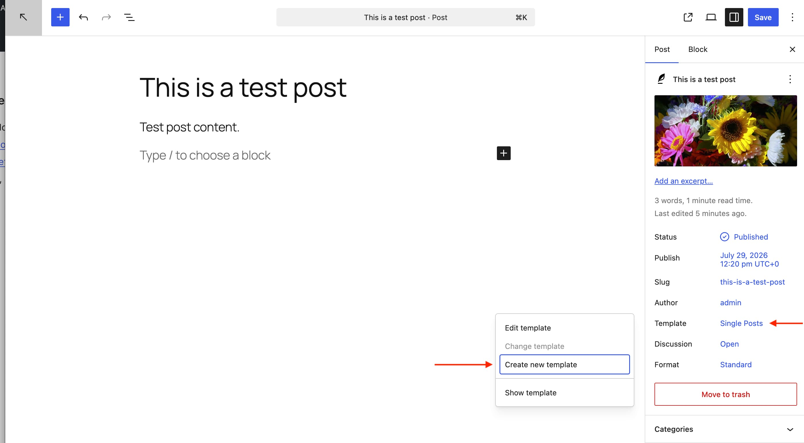

> [!NOTE]
> This option is **only** available if you are using a [block theme](../appearance/block-themes.md) that lets you create custom templates.

5.  This opens a dialog box where you can give a name for the custom template you are about to create. Make sure to give it a descriptive name that describes the purpose of the template example: Full Width.
6.  Click **Create** to open the Template Editor and go to the template editing mode where you can build the custom template using [blocks](blocks-list.md). To go back to the WordPress Block Editor and continue making content changes, click the **Back** link at the top left corner.
7.  When you’re done making changes, select **Publish**. This will prompt you to save all the changes you made including the template and the post or page.
8.  Click **Save** to confirm the changes.

<!-- VideoPress embed (iframe removed): https://videopress.com/embed/YRzUBiec -->

https://videopress.com/v/YRzUBiec

#### Viewing the template in the block editor

To view the template while editing a post or page, click on the **View** button on the top right of the editor and choose **Show template**.

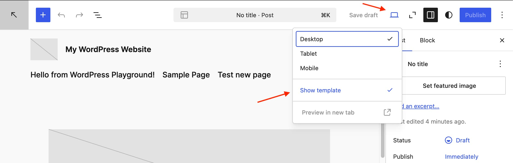

#### Changing a template in the block editor

In the Post/Page Settings sidebar, click on the template name and choose the **Change template** option. This will open a modal where you can choose from available templates to view in the block editor.

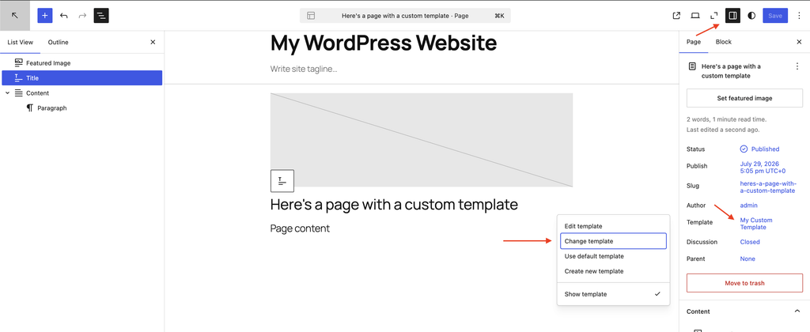

*Location of how to change a template in the block editor*

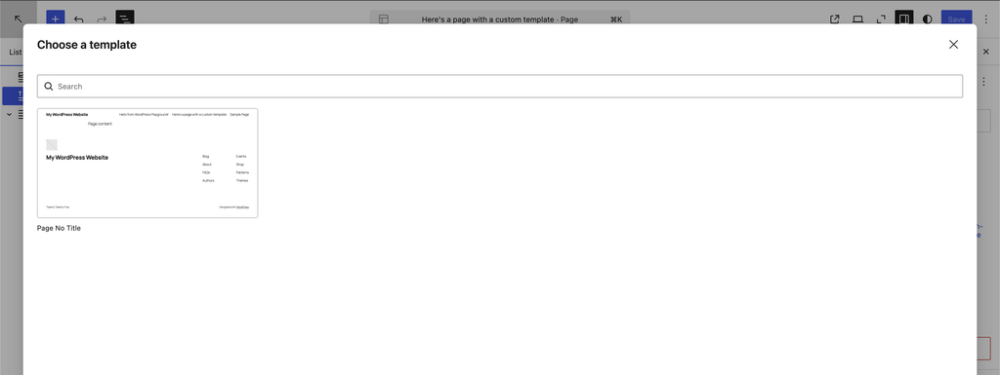

*Change template modal*

### How to use the Template Editor via the Site Editor

#### Navigate to templates

-   Go to **Appearance** > **Editor** to open the [Site Editor](../appearance/site-editor.md). You will be taken to an interface showing a preview of your site and a dark gray sidebar where you can navigate between your templates, template parts, and other aspects of your site.
-   To view the list of templates available for your site and switch between templates:
    -   If you are already in a template, click on the WordPress icon (or Site icon if you have set one) to open the Site Editor left navigation. If you are just entering the Site Editor, skip this step.
    -   Click on **Templates** to view the list of templates.
    -   Click on any template name from the list to preview that template and see a description of what the template does.

#### Edit a template

-   From the Site Editor (**Appearance** > **Editor**), click on **Templates** to view the list of templates on your site, including any you have created and any that come with your theme. If you are already editing a template, click on the WordPress icon (or Site icon if you have set one) to open the Site Editor left navigation.
-   Click on any of the templates in the list to preview that template and see a description of what the template does. From there, you can either click the pencil icon or on the template itself to edit it directly and customize the layout of the selected template using [blocks](blocks-list.md).
-   When you are done with the template customization, click **Save**.

> [!NOTE]
> When you make changes to a template, the editor updates the blocks on all pages/posts that use the template.

-   To go back to the overall view of the **Site Editor**, click on the WordPress icon (or Site icon if you have set one) to open the Site Editor left navigation.

#### Add a new template

The Template Editor displays the templates that you can add to your site.

-   From the **Appearance** > **Editor**, click on **Templates** to view the list of templates on your site, including any you have created and any that come with your theme. If you are already editing a template, click on the WordPress icon (or Site icon if you have set one) to open the Site Editor left navigation.
-   Click the **Add Template** button in the top right corner of the screen to see the optional types of new templates you can add to your site.

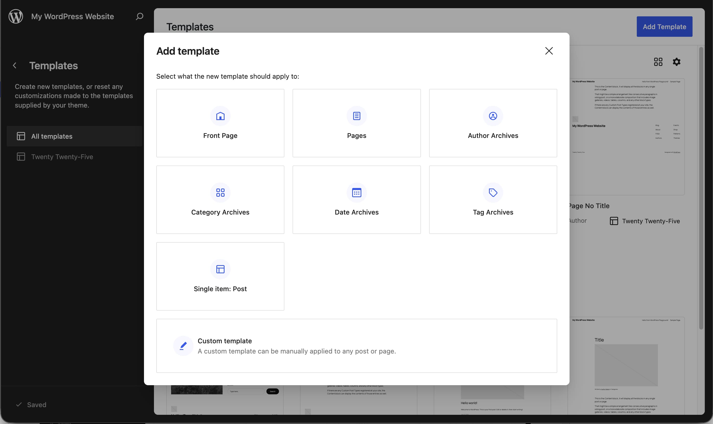

-   **Front Page** – to display the home page of your site if your site is set up to display a [regular page](../../support-guides/dashboard/settings-reading-screen.md#reading-settings) for the home page.
-   **Pages** – It allows the creation of templates that can be applied to a specific page on the site or as the default page template (if not already defined by the theme).
-   **Author Archives** – It allows the creation of templates that can be applied to posts by a specific author on the site or as the default template for all authors (if not already defined by the theme).
-   **Category Archives** – It allows the creation of templates that can be applied to posts by a specific category on the site or as the default template for all categories (if not already defined by the theme).
-   **Date Archives** – It allows the creation of templates that can be applied to posts by date (if not already defined by the theme).
-   **Tag Archives** – It allows the creation of templates that can be applied to posts by tag (if not already defined by the theme).
-   **Single item: Post** – It allows the creation of post-specific templates.
-   **Custom Template** – A template that can be applied to any post or page.

If you already added a template from the Template Editor (for example: Front Page), it will not display that template name (in this case, Front Page) in the drop-down menu, when you try to add a new template.

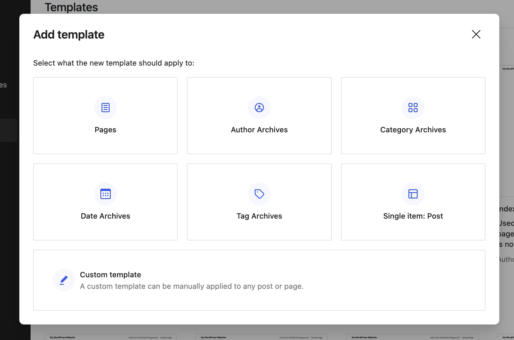

*Add template modal after a new template for Front Page has been created*

Once you select the template to add, you will be shown an option to start the template with content from one of the existing patterns in the site. This means you can start with content already in the template, or start from scratch. You can design the layout further by adding or removing blocks from the template.

<!-- VideoPress embed (iframe removed): https://videopress.com/embed/O4T3hDWU -->

https://videopress.com/v/O4T3hDWU

#### Add a new Page template

Click on the **Add Template button**. On the **Add template modal**, choose “Pages” under the Select what the new template should apply to: option.

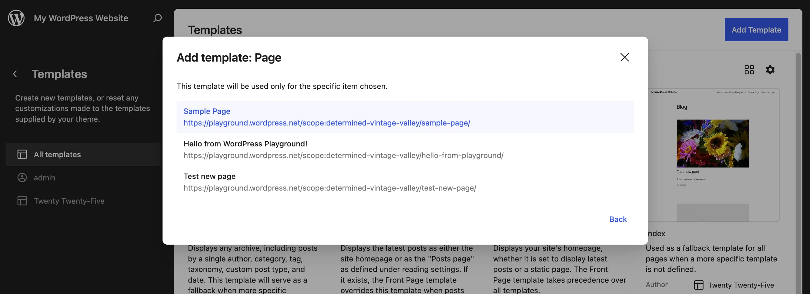

You can select a specific page to apply the template. Once you select the page, you are taken to the Template Editor where you can design the layout of the template.

Similarly, you can Add a template for a specific Post with the **Single Item: Post** option.

#### Add template for all post types and specific post types

Selecting Author, Category, and Single item: Post allows you to create a single template for all the post types or a specific template for a certain post type. This is helpful, for example, if you want to show a grid of posts for a specific “photography” category but not change the default list style for others.

To create a custom category template, select **Category Archives** from the **Add Template** modal. After you choose to add a new template, a new dialog will appear with two choices:

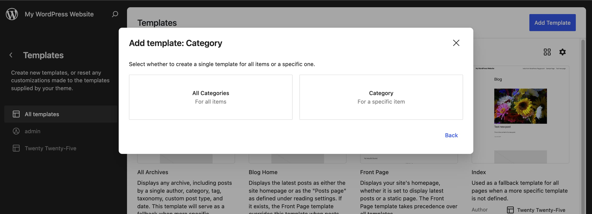

**All Categories** – for creating the default category template. This is used as a fallback when a more specific category template does not exist.

**Category** – for creating a custom template for an individual category. Selecting this option will open a new dialog listing all the categories on your site. If your site has more than **10** Categories, the dialog box will also show a Search box and you can search by the Category name to find the one you are looking for.

Once you make your choice between All Categories or Categories you will be taken to the Template Editor, where you can design the layout of the template.

To create templates for **Author Archives** and **Custom Post Type** archives, follow the Category Archives directions for each of these post types.

#### Create a new custom template

A custom template can be assigned to any post, page, or custom post type.

When you add a new template from the list of choices provided in the Template Editor, they are automatically assigned to their respective page, post, or post type. For example: The Author template gets automatically assigned to posts based on authors. When you create a new custom template, it is not assigned to anything specific until you assign a template to the post or page.

To create a custom template, select **Custom Template** from the drop-down menu, after you choose to add a new template. In the dialog that appears, give a name for the new custom template and click **Create**. Make sure the name describes the template example: Post with sidebar.

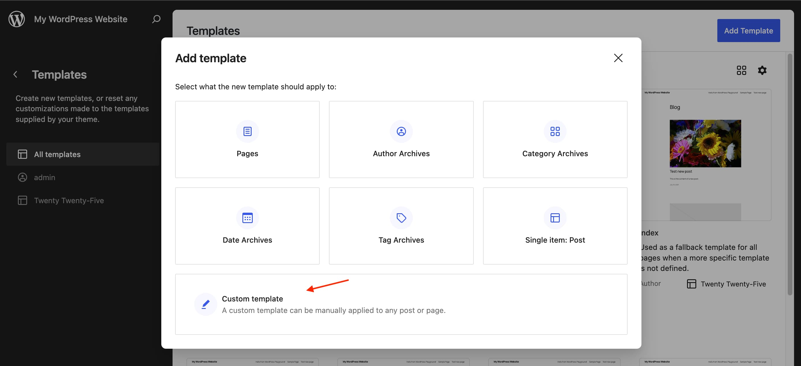

You will be taken to the Template Editor pre-populated with content and you can design the layout of the template further by adding or removing blocks.

## How to assign a custom template to a post or page

See examples of the post settings sidebar template selection options in the [How to use the Template Editor via the WordPress Block Editor](#how-to-edit-templates-via-the-post-editor) section above.

1.  From the WordPress Dashboard, open the post or page that you want to assign the template.
2.  This opens the [WordPress Block Editor](../../support-guides/dashboard/wordpress-block-editor.md).
3.  Navigate to the [Post/Page Settings](page-post-settings-sidebar.md) sidebar tab.
4.  Under the **Summary** section, click the name of the template. A popup will appear.
5.  In the popup, open the drop-down list to find the list of all custom templates. Pick the template you want to assign to the post or page.

> [!NOTE]
> Changing a page’s template affects that page only (not your entire site.)

## How to rename custom templates

You can only rename a custom template that you created. This means the default templates in WordPress and custom templates that came bundled with your theme cannot be renamed.

There are two ways you can rename custom templates:

### From the detail view of the template

-   Click on **Templates** to view the list of templates on your site.
-   Click on the custom template you created, that you want to rename. This will display a preview of the template along with its details.
-   In the detail view of the template click the three-dot icon next to the title and select the ‘Rename’ option in the menu that appears.
-   This will open a dialog box where you can type in a new name for the custom template you selected. Make sure the name describes the template example: Post with sidebar.
-   Click **Save** to save the custom template with the new name.

### From the templates list in the Template Editor

-   Go to the Appearance > Editor > **Templates** screen.
-   Click the three-dot menu icon next to any of the custom templates you created. From the drop-down menu and select **Rename**.
-   This will open a dialog box where you can type in a new name for the custom template you selected. Make sure the name describes the template example: Post with sidebar.
-   Click **Save** to save the custom template with the new name.

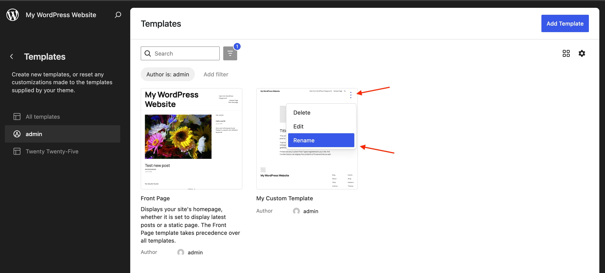

## Clear customizations to templates in your block theme

> [!NOTE]
> This feature is **only** available for the templates that you have already customized. If you don’t find this option, it means your template is already in its default state.

There are two ways you can clear customizations:

### From the templates list in the Template Editor

-   Go to the Appearance > Editor > **Templates** screen.
-   Click the three-dot menu icon to open a drop-down menu and select **Reset**. This will reset the template to the default state and you will lose the changes you made to that template.

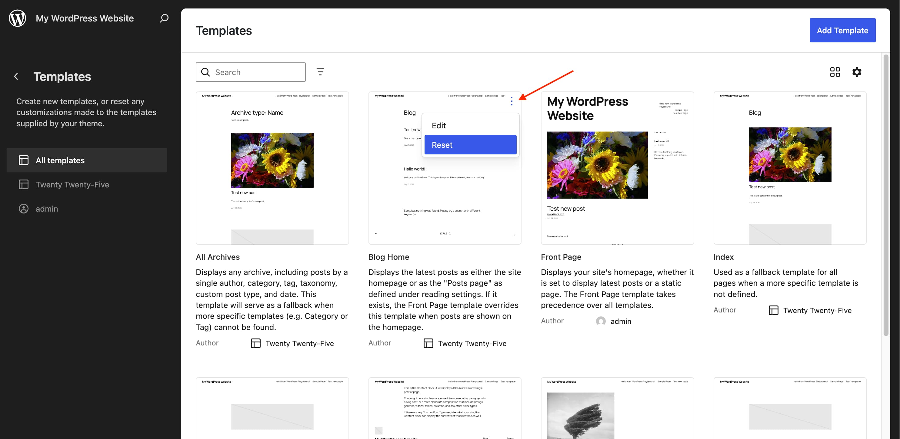

*Reseting a template from the site editor*

### From the Settings sidebar within a template

Note: This will reset the template to the default state and you will lose the changes you made to that template.

-   Go to the Appearance > Editor > **Templates** screen.
-   Choose the template you want to clear customizations for. This will open the template in the Template Editor.
-   Click the **vertical three-dot menu** icon in the top right of the Template settings sidebar. This will open a drop-down menu.
-   Select the **Reset** option.
-   In the modal that reads “Reset to default and clear all customizations” choose the **Reset** button.

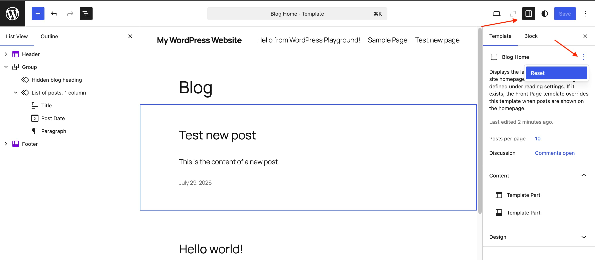

*Resetting a template from the template editor screen*

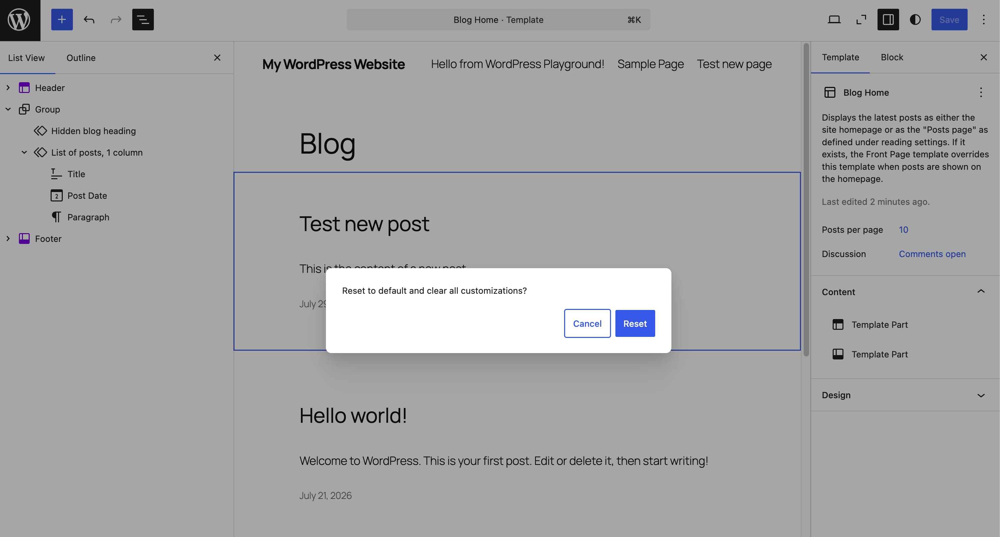

*Reset confirmation modal*

## How to delete a template

You can only delete the custom templates that you created.

-   Go to the Appearance > Editor > **Templates** screen.
-   Click the **three-dot menu icon** near the template name which opens a drop-down menu, and select the **Delete** option.
-   Confirm you want to delete the template in the dialog that displays, and you will be notified once it is complete.

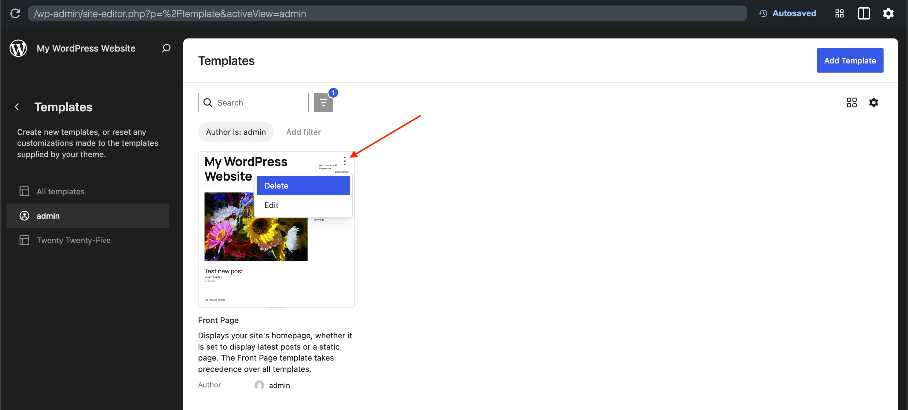

## Resource Links

-   [Deeper customization with template options](https://make.wordpress.org/core/2022/07/21/core-editor-improvement-deeper-customization-with-more-template-options/)
-   **Workshops**
    -   [Creating a landing page with a block theme](https://wordpress.tv/2022/08/15/creating-a-landing-page-with-a-block-theme-2/)
    -   [Personalizing your 404 template](https://wordpress.tv/2022/09/28/personalizing-your-404-template/)
-   **Courses**
    -   [Simple Site Design and Site Editing](https://learn.wordpress.org/course/simple-site-design-with-full-site-editing/)
    -   [Personalized Site Design and Theme Blocks](https://learn.wordpress.org/course/part-2-personalized-site-design-with-full-site-editing-and-theme-blocks/)
    -   [Advanced Site Design using the Site Editor](https://learn.wordpress.org/course/part-3-advanced-site-design-with-full-site-editing-site-editor-templates-and-template-parts/)

Changelog:

-   Updated 2026-07-29 (props @awetz583 @milana_cap @anujrathore24 @estelaris @kel-dc @skorasaurus)
    -   Updated content, videos and screenshots for 7.0
    -   Added information about viewing and changing templates from the block editor
-   Updated 2023-07-08
    -   Updated content, videos and Screenshots for 6.3.
-   Updated 2023-03-27
    -   Updated content, videos, and screenshots for 6.2.
    -   Removed references to “Beta” for the Site Editor.
-   Updated 2022-10-20
    -   Updated content, videos, and screenshots for 6.1
    -   Updated resources section to remove external links and add links to Learn workshops and courses
-   Updated 2022-05-22
    -   Adding 6.0 features. updating screenshots and videos and reworking content.
-   Edited to add in content around the Site Editor on 2022-01-05
-   Edited to add in an additional Resource item on 2021-06-03
-   Created on 2021-07-11
