# Typography Settings overview

You can use the typography settings in your [block](blocks-list.md) to change the font and appearance of your texts. These settings differ from block to block and may include text color, font family, font size, appearance, line height, letter spacing, line indent, columns, decoration, orientation, letter case, drop cap and fit text. When combined, they allow you to have new ways to differentiate your content.

The typography settings are available when you use the [block editor](../../support-guides/dashboard/wordpress-block-editor.md). If you are new to the block editor, [this guide](work-with-blocks.md) will show you how to work with blocks.

<!-- VideoPress embed (iframe removed): https://videopress.com/embed/ZgeBsjsl -->

https://videopress.com/v/ZgeBsjsl

## Access typography settings

The typography settings can be found in the Block Settings sidebar of a [block](blocks-list.md) under the section **Typography**.

If you don’t see the **Block Settings** sidebar, select the block you want to customize, then click the **Settings** icon that is next to the **Save/Publish** button.

### Additional settings

In the **Typography** section, some options may be hidden. Click on the Typography options three-dot menu to explore all the typography settings that are not visible by default.

From the drop-down menu, select the typography setting that you want to add to the **Typography** section. You can add as many settings as you like.

The full list of the different types of settings is listed below.

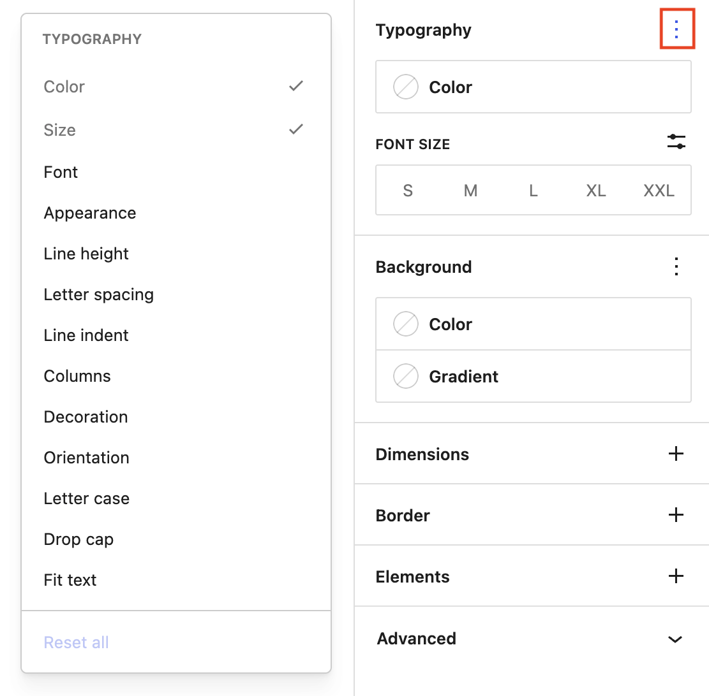

If you make customizations to these settings and want to revert back to the original settings quickly, you can do so by selecting the three-dot menu icon and clicking **Reset All** as [shown in this article](work-with-blocks.md#reset-controls). This resets the settings and removes all of your changes.

## Available settings

Every supported block comes with different typography settings.

### Color

To change the text color of all of the text in a block, click on the Color button. You can choose a pre-defined color from the palette or enter your own color value by clicking on the large color preview at the top of the color menu. Your color options may differ depending on the theme you are using.

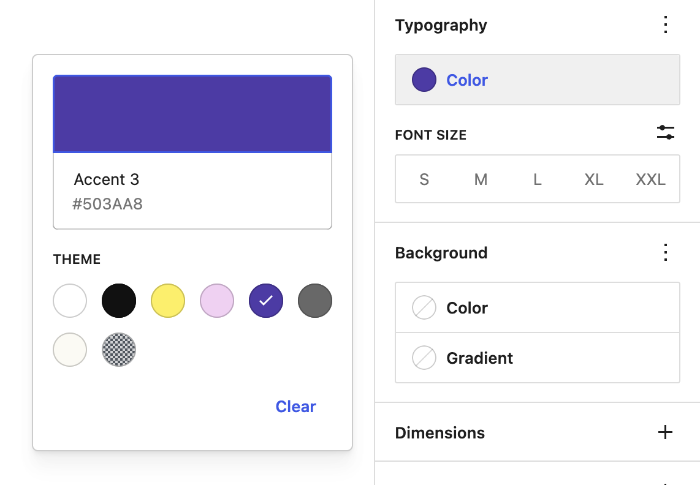

*Example of choosing a purple color from a pre-defined palette.*

You may see a warning if your text color does not have enough contrast compared to the background color that would make it difficult to read. Use the custom color interface to choose a different color to meet accessibility color guidance.

<!-- VideoPress embed (iframe removed): https://videopress.com/embed/Cwg0iNQ4 -->

https://videopress.com/v/Cwg0iNQ4

> [!NOTE]
> [Learn more about color settings.](colors-settings-overview.md)

### Font size

Font size allows you to adjust the size of your text. You can choose from preset sizes like (**S**)small, (**M**)medium, (**L**)large and (**XL**)extra large. You can also set a custom value by clicking the slider icon directly above the default selections.

<!-- VideoPress embed (iframe removed): https://videopress.com/embed/gA6926aC -->

https://videopress.com/v/gA6926aC

You can change the unit of the font size by clicking the **px** icon on the right. You can choose between **px**, **em**, **rem**.

> [!NOTE]
> [Learn the difference between these units here.](#units-explained)

### Font family

This option allows you to change the font family for your text, with a preview of the fonts available in the drop-down menu. The list of available fonts depends on your theme. Click on the three dot menu and choose **Font** to view the font family dropdown.

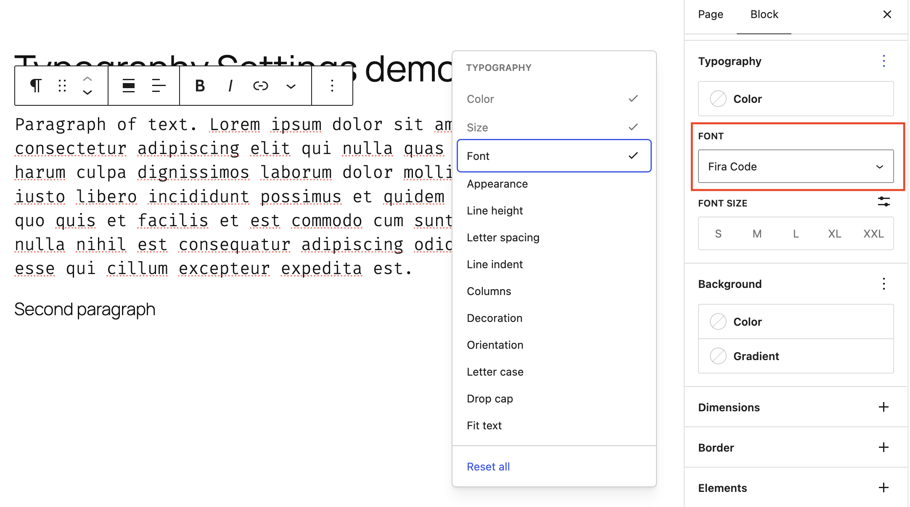

*Font family of FIra Code*

### Appearance

The Appearance setting allows you to change the text’s weight from **Thin** to **Extra Bold** and **Black**. You also have the option to italicize your text from **Regular Italic** to **Extra Bold Italic** and **Black Italic**.

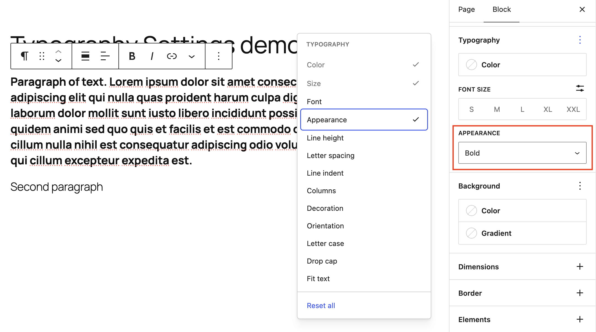

*Appearance bold*

### Line height

This setting sets the spacing above and below each line of text within a given paragraph. The default line height for most themes is **1.5**. You can use the Line height settings to increase or decrease it to your liking. You can also add a custom number for the line height.

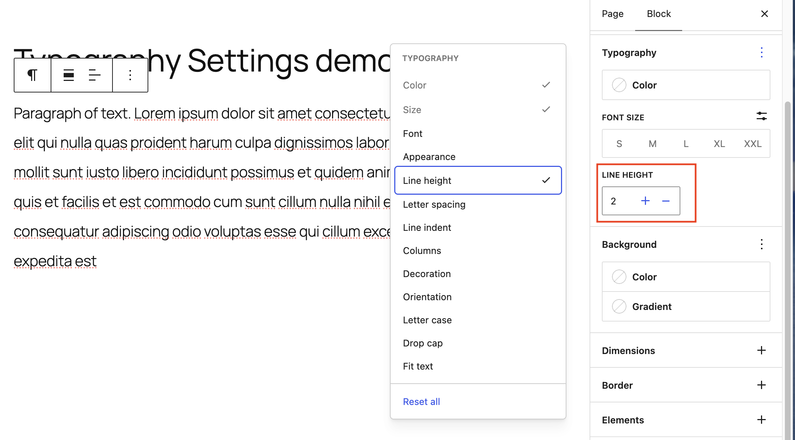

*Line height of two*

### Letter spacing

This setting allows you to set the space between each individual character. You can also change the units from the default (**px**) to **%**, **em**, **rem**`,`**vw** and **vh**.

> [!NOTE]
> [Learn the difference between these units here.](#units-explained)

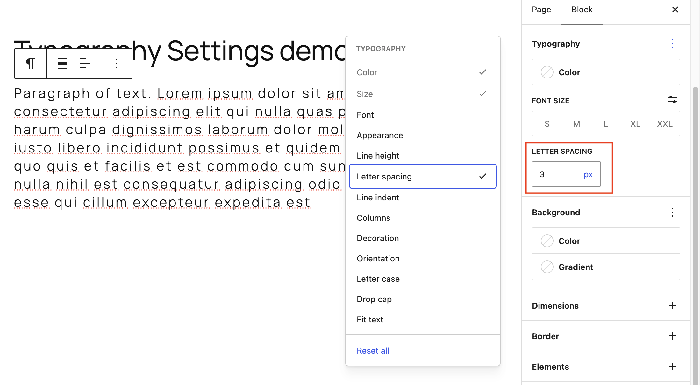

*Letter spacing of three pixels*

### Line indent

Line indent can be used on a paragraph block to add space before the first word in that paragraph. This adds a literary effect to the text.

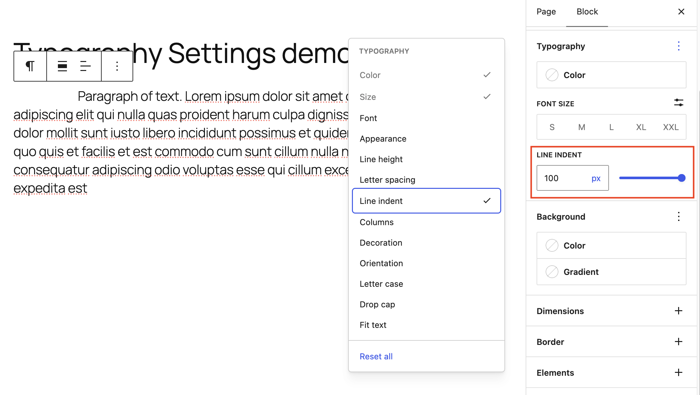

*One hundred pixel line indent*

### Columns

The Columns control can be used to split a paragraph across multiple columns, like how text can flow in a magazine or newspaper.

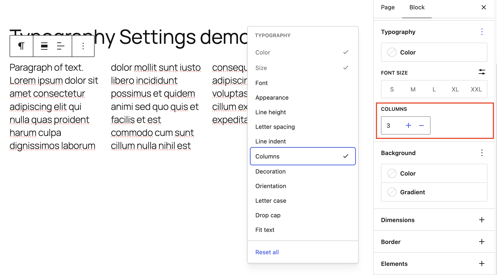

*Three columns*

> [!NOTE]
> Text columns persist on mobile, tablet and desktop

### Decoration

The decoration setting allows you to choose an **Underline** or **Strikethrough** style for the text. Select **Normal** (**—**) to remove and existing underline or strikethrough styles.

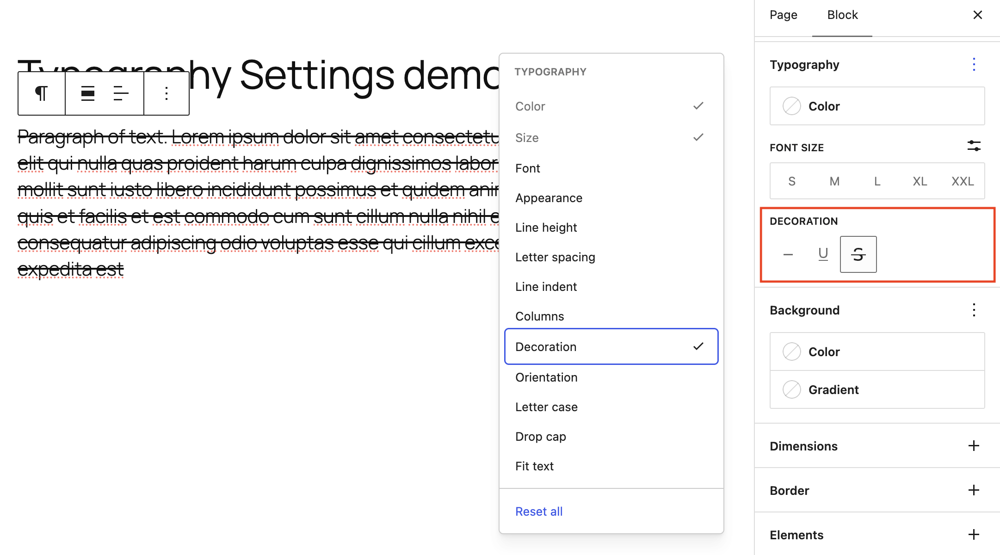

*Strikethrough text decoration*

> [!NOTE]
> It’s best to reserve underlines for links so readers know what’s clickable.

### Orientation

Some blocks such as Heading and Paragraph have an orientation option which enables the block to flow vertically or horizontally.

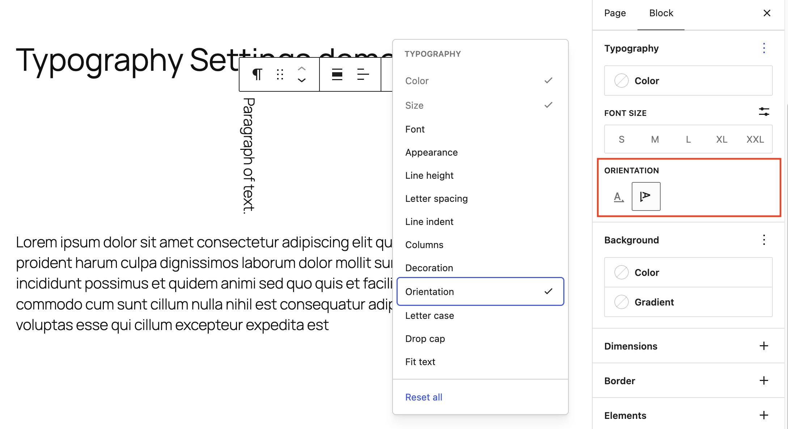

*Vertical text orientation*

### Letter case

This setting allows you to set text in a block to three casing options: all caps (**AB**), all lowercase (**ab**), or the first letter capitalized (**Ab**). Select the None option (**—**) to remove Letter case styles.

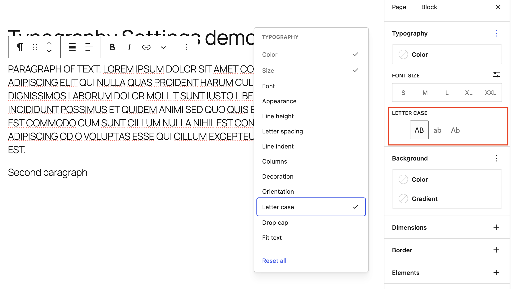

*Letter case of Upper case applied to full paragraph*

### Drop cap

The **Drop cap** feature enlarges the initial letter and aligns it to the left of the text.

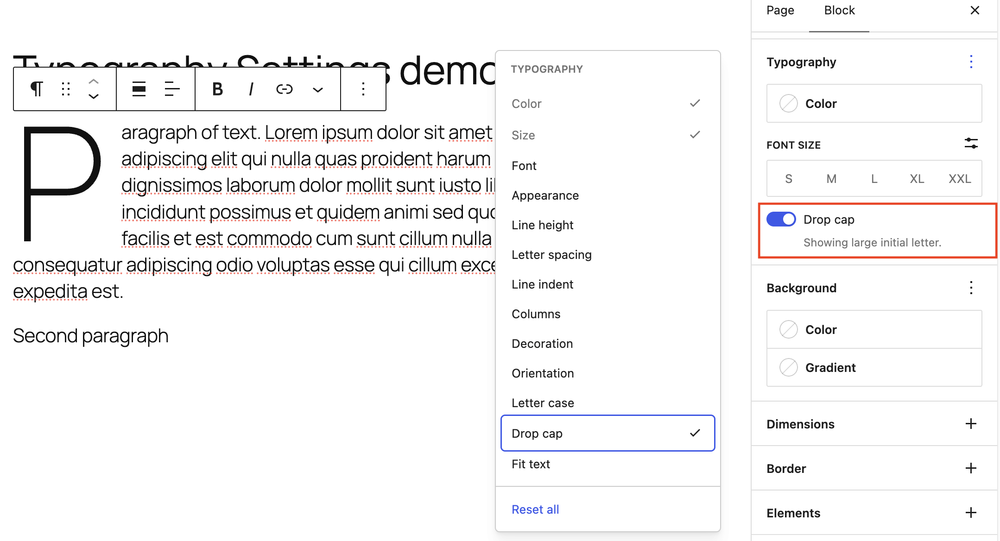

*Paragraph with drop cap active*

### Fit text

The **Fit text** toggle will allow the text to grow or shrink to the full width of the container. It can be used to have a heading that spans a full page width on mobile, tablet and desktop.

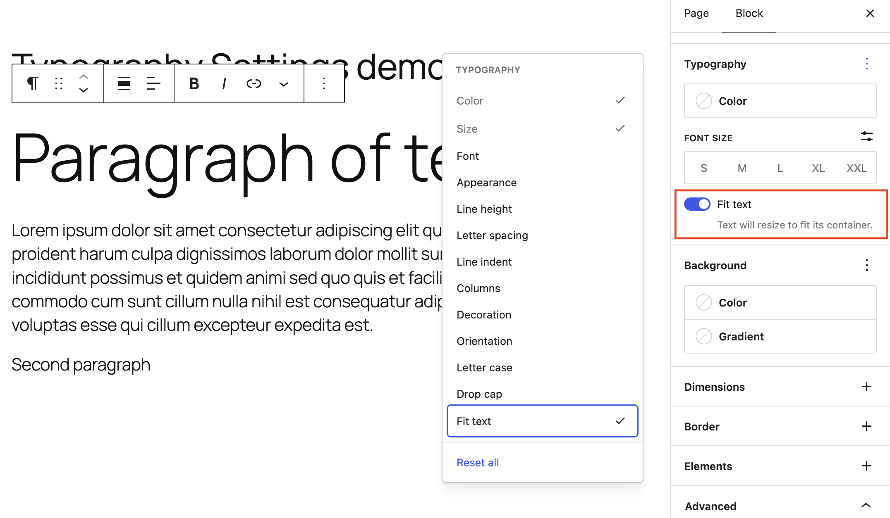

*Paragraph with Fit text enabled*

## The difference between px, em, rem, %, vw, and vh units

-   **px:** **(Pixel):** An absolute unit that stays fixed regardless of screen size or user browser settings.
-   **em**: Relative to the element’s current font size (or parent’s font size).
-   **rem**: **(Root em):** Relative to the root font size (the browser’s default text size).
-   **%:** **(Percentage):** Relative to the parent element’s value (such as a column width).
-   **vw**: **(Viewport Width):** Relative the browser window’s width.
-   **vh**: **(Viewport Height):** Relative the browser window’s height.

Pixel (`px`) is an absolute, non-scalable unit. Because pixels do not change based on other elements, they are not responsive. However, there are rare occasions where an absolute `px` value is needed to satisfy design requirements, such as thin borders, static icons, or rigid component dimensions.

Units such as `em`, `rem`, `%`, `vh`, and `vw` are relative units. They are ideally suited for responsive design because they scale up and down based on the size of other elements or screen dimensions.

> [!NOTE]
> **Accessibility Tip:** Use relative units (such as `rem` or `em`) instead of fixed pixels. This ensures your text and spacing will automatically scale if a user increases their browser’s default text size.

## Changelog

-   Updated 2026-09-06 (props @awetz583)
    -   Added text color
    -   Updated screenshots and video for 7.1
    -   Updated px, em, rem, %, vw, and vh units documentation
-   Updated 2026-06-16 (props @lanamiro1)
    -   Improved layout of font size information
-   Updated 2026-05-23
    -   Added drop cap, fit text, line indent, columns, and orientation
    -   Updated screenshots for 7.0 and added fit text video
    -   Removed out of date information and block list
-   Updated 2025-06-28
    -   Updated font-family with preview feature 
        Updated screenshot and add new showcasing the font-family preview
-   Updated 2023-04-03
    -   Updated list of blocks that support typography settings
    -   Updated screenshots
-   Created 2022-11-01
