# Work with blocks

Each content in the [WordPress Block Editor](../../support-guides/dashboard/wordpress-block-editor.md) is a block. They are the building blocks of your post or page.

The WordPress Block Editor offers an array of [blocks](blocks-list.md) that can be used to create media-rich pages and posts. You can control the layout of the blocks with ease, to build visually appealing web pages.

You can add blocks for paragraphs, images, headings, lists, videos, galleries, and more. WordPress has blocks for all common content elements, and more can be added by [WordPress plugins](https://wordpress.org/plugins/browse/blocks/).

## The anatomy of a block

Most blocks include editable content, a block toolbar, and additional settings in the sidebar. The tools you see depend on the block you select, your theme, and where the block is used.

*Anatomy of a selected Image block in the WordPress editor, showing the block toolbar, block content, and block settings sidebar.*

You can edit, customize, or move one block at a time without changing the other blocks on the post or page.

The tools in the block toolbar vary depending on the block you select.

Each block also has its own settings in the block settings sidebar. These settings give you more control over the block’s layout, appearance, and behavior.

## How to add a block

There are several ways to add blocks to a post or page. The video below shows three common methods:

1.  Using the **Block Inserter** (**+**) icon in the top toolbar.
2.  Selecting the **Add block** (**+**) icon in the content area.
3.  Typing `/` in the content area to search for a block by name.

<!-- VideoPress embed (iframe removed): https://videopress.com/embed/oNubbmNy -->

https://videopress.com/v/oNubbmNy

> [!NOTE]
> [Detailed instructions on adding blocks](adding-a-new-block.md)

## How to configure a block

Each block has its own set of tools to customize the layout and appearance of the block.

### Block toolbar

The block toolbar appears when you select a block. It includes essentials tools for editing, formatting, moving, or changing the selected block. The options you see depend on the block you select. Some blocks have many toolbar options, while others only have a few.

Many toolbar controls appear as icons. To learn what an icon does, hover over it or move keyboard focus to it to see the control label. Screen reader users can navigate through the toolbar to hear each control name.

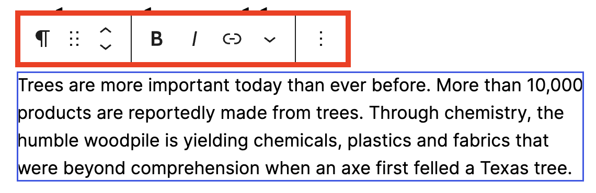

*Paragraph block toolbar*

#### Common toolbar options

Some toolbar options appear for many blocks. These are explained below:

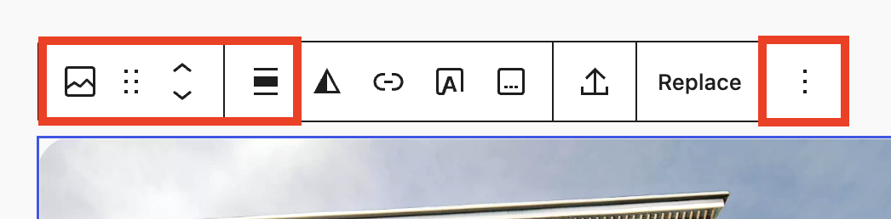

*Image block toolbar*

-   **Transform to** – Shows the type of block currently selected. Select this option to transform the block into another supported block type without losing settings or styles.
-   **Drag handle** – Move the block by dragging it to another place on the page using the six-dot icon.
-   **Move up/down** – Move the block up or down one position on the page using the up and down arrows.
-   **Align** – Change the block’s position, such as left, center, or right. Depending on the block and your theme, this menu may also include width options, such as wide width or full width.
-   **More options** – Open additional actions for the selected block, such as duplicate, lock, hide, or delete. This control appears as three vertical dots.

> [!NOTE]
> Learn more information about [Moving blocks](moving-blocks.md) and the [More options](more-options.md) menu.

#### Justification controls

Some blocks include Justification controls for arranging items inside the selected block. For example, in a Buttons block, justification can move buttons to the left, center, or right, or add space between them.

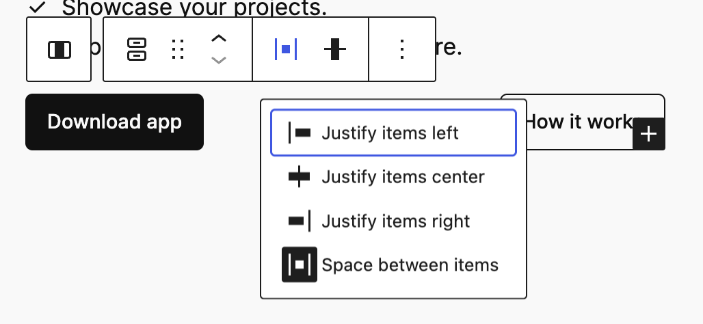

*Dropdown of justification options in the Buttons block toolbar*

Depending on the block, justification controls may appear in the block toolbar, the [block settings](#block-settings) sidebar, or both.

> [!NOTE]
> For more details about justification controls, refer to the [Layout Settings overview](../appearance/layout-settings-overview.md) guide.

#### Block-specific toolbar options

Some blocks include toolbar options that are specific to that block. For example, an Image block may include options to add a link, crop the image, replace the image, or apply a duotone filter.

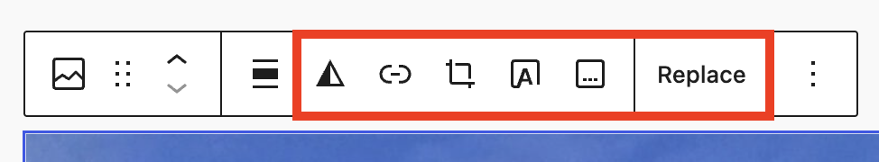

*Block-specific options for the Image block, such as Duotone, Link, Crop, and Add captions.*

The options you see depend on the block you select and your theme. To learn more about a [specific block](blocks-list.md), refer to that block’s documentation.

#### Move the toolbar

By default, the block toolbar appears near the selected block. You can also choose to display the toolbar at the top of the editor.

To turn on the top toolbar, open **Options** (three dots) in the top toolbar, then select **Top toolbar**.

When Top toolbar is turned on, the block toolbar appears at the top of the editor instead of near the selected block.

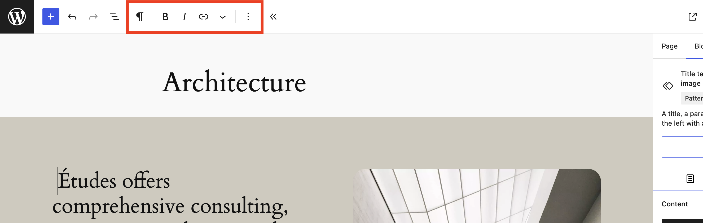

*Block toolbar pinned to the top of the editor*

### Block settings

When you select a block, additional settings may appear in the sidebar to the right of the editor. These settings apply only to the selected block.

If you do not see the sidebar, select the **Settings** icon in the top-right corner of the editor next to the Save/Publish button.

The sidebar can show two types of settings:

-   **Post/Page** –Settings for the entire post or page.
-   **Block** – Settings for the selected block.

[Post/Page Settings](page-post-settings-sidebar.md) may include options such as the featured image, categories, tags, template, permalink, or publishing details.

Select **Block** to view settings for the block you are editing.

Block settings vary by block. Some blocks show only a **Settings** tab. Other blocks include a **Styles** tab for appearance options. In this example, the Media & Text block includes **Settings** and **Styles** tabs:

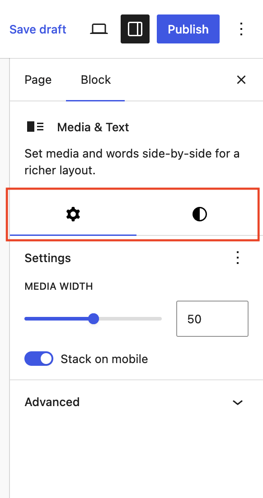

*Media & Text block contains a Settings and Styles tab.*

In this example, the Paragraph block shows only the **Settings** tab:

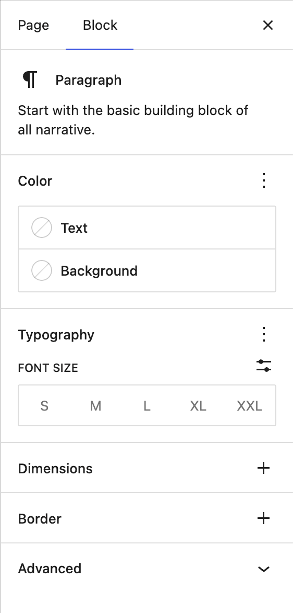

*Paragraph block settings*

Block settings may include a block description and options for color, typography, dimensions (margin, padding, block spacing), border, layout, or advanced settings. The options you see depend on the block you select and your theme.

> [!NOTE]
> For more information about these settings and how to use them, see the guides for [Color](colors-settings-overview.md), [Typography](typography-settings-overview.md), [Dimensions](dimension-controls-overview.md), [Border & Shadow](border-settings-overview.md), [Layout](../appearance/layout-settings-overview.md), and [Advanced settings](advanced-settings-overview.md).

#### Show more block settings

Some block settings panels include a three-dot options menu. Use this menu to show or hide additional settings for that panel.

For example, a panel may let you turn on extra controls or reset settings you changed. The options you see depend on the block you select and your theme.

In this Paragraph block example, the Dimensions panel menu lets you show, hide, or reset the Padding and Margin controls:

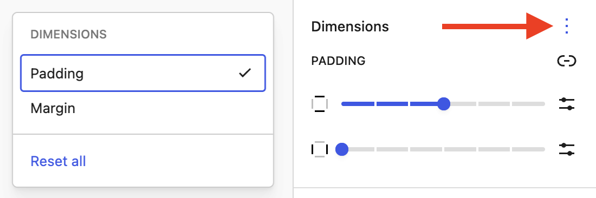

*Padding controls enabled under the “Dimensions options” menu (three dots)*

#### Style variations

Some blocks include style variations in the **Styles** tab. Style variations are preset display options for a block.

For example, blocks such as Image, Gallery, Quote, Separator, Table, and Buttons may include style variations. Available styles depend on the block and the styles enabled for your site.

To preview a style, hover over one of the style buttons. Select a style button to apply that style to the block.

<!-- VideoPress embed (iframe removed): https://videopress.com/embed/F7Yw13DP -->

https://videopress.com/v/F7Yw13DP

#### How to reset settings

If you change a setting and want to return to the default, select the three-dot menu for that settings panel. Select **Reset** to reset one setting, or **Reset all** to reset all settings in that panel.

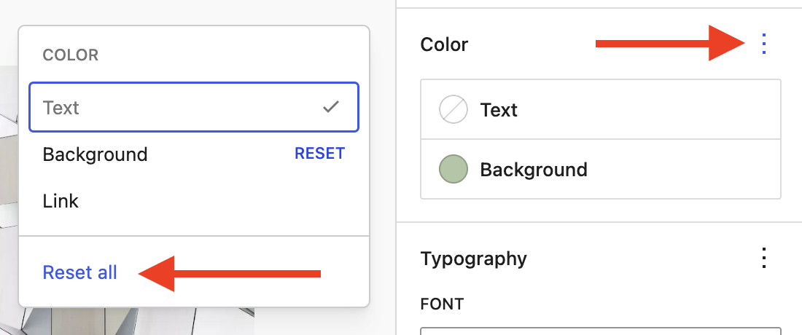

*Reset options under the Color options menu (three dots)*

#### Advanced settings

Many blocks include an Advanced section with additional options, such as including HTML anchors, CSS classes, or other block-specific settings.

> [!NOTE]
> [Learn more about advanced settings](advanced-settings-overview.md)

## How to lock and unlock a block

You can lock a block to prevent it from being moved, removed, or both.

To lock a block:

1.  Select the block.
2.  In the [block toolbar](#block-toolbar), select **More options** (three-dot icon).
3.  Select **Lock**.
4.  Choose one or both options:
    -   **Lock movement** – Stops the block from being moved.
    -   **Lock removal** – Stops the block from being deleted.
5.  Select **Apply**.

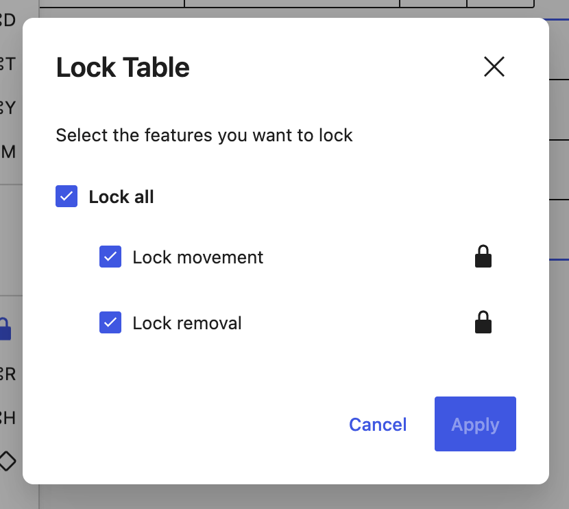

*Features locked in the Table block.*

When a block is locked, a lock icon appears in the block toolbar and in [List View](list-view.md). The lock icon remains visible as long as at least one lock option is turned on.

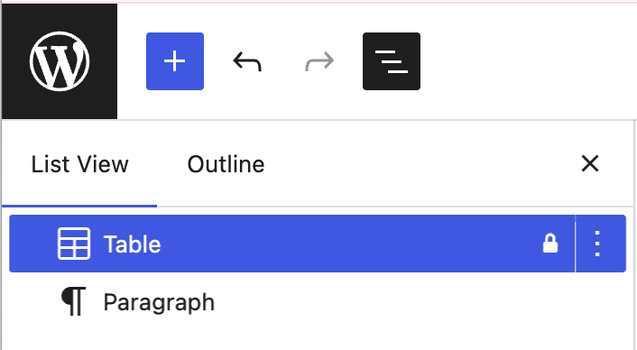

*Lock icon in List View next to the Table block*

To unlock a block:

1.  Select the locked block.
2.  In the block toolbar, select **More options** (three-dot icon).
3.  Select **Unlock**.
4.  Uncheck **Lock movement**, **Lock removal**, or both.
5.  Select **Apply**.

If you uncheck both options, the block is fully unlocked and the lock icon no longer appears.

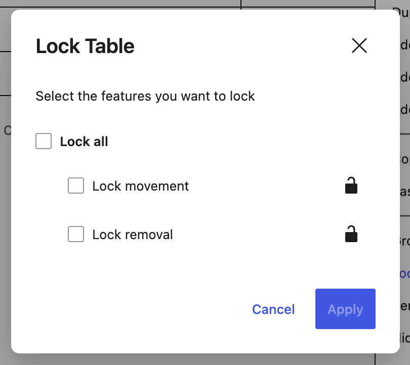

*Features unlocked in the Table block.*

## How to hide a block

You can hide a block without deleting it. You can also hide or show blocks by device type, such as desktop, tablet, or mobile.

Visibility controls are available from the [block toolbar,](#block-toolbar) the block [settings sidebar](#block-settings), and the [Command Palette](../site-editor/site-editor-command-palette.md). These controls open the block visibility options modal.

In [List View](list-view.md), blocks with visibility settings display icons to show where they are hidden.

<video controls preload="metadata" src="https://wordpress.org/documentation/files/2022/05/hide-block.mp4"></video>

### Hide a block

To hide a block:

1.  Select the block.
2.  In the block toolbar, click **Options** (three-dot icon), then select **Hide**.
3.  Alternatively, use the keyboard shortcut: `⇧⌘H` (Mac) or `Ctrl+Shift+H` (Windows).

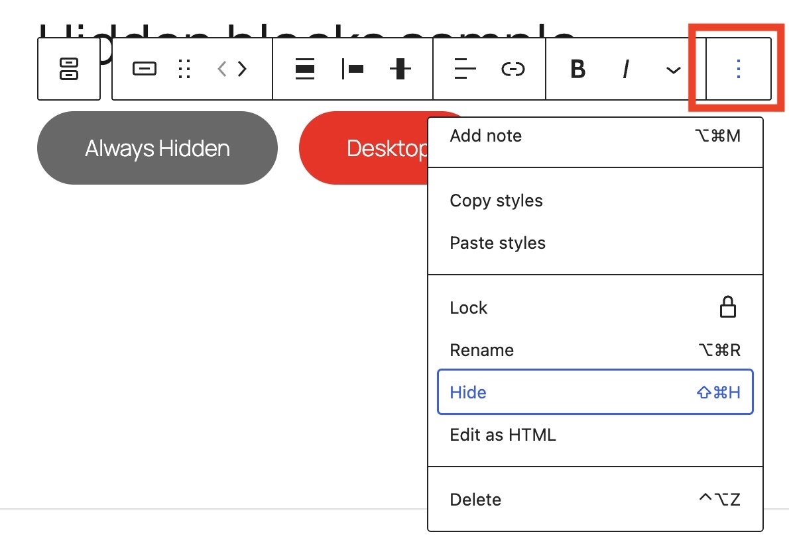

3.  In the Hide block options modal:
    -   Turn on **Omit from published content** to hide the block entirely, or
    -   Select the device types you want to hide the block on.

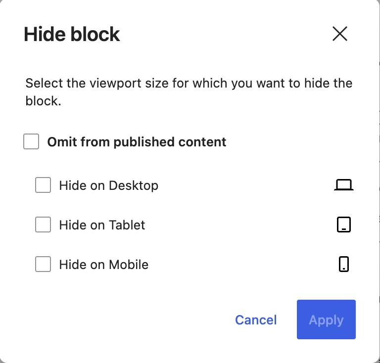

4.  Click **Apply**.

The visibility option you choose affects how the block is hidden.

**Omit from published content** removes the block from the published page. Visitors, screen readers, and search engines will not see or announce that content.

Hiding a block by device type works differently. Blocks hidden on desktop, tablet, or mobile are still part of the page code, but are visually hidden for the selected device sizes. This means the content may still be available to screen readers, search engines, or anyone viewing the page code. Do not use device-based hiding for private or sensitive content.

### Show a block’s visibility status

In List View, you can check a block’s visibility status using the icon and tooltip.

1.  Click **Document Overview** (three horizontal lines) at the top left of the editor.
2.  In the List View tab, an eye icon will display next to the block name.
3.  Hover over the icon to view the tooltip. It will display a message such as “Block is hidden”.

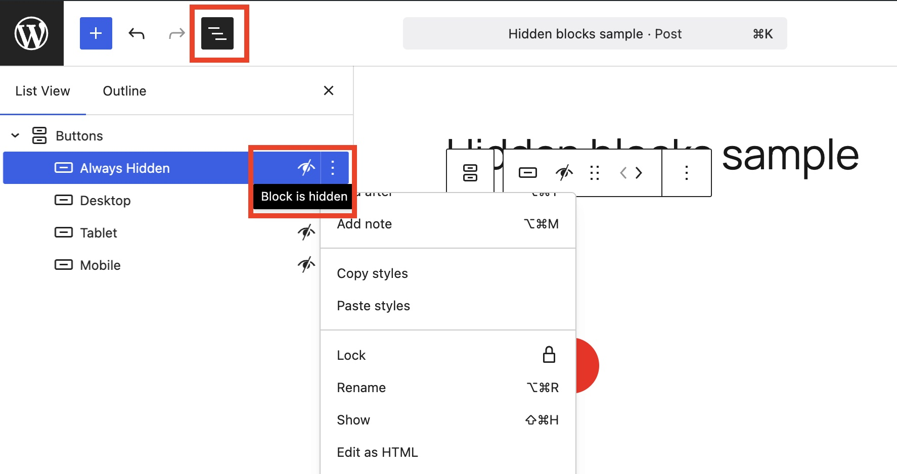

### Show a hidden block

You can show a hidden block from List View:

1.  Open **List View**.
2.  Click **Options** (three-dot icon), then select **Show**.
3.  Turn off **Omit from published content** and/or uncheck any device selections that are hiding the block.
4.  Click **Apply**.

## How to remove a block

To remove a block, select the block and click the **More options** menu (three-dot icon) in the [block toolbar](#block-toolbar) for the block for a list of additional actions. Select **Delete** at the bottom of the menu.

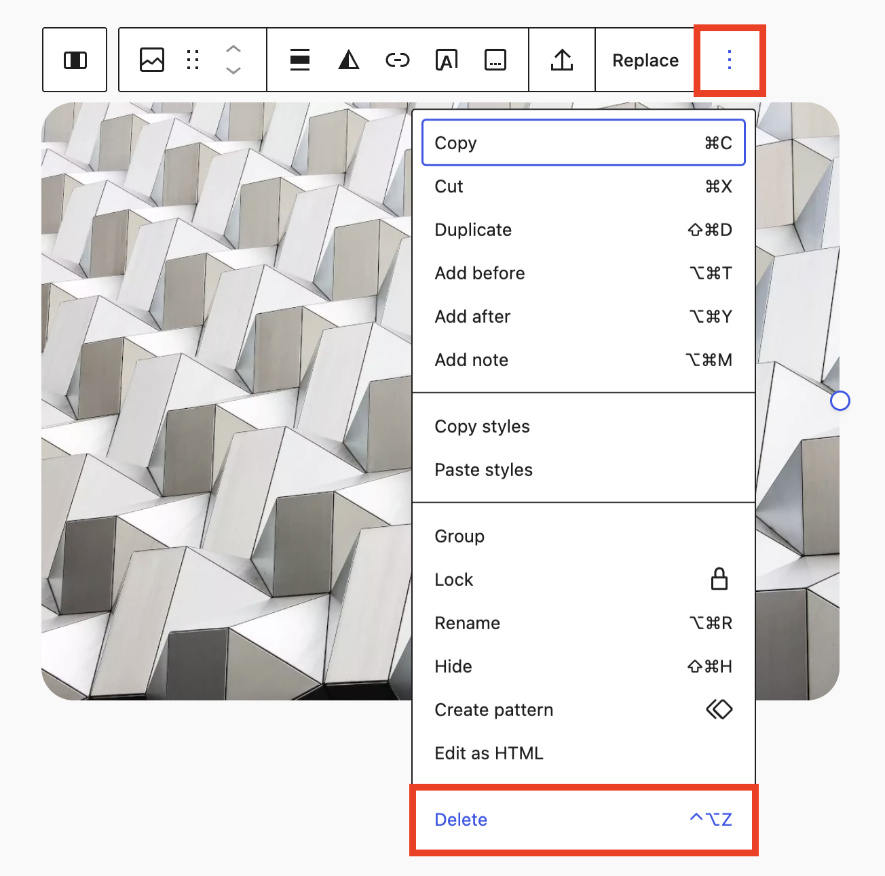

*Delete selecting in the More options menu.*

## How to find a block or pattern

To browse available blocks, select the **Block Inserter** (**+**) icon in the top-left corner of the editor.

The Block Inserter lets you browse blocks by category or search for a [block by name](blocks-list.md). Some blocks show a preview and short description when you hover over them.

Select a block to add it to your post or page.

You can also use the Block Inserter to find [patterns](block-pattern.md). Patterns are prebuilt groups of blocks that create a layout or section you can add to your page. Patterns you create can also be found in the Patterns area.

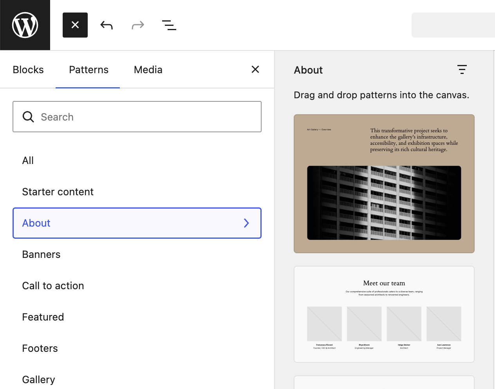

*Patterns tab selected in the Block Inserter*

## How to find the most used blocks

You can set your [preferences](preferences-overview.md) to keep the most-used blocks at the top of the list of blocks when you click on the Block Inserter. This makes it easier for you to choose from the most used blocks on your site.

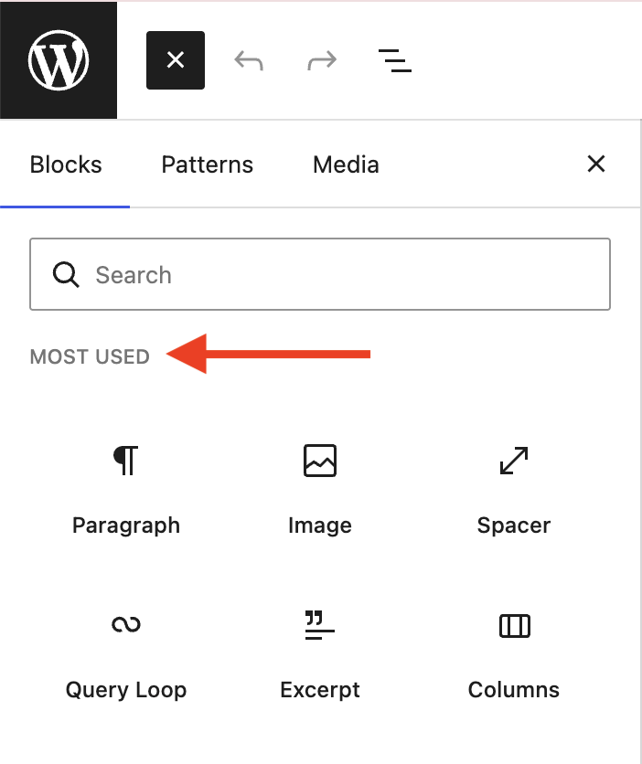

*List of most used blocks in the Block Inserter*

Here are the steps to set the preference to keep the most-used blocks at the top of the list of blocks:

1.  Click the ellipses icon (three-dot icon) in the top right corner of the editor.
2.  Choose **Preferences** > **Blocks**.
3.  Toggle on **Show most used blocks**.

> [!NOTE]
> [Learn more about options to customize your preferences](preferences-overview.md)

## Tips when working with blocks

### Selecting multiple blocks

You can select multiple blocks at once using your mouse or keyboard. Selecting multiple blocks is helpful when you want to move, transform, group, stack, or change settings for several blocks at the same time.

To select multiple blocks, you can:

-   Drag across the blocks you want to select.
-   Select one block, then hold **Shift** and click to select another block.
-   Use **Shift + arrow keys** to extend your selection.

It’s easier to select multiple blocks in List View, especially when blocks are nested or hard to select in the editor canvas.

> [!NOTE]
> For step-by-step instructions on how to select multiple blocks, refer to the [List View guide](list-view.md).

### Linking to existing post or page

You can quickly add links to existing an post or page in your content. Type two open brackets `[[` in your content to show a list of posts and pages and you can select the one to link to, from the list.

<!-- VideoPress embed (iframe removed): https://videopress.com/embed/xCyVgcmI -->

https://videopress.com/v/xCyVgcmI

### Creating patterns

You can create your own synced or unsynced patterns in WordPress.

Use a [Synced pattern](block-pattern.md) when you want to reuse the same content on more than one post or page. When you update a synced pattern, the change appears everywhere that pattern is used.

Synced patterns are helpful for content that should stay the same across your site, such as contact information, business hours, social media links, or calls to action.

Use an unsynced pattern when you want to reuse a layout or starting point, but edit each copy separately.

> [!NOTE]
> [Learn more about how to use patterns](block-pattern.md)

### Grouping blocks

You can group together multiple blocks into one group and treat them as a unit. This is helpful to edit, format (such as add a common background color, change the font color etc) or move a group of blocks. If you don’t want them to be in a group, you can Ungroup your blocks as well.

> [!NOTE]
> [Learn more about the Grouping blocks](../design-blocks/group-block.md)

Changelog:

-   Updated 2025-05-31 (props to @kjoyner @bph @karthickmurugan)
    -   Updated some screenshots to 7.0
    -   Removed outdated video
    -   Add content about justification controls
    -   Refactored block settings and block toolbar sections
    -   Plain language updates
-   Updated 2026-05-05
    -   Updated hiding option
-   Updated 2024-04-17
    -   Updated videos
-   Updated 2023-12-10
    -   Updated Screenshots
-   Updated 2023-11-11
    -   Set all headings in sentence case
-   Updated 2023-08-08
    -   Replaced “Reusable Blocks” with “Patterns”
-   Created 2022-05-15
