# Twenty Twenty-Three

[Twenty Twenty-Three](https://wordpress.org/themes/twentytwentythree/) is the new, accessibility-ready, default theme for [WordPress Version 6.1](https://wordpress.org/documentation/wordpress-version/version-6-1//).

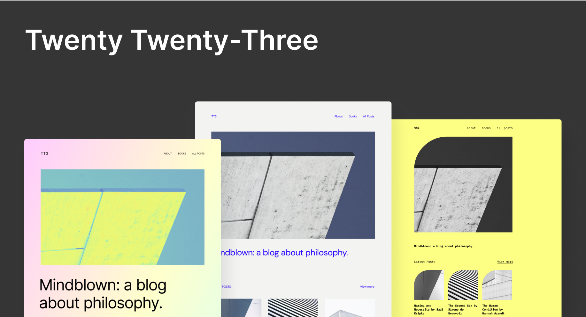

A minimalist block theme designed to take full advantage of full site editing capabilities, Twenty Twenty-Three includes a collection of [ten community-submitted style variations](https://make.wordpress.org/design/2022/09/07/tt3-default-theme-announcing-style-variation-selections/). Explore the Styles panel and change the look-and-feel of your site in an instant – bold and bright, or soft and subtle, the choice is yours.

<video controls preload="metadata" src="https://wordpress.org/news/files/2022/11/Introducing-TT3_V4_captions.mp4" poster="../../assets/images/external/wordpress.org/f070db8365-introducing_tt3_featured_image.png"></video>

## Quick specs

-   Requires at least WordPress 6.1.
-   Requires at least PHP version 5.6.

## Full site editing support

Twenty Twenty-Three is designed to support full site editing’s powerful features, including:

-   [Site Editor](../appearance/site-editor.md): an editor that allows you to edit all parts of your site, navigate between templates, and more.
-   [Styles](../appearance/styles-overview.md): a feature that allows you to customize your site, including individual blocks, as much as you’d like with different colors, typography, layouts, and more.
-   [Templates](../block-editor/template-editor.md): edit, create, and manage templates used by pages, posts, and other content.
-   [Template parts](../theme-blocks/template-part-block.md): a way to organize and display groups of blocks as part of a block template mainly for site structure, like Headers and Footers.
-   Theme blocks including the [Navigation block](../theme-blocks/navigation-block.md), [Query Loop block](../theme-blocks/query-loop-block.md), and more.

Like its predecessor Twenty Twenty-Two, this theme is designed to use WordPress site-editing features *instead of* the Customizer, which will be hidden by default. The Customizer may be automatically reactivated if you have plugins that require it.

## Templates

Twenty Twenty-Three includes several custom templates for you to use:

-   **Blank:** this displays post content without any additional blocks.
-   **Blog (Alternative):** provides a different way of displaying blog posts, in a list format with the date on the left and the post title on the right.

## Block patterns

Explore patterns to save time while crafting creative layouts. Patterns are collections of predesigned blocks whose text and media content can be quickly swapped out with your own. Whether a call-to-action, an event announcement, or a pricing table, patterns can help jump-start the creation of your page or post.

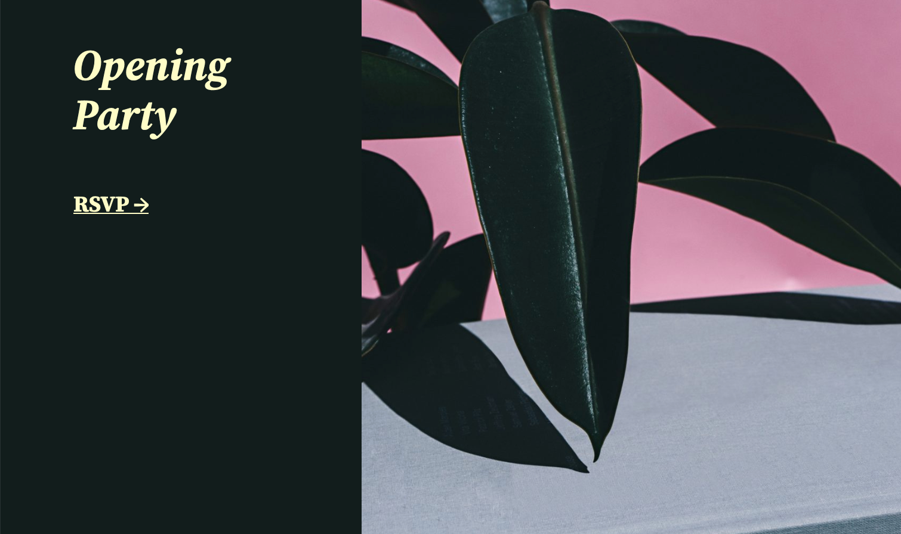

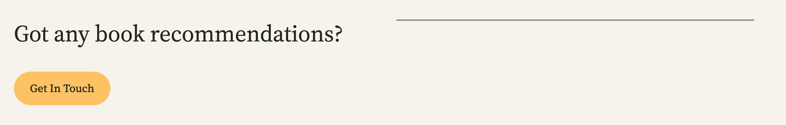

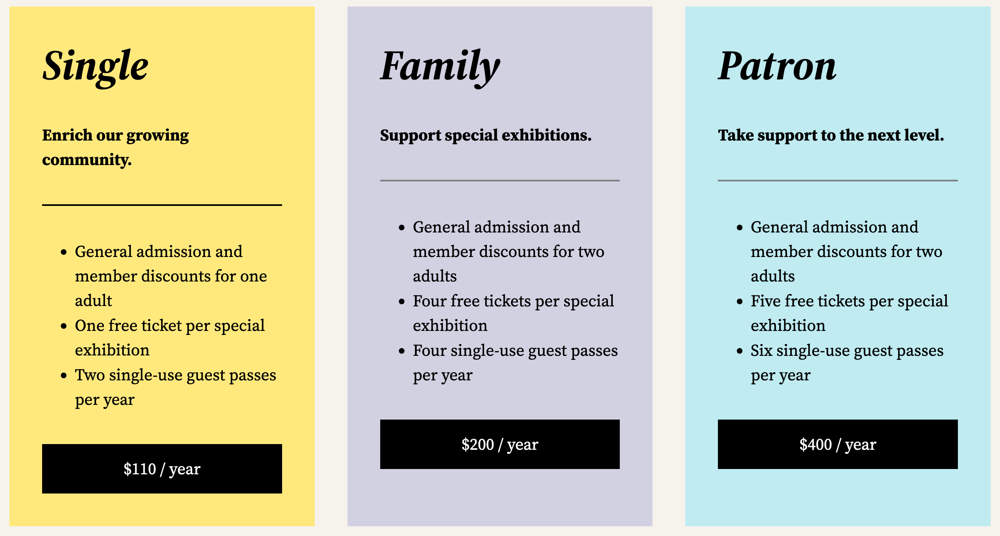

## Style variations

Twenty Twenty-Three’s default colour scheme consists of a minimalist black-and-white palette, along with green accents.

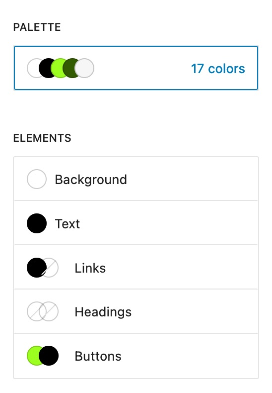

Prefer a different look? Visit the Styles area in the Editor and choose from ten additional style variations to instantly switch up the design, including colors and typography.

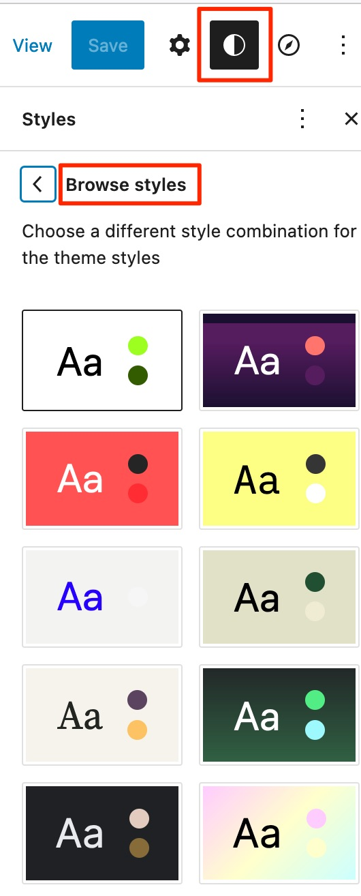

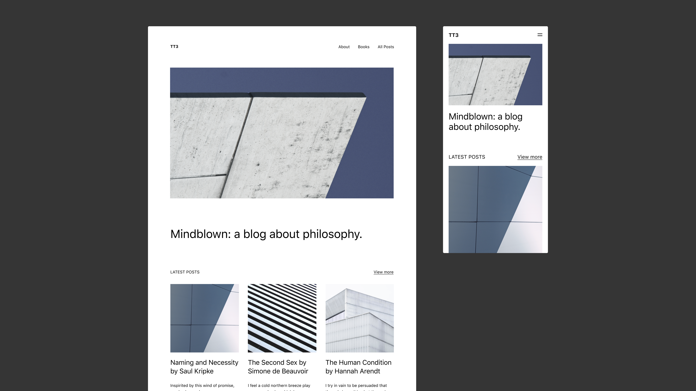

*Default*

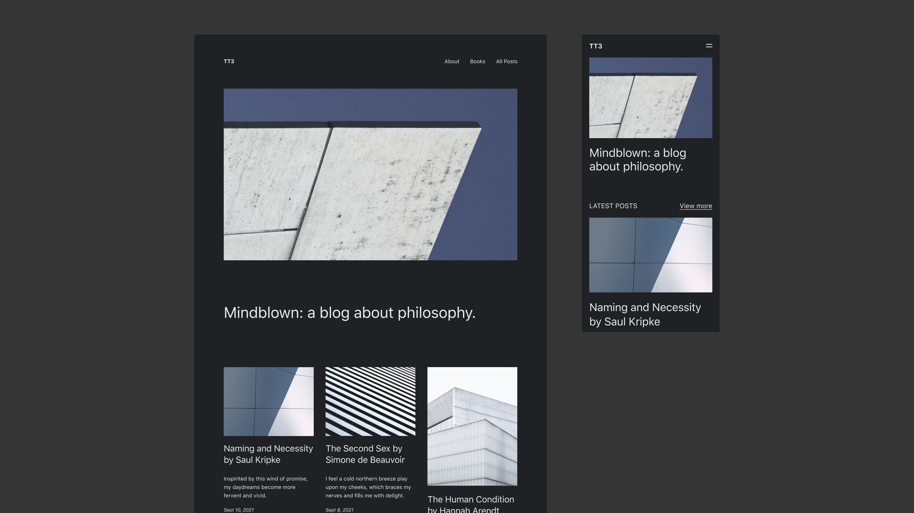

*Pitch  by [@richtabor](https://profiles.wordpress.org/richtabor/)*

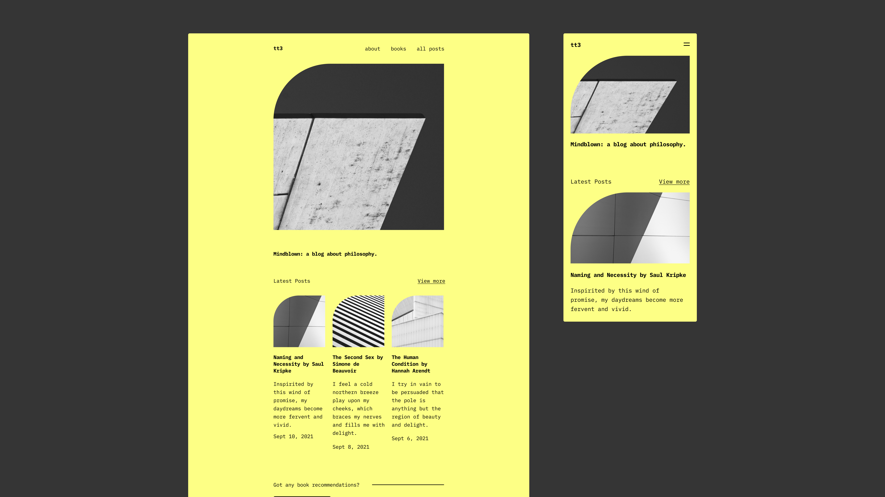

*Canary  by [@beafialho](https://profiles.wordpress.org/beafialho/)*

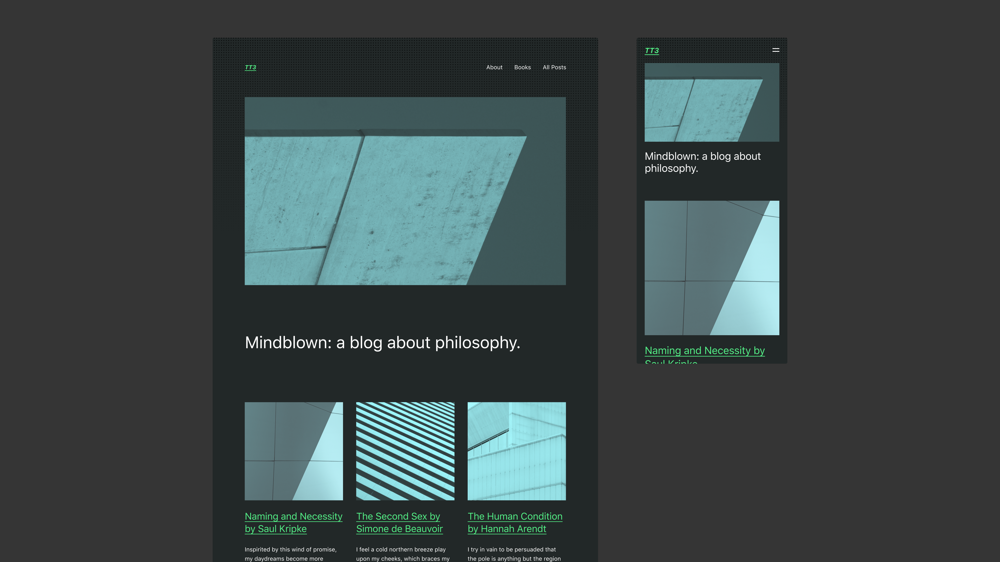

*Pilgrimage  by [@luminuu](https://profiles.wordpress.org/luminuu/)*

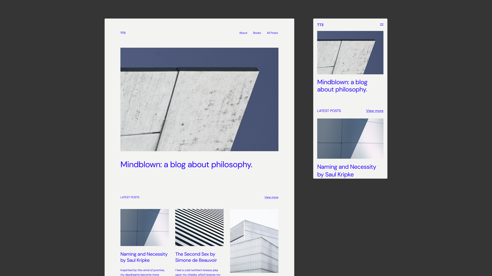

*Electric  by [@beafialho](https://profiles.wordpress.org/beafialho/)*

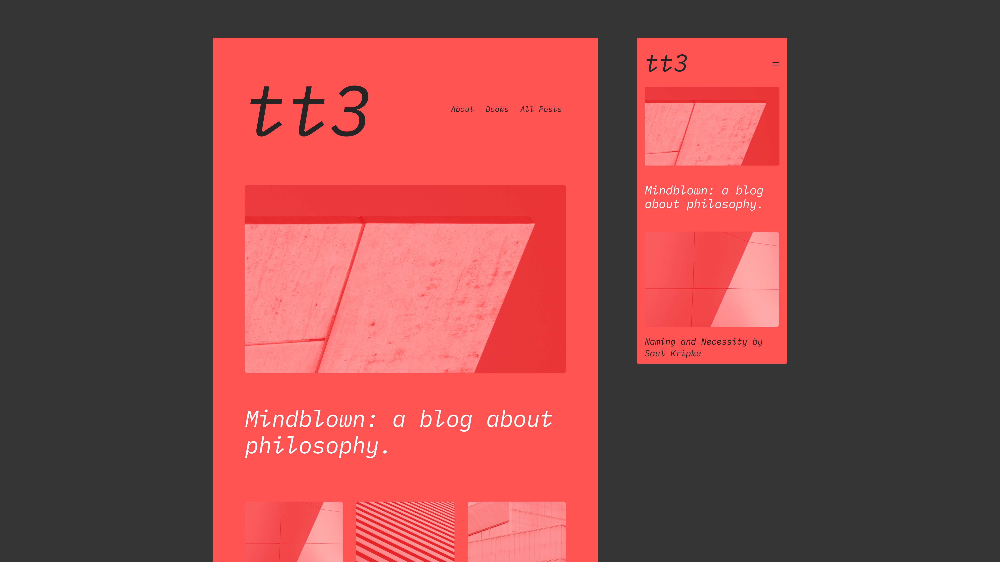

*Block out  by [@critterverse](https://profiles.wordpress.org/critterverse/)*

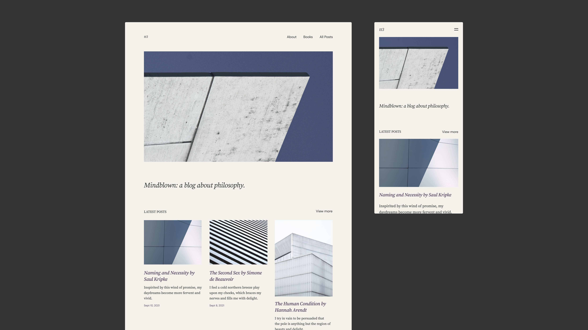

*Marigold  by [@nudge](https://profiles.wordpress.org/nudge/)*

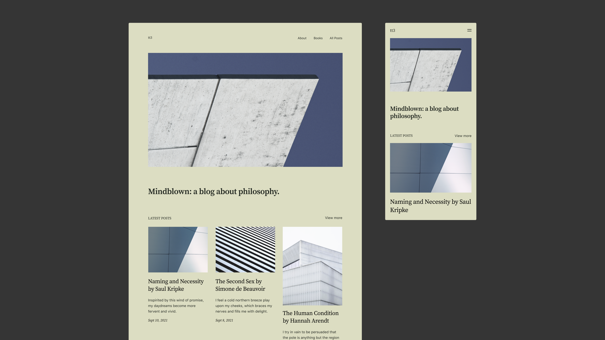

*Grapes  by [@amjadr360](https://profiles.wordpress.org/amjadr360/)*

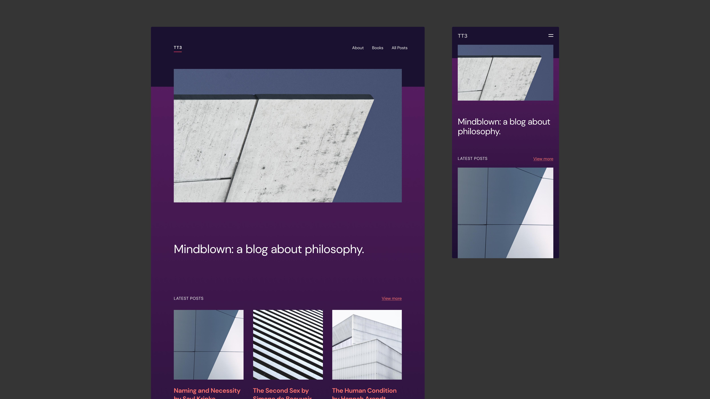

*Aubergine  by [@anariel-design](https://profiles.wordpress.org/anariel-design/)*

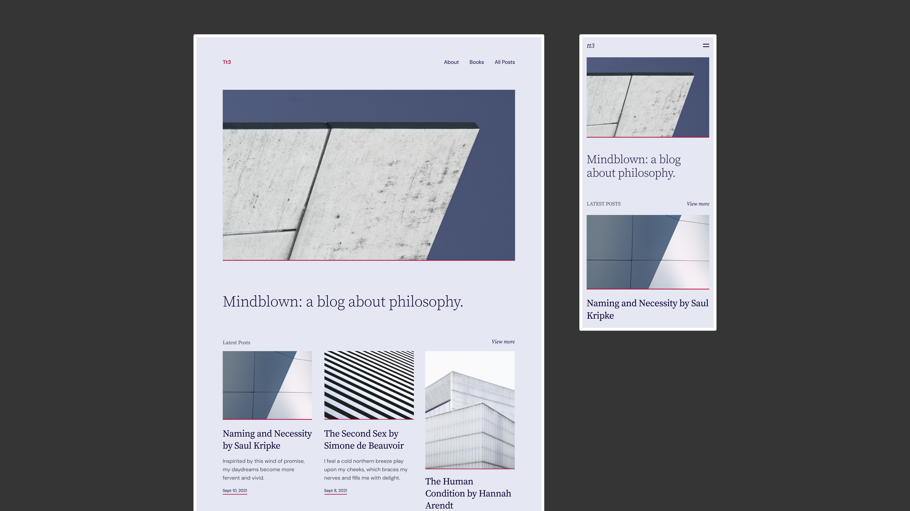

*Whisper  by [@colorful-tones](https://profiles.wordpress.org/colorful-tones/)*

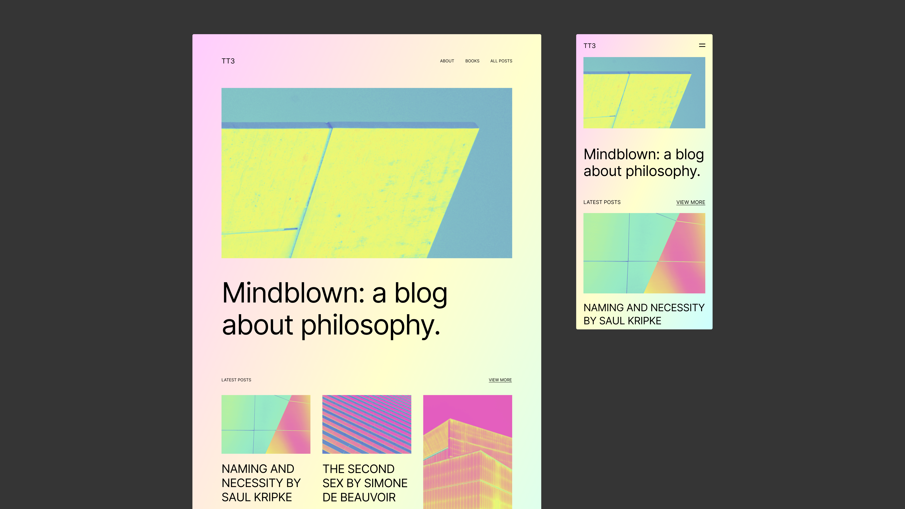

*Sherbet  by [@bgardner](https://profiles.wordpress.org/bgardner/)*

## Design specifications

Twenty Twenty-Three takes advantage of fluid typography presets, so that each piece of text can adapt to any screen size, automatically. The theme also uses fluid spacing presets, to help maintain consistency in the spacing between blocks at all screen sizes. If you’re interested in learning more about the sizes, spacing, and font families in those presets, check out Twenty Twenty-Three’s [design specification](https://github.com/WordPress/twentytwentythree/blob/trunk/DESIGN-SPEC.md).

## Support and resources

Get community help with Twenty Twenty-Three in its [support forum.](https://wordpress.org/support/theme/twentytwentythree/)

Learn how to take full advantage of full site editing with the [Simple Site Design with Full Site Editing Learn WordPress course](https://learn.wordpress.org/course/simple-site-design-with-full-site-editing/).

Read more about the Twenty Twenty-Three theme in [the introduction post](https://wordpress.org/documentation/wordpress-version/version-6-1//).

[Twenty Twenty-Three changelog.](twenty-twenty-three-changelog.md)
