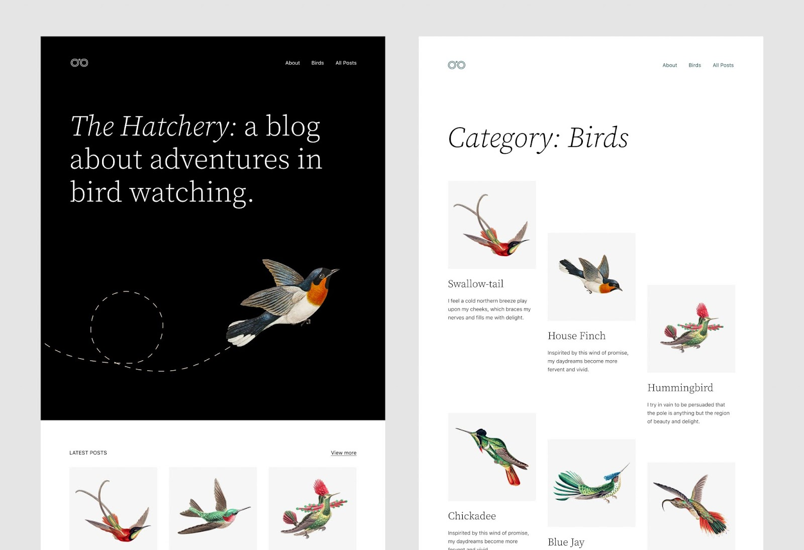
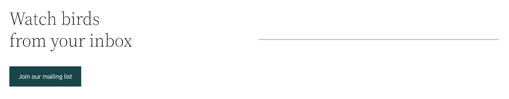
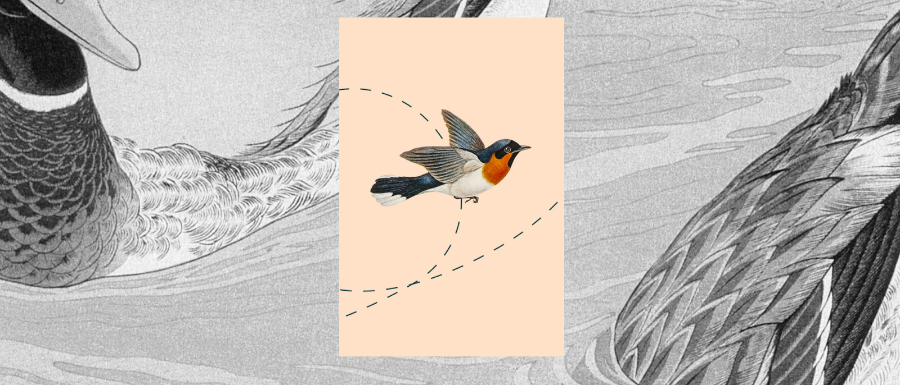
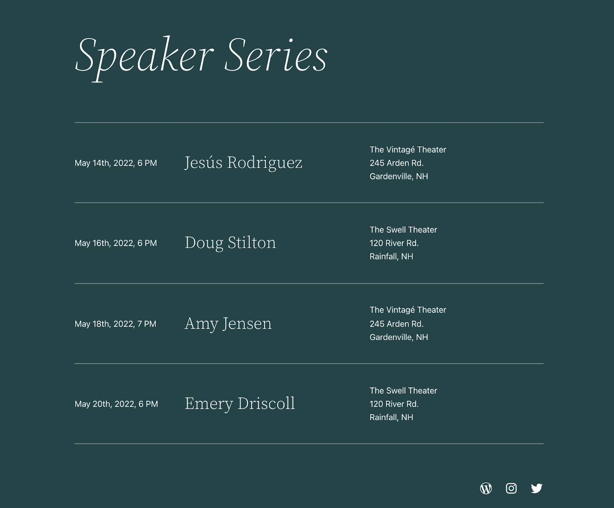
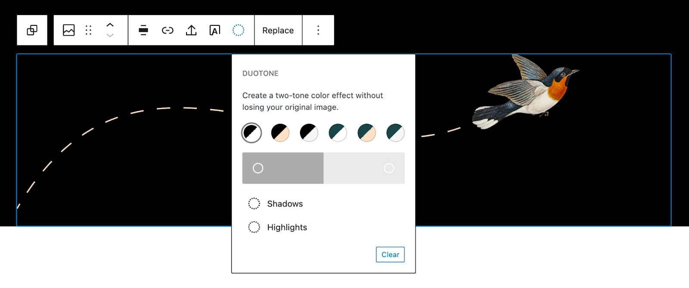

# Twenty Twenty-Two

[Twenty Twenty-Two](https://wordpress.org/themes/twentytwentytwo/) is the new default theme for [WordPress Version 5.9](https://wordpress.org/documentation/wordpress-version/version-5-9/).

Everyone deserves a truly unique website, built on a solid, well-designed foundation. Twenty Twenty-Two aims to help you achieve that by offering a wide set of patterns, templates, headers, footers, and custom color palettes. As the first-ever default [block theme](../appearance/block-themes.md), Twenty Twenty-Two invites you to explore full site editing and create a site that reflects your individual vision.

## Quick Specs

-   Requires at least WordPress 5.9.
-   Requires at least PHP version 5.6.

## Full Site Editing Support

Twenty Twenty-Two is designed to support all of the features of full site editing. This includes the following:

-   [Site Editor](../appearance/site-editor.md): an editor that allows you to edit all parts of your site, navigate between templates, and more.
-   [Styles](../appearance/styles-overview.md): a feature that allows you to customize your site, including individual blocks, as much as you’d like with different colors, typography, layouts, and more.
-   [Templates](../block-editor/template-editor.md): edit, create, and manage templates that a page or posts uses.
-   [Template parts](../theme-blocks/template-part-block.md): a way to organize and display groups of blocks as part of a block template mainly for site structure, like Headers and Footers.
-   Theme blocks including the [Navigation Block](../theme-blocks/navigation-block.md), [Query Loop block](../theme-blocks/query-loop-block.md), and more.

Thanks to these options you should find that you won’t need to switch themes as often to create the desired look and feel of your site.

Keep in mind that Twenty Twenty-Two is designed to use the above features instead of the Customizer to edit your site. The Customizer will be hidden by default, though it may be reactivated if you have plugins installed that require it.

## Templates

Twenty Twenty-Two has three custom templates for you to use with your posts and pages:

-   Blank: this includes the post content without any additional blocks.
-   Page (Large Header): this includes a big, visually interesting headline.
-   Single Post (No Separators), and Single Page (No Separators): These are the standard post/page templates, but with no horizontal separators on them.

When exploring these templates and making them your own, be sure to take advantage of the Page patterns that you can use to build your templates. To learn more about templates and how to use them on your site, please read the [Template Editor support article](../block-editor/template-editor.md).

## Block Patterns

Twenty Twenty-Two comes with 64 patterns to create beautiful content from footers, headers, pages, and more. To learn more about block patterns and how to use them on your site, please read the [Block Patterns support article](../block-editor/block-pattern.md).

Here are just a few examples to look forward to:

**Subscribe callout**

**Layered images with duotone**

**List of events**

## Color Palette

The theme provides several recommended colors that work well with the design of the theme. You can use these colors throughout your site including when customizing your site with [the Styles feature](../appearance/styles-overview.md) or when customizing individual blocks. Duotone filters are also included as part of the color palette options so you can easily have all aspects of your site embrace a shared palette:

Black

White

Dark Green

Beige

Light Grey

## Support and Resources

Get community help with Twenty Twenty-Two in its [support forum](https://wordpress.org/support/theme/twentytwentytwo/).

Learn how to take full advantage of full site editing with the [Simple Site Design with Full Site Editing Learn WordPress course](https://learn.wordpress.org/course/simple-site-design-with-full-site-editing/).

Read more about the Twenty Twenty-Two theme [in the introduction post](https://make.wordpress.org/core/2021/10/06/introducing-twenty-twenty-two/).

[Twenty Twenty-Two changelog](twenty-twenty-two-changelog.md).
