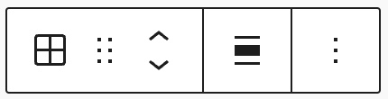
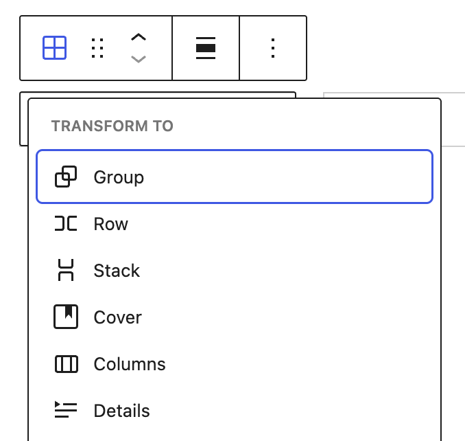
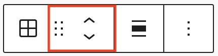
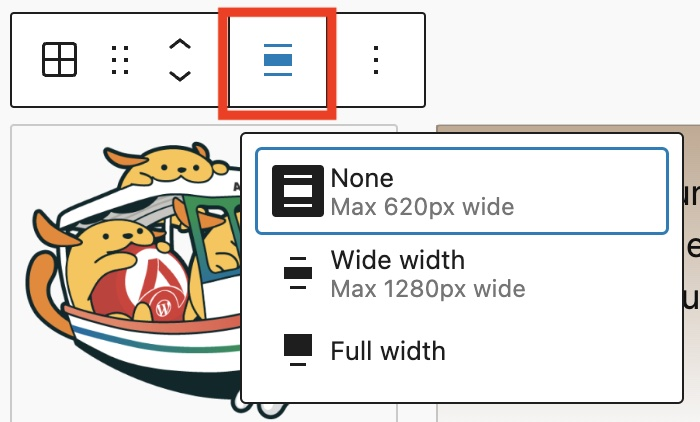
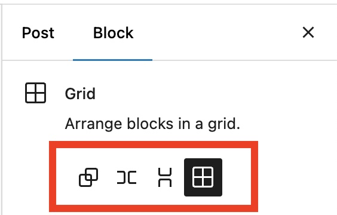
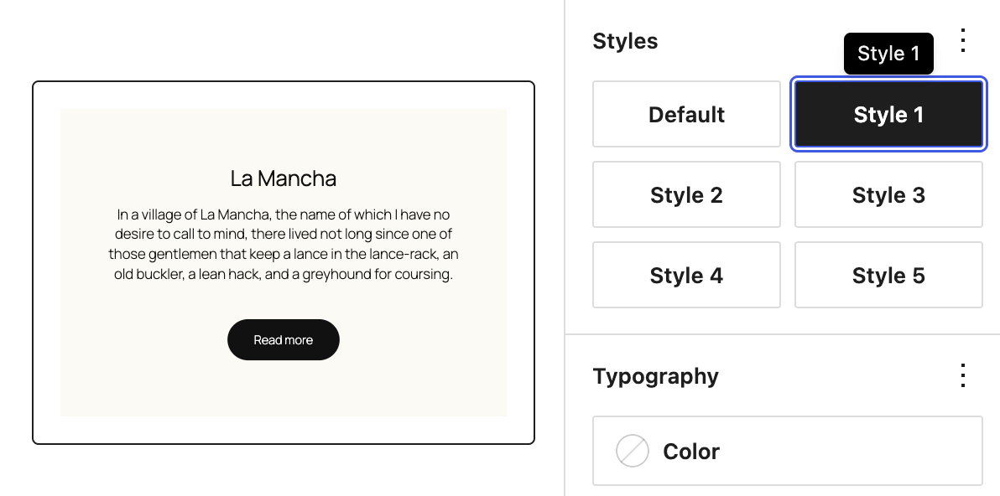
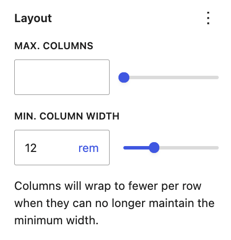
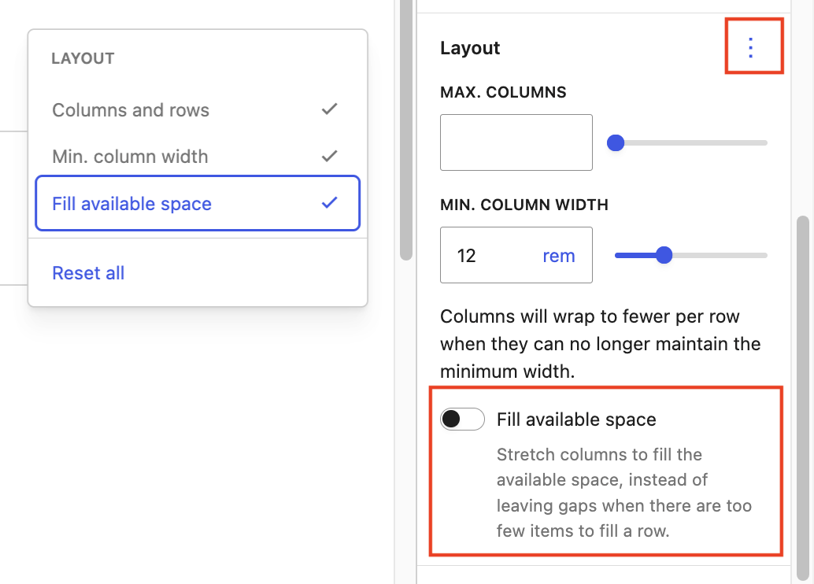
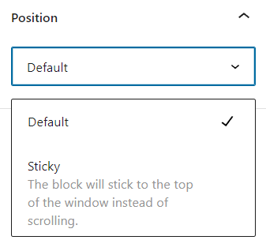

# Grid block

[Go back to the list of Blocks](../block-editor/blocks-list.md)

Grid block is one of the container blocks that can be used to organize multiple blocks and adjust the height, width, and position of all blocks inside the container. As a container block, it’s possible to transform a Grid block into a Group, Row or Stack block without changing the content of the block.

<!-- VideoPress embed (iframe removed): https://videopress.com/embed/Xqq2iyJ4 -->

https://videopress.com/v/Xqq2iyJ4

## Add a Grid block

To add a Grid block, click the **+ Block Inserter** button in the top-left corner of the editor. Search for the Grid block and click on the block to add it to the page

> [!NOTE]
> [Get detailed instructions on adding blocks](../block-editor/adding-a-new-block.md).

## Block toolbar

To view the block toolbar, click on the block, and the toolbar will be displayed.

Every block comes with unique toolbar icons. These block-specific controls allow you to manipulate the block right in the editor.

### Transform to

Click on the Transform button to convert the Grid block into Group, Row, Stack, Cover, Columns or Details blocks.

### Block-moving tools

Use the block-moving tools to move the Grid block.

The **drag** or **six dots** icon allows you to freely reposition the block anywhere within the editor by holding the icon and dragging it to the new location.

You can also use the **arrow icons** to move the block up or down within the group of nested blocks or when there are multiple blocks.

> [!NOTE]
> [Get more information about moving a block within the Editor](../block-editor/moving-blocks.md).

### Align

Use the change alignment tool to change the width of the Grid block. The following is a list of the block width options:

-   **None** – Keep width the same as the content size
-   **Wide width** – Increase the width of the block beyond the content size
-   **Full width** – Extend the block to cover the full width of the screen

**Wide width** and **Full width** alignment options are only available if they are enabled in your theme.

### Options

The Options button on a block toolbar gives you more features to customize the block.

> [!NOTE]
> [Read about these and other settings.](../block-editor/more-options.md)

## Block settings

The block settings panel contains customization options specific to the block. To open it, select the block and click the cog icon next to the Publish button.

Click Group, Row, Stack button in the Block Settings to transform the Grid block to each block.

### Styles

You can modify the Grid block styles by choosing the options under the **Styles** panel. The style options may vary based on your theme.

### Typography

The Grid block provides typography settings to change the font family, appearance, line height, letter spacing, decoration, letter case, and font size.

> [!NOTE]
> [Get more details about changing typography settings.](../block-editor/typography-settings-overview.md)

### Background

The Background settings allow you to customize the appearance of supported blocks using background images, colors, and gradients.

> [!NOTE]
> For details, refer to the [Background Settings Overview](../block-editor/background-settings-overview.md).

### Layout

In the Grid block’s **Layout** settings, you can control how many columns appear in each row.

-   **Max. columns** – Sets the maximum number of columns the grid can show in one row.
-   **Min. column width** – Sets the smallest width each column can be before the grid wraps to fewer columns per row.

Use a combination of these settings to control how the grid scales across various screen sizes.

For example, if you set **Max. columns** to `4` and **Min. column width** to `12rem`, the grid displays up to 4 columns when space permits. On narrower screens, the grid automatically wraps content into 3, 2, or 1 column to fit the screen width.

<video controls preload="metadata" src="https://wordpress.org/documentation/files/2024/09/grid-block-min-max-layout-settings.mp4"></video>

#### Fill available space

Enable the toggle to Fill available space by clicking on the three dot menu at the top right of the **Layout** settings panel. When this is selected, content inside the grid columns will automatically stretch to fill the available space, instead of leaving gaps when there are too few items to fill a row.

> [!NOTE]
> [Learn more in the Layout Settings overview.](../appearance/layout-settings-overview.md)

### Dimensions

The Grid block provides dimension settings options to add padding, margin, and block spacing.

> [!NOTE]
> For details, refer to this support article: [Dimension settings overview](../block-editor/dimension-controls-overview.md).

### Border & Shadow

The Grid block provides border settings options to add border color, width, and radius. You can also add a shadow.

> [!NOTE]
> For details refer to this support article: [Border & Shadow settings overview](../block-editor/border-settings-overview.md).

### Elements

Use the elements panel to change colors for blocks nested inside the selected block.

> [!NOTE]
> [Learn more about changing colors for nested elements.](../block-editor/colors-settings-overview.md#elements-panel-for-nested-elements)

### Position

The position setting is only available when the Grid block is located at the root-level. The drop-down menu has two options: **Default** and **Sticky**. If the Sticky option is selected, the Grid block will remain at the top of the window when you scroll down the page.

### Advanced

The Grid block provides the following Advanced settings options: HTML Anchor, Additional CSS Class(es), Additional CSS, HTML element, Styles, and Allowed blocks.

> [!NOTE]
> [Learn more about advanced settings](../block-editor/advanced-settings-overview.md)

## Changelog

-   Updated 2026-09-05 (props to @milana_cap @awetz583)
    -   Updated screenshots and video for 7.1
    -   Added Fill available space to Layout
    -   Combined Settings and Styles panels
-   Updated 2026-05-19 (props to @kjoyner @isabel_brison, @ramonopoly, @joen)
    -   Updated screenshots for WordPress 7.0 release
    -   Added video demonstrating min and max column options
    -   Removed italics
    -   Updated Advanced content section
    -   Updated headings to use sentence casing
-   Created 2024-08-24
