# Group block

[Go back to the list of **Blocks**](../block-editor/blocks-list.md)

The *Group block* allows you to group different blocks together and customize them to your liking, including setting custom background colors, spacing, and more.

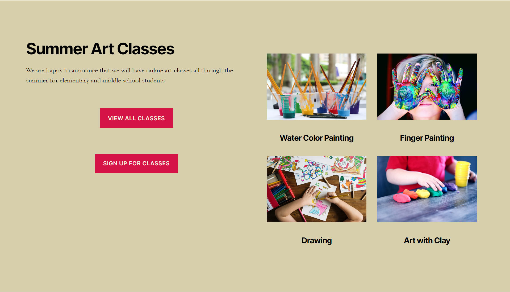

*Example of a Group block with columns, heading, paragraph, image and button blocks.*

## Adding a Group block

To add a *Group block*, click on the **Block Inserter** icon.

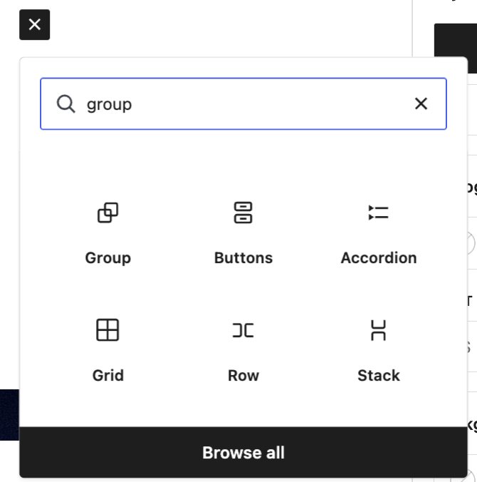

You can also type `/group` and hit enter in a new paragraph block to add one quickly. **Accordion, Buttons, Row, Stack and Grid are also types of Group blocks**, they just have a different layout style by default.

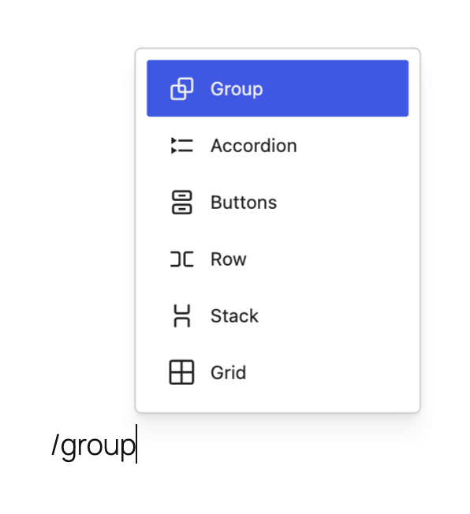

### Block variations

When the Group block is created, you will find different variations to choose from: Group, Stack, Row, and Grid.

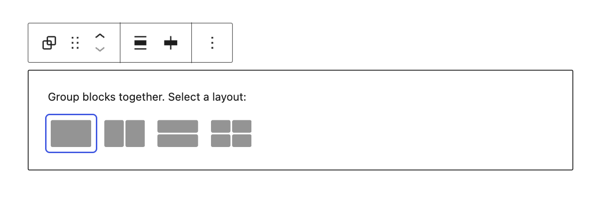

### Converting multiple blocks to a Group block

You can create a group by selecting multiple blocks in several ways. One way is to drag your mouse to highlight the blocks you want to group. Alternatively, you can hold down the “Shift” key and use the arrow keys or click on each block to select multiple blocks. Once the blocks are selected, group icons will appear. You can click on these icons or use the “More Options” button to combine the blocks into a single group. For a quicker method, use the keyboard shortcut (Ctrl + G on Windows or ⌘ Command + G on Mac) to instantly group the selected blocks. Check the video below for a demonstration.

<video controls preload="metadata" src="https://wordpress.org/documentation/files/2023/03/group-block-convert-to-group-1.mp4"></video>

> [!NOTE]
> [Detailed instructions on adding blocks](../block-editor/adding-a-new-block.md)

## Block toolbar

Most blocks have their own block-specific controls that allow you to manipulate the block right in the editor. The Group block offers standard block options as well as full-width and wide-width options, if the theme supports these alignment styles.

The Group block shows three buttons in addition to the “Group” block icon.

-   Moving handles
-   Change alignment
-   Align items justification
-   More options

### Moving handles

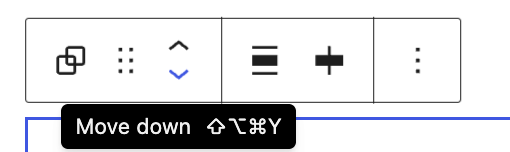

The up and down arrow icons can be used to shift a block up and down in your document.

> [!NOTE]
> Detailed instructions on moving a block within the editor can be found [here](../block-editor/moving-blocks.md).

### Change alignment

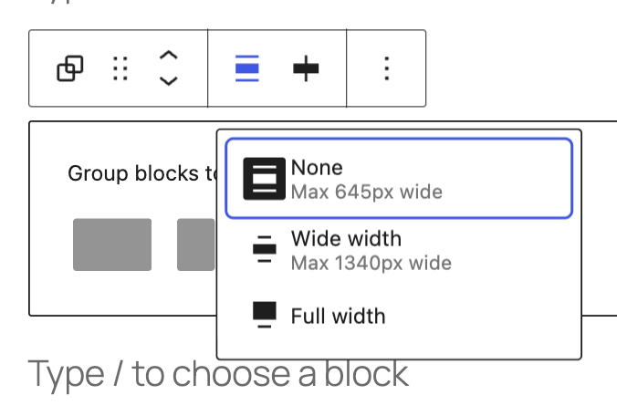

**None –** Is the default width, the same as the main content.

**Wide width** – Increase the width of the post beyond the content size.

**Full width** – Extend the block to cover the full width of the screen, if supported by your site’s theme.

### Items align justification

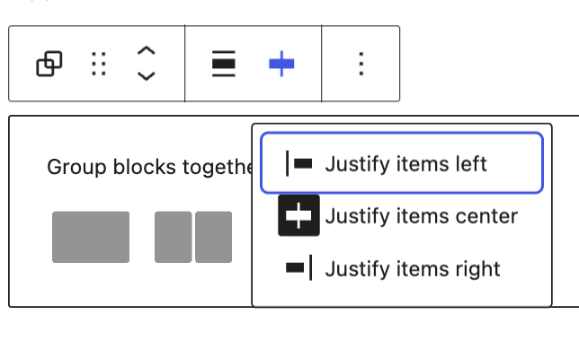

The three options to justify the items inside the Group block are **left**, **center** and **right**.

### More options

These controls give you the option to copy, duplicate, and edit your block as HTML.

> [!NOTE]
> [Read about these and other settings.](../block-editor/more-options.md)

## Editing the block

The nice thing about the Group block is that you can add any other blocks inside the group block and create a layout of your own. To add blocks to the Group block, click on the inserter icon inside the Group block.

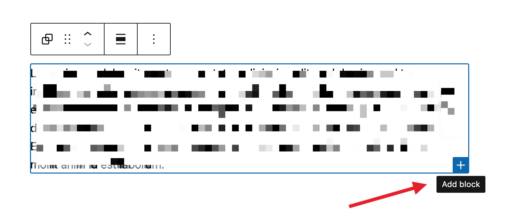

## Adding content

Inside the Group block, you can add a columns block, cover block or any other available block to create the layout of your choice.

The Group block shown here has columns, heading, paragraph, image and button blocks.

Note that since the Group block has the ability to embed other blocks, if you click specifically on one of the blocks, the settings in the sidebar will change according to the block you added to the Group block. For example, if you added an image inside the Group block, when you click on the image the sidebar will display the options from the Image block settings.

Every block has specific options in the editor sidebar in addition to the options found in the block toolbar. If you do not see the sidebar, simply click the ‘**Settings**‘ icon next to the Publish/Update button.

## Group block settings

### Alignment

There are four alignment options for the Group block:

-   Default
-   Row (Horizontal)
-   Stack (Vertical)
-   Grid

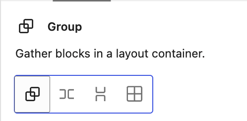

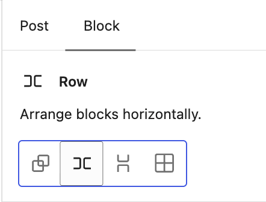

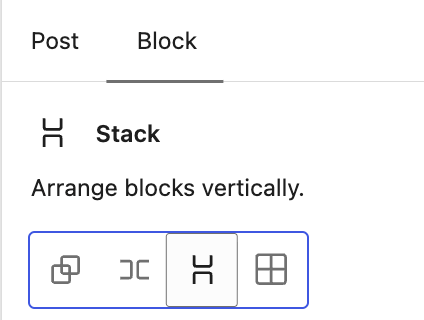

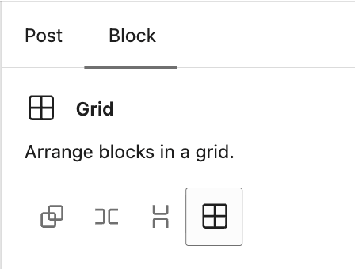

Once you choose one of the other group blocks, like Row, Stack or Grid, the settings change to those of each block.

### Styles

You can modify the block styles by choosing the **Default** or **Style 1** to **Style 5** buttons in the Styles settings panel. Hover over the **Default** or **Style** buttons to get a preview of the styles.

The style options may vary based on your theme.

### Typography

This option allows you to set the font, color, size, line height and other typography-related settings for the block.

> [!NOTE]
> [Learn more about typography settings.](../block-editor/typography-settings-overview.md)

### Background

The Background settings allow you to customize the appearance of supported blocks using background images, colors, and gradients.

> [!NOTE]
> For details, refer to the [Background Settings Overview](../block-editor/background-settings-overview.md).

### Layout

This is an advanced option that allows you to add custom content widths to the overall Group block for all blocks assigned to the center or wide columns. In many cases, you won’t need to use this option. When you toggle this option on, it allows the Group block to inherit the options set by your theme. When it’s toggled off, you can customize to your liking.

> [!NOTE]
> [This article provides details about layout settings.](../appearance/layout-settings-overview.md)

### Dimensions

The option to control block spacing and padding is enabled for the block.

> [!NOTE]
> [Learn more about dimension controls.](../block-editor/dimension-controls-overview.md)

### Border & Shadow

This option allows you to set a border around the block, including the color, the width, radius, and the style of the border.

> [!NOTE]
> [Learn more about Border & Shadow settings.](../block-editor/border-settings-overview.md)

### Elements

The Elements settings allow you to customize the appearance of links, buttons, headings, and heading levels H1 through H6.

### Position

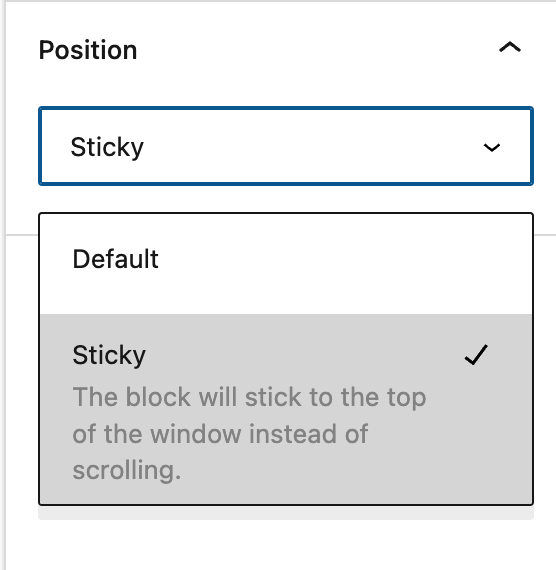

The “Position” group setting allows you make a group block stick to the top of the viewport instead of scrolling, as seen in the demo below:

<video controls preload="metadata" src="https://wordpress.org/documentation/files/2023/03/group-block-settings-sticky-demo-1.mp4"></video>

*video showing the sticky Group block*

Please note that **only “top level” Group blocks can be set as sticky**. If a Group block is embedded inside any other block, the “Position” setting will not be available in the settings.

### Advanced

The block provides the following Advanced settings options: HTML Anchor, Additional CSS Class(es), Additional CSS, HTML Element, Styles, and Allowed blocks.

> [!NOTE]
> [Learn more about advanced settings](../block-editor/advanced-settings-overview.md)

## Changelog

-   Updated 2026-09-06 (props @atachibana)
    -   Rearrange the Styles sections for WordPress 7.1 and add explanatory text.
-   Updated 2026-08-23 (props @estelaris, @jdy68)
    -   Updated images for “adding a new block”, “block variations” and “block toolbar”, added keyboard shortcuts to group blocks, typography settings sections + link
-   Updated 2026-05-25 (props @kjoyner @awetz583)
    -   Updated “Advanced” section to refer to new overview page
-   Updated 2023-11-21
    -   Capitalization of headings to sentence case
-   Updated 2023-04-04
    -   Added link to the list of blocks
-   Updated 2023-03-29
    -   Updated to reflect the 6.2 changes
-   Updated 2022-11-25
    -   Removed redundant content
    -   Added alt text to the some images
-   Updated to include Dimension controls for WP 5.9 2022-01-17
-   Updated with new images for WP 5.6 2020-11-27
-   Created 2020-09-21
