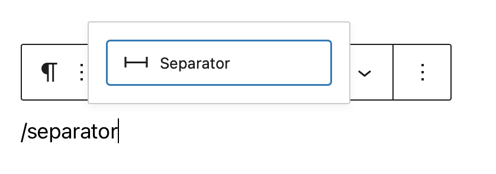
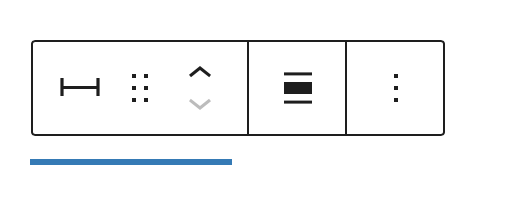
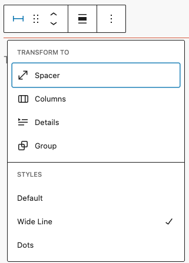
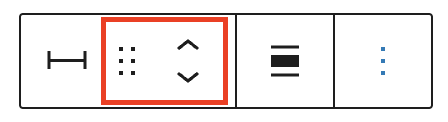
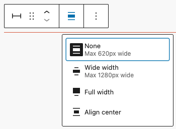
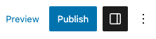
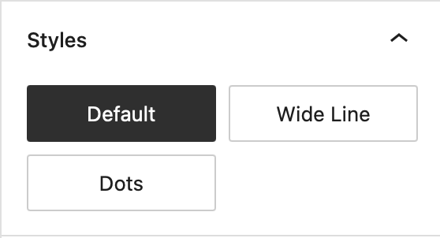
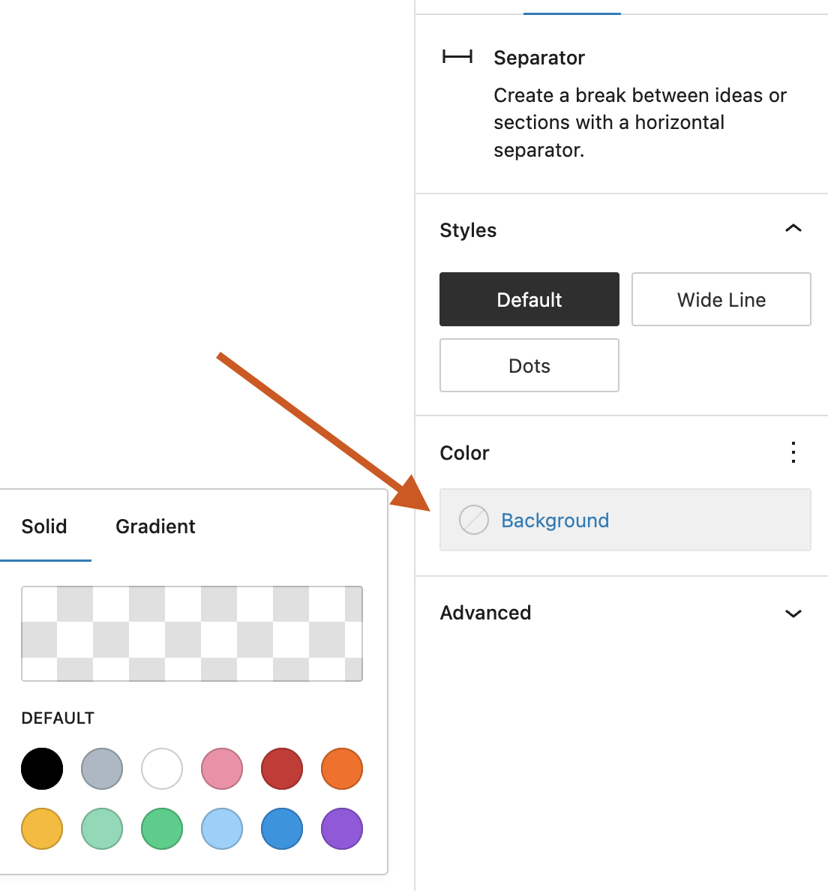
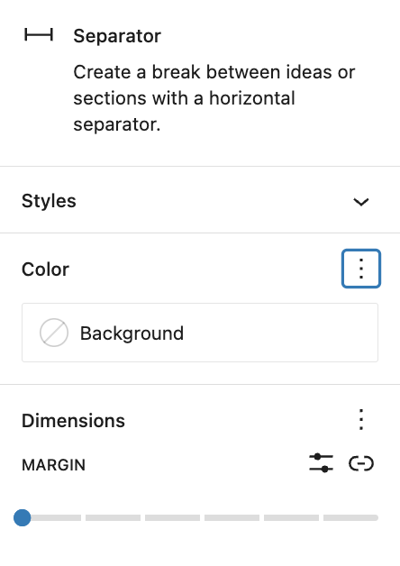

# Separator block

[Go back to the list of **Blocks**](../block-editor/blocks-list.md)

The *separator block* creates a break between two blocks of content with a horizontal line. This helps to create a separation between ideas or sections on your post or page.

In order to add a Separator block, click on the **Block Inserter** icon.

<video controls preload="metadata" src="https://wordpress.org/documentation/files/2023/06/separator-block-demo.mp4"></video>

*A video showing the process of adding a separator block using the block inserter and changing styles and settings.*

You can also type<kbd>/separator</kbd> and hit enter in a new Paragraph block to add one quickly.

> [!NOTE]
> [Detailed instructions on adding blocks](../block-editor/adding-a-new-block.md)

## Block toolbar

Each block has its own block-specific controls that allow you to manipulate the block right in the editor. The Separator block has the following options in the Block toolbar.

### Transform to

When you click on the “Transform” button, you can convert the Separator block into Spacer, Columns, Details, or Group blocks.

-   **Group**: Wraps the Separator inside a Group block, allowing background color, spacing, and border customization.
-   **Spacer**: Transforms the visual line into empty vertical space, useful for adding space between blocks without a visible divider.
-   **Columns**: Wraps the content into a multi-column layout, ideal for displaying blocks side-by-side.
-   **Details**: Converts the Separator into a collapsible block for toggling additional content, providing interactive and space-saving content organization.

### Block-moving tools

Use the block-moving tools to move the block up and down inside the editor. Use the six dots icon to drag and drop the *Separator Block* and reposition it anywhere on the editor. Alternatively, click on the up and down arrows to move the block up or down the editor.

> [!NOTE]
> [Get more information about moving a block within the editor.](../block-editor/moving-blocks.md)

### Change alignment

The change alignment tool lets you align the *Separator block* within the content. You can choose one of the following alignment options:

**None**: Leaves the block alignment as is.

**Wide width**: Increase the width of the block beyond the content size.

**Full width**: Extend the block to cover the full width of the screen (if supported by your site’s theme).

**Align center**: Align the block to the center of the content.

### More options

These controls give you the option to copy, duplicate, and edit your block as HTML.

> [!NOTE]
> [Read about these and other settings.](../block-editor/more-options.md)

## Block settings

Every block has specific options in the editor sidebar in addition to the options found in the block toolbar. *If you do not see the sidebar, simply click the ‘sidebar’ icon.*

*Use the sidebar icon to toggle the settings pane on or off.*

### Styles

You can modify the Separator block’s look by choosing one of the styles available in the block’s settings on right-hand side under **Styles**. You can either hover or focus click on each of the style buttons (e.g. ‘Default’, ‘Wide Line’ or ‘Dots’) to get a preview of the styles.

> [!NOTE]
> The style options may vary based on your theme!

### Color

*Color settings allow you to change the color of the separator*

The color settings let you customize the color for the Separator block. Pick a color from the suggestions, or add a custom color using the color picker or by adding a color code.

> [!NOTE]
> [See this guide for more information about changing colors.](../block-editor/colors-settings-overview.md)

### Dimensions

The separator block provides the ability to add margin values via the Dimensions settings option, giving you more control over content separation.

*The ‘margin’ dimension setting allows you to add space above or below your separator.*

> [!NOTE]
> [See this guide for more information about dimensions settings.](../block-editor/dimension-controls-overview.md)

### Advanced

The Separator block provides the following Advanced settings options: HTML Anchor, Additional CSS Class(es), Additional CSS, and Styles. You may see the Additional CSS Class(es) field populated with a CSS class already if the Separator block has [Styles](#styles) applied.

> [!NOTE]
> [Learn more about advanced settings](../block-editor/advanced-settings-overview.md)

## Changelog

-   Updated 2026-05-25 (props @kjoyner @awetz583)
    -   Updated “Advanced” section to refer to new overview page
-   2025-04-17 (props to [@karthickmurugan](https://profiles.wordpress.org/karthickmurugan/))
    -   Update screenshots to 6.8.
    -   Update **Transform to** section with new options.
-   Updated 2023-06-28
    -   Updated video & screenshots for 6.2
    -   Added dimensions settings section
    -   Tweaked wording for Styles section to include preview on hover/focus click
-   Updated 2022-11-22
    -   Removed redundant content
    -   Aligned images for mobile view
-   Updated 2022-08-03
    -   Screenshot, content, and video updated for 6.0
    -   Added ALT tags for the images
-   Updated 2020-08-23
    -   Updated images to WP 5.5
-   Updated 2020-08-10
    -   Added link to the list of blocks
    -   Added changlog box
-   Created 2019-03-07
