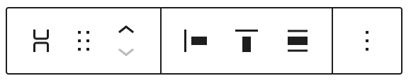
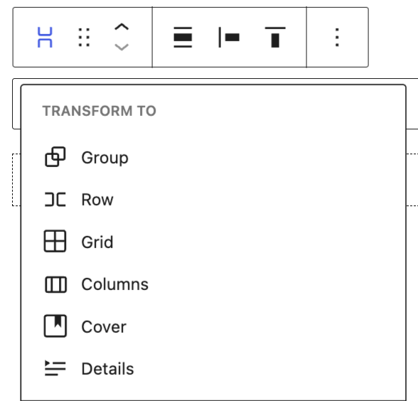
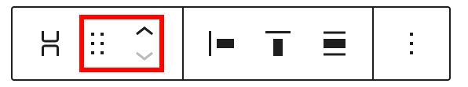
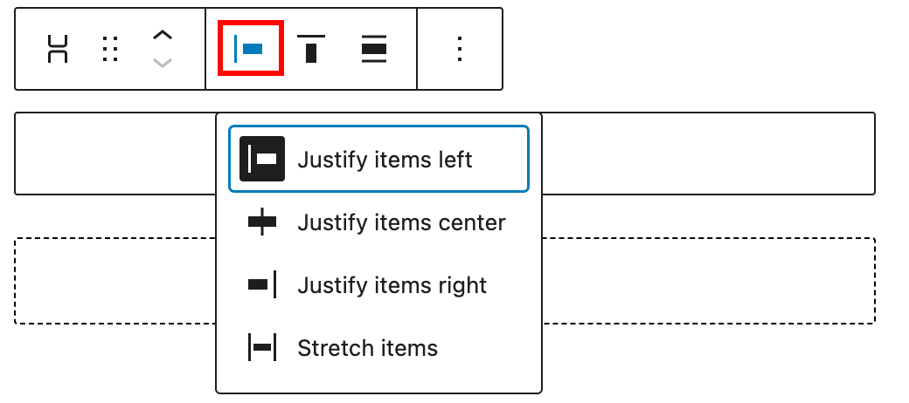
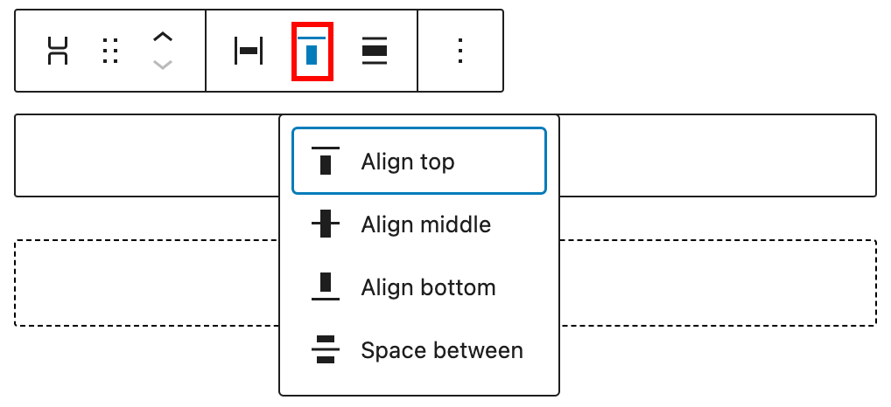
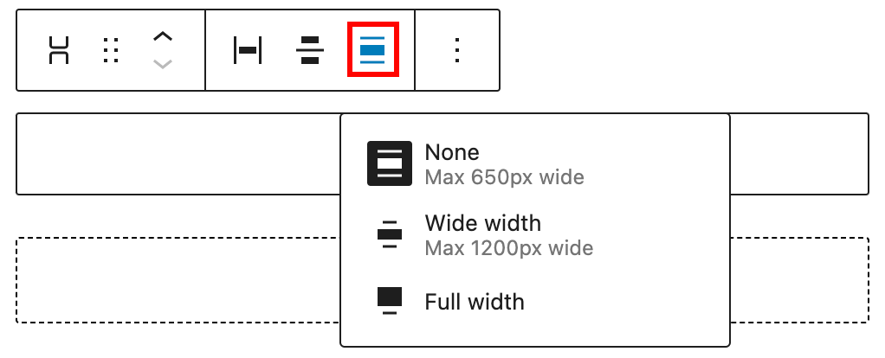
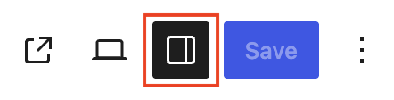
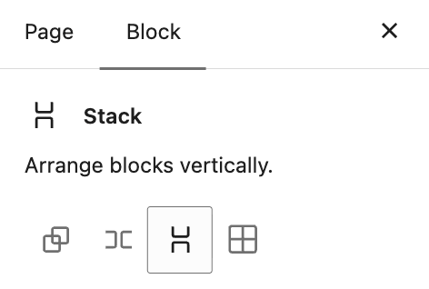

# Stack block

[Go back to the list of Blocks](../block-editor/blocks-list.md)

Stack block is one of the container blocks that can be used to nest other blocks vertically. As a container block, it’s possible to transform a Stack block into a Group or Row block without changing the content of the block.

<!-- VideoPress embed (iframe removed): https://videopress.com/embed/b5FAgM88 -->

https://videopress.com/v/b5FAgM88

## Add a Stack block

Click the block inserter **(+)** icon to open the block inserter pop-up window and search for the *Stack* block.

You can also use the keyboard shortcut <kbd>/stack-block</kbd> to quickly insert a *Stack* block.

> [!NOTE]
> Detailed instructions on adding blocks can be found [here](../block-editor/adding-a-new-block.md).

## Block Toolbar

To view the block toolbar, click on the block, and the toolbar will be displayed.

Every block comes with unique toolbar icons. These block-specific controls allow you to manipulate the block right in the editor.

### Transform to

Click on the **Transform** button to convert the Stack block into Group, Row, Grid, Columns, Cover, or Details block.

### Moving handles

The dotted icons can be used to drag and drop a block to the place of your choosing. The up and down arrow icons can be used to shift a block up and down in your document.

> [!NOTE]
> [Get more information about moving a block within the editor.](../block-editor/moving-blocks.md)

### Change items justification

Click the **Change items justification** button in the Block toolbar to display the justification drop-down. You can justify the block text to the left, make it center-justified, align it to the right, or stretch it.

### Change vertical alignment

-   **Align top –** Make the block vertically aligned top.
-   **Align middle –** Make the block vertically aligned middle.
-   **Align bottom –** Make the block vertically aligned bottom.
-   **Space between** – Leave a space between blocks. Remember that this option is only available for the parent *Stack* block.

### Align

Use the change alignment tool to change the width of the *Stack* block. The following is a list of the block width options:

-   None
-   Wide width
-   Full width

### Options

The Options button on a block toolbar gives you more features to customize the block.

> [!NOTE]
> [Read about these and other settings.](../block-editor/more-options.md)

## Block settings

Every block has specific options in the editor sidebar in addition to the options found in the block toolbar. If you don’t see the sidebar, click on the **Settings** button next to the Save/Publish button.

Click **Group**, **Row**, or **Grid** button in the Block Settings to transform the block into one of these variations.

### Styles

You can modify the Stack block styles by choosing the options under the **Styles** panel. The style options may vary based on your theme.

### Typography

The Stack block provides typography settings to change the color, font family, appearance, line height, letter spacing, decoration, letter case, and font size.

> [!NOTE]
> For details, refer to this support article: [Typography settings overview](../block-editor/typography-settings-overview.md)

### Background

The Background settings allow you to customize the appearance of supported blocks using background images, colors, and gradients.

> [!NOTE]
> For details, refer to the [Background Settings Overview](../block-editor/background-settings-overview.md).

### Layout

The Stack block provides Layout settings options to change the justification or orientation of the text and to wrap to multiple lines.

> [!NOTE]
> For details, refer to this support article: [Layout settings overview](../appearance/layout-settings-overview.md)

### Dimensions

The Stack block provides dimension settings options to add padding, margin, and block spacing.

> [!NOTE]
> For details, refer to this support article: [Dimension settings overview](../block-editor/dimension-controls-overview.md)

### Border & Shadow

The Stack block provides border settings options to add border color, width, and radius. You can also add a shadow.

> [!NOTE]
> For details refer to this support article: [Border settings overview](../block-editor/border-settings-overview.md)

### Position

The position setting is only available when the *Stack* block is located at the root-level. The drop-down menu has two options: **Default** and **Sticky**. If the Sticky option is selected, the *Stack* block will remain at the top of the window when you scroll down the page.

### Elements

Use the elements panel to change colors for blocks nested inside the selected block.

> [!NOTE]
> [Learn more about changing colors for nested elements.](../block-editor/colors-settings-overview.md#elements-panel-for-nested-elements)

### Advanced

The Stack block provides the following Advanced settings options: HTML Anchor, Additional CSS Class(es), Additional CSS, HTML Element, Styles, and Allowed blocks.

> [!NOTE]
> [Learn more about advanced settings](../block-editor/advanced-settings-overview.md)

## Changelog

-   Updated 2026-09-05 (props @awetz583 @lastsplash)
    -   Combined settings and styles tabs for 7.1
    -   Removed outdated layout screenshot
-   Updated 2026-05-25 (props @kjoyner @awetz583)
    -   Updated “Advanced” section to refer to new overview page
-   Updated 2023-05-23
    -   Updated screenshots and content for 6.2
-   Created 2022-11-28
