# Amazon Kindle Embed

[Go to the List of Blocks](../block-editor/blocks-list.md)

The **Amazon Kindle** embed block allows users to embed Amazon Kindle content.

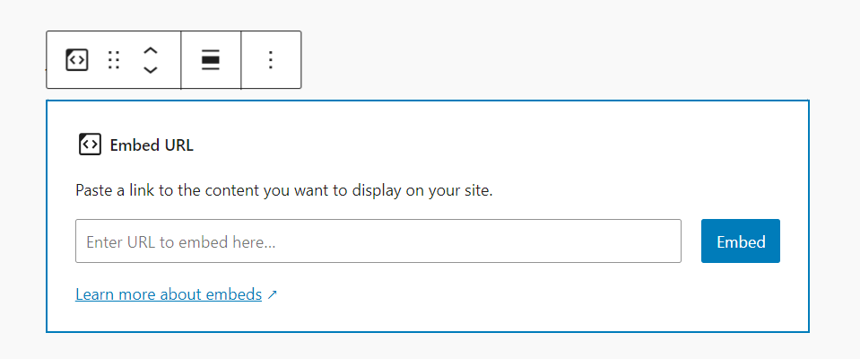

Click the **(+)** icon to open the block inserter pop-up window and search for the **Amazon Kindle** embed block.

You can also use the keyboard shortcut `/amazon-kindle` to quickly insert an **Amazon Kindle** embed block.

Keep in mind that the link needs to follow this format: <http://www.amazon.com/dp/ASIN> where you will need to paste your preferred ASIN numbers and choose the corresponding locale (amazon.co.uk, amazon.com, and so on). More information can be found here: [Linking from Your Website](https://kdp.amazon.com/en_US/help/topic/G200652190).

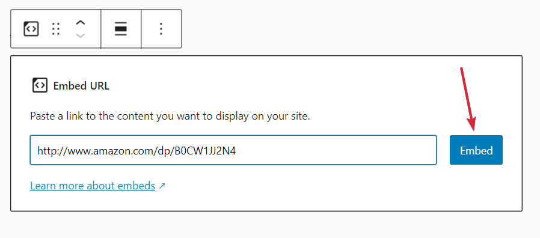

Then paste the preferred URL, click on the Embed button and the book’s details will be added:

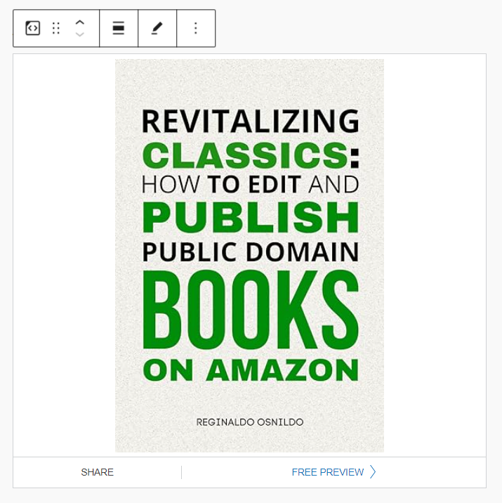

> [!NOTE]
> Detailed instructions on adding blocks can be found [here](../../support-guides/dashboard/wordpress-block-editor.md#adding-a-block).

## Block toolbar

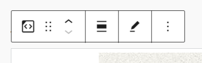

The block toolbar contains the tools to customize each block. The **Amazon Kindle** block’s toolbar consists of the following tools:

**Transform to**

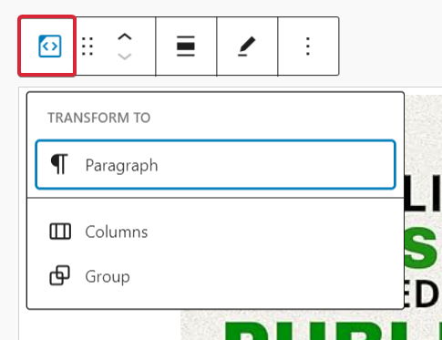

If you click the Embed icon on the toolbar, you will be able to convert the block into columns and group blocks.

**Block-moving tools**

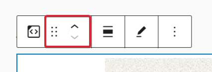

Use the block-moving tools to move the block up and down inside the editor. Use the six dots icon to drag and drop the **Amazon Kindle** block and reposition it anywhere on the editor. Alternatively, click on the up and down arrows to move the block up or down the editor.

**Change alignment**

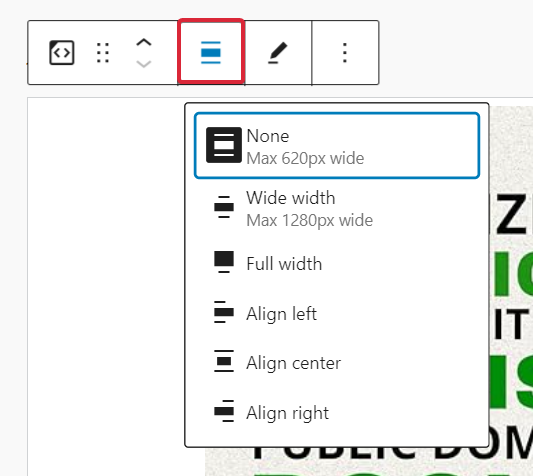

The change alignment tool is used for the **Amazon Kindle** block’s position and width:

-   **None** – Uses the default alignment options.
-   **Wide width** – Increase the width of the post beyond the content size.
-   **Full width** – Extend the book embed to cover the full width of the screen.
-   **Align left** – Make the book embedded, left aligned.
-   **Align center** – Make the book embedded, center aligned.
-   **Align right** – Make the book embedded, right aligned.

**Edit URL**

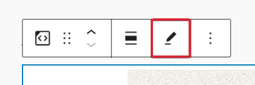

The edit URL button is used to modify the **Amazon Kindle** block embed link.

**More options**

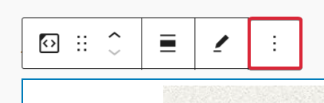

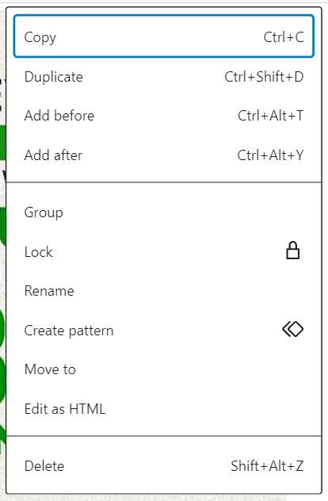

Click on the three dots icon to show more block options. A drop-down menu with these actions will appear:

-   **Copy** adds the Amazon Kindle block into the clipboard. Then, you can paste it anywhere you want in the block editor.
-   **Duplicate** creates a copy of the selected block that appears after the current block.
-   **Add Before** inserts a new block before the selected block(s).
-   **Add After** inserts a new block after the selected block(s).
-   **Group** allows you to create a group of blocks and treat them as a unit. You can, for instance, add a common background color or other blocks to the group.
-   **Lock** lets you prevent users from moving or deleting the selected block. A pop-up window will appear to set the block locking attribute to the selected block. You can opt to disable movement, prevent removal, or both for the selected block.
-   **Rename** let’s you create a custom name for the block.
-   **Create patterns** lets you add the selected block to a list of Synced patterns, so you can use them on other posts or pages as well.
-   **Move to** lets you use a blue line on the editor to indicate the new position for the selected block. Use your keyboard’s up and down arrows to move the blue line. When the line is in the desired position, press Enter to move the selected block to that position.
-   **Edit as HTML** allows you to modify the HTML code of the embed block.
-   **Delete** deletes the selected block from the content.

## Block settings

The block settings panel contains customization options specific to the block. To open it, select the block and click the cog icon next to the Publish button.

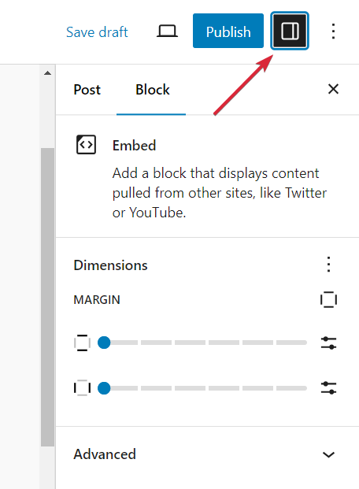

Here are the options for the **Amazon Kindle block**:

**Advanced**

The following Advanced settings options are available: HTML Anchor, Additional CSS Class(es), Additional CSS, and Styles.

> [!NOTE]
> [Learn more about advanced settings.](../block-editor/advanced-settings-overview.md)

## Changelog

-   Updated 2026-06-29
    -   Linked to advanced settings
-   Updated 2024-09-16
    -   Updated broken and missing images.
    -   Replaced old images with current ones.
    -   Edited some texts to ensure they correlate with the images.
-   Created 2022-11-11
