# Cloudup Embed

With the [Cloudup](https://cloudup.com/) Embed block, you can embed contents from Cloudup into your posts and pages. You need a Cloudup account to be able to embed contents from Cloudup into your posts or pages.

**Embedded Cloudup content:**

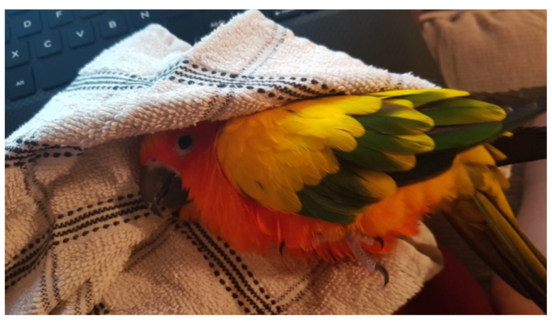

*Embedded Cloudup content*

**Steps to embed Cloudup content:**

1.  **Go to Cloudup.com and request an account to start using the service.** You need an account to use the service.

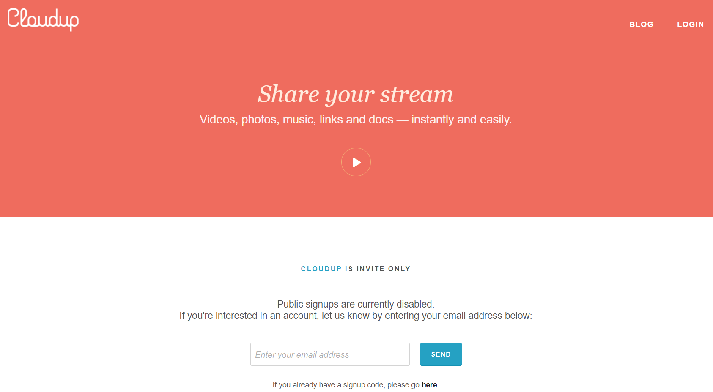

2.  **When/If you have a Cloudup account.**  
    You can copy the custom links of the contents you want to embed on your page/post

3.  **Add a Cloudup Embed Block to your post/page**

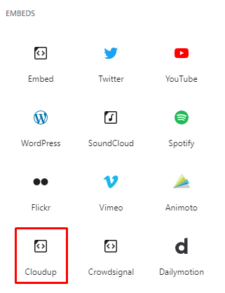

> [!NOTE]
> [Detailed instructions on adding blocks](../block-editor/adding-a-new-block.md)

4.  **Paste the Cloudup link**

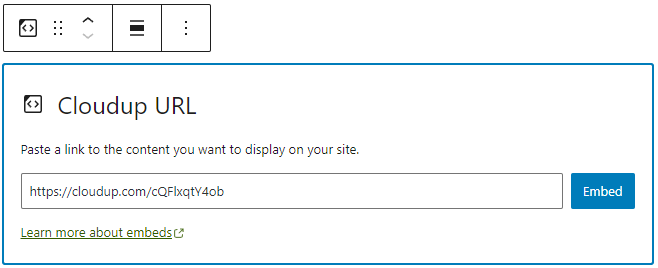

5.  **Click the “Embed” button**

If it’s a link that can be successfully embedded you will see a preview in your editor.

If you use a URL that can’t be embedded, the block shows the message *“Sorry, this content could not be embedded.”* You will have two choices: Try again with a different URL or convert to link.

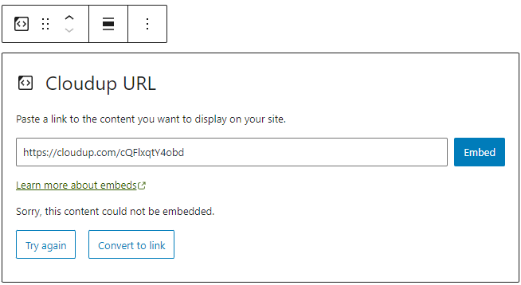

## Block toolbar

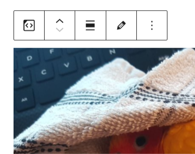

Besides the Mover and Drag & Drop Handle, the Block Toolbar for the Cloudup embed shows four buttons:

-   Transform to
-   Change alignment
-   Edit URL, and
-   More Options.

**Transform to**

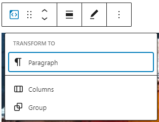

You can transform a Cloudup embed to a Group. This would give you the ability to change the background and text color around the Cloudup embed.

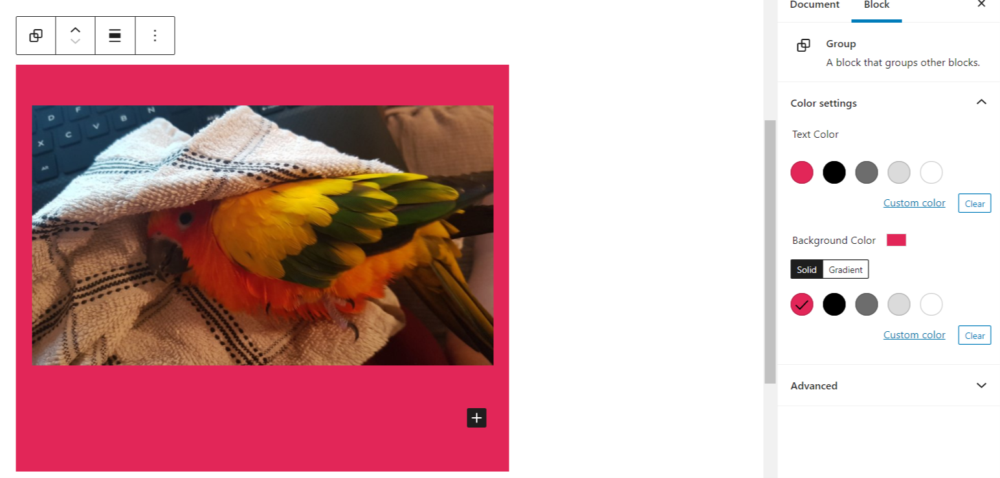

*Editor view of a Cloudup Embed as a group with Color Settings controls*

*Cloudup Embed with a red background.*

**Change alignment**

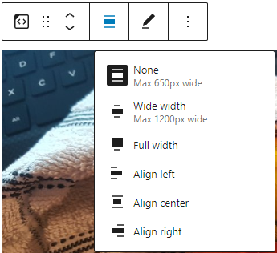

-   **Align left** – Make the Cloudup embed post-left-aligned.
-   **Align center** – Make the Cloudup embed post alignment centered.
-   **Align right** – Make the Cloudup embed post-align-right.
-   **Wide width** – Increase the width of the Cloudup embed post beyond the content size.
-   **Full width** – extend the Cloudup embed post to cover the full width of the screen.

“Wide width” and “Full width” alignment need to be enabled by the Theme of your site.

**Edit URL**

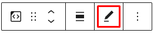

Via the edit URL icon, you can change the Cloudup embed URL in the embed block. To overwrite the existing URL and click on the “Embed” button.

**More options**

These controls give you the option to copy, duplicate, and edit your block as HTML.

> [!NOTE]
> [Read about these and other settings.](../block-editor/more-options.md)

## Block settings

**Media settings**

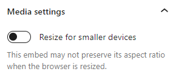

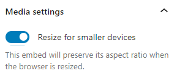

Via the Media Settings, you can control the behavior of your post embed when viewed from a smaller device, like on a phone screen.

The Toggle switch turns on or off the resize functionality for smaller devices. The default setting is “on” or blue.

“Off:” This embed may not preserve its aspect ratio when the browser is resized. In the off position, the toggle switch is gray.

“On:” This embed will preserve its aspect ratio when the browser is resized. The toggle switch turns blue in the “On” position.

**Advanced**

The following Advanced settings options are available: HTML Anchor, Additional CSS Class(es), Additional CSS, and Styles.

> [!NOTE]
> [Learn more about advanced settings.](../block-editor/advanced-settings-overview.md)

## Changelog

-   Updated 2026-06-29
    -   Linked to advanced settings
-   Updated 2023-02-07
    -   Updated images
    -   Fixed headings capitalization
    -   Added alt text to images
-   Updated 2022-11-26
    -   Removed redundant content
    -   Aligned images for mobile view
    -   Added alt text to images
-   Created 2020-08-24
