# Crowdsignal embed

[Go back to the list of **Blocks**](../block-editor/blocks-list.md)

With the *Crowdsignal Embed* block, you can embed Crowdsignal polls (or surveys or votes) into your posts and pages. You need a Crowdsignal account to be able to create polls (or surveys or votes) before you can embed them into your posts or pages.

Since WordPress 4.2, it has supported surveys created with the block editor powered survey/project editor, which are published on `*.crowdsignal.net`.

<video controls preload="metadata" src="https://wordpress.org/documentation/files/2022/08/CrowdSignal-HelpHub-Walkthrough-1.mp4"></video>

**Example of an Embedded Crowsignal Poll**:

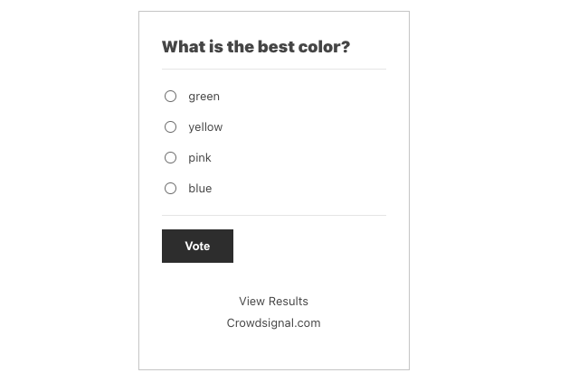

## Steps to embed Crowdsignal polls (or surveys or votes):

1.  **Go to crowdsignal.com and signup for a free account.**  
    On your Crowdsignal Dashboard, create a new survey, poll, quiz, or rating, or select one you’ve already created.

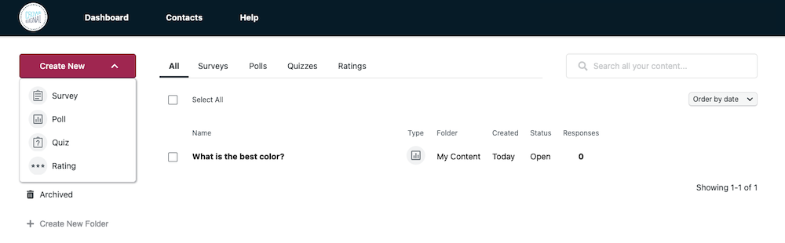

2.  **Get the custom link to share your poll** 
    Either from the Dashboard or within the editor, find the “Share” button.

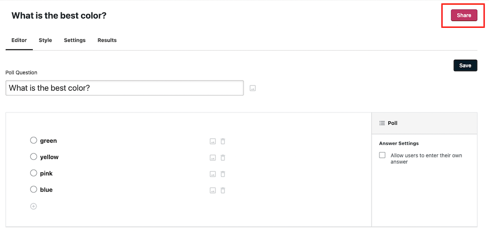

*Find the share link within the Editor panel*

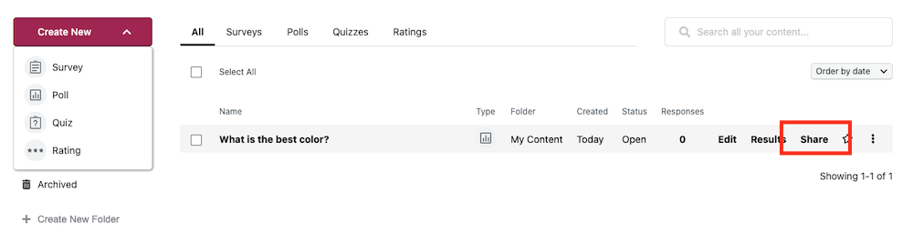

*Find the share link within the Dashboard for the poll*

Within the **Share Your Poll** pop up, click “Copy to Clipboard”.

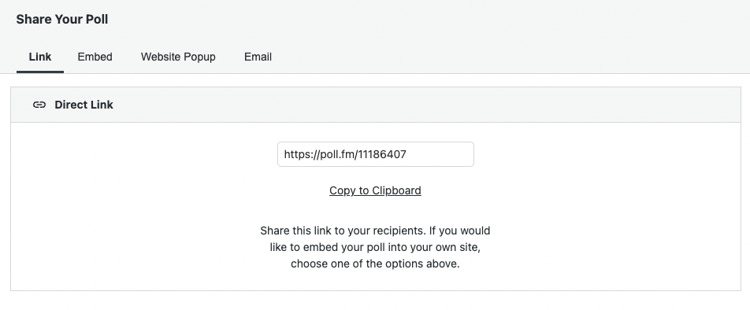

3.  **Add a Crowdsignal Embed Block to your post/page**

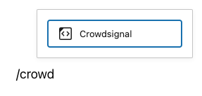

*Adding a block via the “Slash” command from an empty row*

> [!NOTE]
> [Detailed instructions on adding blocks](../block-editor/adding-a-new-block.md)

4.  **Paste the Crowdsignal Poll link from step 2** **into the text box**

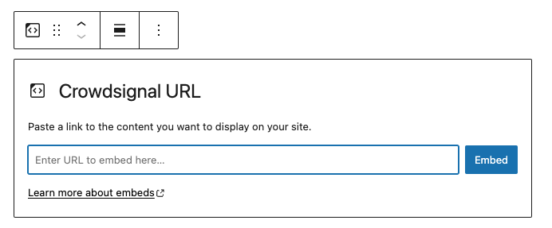

5.  **Click the “Embed” button**

If it’s a link that can be successfully embedded you will see a preview in your editor.

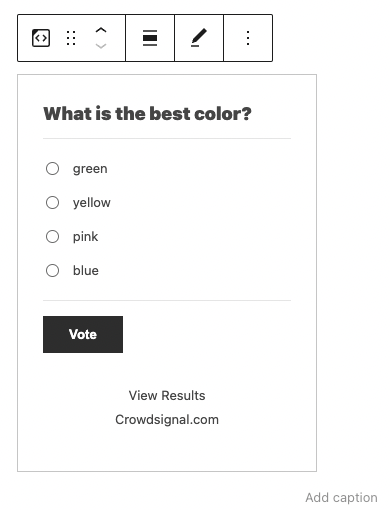

If you use a URL that can’t be embedded, the block shows the message *“Sorry, this content could not be embedded.”* You will have two choices: Try again with a different URL or convert to link.

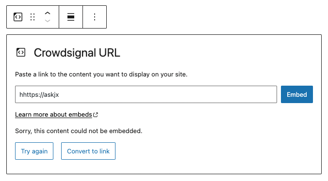

## Block Toolbar

Besides the Mover and Drag & Drop Handle, the Block Toolbar for the Crowdsignal embed shows four buttons:

-   Transform to
-   Change alignment
-   Edit URL, and
-   More options.

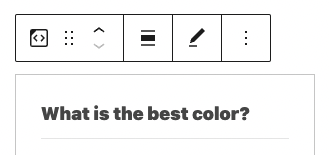

**Transform to**:

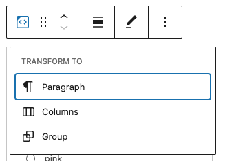

You can transform a Crowdsignal embed into a Paragraph, Columns, or Group. Transforming it into a Group would give you the ability to change the background color around the Crowdsignal embed.

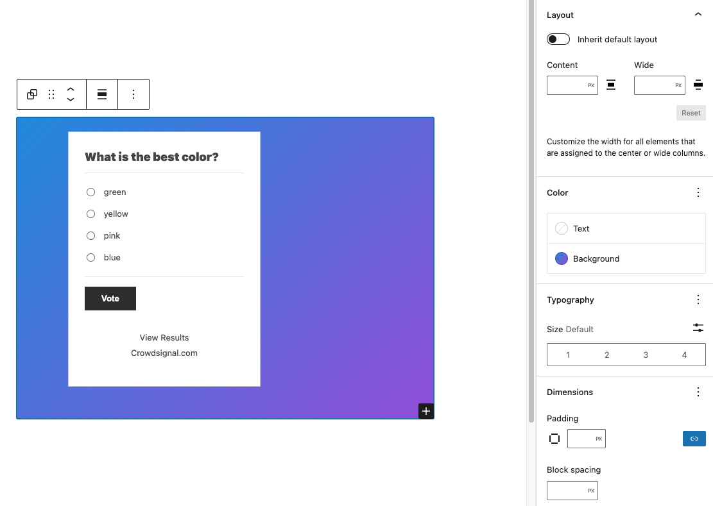

_*Editor view of a Crowdsignal Embed as a group with Color Settings controls*_

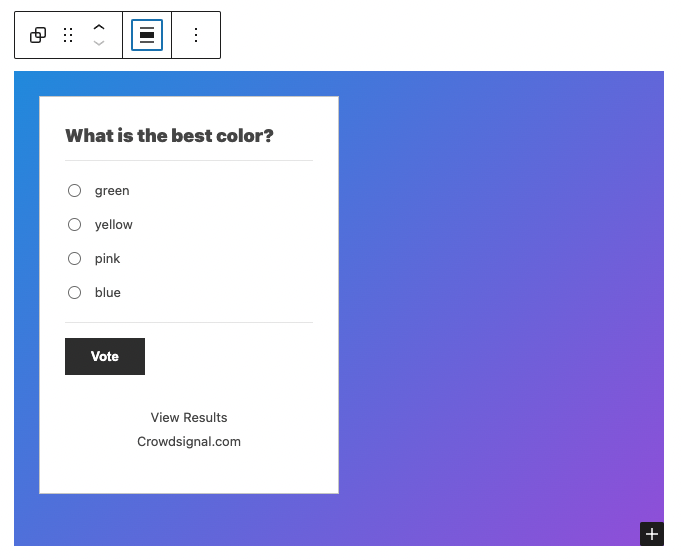

*Crowdsignal embed with a gradient background.*

**Change alignment:**

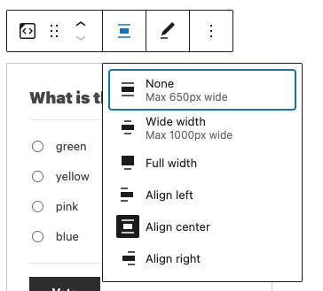

-   Wide width – Increase the width of the post beyond the content size
-   Full width – extend the Crowdsignal post to cover the full width of the screen.
-   Align left – Make the Crowdsignal post left aligned
-   Align center – Make the Crowdsignal post alignment centered
-   Align right – Make the Crowdsignal post align right

*“Wide width” and “Full width” alignment need to be enabled by the Theme of your site.*

**Edit URL**:

Via the edit URL, you can change the Crowdsignal Embed URL in the embed block. Overwrite the existing URL and click on the “Embed” Button.

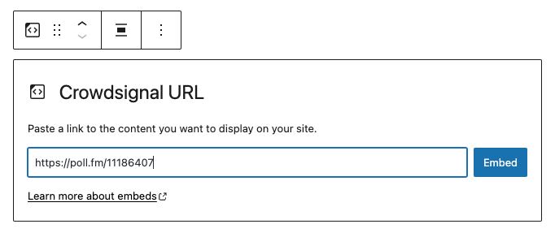

**More options**

The More Options menu represented by three vertical dots on the far right of the toolbar gives you more features such as the ability to duplicate, remove, or edit your block as HTML.

> [!NOTE]
> [Read about these and other settings.](../block-editor/more-options.md)

## Block Settings

Besides the Advanced section, the Crowdsignal embed has only one other setting in the “Block Settings” sidebar: Media Settings.

### Media Settings

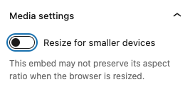

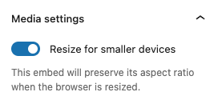

Via the *Media Settings* you can control the behavior of your embed when viewed from a smaller device, like on a phone screen.

The Toggle switch turns on or off the resize functionality for smaller devices. The default setting is “on” or blue.

**“Off:”** This embed may not preserve its aspect ratio when the browser is resized. In the off position, the toggle switch is gray.

**“On:”** This embed will preserve its aspect ratio when the browser is resized. The toggle switch turns blue in the “On” position.

**Advanced**

The following Advanced settings options are available: HTML Anchor, Additional CSS Class(es), Additional CSS, and Styles.

> [!NOTE]
> [Learn more about advanced settings.](../block-editor/advanced-settings-overview.md)

## Changelog

-   Updated 2026-06-29
    -   Linked to advanced settings
-   Updated 2026-02-15
    -   Added \*.cloudsignal.net support from WordPress 4.2
-   Updated 2022-11-26
    -   Removed redundant content
    -   Aligned images for mobile view
-   Updated 2022-08-29
    -   Removed the external link
-   Updated 2022-08-26
    -   Video walkthrough created
    -   Updated with images from WordPress 6.0
    -   Added new “Transform to” setting (Column)
    -   Added “Lock” information under More Options
    -   Added ALT tags for the images
-   Updated 2020-08-17
    -   Updated 5.5 screenshots
    -   Replaced “More Options” – new screenshot,
    -   Added “Move to” and “Copy” section under More Options
-   Updated 2020-07-25
    -   Uploaded image for crowdsignal embed with green background
-   Created 2020-07-03
