# Dailymotion embed

Dailymotion is a video-sharing platform. Using the *Dailymotion Embed* block includes a Dailymotion video into your post/page with play buttons, so your visitor can stay on your site to watch it. You don’t need a Dailymotion account to embed posts.

<video controls preload="metadata" src="https://wordpress.org/documentation/files/2022/08/DailyMotion-Embed-HelpHub.mp4"></video>

## Steps to embed a Dailymotion video in your post or page

1.  Locate the video and copy the URL from Dailymotion.com in the browser bar

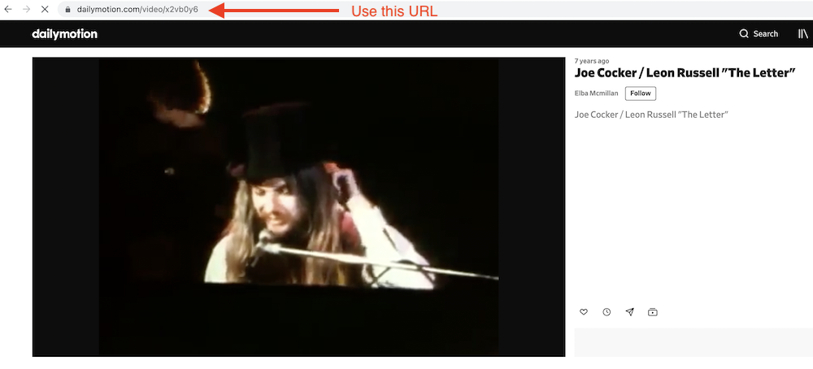

2.  Add a Dailymotion Embed block to your post

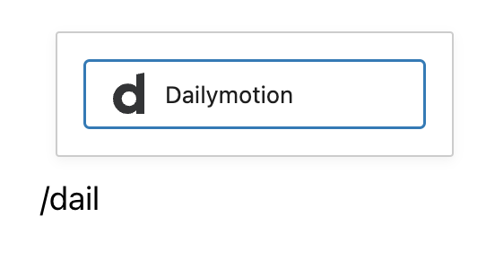

*Adding a block via the “Slash” command from an empty row*

> [!NOTE]
> [Detailed instructions on adding blocks](../block-editor/adding-a-new-block.md)

3.  Paste the video URL into the text box

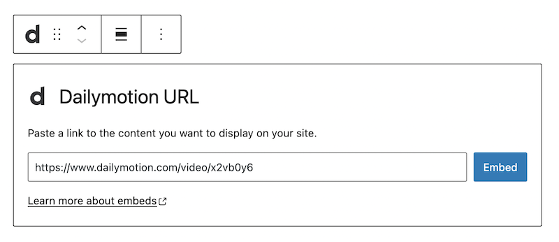

4.  Click the “Embed” button

If it’s a link that can be successfully embedded you will see a preview in your editor.

You’ll see your video in the block editor, with the option to write a caption underneath.

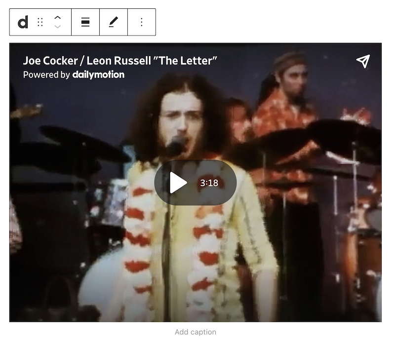

If you use a URL that can’t be embedded, the block shows the message “Sorry, this content could not be embedded.” You will have two choices: Try again with a different URL or Convert to link.

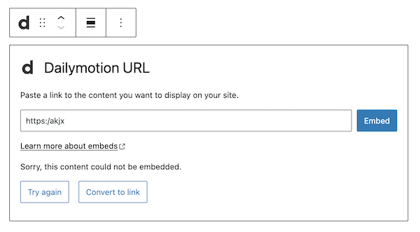

## Block Toolbar

Besides the Mover and Drag & Drop Handle, the Block Toolbar for the Dailymotion embed shows four buttons:

-   Transform to
-   Change alignment
-   Edit URL, and
-   More Options.

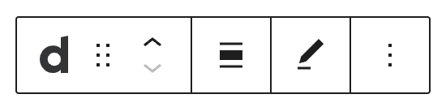

**Transform to**:

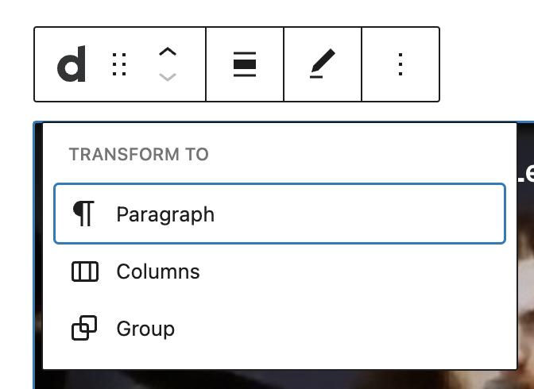

You can transform a Dailymotion embed into a Paragraph, Columns, or Group. Transforming it into a Group would give you the ability to change the background color around the Dailymotion embed.

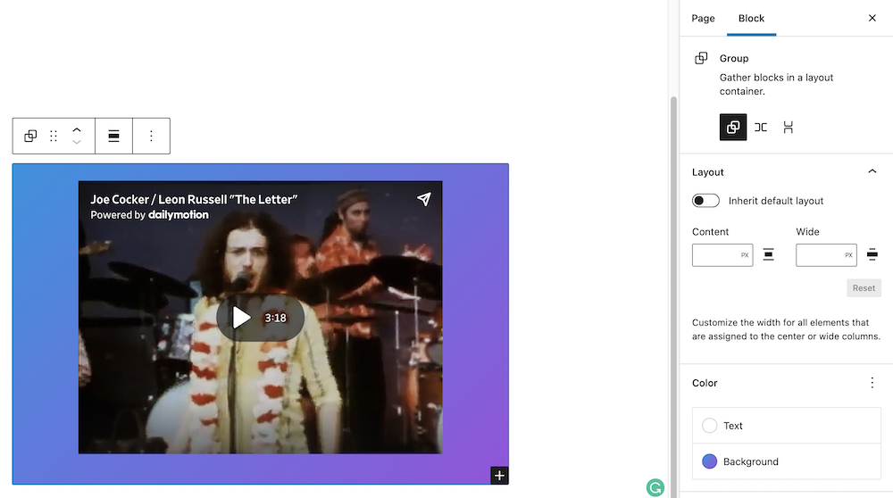

_*Editor view of a Dailymotion Embed as a group with Color Settings controls*_

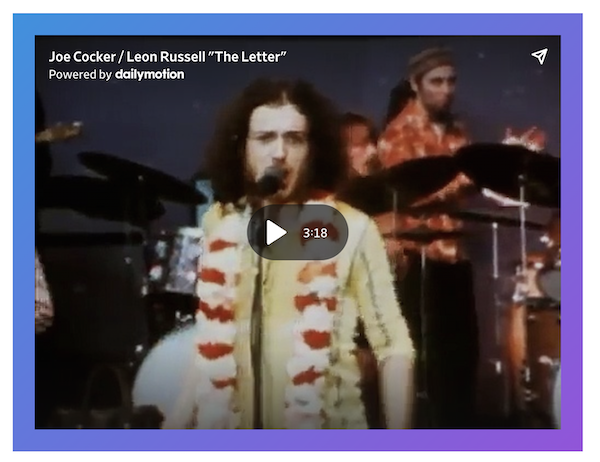

*Dailymotion embed with a gradient background.*

**Change alignment:**

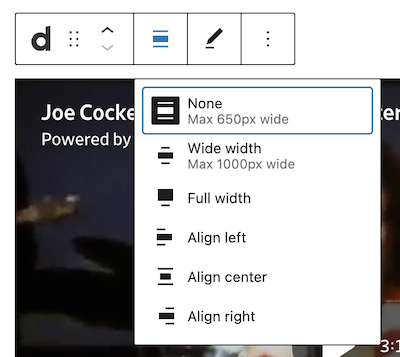

-   Wide width – Increase the width of the post beyond the content size
-   Full width – extend the Dailymotion post to cover the full width of the screen.
-   Align left – Make the Dailymotion post left aligned
-   Align center – Make the Dailymotion post alignment centered
-   Align right – Make the Dailymotion post align right

*“Wide width” and “Full width” alignment need to be enabled by the Theme of your site.*

**Edit URL**:

Via the edit URL, you can change the Dailymotion Embed URL in the embed block. Overwrite the existing URL and click on the “Embed” Button.

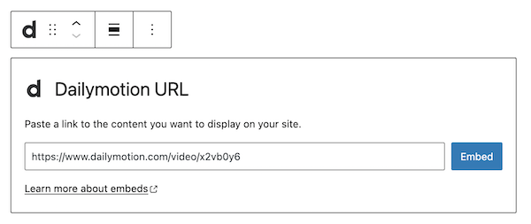

**More options**

The More Options menu represented by three vertical dots on the far right of the toolbar gives you more features such as the ability to duplicate, remove, or edit your block as HTML.

> [!NOTE]
> [Read about these and other settings.](../block-editor/more-options.md)

## Block Settings

Besides the Advanced section, the Dailymotion embed has only one other setting in the “Block Settings” sidebar: Media Settings.

### Media Settings

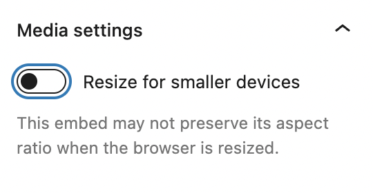

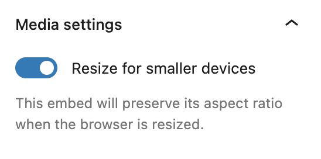

Via the *Media Settings* you can control the behavior of your embed when viewed from a smaller device, like on a phone screen.

The Toggle switch turns on or off the resize functionality for smaller devices. The default setting is “on” or blue.

**“Off:”** This embed may not preserve its aspect ratio when the browser is resized. In the off position, the toggle switch is gray.

**“On:”** This embed will preserve its aspect ratio when the browser is resized. The toggle switch turns blue in the “On” position.

**Advanced**

The following Advanced settings options are available: HTML Anchor, Additional CSS Class(es), Additional CSS, and Styles.

> [!NOTE]
> [Learn more about advanced settings.](../block-editor/advanced-settings-overview.md)

## Changelog

-   Updated 2026-06-29
    -   Linked to advanced settings
-   Updated 2022-11-26
    -   Removed redundant content
    -   Aligned images for mobile view
-   Updated 2020-08-27
    -   Updated 5.5 Screenshots
-   Updated 2020-08-19
    -   Replaced “More Options” – new screenshot
    -   Added “Move To” and “Copy” section under More Options
-   Updated 2020-08-11
    -   Screenshots as per WordPress 5.5
    -   Embedded VideoPress video
-   Created 2020-07-27
