# Facebook embed

[Go back to the list of **Blocks**](../block-editor/blocks-list.md)

> [!NOTE]
> Due to Facebook’s [decision to close the oEmbed end](https://developers.facebook.com/blog/post/2020/08/04/Introducing-graph-v8-marketing-api-v8) point for embedding Facebook links, the block will not work anymore after October 24, 2020. Publishers who want to embed Facebook links into their sites will require a developer account and an appid, and provide an authentication token with their call to the endpoint. Facebook Documentation: [create an app](https://developers.facebook.com/docs/apps/)

WordPress leadership reached out to Facebook but it seems the policy change is final. Apart from alerting users here and in other places, WordPress contributors can’t do anything about it.

---

*Facebook Embed* block allows you to add Facebook posts to your post or pages. Keep in mind that the post needs to be *public* in order to add it.

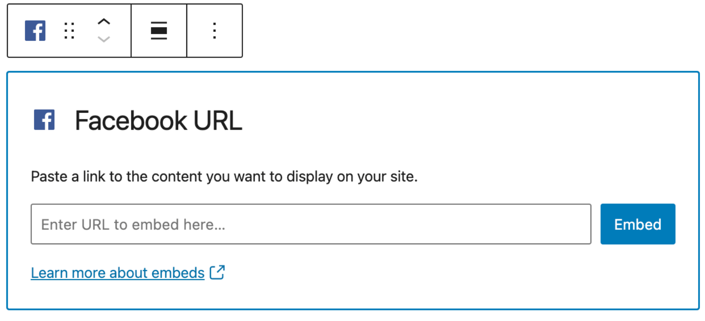

Besides Facebook Posts, you can also share links to Facebook Photos, Facebook Albums, and Facebook Videos.

Note that you can not embed Facebook pages, Facebook events, and Facebook groups.

Embedding a Facebook post is as simple as following these steps:

1.  Copy the preferred link from the Facebook post you want to embed. Make sure it’s a public post.

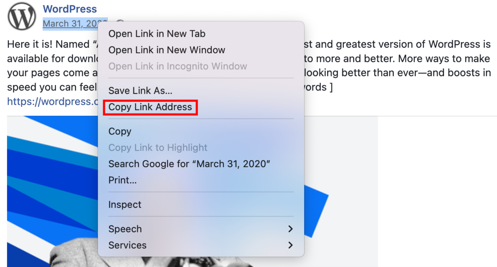

2.  From the WordPress dashboard, go to your post and click the (+) icon to open the block inserter pop-up window and search for the *Facebook* block. You can also use the keyboard shortcut <kbd>/facebook</kbd> to quickly insert a *Facebook* block.

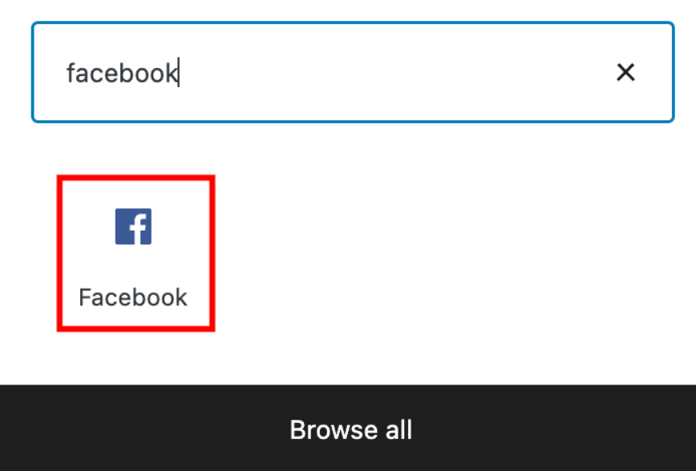

> [!NOTE]
> [Detailed instructions on adding blocks](../block-editor/adding-a-new-block.md)

3.  Paste the link that you’ve copied and click *Embed*.

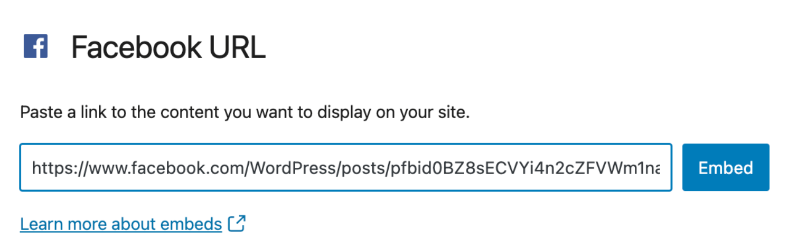

4.  In your editor, you see the link and the comment “*Embedded content from facebook.com can’t be previewed in the editor”*.

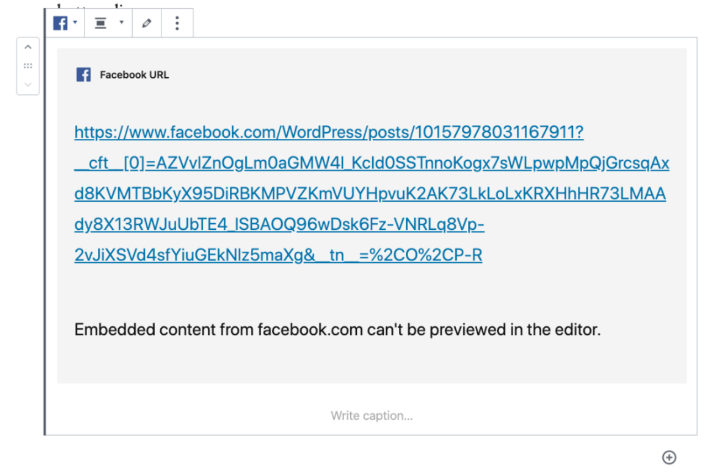

5.  Use the *Preview* button to see how the post fits into your post/page

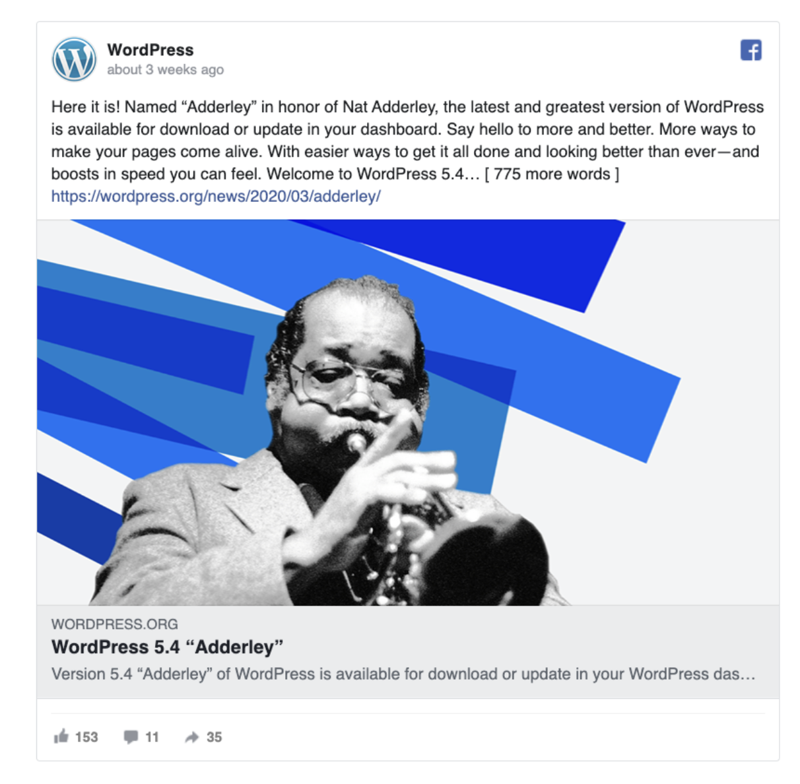

## Block Toolbar

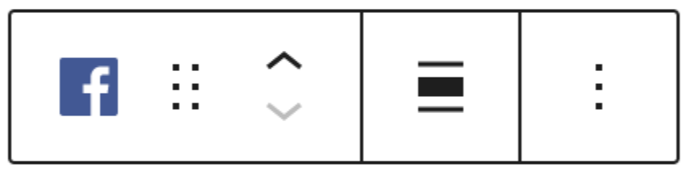

The block toolbar contains the tools to customize each block. The *Facebook*  block’s toolbar consists of the following tools:

**Transform to**

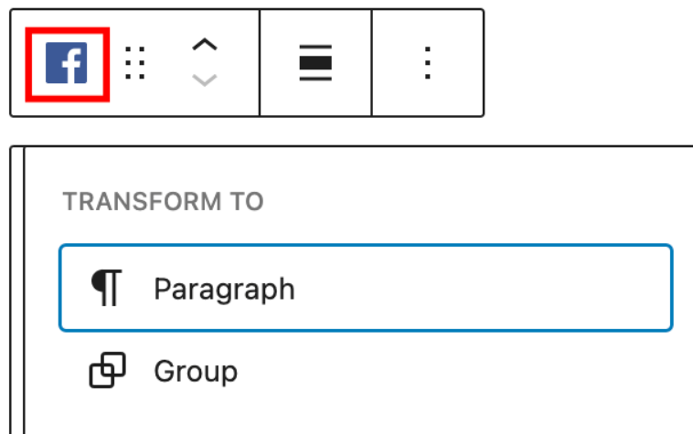

You can transform a *Facebook embed* into a Group. This would give you the ability to change the background color around the *Facebook embed*.

**Block-moving tools**

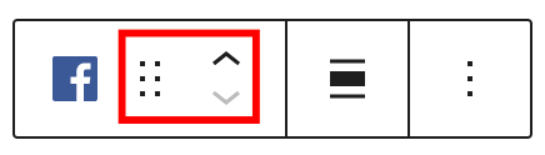

Use the block-moving tools to move the block up and down inside the editor. Use the six dots icon to drag and drop the *Facebook* block and reposition it anywhere on the editor. Alternatively, click on the up and down arrows to move the block up or down the editor.

**Change alignment**

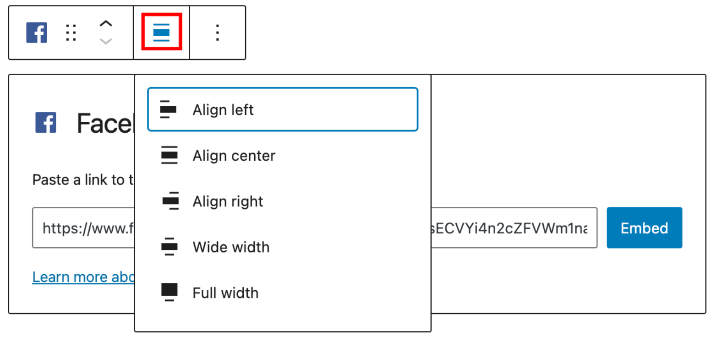

-   **Align left** – Make the Facebook post left aligned
-   **Align center** – Make the Facebook post alignment centered
-   **Align right** – Make the Facebook post align right
-   **Wide width** – Increase the width of the post beyond the content size
-   **Full width** – Extend the Facebook post to cover the full width of the screen.

**Note:** *“Wide width” and “Full width” alignments need to be enabled by the Theme of your site.*

**More options**

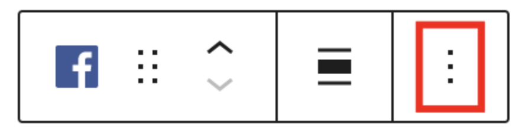

These controls give you the option to copy, duplicate, and edit your block as HTML.

> [!NOTE]
> [Read about these and other settings.](../block-editor/more-options.md)

## Block Settings

The block settings panel contains customization options specific to the block. To open it, select the block and click the cog icon next to the Publish button.

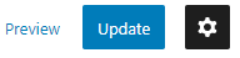

Besides the Advanced section, the Facebook embed has only one setting in the “Block Settings” sidebar: Media Settings.

**Media settings**

Via the *Media Settings* you can control the behavior of your post embed when viewed from a smaller device, like on a phone screen.

The Toggle switch turns on or off the resize functionality for smaller devices. The default setting is “on” or blue.

**“Off:”** This embed may not preserve its aspect ratio when the browser is resized. In the off position the toggle switch is gray.

**“On:”** This embed will preserve its aspect ratio when the browser is resized. The toggle switch turns blue in the “On” position.

**Advanced settings**

The “Advanced” tab lets you add CSS class(es) to your block. This will allow you to write custom CSS and styles to the block.

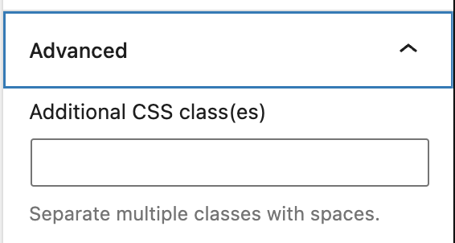

*Advanced option in the selected Block*

## Changelog

-   Updated 2024-09-27
    -   Updated broken image Screenshots.
    -   Fixed inconsistent “Facebook” capitalization issue in the images’ ALT texts.
-   Updated 2022-08-16
    -   Fixed formatting, updated screenshots, and added new information about block-moving tools functionality.
    -   Added ALT tags for the images
-   Updated 2020-09-21
    -   Announcement of discontinuation of Facebook block in v. 9.0 and WordPress 5.6
-   Updated 2020-08-18
    -   Replaced “More Options” – new screenshot
    -   Added “Move To” and “Copy” section under More Options
-   Updated 2020-04-21
    -   Add sentence to the Alignment about Theme support for wide width and full width options.
-   Created 2020-04-20
