# Issuu embed

[Go back to the list of **Blocks**](../block-editor/blocks-list.md)

With the Issuu Embed block, you can embed your published content and magazines from Issuu into your posts and pages. You need an Issuu account and an upgraded plan to be able to embed content from Issuu into your posts or pages.

**Embedded Issuu content**

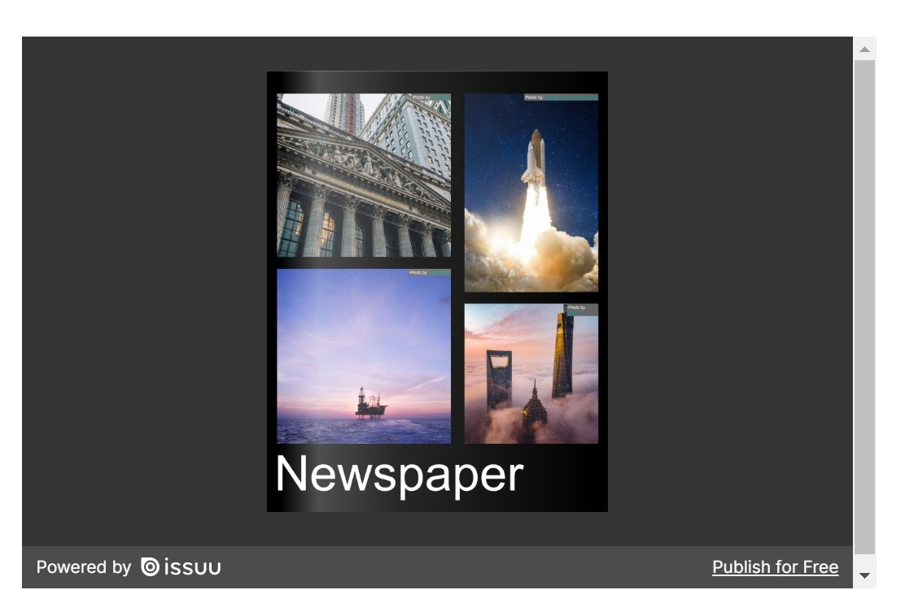

*Embedded Issuu document in WordPress block editor.*

**Steps to embed Issuu content:**

1.  Go to Issuu.com to create your account and content.

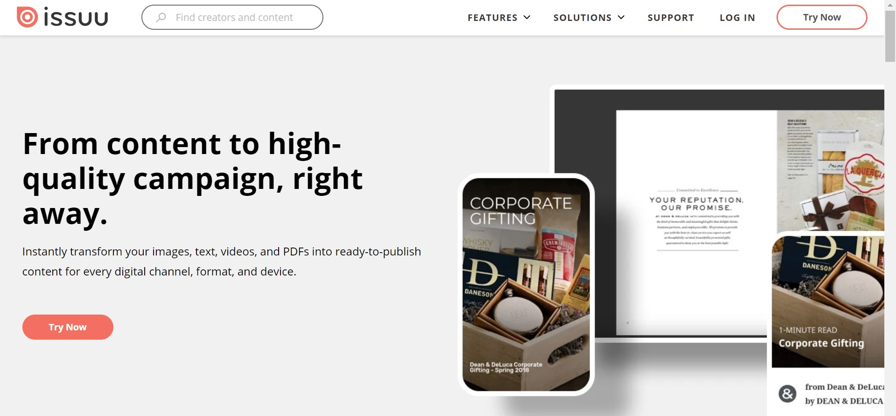

*Go to Issuu.com to create your account and contents*

2.  Create your content, and click the **Share** button to grab the embed URL or shareable link.

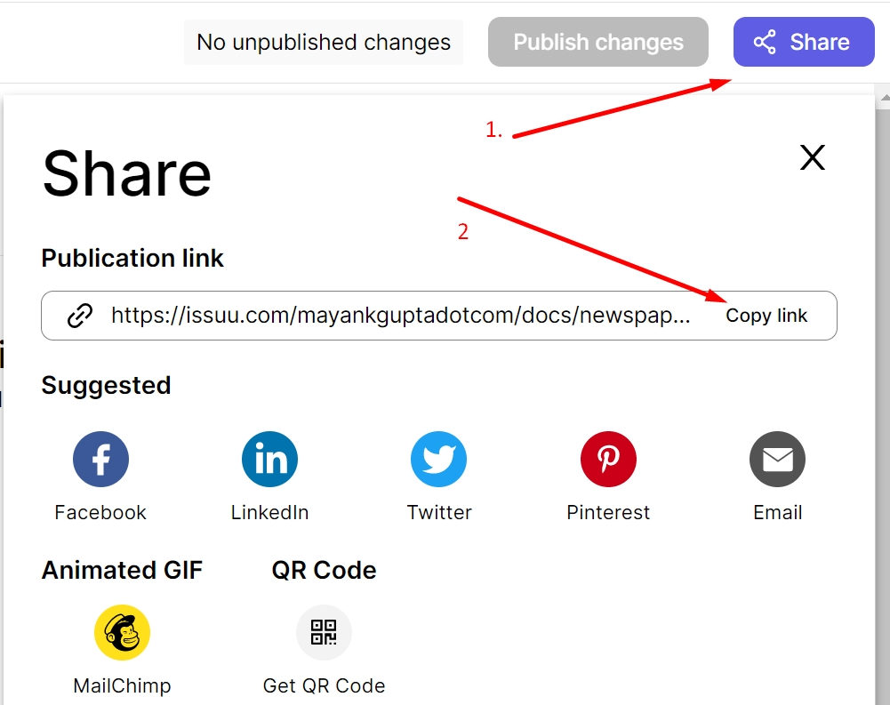

*Grab the sharable publication link from issuu to embed the document in the block editor*

3.  Add an **Issuu Embed Block** to your post/page by clicking the **(+) Block inserter** icon.

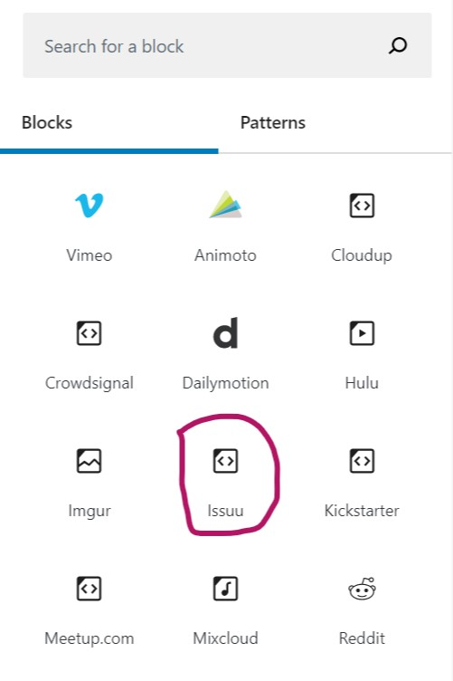

*Insert the Issuu Embed Block with Block Inserter*

> [!NOTE]
> [Detailed instructions on adding blocks](../block-editor/adding-a-new-block.md)

4.  Paste the Issuu content link from step 2.

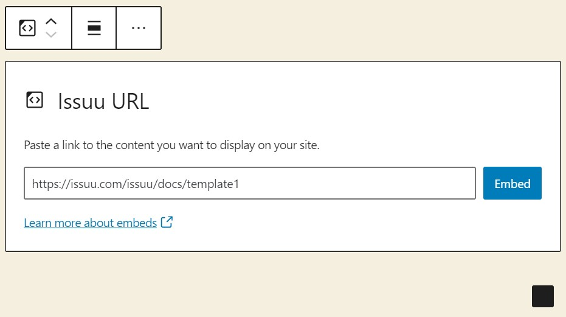

*Paste the Issuu content link from step 2*

5.  Click the **Embed** button. If it’s a link that can be successfully embedded, you will see a preview in your editor.

*Embedded Issuu document in WordPress block editor.*

If you use a URL that can’t be embedded, the block shows the message “Sorry, this content could not be embedded.” You will have two choices: **Try again** with a different URL or **Convert to link**.

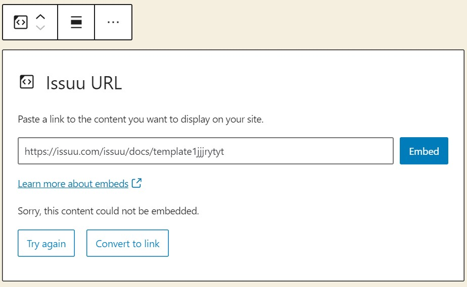

*Error is shown when the Issuu document cannot be embedded*

If you don’t have an upgraded Issuu account, you will see an overlay on top of the embedded content with the message “Why I can’t see my embed”.

## Block toolbar

Besides the Mover and Drag & Drop Handle, the Block Toolbar for the Issuu embed shows four buttons:

-   Transform to
-   Change alignment
-   Edit URL, and
-   More options.

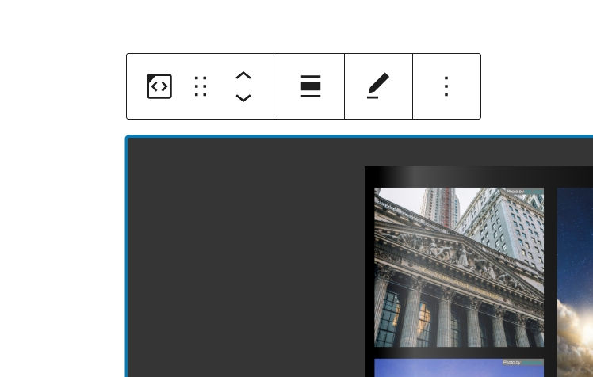

*Click on embedded content to see Issuu Block Toolbar*

**Transform to**

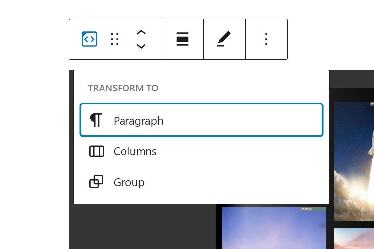

*Transform an embedded block to Paragraph, Columns or Group*

You can transform an Issuu embed into a Group. This would give you the ability to change the background and text color around the Issuu embed.

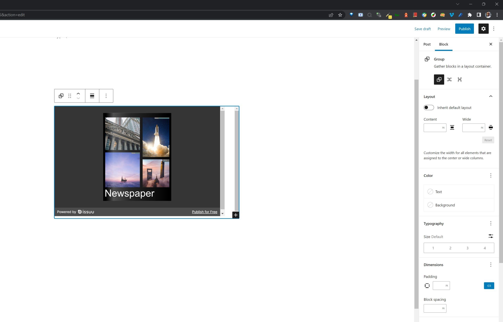

*Editor view of a Issuu Embed as a group with Color Settings controls*

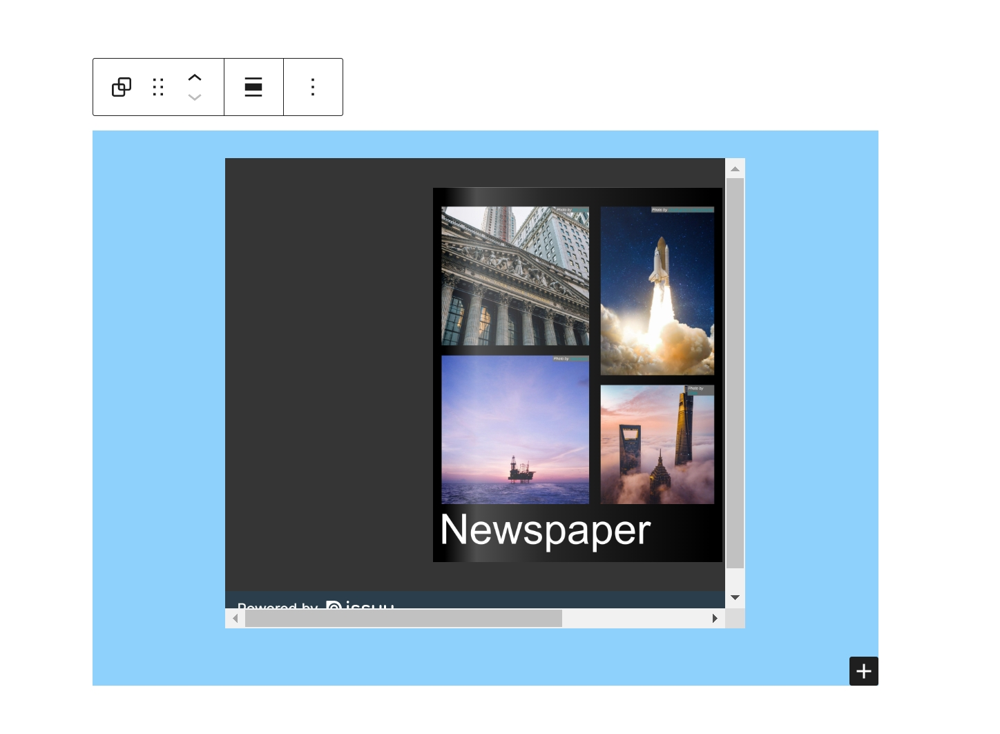

*Issuu Embed with a blue background.*

**Change alignment**

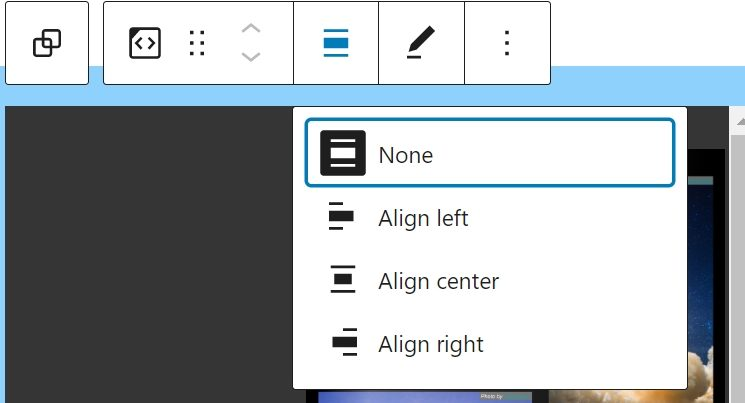

*Align Issuu Embed Block by clicking on the Issuu Embed Block*

-   **Align left** – Make the Issuu embed post-left-aligned.
-   **Align center** – Make the Issuu embed post alignment centered.
-   **Align right** – Make the Issuu embed post align right.
-   **Wide width** – Increase the width of the Issuu embed post beyond the content size.
-   **Full width** – extend the Issuu embed post to cover the full width of the screen.

**Wide width** and **Full width** alignment need to be enabled by the theme of your site. 
 
**Edit URL** 
Via the edit URL, you can change the Issuu embed URL in the embed block. To overwrite the existing URL and click on the **Embed** button.

*Change or edit the embed URL*

**More options**

These controls give you the option to copy, duplicate, and edit your block as HTML.

> [!NOTE]
> [Read about these and other settings.](../block-editor/more-options.md)

## Block settings

**Media Settings**

*Resize for smaller devices switched off*

*Resize for smaller devices switched on*

Via the Media Settings, you can control the behavior of your post embed when viewed from a smaller device, like on a phone screen.

The Toggle switch turns on or off the resize functionality for smaller devices. The default setting is “on” or blue.

“Off:” This embed may not preserve its aspect ratio when the browser is resized. In the off position, the toggle switch is gray.

“On:” This embed will preserve its aspect ratio when the browser is resized. The toggle switch turns blue in the “On” position.

**Advanced**

The following Advanced settings options are available: HTML Anchor, Additional CSS Class(es), Additional CSS, and Styles.

> [!NOTE]
> [Learn more about advanced settings.](../block-editor/advanced-settings-overview.md)

## Changelog

-   Updated 2026-06-29
    -   Linked to advanced settings
-   Updated 2022-11-26
    -   Removed redundant content
    -   Aligned images for mobile view
-   Updated 2022-10-18
-   Updated 2020-08-17
    -   Updated 5.5 screenshot
    -   Updated “Move to” and “Copy” section under “More Options”
-   Updated 2020-07-25
    -   Uploaded image for issuu embed with red background
-   Created 2020-07-19
