# Kickstarter embed

[Go back to the list of **Blocks**](../block-editor/blocks-list.md)

With the Kickstarter Embed block, you can embed Kickstarter projects into your posts and pages. You don’t need a Kickstarter account to be able to embed projects.

**Embedded Kickstarter Project:**

<video controls preload="metadata" src="https://wordpress.org/documentation/files/2022/10/Kickstarter-Embed-Block-HelpHub-Oct-2022.mp4"></video>

**Steps to Embed Kickstarter Projects:**

1.  **Find the Project you want to embed on Kickstarter.com, and click “Share this project”**

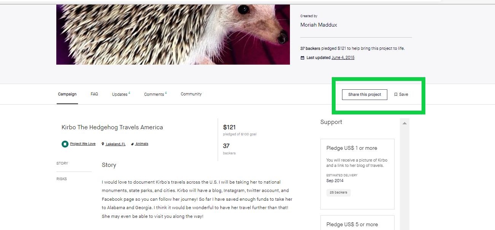

2.  **Click the “Embed” link to copy the URL**

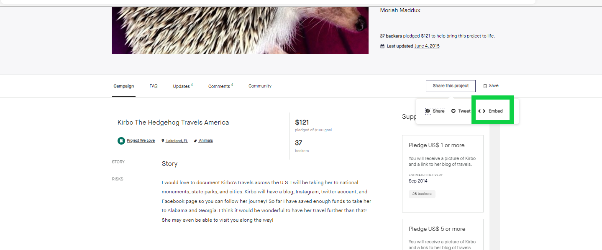

3.  **Find the “Project short link” and copy the URL**

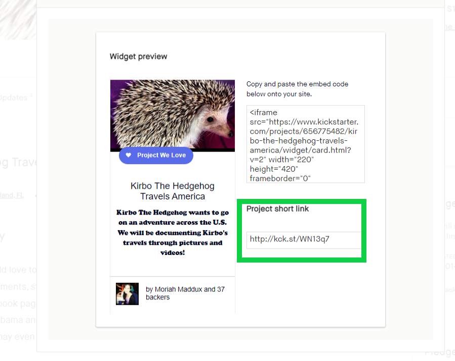

4.  **Add a Kickstarter Embed Block to your post/page**

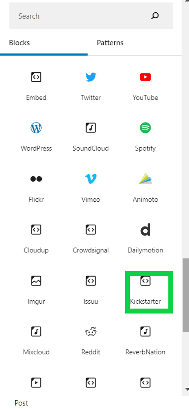

> [!NOTE]
> [Detailed instructions on adding blocks](../block-editor/adding-a-new-block.md)

5.  **Paste the Kickstarter Project link from step 3**

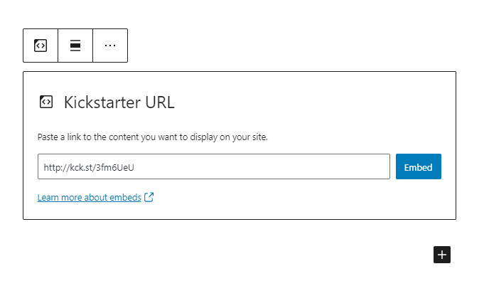

6.  **Click the “Embed” button**

If it’s a link that can be successfully embedded you will see a preview in your editor.

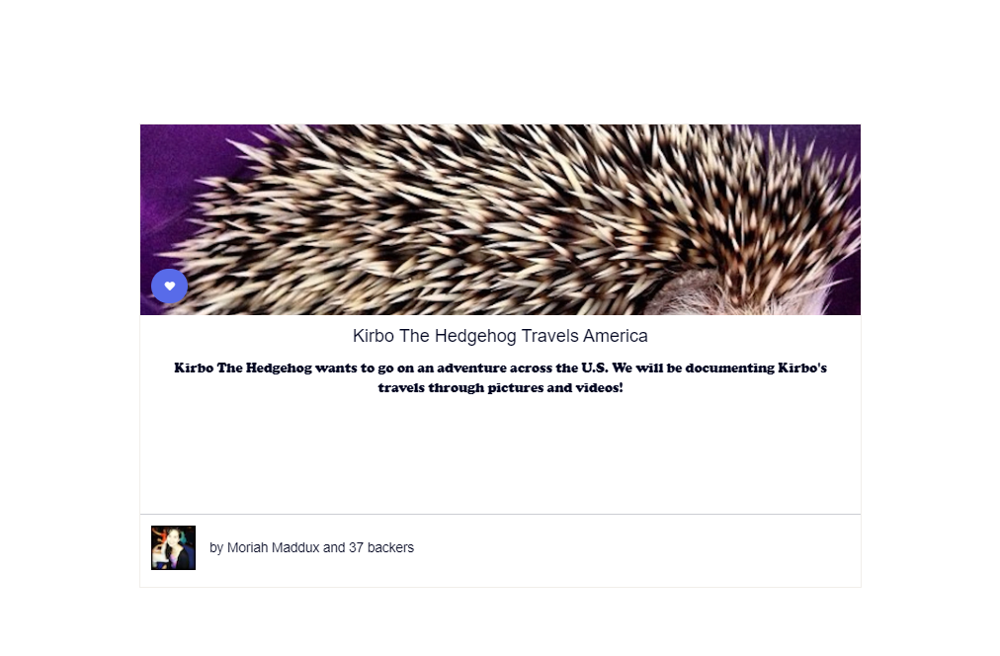

If you use a URL that can’t be embedded, the block shows the message *“Sorry, this content could not be embedded.”* You will have two choices: Try again with a different URL or convert to link.

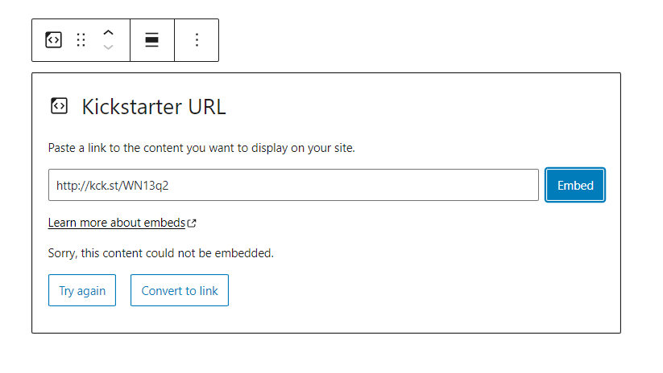

## Block Toolbar

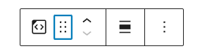

Besides the Mover and Drag & Drop Handle, the Block Toolbar for the Kickstarter embed shows four buttons:

-   Transform to
-   Change alignment
-   Edit URL, and
-   More Options.

**Transform to**

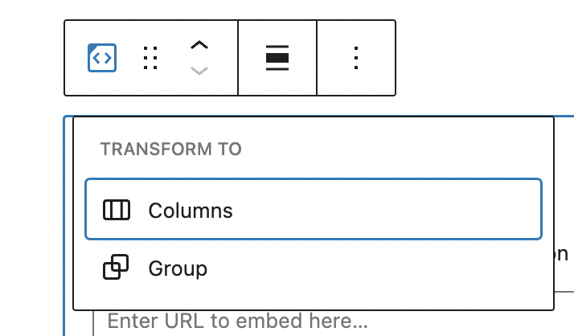

You can transform a Kickstarter embed to a Group. This would give you the ability to change the background and text color around the Kickstarter embed.

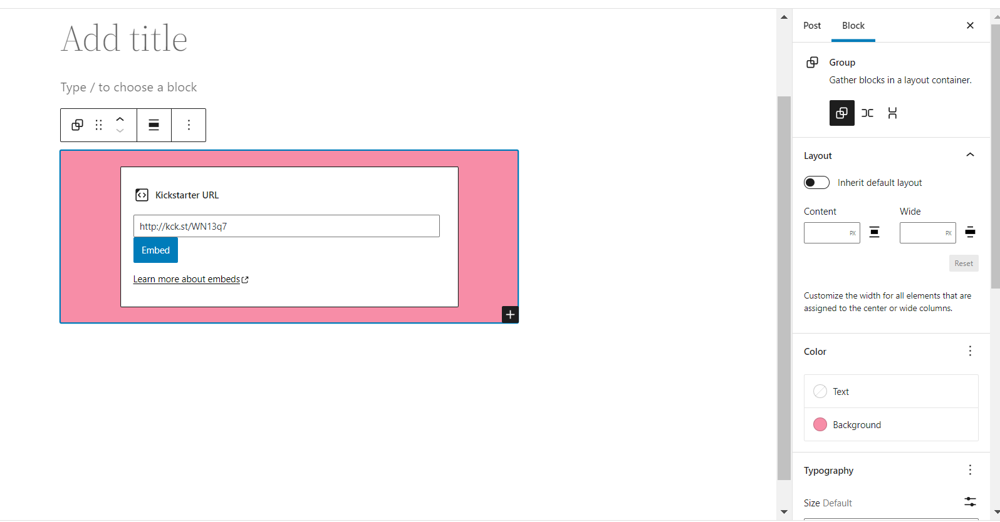

**Change Alignment**

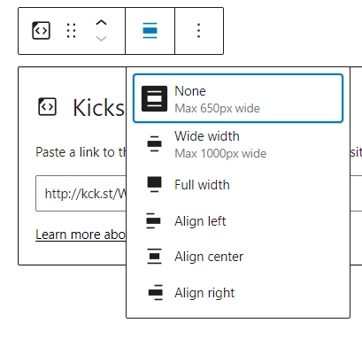

-   **Align left** – Make the Kickstarter embed post-left-aligned.
-   **Align center** – Make the Kickstarter embed post alignment centered.
-   **Align right** – Make the Kickstarter embed post-align-right.
-   **Wide width** – Increase the width of the Kickstarter embed post beyond the content size.
-   **Full width** – extend the Kickstarter embed post to cover the full width of the screen.

“Wide width” and “Full width” alignment need to be enabled by the Theme of your site.

**Edit URL**

Via the edit URL, you can change the Kickstarter embed URL in the embed block. To overwrite the existing URL and click on the “Embed” button.

**More Options**

The More Options menu represented by three vertical dots on the far right of the toolbar gives you more features such as the ability to duplicate, remove, or edit your block as HTML.

> [!NOTE]
> [Read about these and other settings.](../block-editor/more-options.md)

## Block settings

### Media Settings

Via the Media Settings, you can control the behavior of your post embed when viewed from a smaller device, like on a phone screen.

The Toggle switch turns on or off the resize functionality for smaller devices. The default setting is “on” or blue.

“Off:” This embed may not preserve its aspect ratio when the browser is resized. In the off position, the toggle switch is gray.

“On:” This embed will preserve its aspect ratio when the browser is resized. The toggle switch turns blue in the “On” position.

**Advanced**

The following Advanced settings options are available: HTML Anchor, Additional CSS Class(es), Additional CSS, and Styles.

> [!NOTE]
> [Learn more about advanced settings.](../block-editor/advanced-settings-overview.md)

## Changelog

-   Updated 2026-06-29
    -   Linked to advanced settings
-   Updated 2022-11-23
    -   Removed redundant content
    -   Aligned images for mobile view
-   Updated 2022-10-28
-   Updated 2020-08-17
    -   Updated 5.5 screenshots
    -   Added “Move To” and “Copy” section under More Options
-   Created 2020-06-25
