# MixCloud embed

[Go back to the list of **Blocks**](../block-editor/blocks-list.md)

With the Mixcloud Embed block, you can embed tracks, playlists, and profile from Mixcloud into your posts and pages. You don’t need a Mixcloud account to be able to use them, although they need to be public.

<video controls preload="metadata" src="https://wordpress.org/documentation/files/2020/07/mixcloud-embed-walkthrough.mp4"></video>

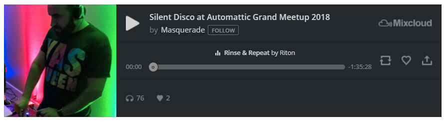

*Embedded Mixcloud track*

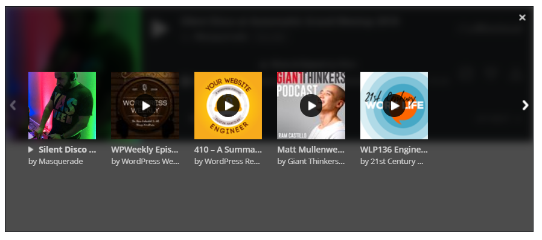

*Embedded Mixcloud playlist*

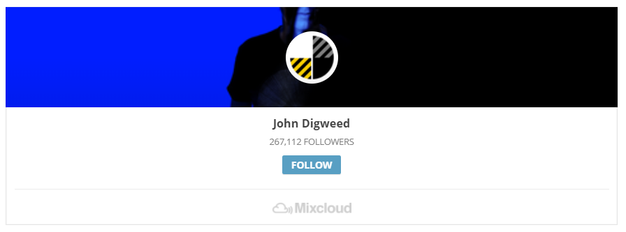

*Embedded Mixcloud profile*

**Steps to Embed a track from Mixcloud:**

1.  Find your track link on Mixcloud

In the web player select the track and click on the “Share” button.

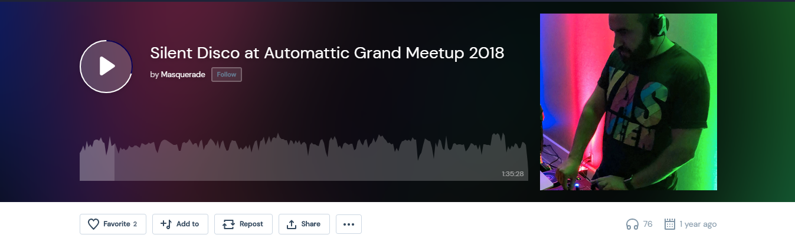

2.  In the share section, highlight the track link and copy it

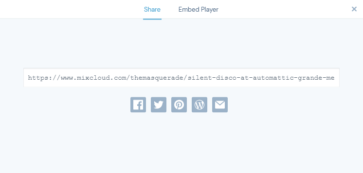

3.  Add a Mixcloud embed block to your page/post

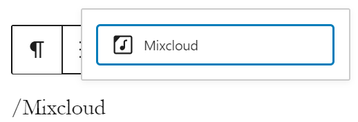

> [!NOTE]
> [Detailed instructions on adding blocks](../block-editor/adding-a-new-block.md)

4.  Paste the link into the text box and click on the “Embed” button

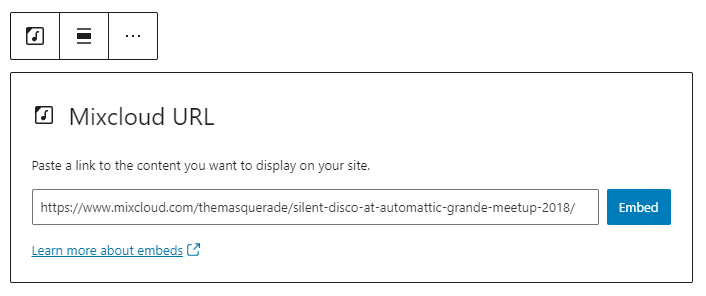

If it’s a link that can be successfully embedded you will see a preview in your editor.

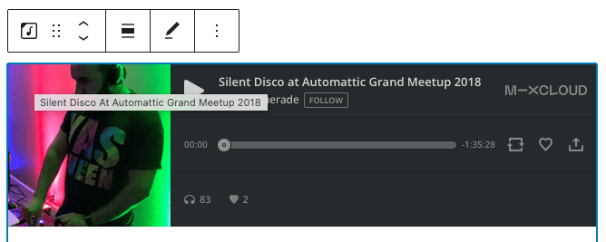

If you use an URL that can’t be embedded, the block shows the message *“Sorry, this content could not be embedded.”*

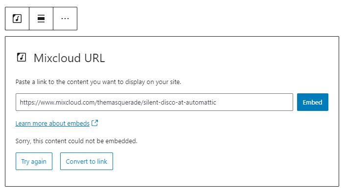

You will have two choices: Try again with a different URL or convert it to a link.

5.  Click on “Preview” to see how it will look on the front-end

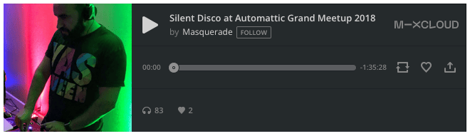

**Embed a playlist from Mixcloud:**

A playlist URL can be embedded and the complete tracklist shows in the embed box.

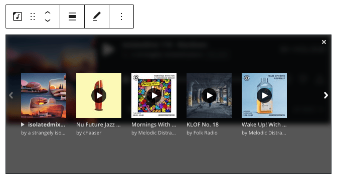

Click on the “UP NEXT” option to view your playlist in the embed box.

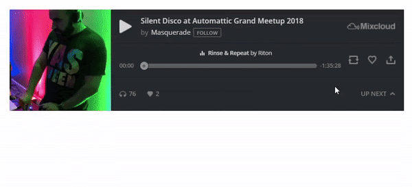

The playlist will follow the same order of tracks as you have in Mixcloud.

**Embed a profile from Mixcloud:**

A profile URL can be embedded and the profile widget shows in the embed box, with additional navigation in the bottom.

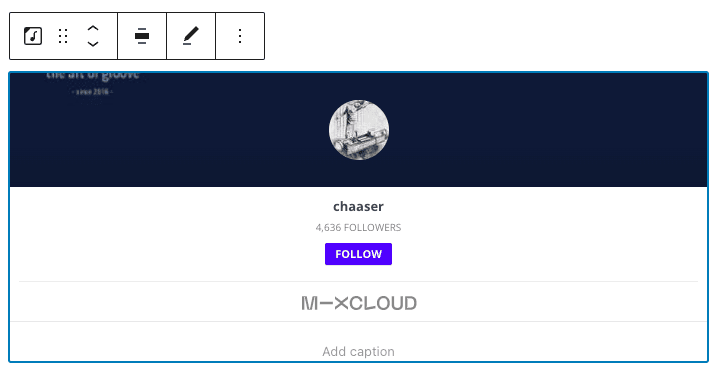

## Block Toolbar

Each block has its own block-specific controls that allow you to manipulate the block right in the editor. The *SoundCloud Embed block* has the following options in the Block toolbar.

-   Transform to
-   Block moving tools
-   Change alignment
-   Edit URL, and
-   More options.

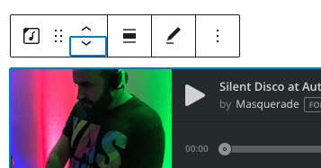

**Transform to**:

You can transform a *Mixcloud Embed block* into a Paragraph, Columns, or a Group block.

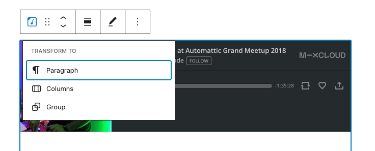

You can transform a Mixcloud embed into a Group. This would give you the ability to change the background color around the Mixcloud embed.

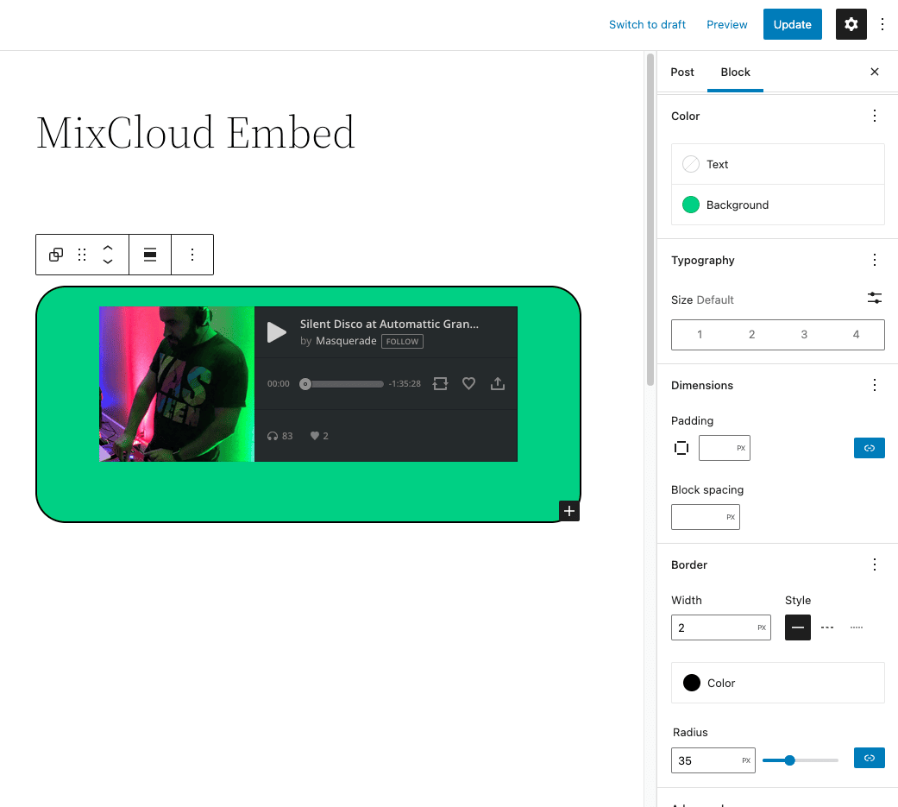

*Mixcloud embed wrapped in Group block with many customization options*

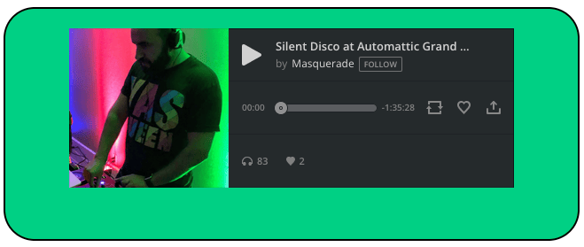

*Mixcloud embed wrapped in Group block with green background and solid border*

**Block-moving tools**

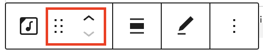

Use the block-moving tools to move the block up and down inside the editor. Use the six dots icon to drag and drop the *Mixcloud Embed block* and reposition it anywhere on the editor. Alternatively, click on the up and down arrows to move the block up or down the editor.

> [!NOTE]
> [Get more information about moving a block within the editor.](../block-editor/moving-blocks.md)

**Change alignment**

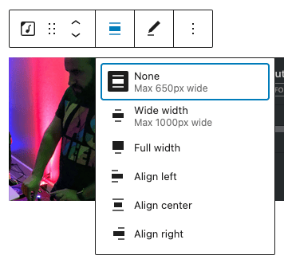

-   **Align left** – Make the Mixcloud post left aligned
-   **Align center** – Make the Mixcloud post alignment centered
-   **Align right** – Make the Mixcloud post align right
-   **Wide width** – Increase the width of the post beyond the content size
-   **Full width** – Extend the Mixcloud post to cover the full width of the screen

“Wide width” and “Full width” alignment need to be enabled by the Theme of your site.

**Edit URL**

Via the edit URL, you can change the Mixcloud Embed URL in the embed block. Overwrite the existing URL and click on the “Embed” button.

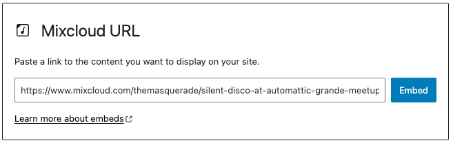

**More options**

The More Options menu represented by three vertical dots on the far right of the toolbar gives you more features such as the ability to duplicate, remove, or edit your block as HTML.

> [!NOTE]
> [Read about these and other settings.](../block-editor/more-options.md)

## Block Settings

Besides the Advanced section, the Mixcloud embed has only one setting in the “Block Settings” sidebar: Media Settings.

**Media Settings**

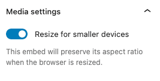

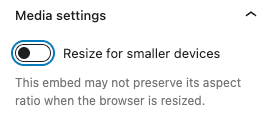

Via the *Media Settings,* you can control the behavior of your post embed when viewed from a smaller device, like on a phone screen.

The Toggle switch turns on or off the resize functionality for smaller devices. The default setting is “on” or blue.

**“Off:”** This embed may not preserve its aspect ratio when the browser is resized. In the off position, the toggle switch is gray.

**“On:”** This embed will preserve its aspect ratio when the browser is resized. The toggle switch turns blue in the “On” position.

**Advanced**

The following Advanced settings options are available: HTML Anchor, Additional CSS Class(es), Additional CSS, and Styles.

> [!NOTE]
> [Learn more about advanced settings.](../block-editor/advanced-settings-overview.md)

## Changelog

-   Updated 2026-06-29
    -   Linked to advanced settings
-   Updated 2022-11-24
    -   Removed redundant content
    -   Aligned images for mobile view
-   Updated 2022-08-26
-   Updated 2020-08-11
    -   Screenshots as per WordPress 5.5
    -   Added “Move To” and “Copy” section under More Options
-   Created 2020-07-05
