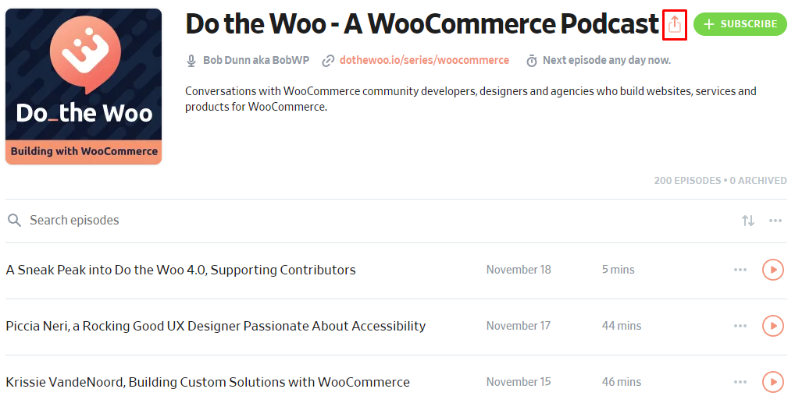
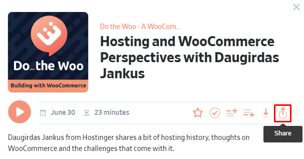
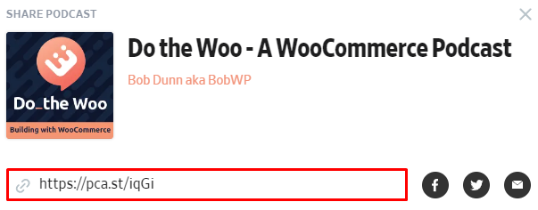
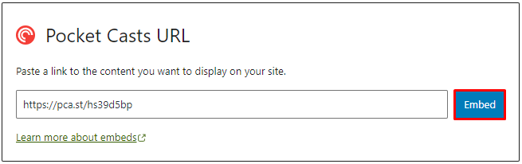
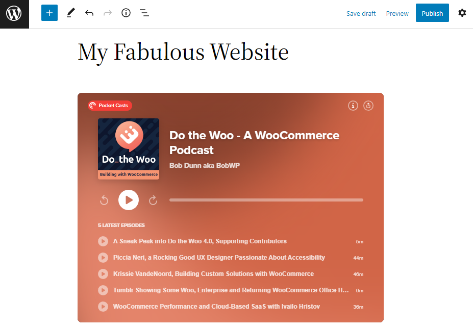
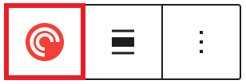
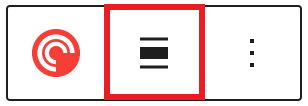
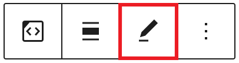
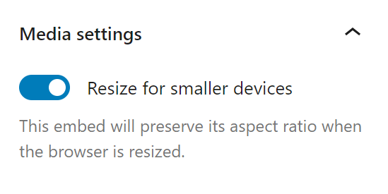

# Pocket Casts embed

[Go back to the list of Blocks](../block-editor/blocks-list.md)

The Pocket Casts Embed block is a new WordPress feature, and a variation of the [Embed block](embed-block.md). The block enables you to insert any Pocket Casts content, such as a podcast page, an episode, and the time position within an episode, into your post or page.

## Add a Pocket Casts Embed block

To add the Pocket Casts Embed block to the editor, click the (**+**) icon at the top left corner to open the Block Inserter. Search for and then click the Pocket Casts Embed block to add it to the editor.

<video controls preload="metadata" src="https://wordpress.org/documentation/files/2022/11/screencast_how-to-add-pocket-casts-embed-block.mp4"></video>

Alternatively, you can manually insert the Pocket Casts Embed block using the keyboard shortcut <kbd>/pocket-casts</kbd>.

Once inserted, you can embed a Pocket Casts URL to the block. Here are the steps to insert a podcast page and an episode to the Pocket Casts Embed block:

1.  Find a podcast and click on it to open the podcast page. Hover your mouse over the podcast title and click the **Share** button.

2.  If you want to share an episode, click on the episode and click the **Share** button on the pop-up window. Here is an example of the Share Episode pop-up window:

3.  Copy the URL link from the pop-up window. Here is an example of the Share Podcast pop-up window:

4.  Paste the URL link into the text box on the Pocket Casts Embed block and click the **Embed** button.

5.  You will see a preview of the embedded podcast content on the editor.

Moreover, you can also embed a Pocket Casts URL directly into the block editor. Here are the steps:

1.  Create a new post.
2.  Copy and paste a Pocket Casts URL into the block editor, for example, <https://pca.st/k2rof194> or <https://pca.st/qekyjgs6>.
3.  Check if the URL is replaced by the Pocket Casts player.

<video controls preload="metadata" src="https://wordpress.org/documentation/files/2022/11/screencast_how-to-add-pocket-casts-embed-block-variation.mp4"></video>

## Block Toolbar

The block toolbar displays several tools used to customize each block. When you select the Pocket Casts Embed block, it will show the block toolbar that contains the following tools:

**Transform to**

Use the **Transform** button to change the Pocket Casts Embed block into a Paragraph, a Column, or a Group block.

**Change alignment**

You can change the alignment of the Pocket Casts Embed block using this tool. Click on the **Change alignment** button and select one of the following alignment options:

-   **None** – is the default block size.
-   **Wide width** – increases the block width beyond the content size.
-   **Full width** – extends the block to cover the full width of the screen.
-   **Align left** – make the block left-aligned.
-   **Align center** – make the block center-aligned.
-   **Align right** – make the block right-aligned.

**Edit URL**

The **Edit URL** button only appears after you have embedded the podcast content. It lets you change the Pocket Casts Embed’s URL via the Embed block. Overwrite the existing URL and paste a new one on the URL field and click the Embed button to confirm the changes.

**More options**

Details about **More options** can be found in this [support article](../block-editor/more-options.md).

## Block Settings

WordPress blocks have specific configuration options in the block settings panel. To access the Pocket Casts Embed block settings panel, click the **Settings** button at the top-right corner of the WordPress editor. Alternatively, click the **More options** or three dots icon in the Pocket Casts Embed block toolbar and select **Show more settings**.

**Media settings**

The Media settings option allows you to control the behavior of the Pocket Casts Embed block when viewed from a smaller device, such as a mobile phone screen. The option only appears after you have embedded the podcast content. The Media settings option is active by default.

When you turn the toggle switch off, the Pocket Casts Embed block may not preserve its aspect ratio when the browser’s window is resized. Meanwhile, if the option is active, the block will maintain its aspect ratio regardless of the browser’s window size.

**Advanced**

The following Advanced settings options are available: HTML Anchor, Additional CSS Class(es), Additional CSS, and Styles.

> [!NOTE]
> [Learn more about advanced settings.](../block-editor/advanced-settings-overview.md)

## Changelog

-   Updated 2026-06-29
    -   Linked to advanced settings
-   Updated 2026-04-06
    -   Removed incorrect reference to premium Pocket Casts account (props to @katodea @awetz583)
-   Created 2022-11-25
