# ReverbNation embed

[Go back to the list of **Blocks**](../block-editor/blocks-list.md)

With the ReverbNation Embed block, you can embed contents from ReverbNation into your posts and pages. You don’t need a ReverbNation account to be able to embed contents from ReverbNation into your posts or pages.

**Embedded ReverbNation Content:**

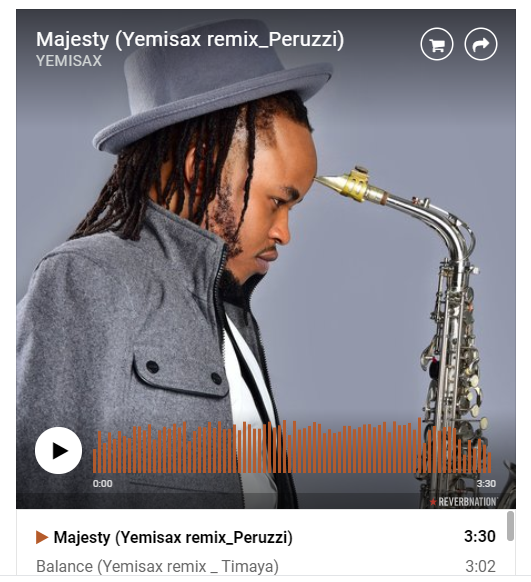

**Steps to Embed ReverbNation Content:**

1.  Go to [ReverbNation.com](https://reverbnation.com) and search for the content you want to embed. You can signup for an account, but it is not needed to share content.

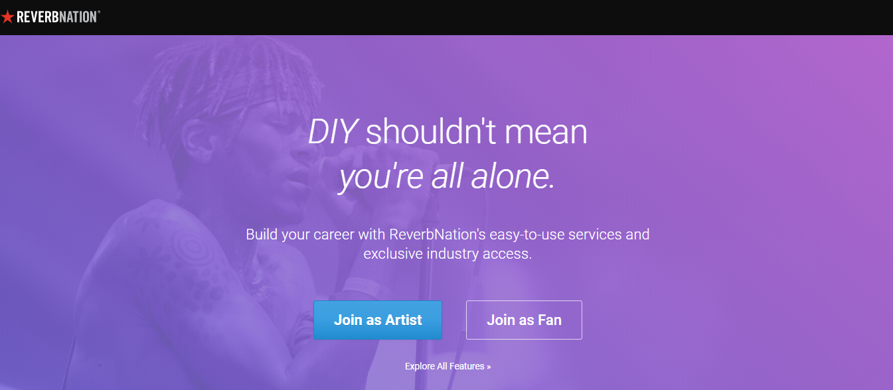

2.  **Click on the “share artist” to get a link**

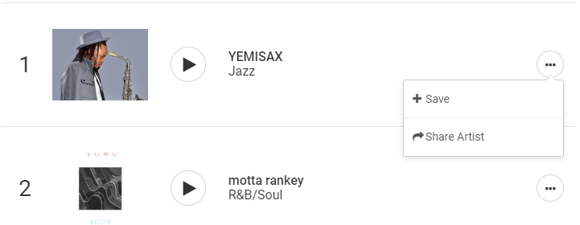

**Copy your custom link**

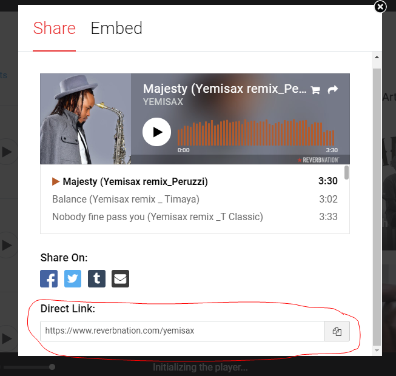

3.  **Add a ReverbNation Embed Block to your post/page**

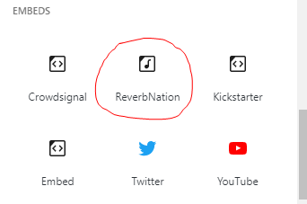

> [!NOTE]
> [Detailed instructions on adding blocks](../block-editor/adding-a-new-block.md)

4.  **Paste the ReverbNation content link from step 2**

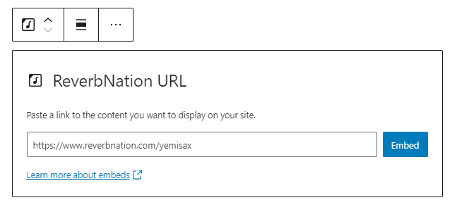

5.  **Click the “Embed” button**

If it’s a link that can be successfully embedded you will see a preview in your editor.

If you use a URL that can’t be embedded, the block shows the message *“Sorry, this content could not be embedded.”* You will have two choices: Try again with a different URL or convert to link.

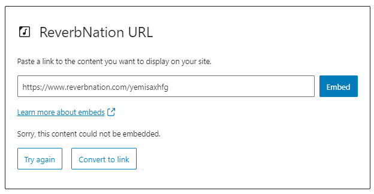

## Block Toolbar

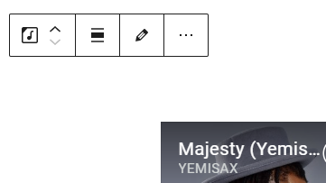

Besides the Mover and Drag & Drop Handle, the Block Toolbar for the ReverbNation embed shows four buttons:

-   Transform to
-   Change alignment
-   Edit URL, and
-   More Options.

**Transform to**

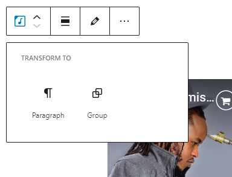

You can transform a ReverbNation embed to a Group. This would give you the ability to change the background and text color around the ReverbNation embed.

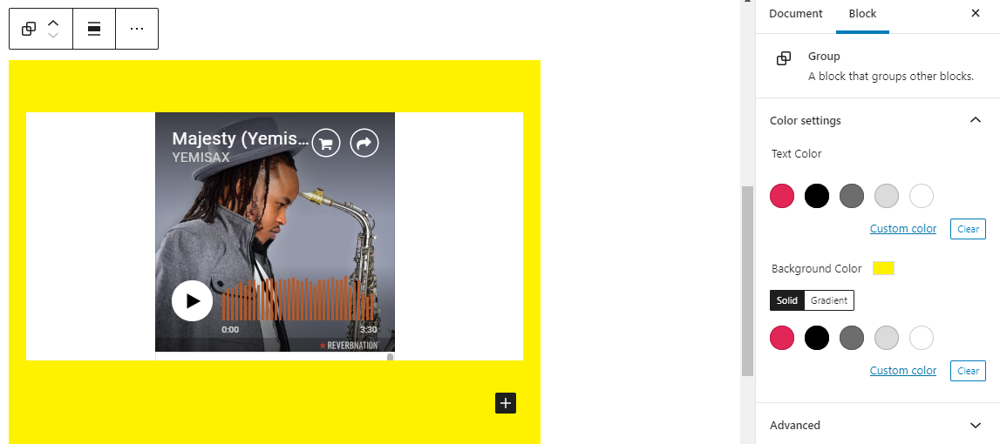

*Editor view of a Reverbnation Embed as a group with Color Settings controls*

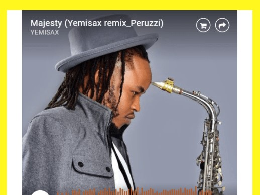

*Reverbnation Embed with a yellow background.*

**Change Alignment**

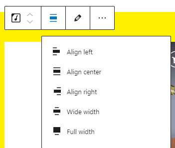

-   **Align left** – Make the ReverbNation embed post-left-aligned.
-   **Align center** – Make the ReverbNation embed post alignment centered.
-   **Align right** – Make the ReverbNation embed post-align-right.
-   **Wide width** – Increase the width of the ReverbNation embed post beyond the content size.
-   **Full width** – extend the ReverbNation embed post to cover the full width of the screen.

“Wide width” and “Full width” alignment need to be enabled by the Theme of your site.

**Edit URL**

Via the edit URL, you can change the ReverbNation embed URL in the embed block. To overwrite the existing URL and click on the “Embed” button.

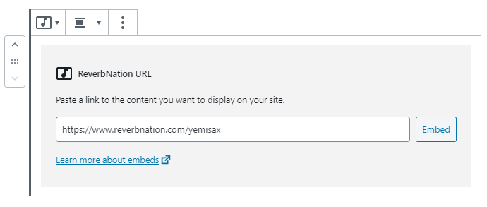

**More Options**

These controls give you the option to copy, duplicate, and edit your block as HTML.

> [!NOTE]
> [Read about these and other settings.](../block-editor/more-options.md)

## Block settings

### Media Settings

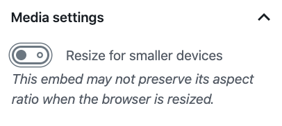

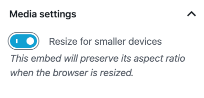

Via the Media Settings, you can control the behavior of your post embed when viewed from a smaller device, like on a phone screen.

The Toggle switch turns on or off the resize functionality for smaller devices. The default setting is “on” or blue.

“Off:” This embed may not preserve its aspect ratio when the browser is resized. In the off position, the toggle switch is gray.

“On:” This embed will preserve its aspect ratio when the browser is resized. The toggle switch turns blue in the “On” position.

**Advanced**

The following Advanced settings options are available: HTML Anchor, Additional CSS Class(es), Additional CSS, and Styles.

> [!NOTE]
> [Learn more about advanced settings.](../block-editor/advanced-settings-overview.md)

## Changelog

-   Updated 2026-06-29
    -   Linked to advanced settings
-   Updated 2022-11-25
    -   Removed redundant content
    -   Aligned images for mobile view
    -   Added alt text to images
-   Updated 2020-08-18
    -   Updated “More Options” sections: replaced screenshot and added text for “Move to” and “Copy”
-   Updated 2020-07-25
    -   Updated 5.5 screenshots
-   Updated 2020-07-25
    -   Uploaded image for Reverbnation embed with a yellow background
-   Created 2020-07-04
