# SmugMug embed

[Go back to the list of **Blocks**](../block-editor/blocks-list.md)

The *SmugMug Embed block* helps to embed images from SmugMug.com on your page or blog post. All you need to embed a SmugMug image is a SmugMug image URL. You do not need a SmugMug account to embed images.

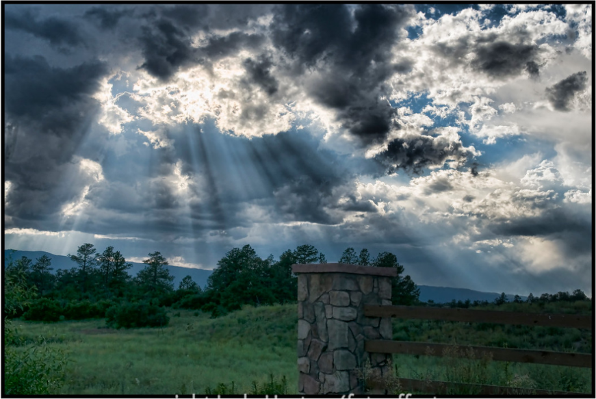

**Steps To Embed SmugMug Images on your Page or Post**

**1. Choose an Image from smugmug.com and find image URL**

Search for an image from smugmug.com and select any image to embed on a page or post.

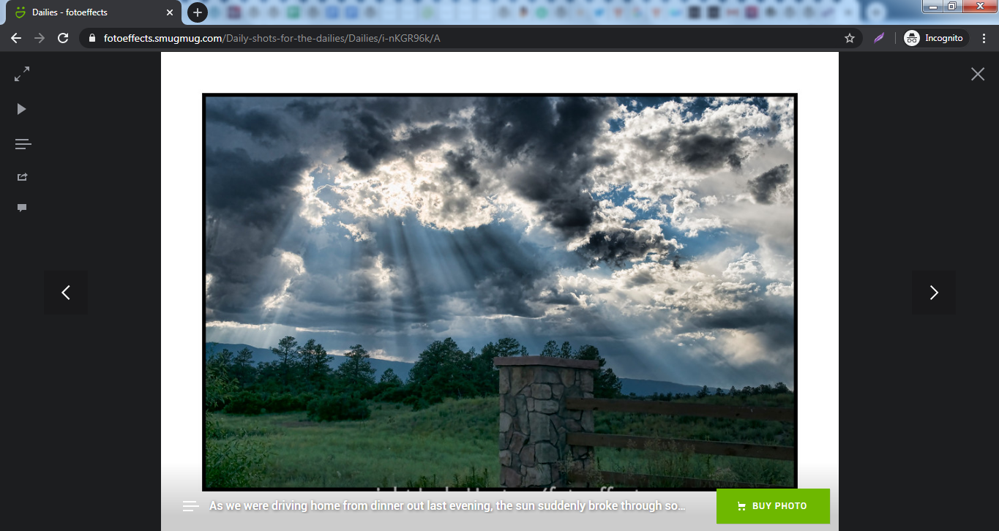

After choosing an image we want on our page or post, copy its URL from the address bar of our browser.

**2. Copy the image URL**

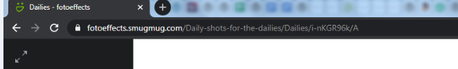

**3. Add a SmugMug Embed block to your post or page**

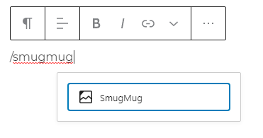

> [!NOTE]
> [Detailed instructions on adding blocks](../block-editor/adding-a-new-block.md)

**4. Paste the URL in the text box**

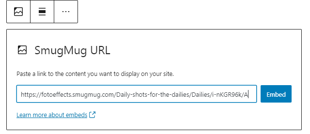

5\. **Click the “Embed” button**

A preview won’t be displayed.

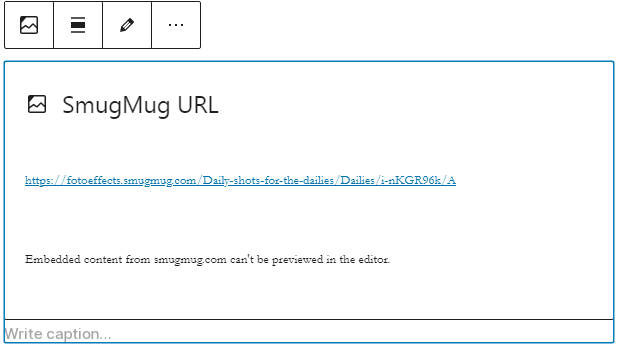

If we use an URL that can’t be embedded, the block shows the message *“Sorry, this content could not be embedded.”*

You will have two choices: Try again with a different URL or convert it to a link.

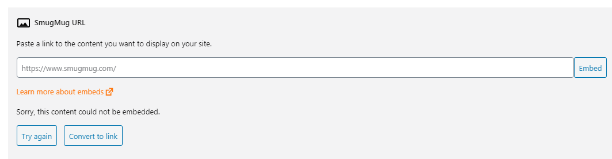

**6. Click on “Preview” to see how it will look**

## Block Toolbar

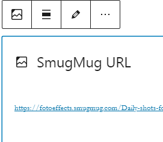

Besides the Mover and Drag & Drop Handle, the Block Toolbar for the *SmugMug Embed block* shows four buttons:

-   Transform to
-   Change alignment
-   Edit URL, and
-   More Options.

**Transform to**:

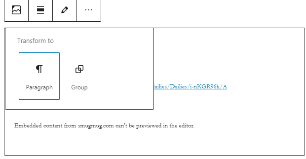

You can transform a *SmugMug Embed block* to a Group. This would give you the ability to change the background color around the SmugMug embed.

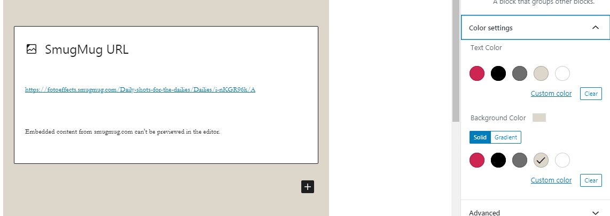

*Editor view of an SmugMug Embed as a group with Color Settings controls*

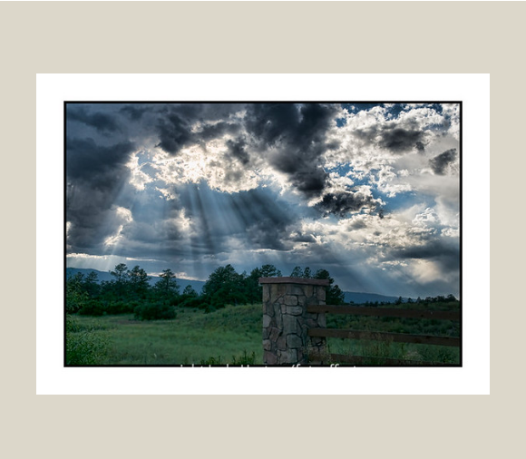

*SmugMug embed with a Gray background.*

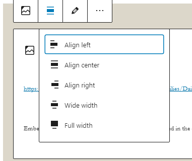

**Alignment:**

-   **Align left** – Make the SmugMug post left aligned
-   **Align center** – Make the SmugMug post alignment centered
-   **Align right** – Make the  SmugMug post align right
-   **Wide width** – Increase the width of the post beyond the content size
-   **Full width** – extend the SmugMug post to cover the full width of the screen.

“Wide width” and “Full width” alignment need to be enabled by the Theme of your site.

**Edit URL**

Via the edit URL, you can change the SmugMug URL in the embed block. Overwrite the existing URL and click on the “Embed” Button

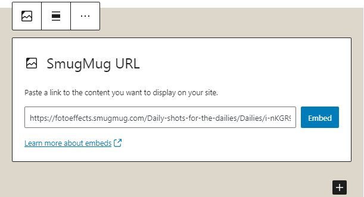

**More Options:**

These controls give you the option to copy, duplicate, and edit your block as HTML.

> [!NOTE]
> [Read about these and other settings.](../block-editor/more-options.md)

## Block Settings

Besides the Advanced section, the SmugMug embed has only one setting in the “Block Settings” sidebar: Media Settings.

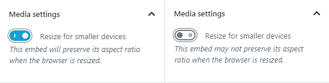

Via the Media Settings you can control the behavior of your post embed when viewed from a smaller device, like on a phone screen.

The Toggle switch turns on or off the resize functionality for smaller devices. The default setting is “on” or blue.

**“Off:”** This embed may not preserve its aspect ratio when the browser is resized. In the off position the toggle switch is gray.

**“On:”** This embed will preserve its aspect ratio when the browser is resized. The toggle switch turns blue in the “On” position.

**Advanced**

The following Advanced settings options are available: HTML Anchor, Additional CSS Class(es), Additional CSS, and Styles.

> [!NOTE]
> [Learn more about advanced settings.](../block-editor/advanced-settings-overview.md)

## Changelog

-   Updated 2026-06-29
    -   Linked to advanced settings
-   Updated 2023-01-26
    -   Updated for formatting consistency
-   Updated 2022-11-25
    -   Removed redundant content
    -   Aligned images for mobile view
    -   Added alt text to images
-   Updated “More Options” sections: replaced screenshot and added text for “Move to” and “Copy”
-   Updated 2020-08-20
    -   Updated 5.5 Screenshots
-   Updated 2020-08-19
    -   Replaced “More Options” – new screenshot
    -   Added “Move To” and “Copy” section under More Options
-   Update 2020-08-10
    -   Removed mention of ‘reusable blocks’ and added standard blocks
    -   Added Changelog Box
-   Created 2020-07-02
