# Speaker Deck embed

The Speaker Deck embed block will allow users to embed their own slides/presentation in their post/page. Users need to create an account to upload their own slides/presentation on Speaker Deck. You don’t need a Speaker Deck account to embed a presentation, although it needs to be public.

**Embedded Speaker Deck Slide**

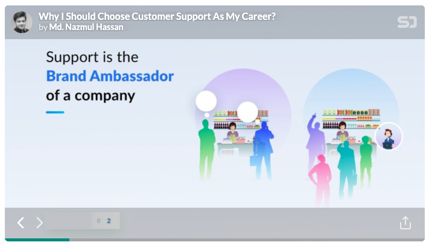

**Steps to Embed a slide from Speaker Deck**

1.  Find the URL of your Speaker Deck slide

Log in to your Speaker Deck account and visit the My Decks menu to get your all decks

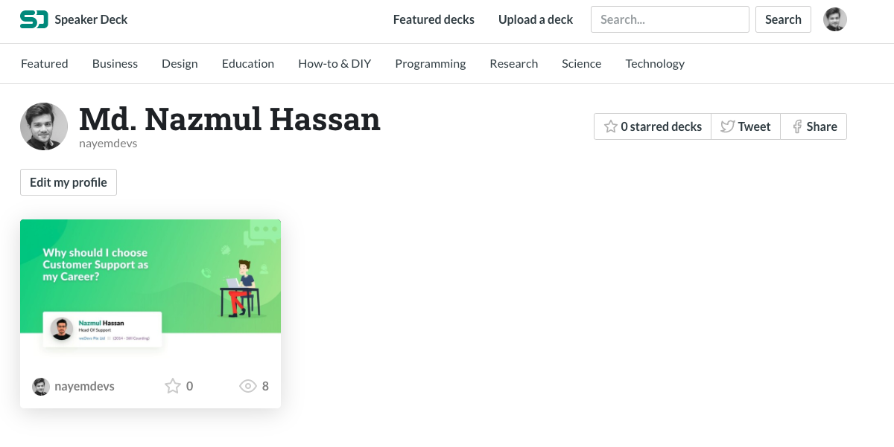

Open the deck that you want to embed. After that Copy the link from the browser address bar.

2.  Add the Speaker Deck block from the block list

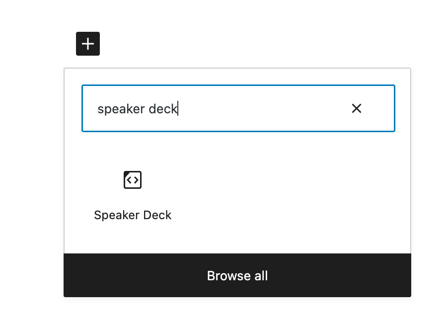

> [!NOTE]
> [Detailed instructions on adding blocks](../block-editor/adding-a-new-block.md)

3.  Paste the Deck link into the URL box

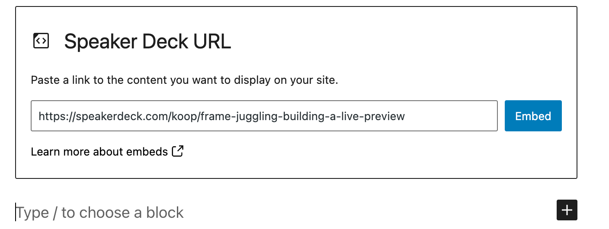

4.  Click the “Embed” button

If it’s a link that can be successfully embedded you will see a preview in your editor.

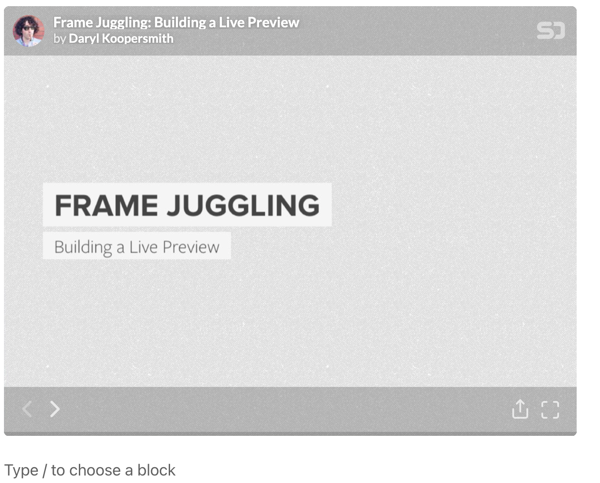

5.  If you use a URL that can’t be embedded, the block shows the message *“Sorry, this content could not be embedded.”* You will have two choices: Try again with a different URL or convert to link.

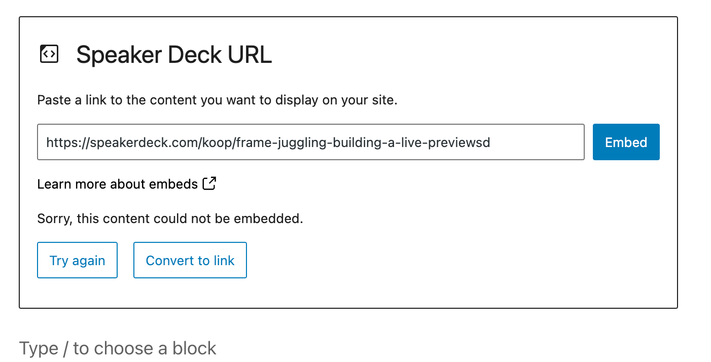

## Block Toolbar

Besides the Mover and Drag & Drop Handle, the Block Toolbar for the Speaker Deck embed shows four buttons:

-   Transform to
-   Change alignment
-   Edit URL, and
-   More Options.

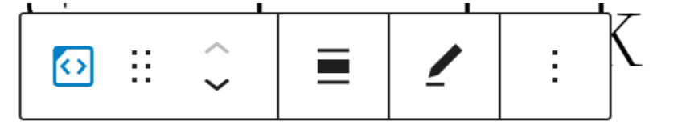

**Transform to**:

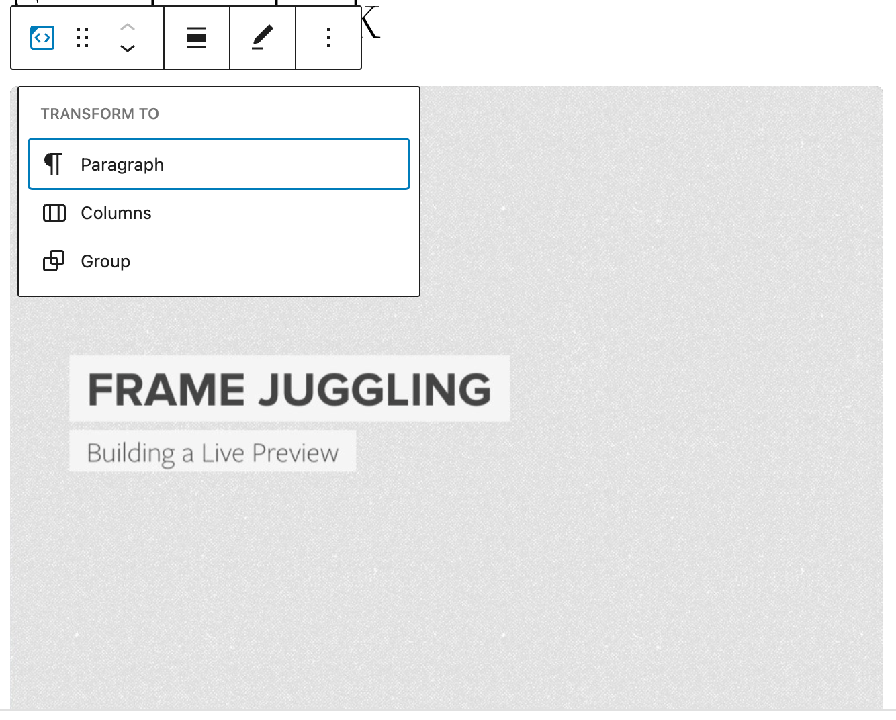

You can transform a Speaker Deck embed to a Group. This would give you the ability to change the background color around the Speaker Deck embed.

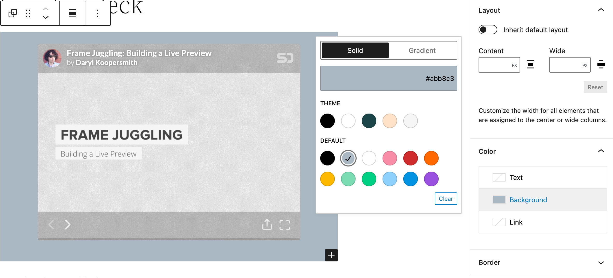

*Editor view of an Speaker Deck Embed as a group with Color Settings controls*

**Change Alignment**

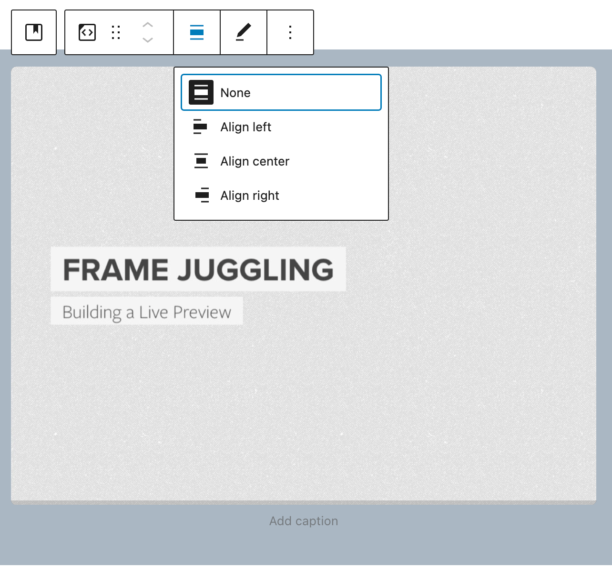

-   **None** – No alignment.
-   **Align left** – Make the Speaker Deck post left aligned
-   **Align center** – Make the Speaker Deck post alignment centered
-   **Align right** – Make the  Speaker Deck] post align right

**Edit URL**

Via the edit URL, you can change the Speaker Deck Embed URL in the embed block. Overwrite the existing URL and click on the “Embed” Button.

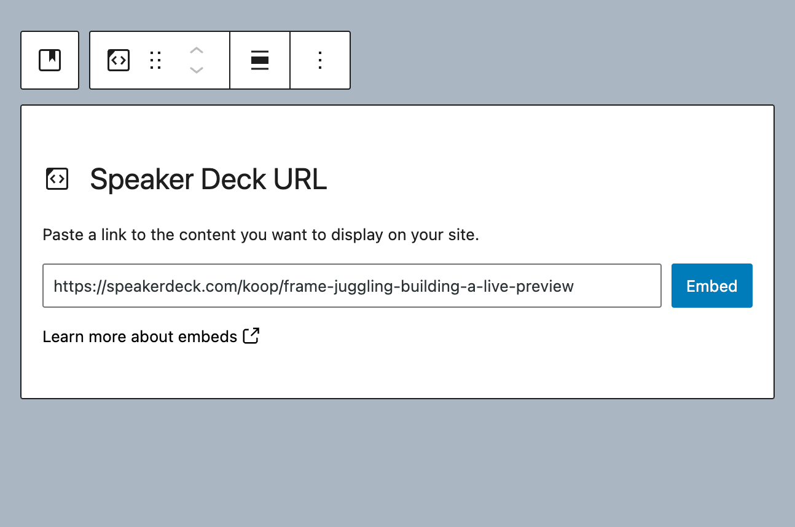

**More Options:**

These controls give you the option to copy, duplicate, and edit your block as HTML.

> [!NOTE]
> [Read about these and other settings.](../block-editor/more-options.md)

## Block Settings

Besides the Advanced section, the Speaker Deck embed has only one setting in the “Block Settings” sidebar: Media Settings.

**Media Settings**

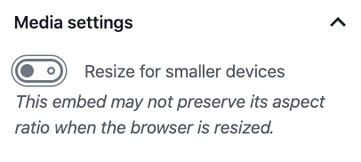

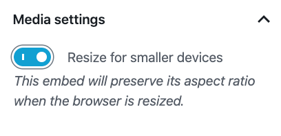

Via the Media Settings you can control the behavior of your post embed when viewed from a smaller device, like on a phone screen.

The Toggle switch turns on or off the resize functionality for smaller devices. The default setting is “on” or blue.

**“Off:”** This embed may not preserve its aspect ratio when the browser is resized. In the off position the toggle switch is gray.

**“On:”** This embed will preserve its aspect ratio when the browser is resized. The toggle switch turns blue in the “On” position.

**Advanced**

The following Advanced settings options are available: HTML Anchor, Additional CSS Class(es), Additional CSS, and Styles.

> [!NOTE]
> [Learn more about advanced settings.](../block-editor/advanced-settings-overview.md)

## Changelog

-   Updated 2026-06-29
    -   Linked to advanced settings
-   Updated 2022-11-25
    -   Removed redundant content
    -   Aligned images for mobile view
    -   Added alt text to images
-   Updated 2022-04-19
    -   Updated screenshots for 5.9
-   Updated 2020-09-04
    -   Screenshots updated to 5.5
-   Updated 2020-08-19
    -   Replaced “More Options” – new screenshot
    -   Added “Move To” and “Copy” section under More Options
-   Updated 2020-08-11
    -   Screenshots as per WordPress 5.5
    -   Embedded VideoPress video
-   Created 2020-07-27
