# TED embed

[Go back to the list of **Blocks**](../block-editor/blocks-list.md)

The TED embed block lets you add a TED video to your page/post. The embedded video includes a play button that allows users to watch the video on your website.

You cannot embed TED playlists and series.

**Six Steps to embed a TED Video on your post or page**

1.  Find the [video on ted.com](https://www.ted.com/talks/matt_mullenweg_why_working_from_home_is_good_for_business) and copy the video URL from the browser bar.

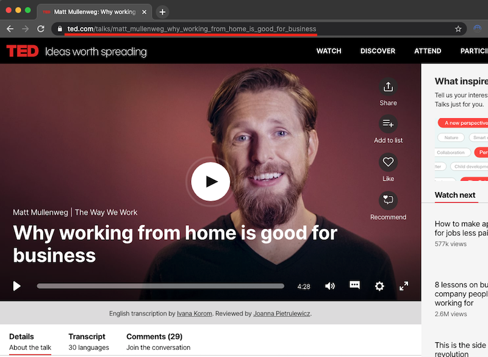

2.  Add the TED Embed block to your post.

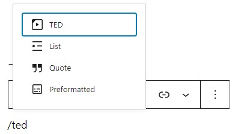

*Adding a block via the “Slash” command from an empty row*

> [!NOTE]
> [Detailed instructions on adding blocks](../block-editor/adding-a-new-block.md)

3.  Paste the TED URL from step 1 into the block.
4.  Click on the “Embed” button.

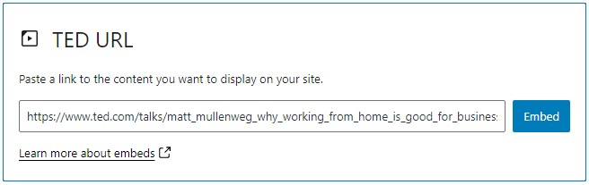

5.  Now you can see the TED video in your editor.

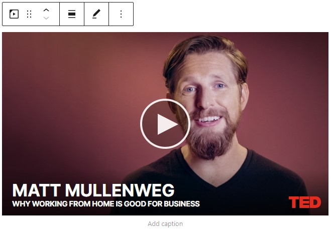

6.  Click on Preview to see how the video is displayed on the front end of your page.

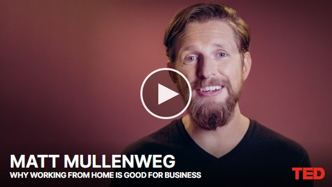

## Block Toolbar

Besides the Mover and Drag & Drop Handle, the Block Toolbar for the TED embed shows four buttons:

-   Transform to
-   Change alignment
-   Edit URL, and
-   More Options.

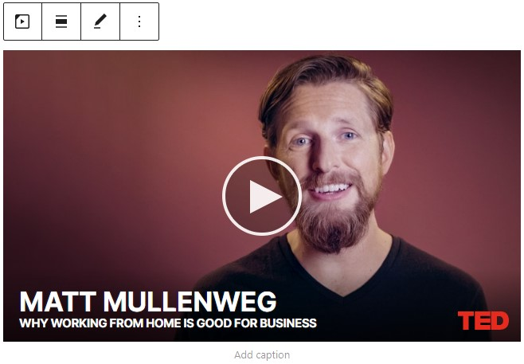

**Transform to**:

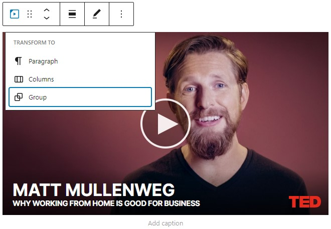

You can transform a TED embed to a Group. This would give you the ability to change the background color around the TED embed.

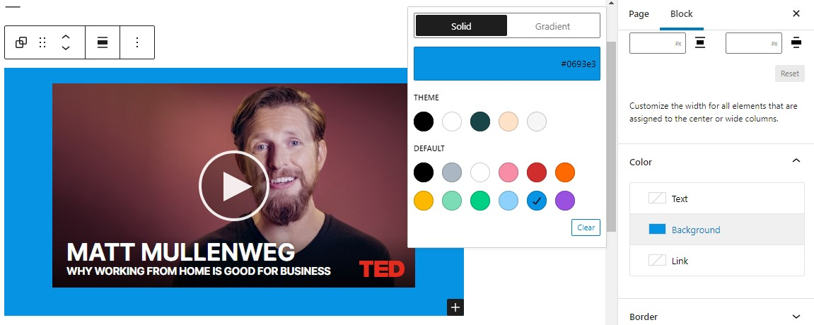

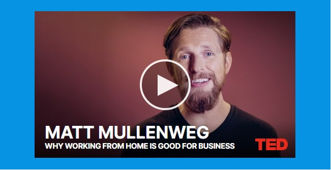

*Preview of Ted Embed with background*

**Change Alignment**

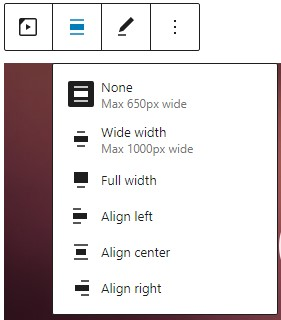

-   **Wide width** – Increase the width of the post beyond the content size
-   **Full width** – extend the TED embed post to cover the full width of the screen.
-   **Align left** – Make the TED embed post left aligned
-   **Align center** – Make the TED embed post alignment centered
-   **Align right** – Make the TED embed post align right

**Edit URL**

Via the edit URL, you can change the TED Embed URL in the embed block. Overwrite the existing URL and click on the “Embed” Button.

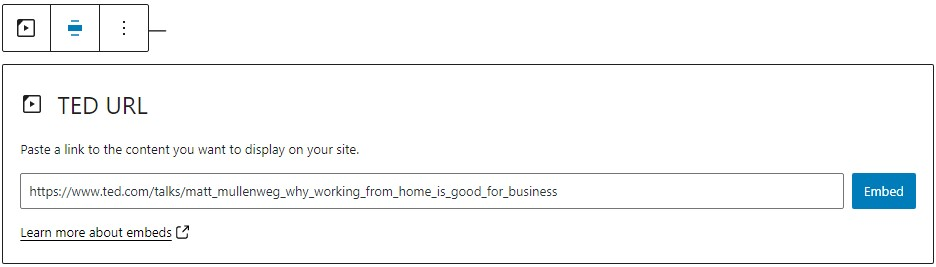

**More Options:**

These controls give you the option to copy, duplicate, and edit your block as HTML.

> [!NOTE]
> [Read about these and other settings.](../block-editor/more-options.md)

## Block Settings

**Media Settings**

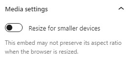

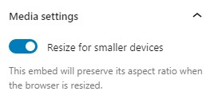

Via the *Media Settings* you can control the behavior of your post embed when viewed from a smaller device, like on a phone screen.

The Toggle switch turns on or off the resize functionality for smaller devices. The default setting is “on” or blue.

**“Off:”** This embed may not preserve its aspect ratio when the browser is resized. In the off position the toggle switch is gray.

**“On:”** This embed will preserve its aspect ratio when the browser is resized. The toggle switch turns blue in the “On” position.

**Advanced**

The following Advanced settings options are available: HTML Anchor, Additional CSS Class(es), Additional CSS, and Styles.

> [!NOTE]
> [Learn more about advanced settings.](../block-editor/advanced-settings-overview.md)

## Changelog

-   Updated 2026-06-29
    -   Linked to advanced settings
-   Updated 2022-11-25
    -   Removed redundant content
    -   Aligned images for mobile view
    -   Added alt text to images
    -   Removed Reusable blocks
-   Updated 2022-04-27
    -   Replaced TED screenshots with 5.9 version.
    -   Updated text to match the screenshots
-   Updated 2020-09-02
    -   Replaced TED screenshots with 5.5 version.
-   Updated 2020-08-19
    -   Replaced “More Options” – new screenshot
    -   Added “Move To” and “Copy” section under More Options
-   Updated 2020-06-18
    -   Fixed the ‘Block Setting’ section as the advance heading was in the wrong place.
    -   Featured image added.
-   Updated 2020-06-04
    -   Uploaded images to the media library and replaced old images.
-   Created 2020-06-04
