# Twitter embed

[Go back to the list of **Blocks**](../block-editor/blocks-list.md)

With the Twitter Embed block, you can embed Tweets (posts on Twitter) into your posts and pages. You don’t need a Twitter account to be able to use it. You can only embed public tweets, though.

**An example:**

<!-- x embed -->

https://twitter.com/WordPress/status/1247690005516034048?ref_src=twsrc%5Etfw

Apart from a single tweet you can also use the block to add:

-   Profile links – shows the latest tweets from a user.
-   Twitter List – shows the latest tweets from a Twitter List.

**Steps to embed a Tweet**

1.  **You need to find the URL of the Tweet** 
    Like other social networks, the post date of a single Tweet is linking to the single tweet view. To grab the URL, point your mouse to the date, using the right mouse click menu select Copy Link Address.

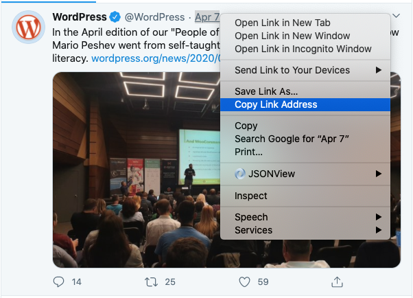

Depending on the version of Twitter Interface (Mobile or Desktop) you can also use the left option on the bottom of the tweet

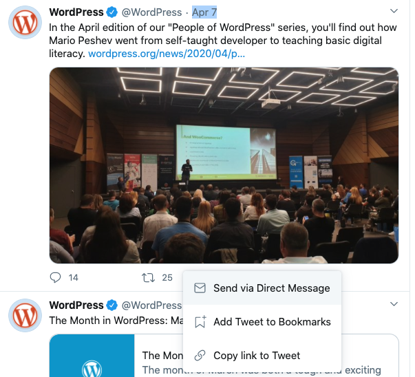

2.  **Go to your post or page**
3.  **Add the Twitter block**

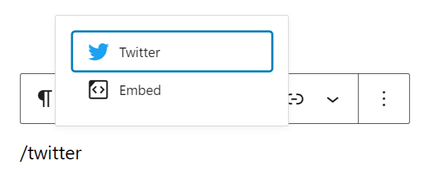

*Insert a Twitter block*

> [!NOTE]
> [Detailed instructions on adding blocks](../block-editor/adding-a-new-block.md)

4.  **Paste the link into the text box and click the “Embed” button**

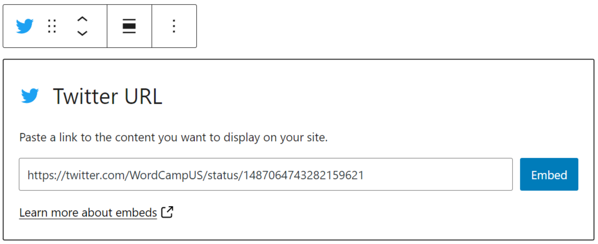

*Twitter block embed view*

If it’s a link that can be successfully embedded you will see a preview in your editor.

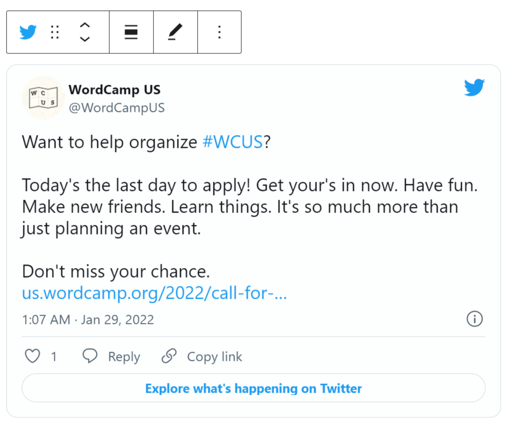

If you use an URL that can’t be embedded, the block shows the message *“Sorry, this content could not be embedded.”*

You will have two choices: Try again with a different URL or convert it to a link.

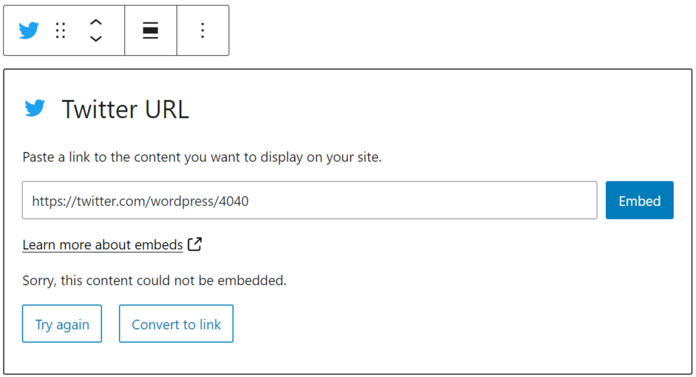

6.  **Click on “Preview” to see how it will look on the front-end**

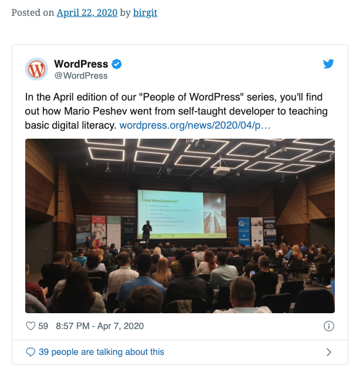

## Block Toolbar

Besides the “Mover” and “Drag & Drop Handle”, the Block Toolbar for the Twitter Embed block shows four buttons:

-   Transform to – also the icon for the block.
-   The drag handle
-   The move up and down options
-   Change alignment
-   Edit URL, and
-   More Options.

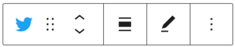

**Transform to**:

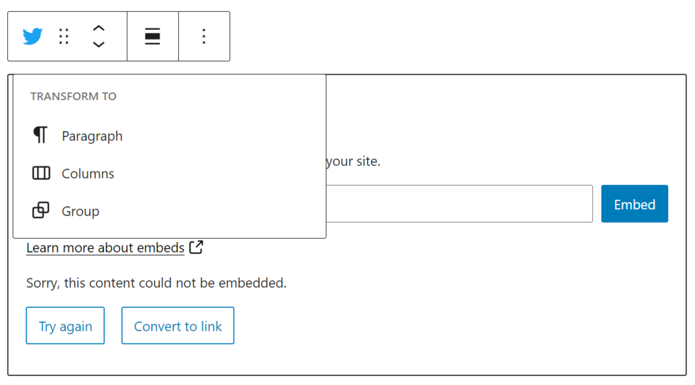

You can transform a Twitter embed to a Paragraph. This will convert the tweet embed to a link.

You can transform a Twitter embed to Columns.

You can transform a Twitter embed to a Group. This would give you the ability to change the background color around the Twitter embed.

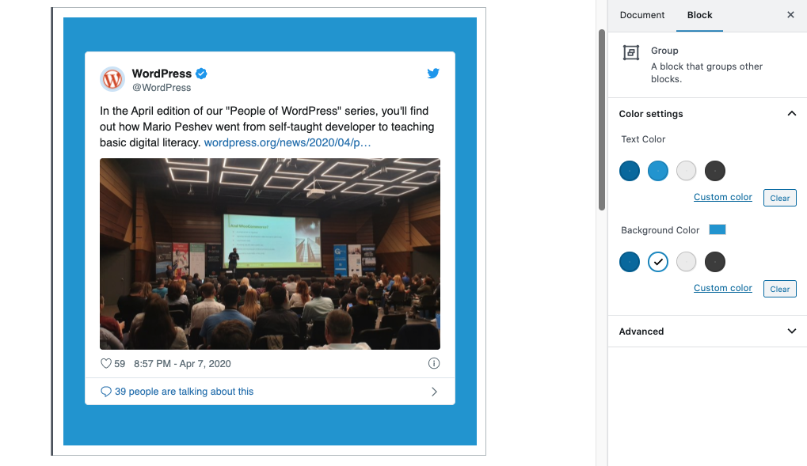

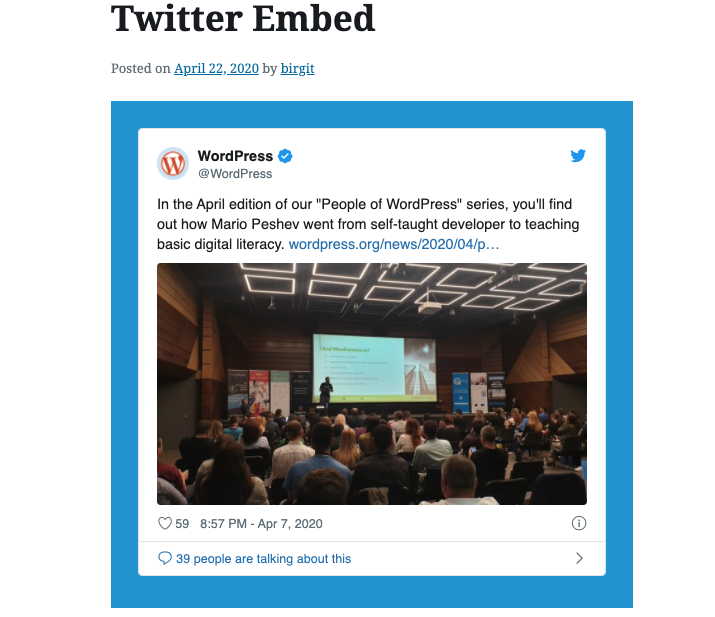

*Left: Editor view of an Twitter Embed as a group with Color Settings controls  Right: Twitter embed with a blue background.*

**Change Alignment**

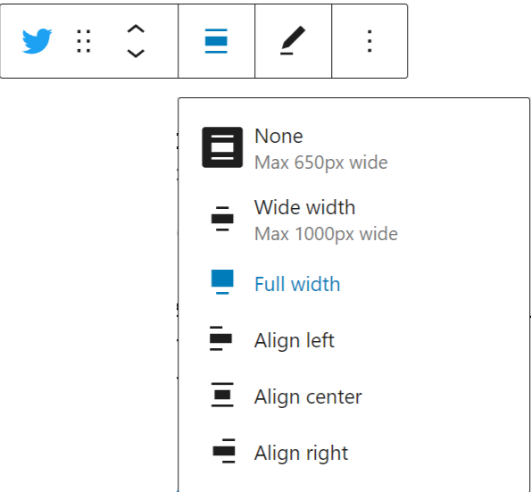

-   **None – Default alignment option.**
-   **Wide width – Increase the width of the post beyond the content size.**
-   **Full width – Extend the block to cover the full width of the screen.**
-   **Align left – Make the block left-aligned.**
-   **Align center – Make the block alignment centered.**
-   **Align right – Make the block right aligned.**

“Wide width” and “Full width” alignment need to be enabled by the Theme of your site.

**Edit URL**

Via the edit URL, you can change the Twitter Embed URL in the embed block. Overwrite the existing URL and click on the “Embed” Button on the right.

**More Options**

> [!NOTE]
> [Read about these and other settings.](../block-editor/more-options.md)

## Block Settings

Besides the Advanced section, the Twitter embed has only one setting in the “Block Settings” sidebar: Media Settings.

**Media Settings**

Via the *Media Settings* you can control the behavior of your post embed when viewed from a smaller device, like on a phone screen.

The Toggle switch turns on or off the resize functionality for smaller devices. The default setting is “on” or blue.

**“Off:”** This embed may not preserve its aspect ratio when the browser is resized. In the off position the toggle switch is gray.

**“On:”** This embed will preserve its aspect ratio when the browser is resized. The toggle switch turns blue in the “On” position.

**Advanced**

The following Advanced settings options are available: HTML Anchor, Additional CSS Class(es), Additional CSS, and Styles.

> [!NOTE]
> [Learn more about advanced settings.](../block-editor/advanced-settings-overview.md)

## Changelog

-   Updated 2026-06-29
    -   Linked to advanced settings
-   Updates 2022-11-27
    -   Removed redundant content
    -   Added alt text to images
-   Updated 2022-02-04
    -   Replace images with new screenshots for WordPress 5.9
    -   Updated text information for more settings for capitalisation
-   Updated 2020-08-18
    -   Replaced “More Options” – new screenshot
    -   Added “Move To” and “Copy” section under More Options
-   Updated: 2020-06-20
    -   Fixed typos
-   Updated: 2020-06-04
    -   Fixed typos
-   Updated: 2020-04-24
    -   Added it to the Embed Blocks category
-   Created 2020-04-22
