# VideoPress embed

[Go back to the list of **Blocks**](../block-editor/blocks-list.md)

With the VideoPress Embed block, you can embed videos from VideoPress into your posts and pages. You don’t need a VideoPress account to be able to embed them, although the video-sharing option should be enabled.

**Steps to embed a video from VideoPress**

1.  Find the video permalink – In the web player, select the video and click on the **Share** button.

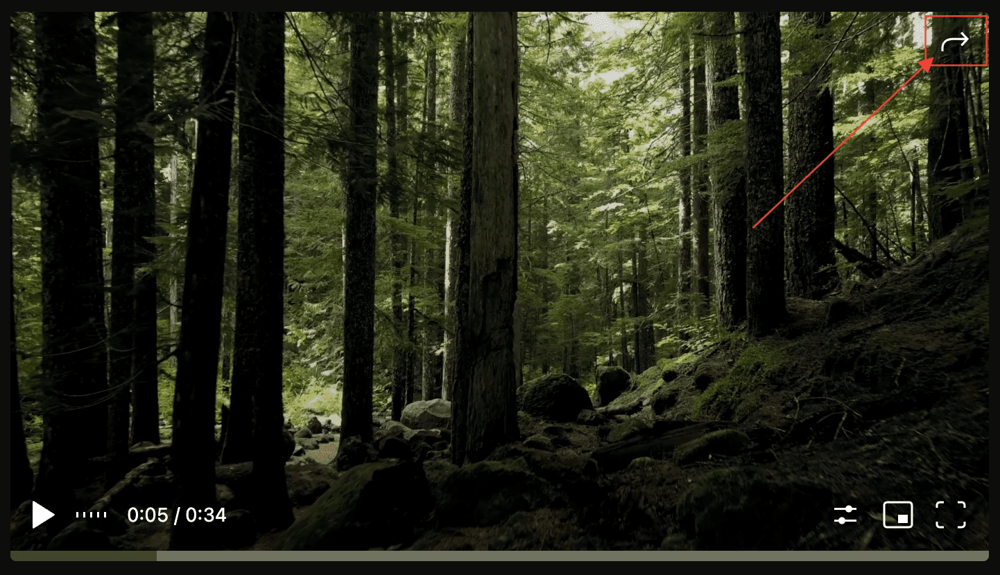

2.  In the share section, click on the permalink and it will be automatically copied. Alternatively, you can highlight the link and copy it.

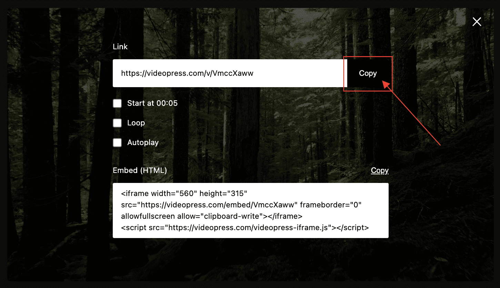

VideoPress provides you with three sharing options:

-   Start at = true/false to exactly the time you want the video to start at.
-   Loop = true/false to automatically play the video over and over.
-   Autoplay = true/false to automatically play the video when it loads.

3.  Add a VideoPress embed block to your page/post by clicking the **(+)** Block inserter icon.

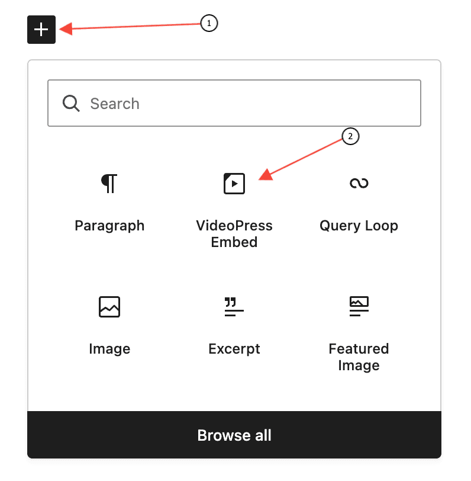

> [!NOTE]
> [Detailed instructions on adding blocks](../block-editor/adding-a-new-block.md)

4.  Paste the link into the text box and click on the **Embed** button.

If it’s a link that can be successfully embedded you will see a preview in your editor.

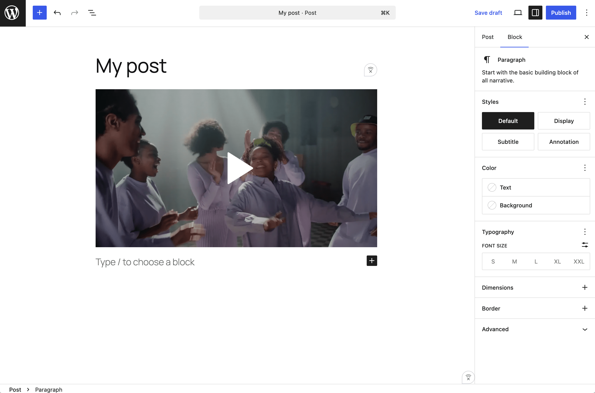

If you use an URL that can’t be embedded, the block shows the message “Sorry, this content could not be embedded.” You will have two choices: **Try again** with a different URL or **Convert to link**.

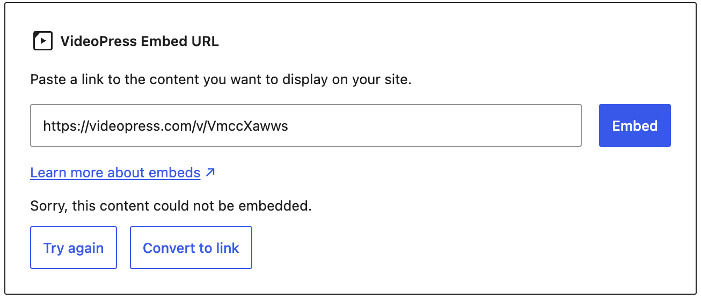

5.  Click on **Preview** to see how it will look on the front-end.

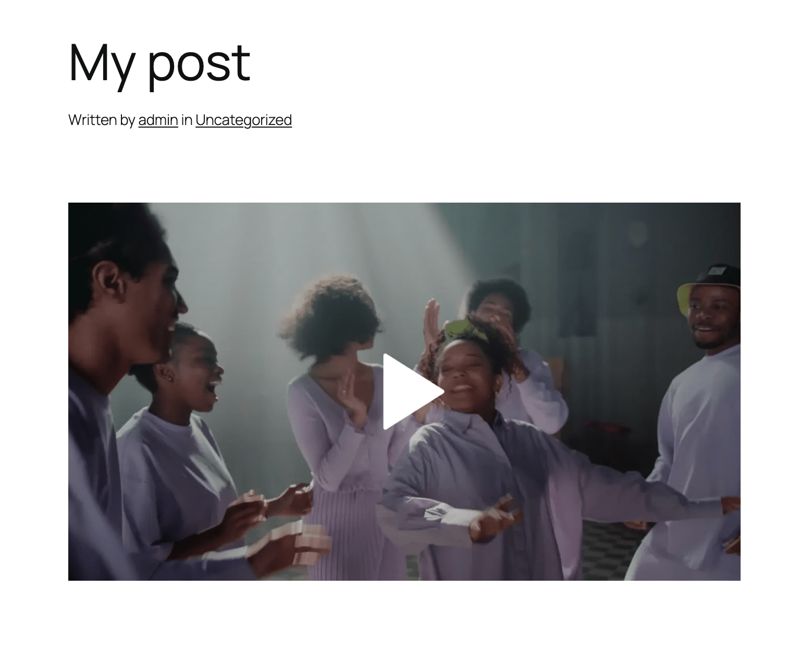

## Block toolbar

Besides the “Mover” and “Drag & Drop Handle”, the Block Toolbar for the VideoPress Embed block shows four buttons:

-   Transform to
-   Change Alignment
-   Edit URL, and
-   More Options

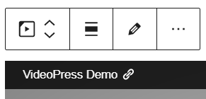

**Transform to**

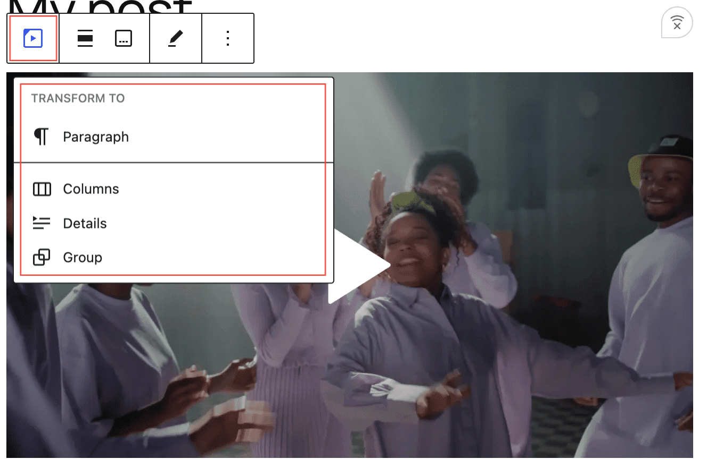

You can transform a VideoPress embed into a Group. This would give you the ability to change the background color around the VideoPress embed.

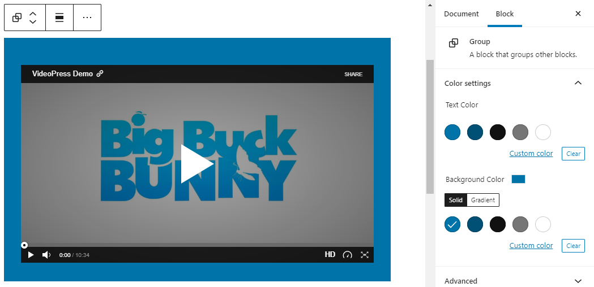

*Editor view of a VideoPress embed as a group with Color Settings controls*

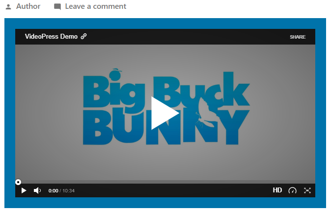

*VideoPress embeds with a blue background-color*

**Change alignment**

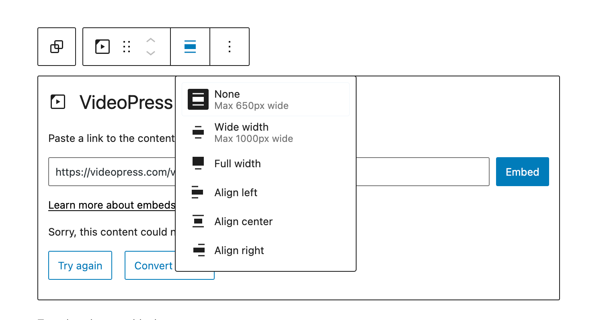

-   **Align left** – Make the VideoPress post. left aligned.
-   **Align center** – Make the VideoPress post alignment centered.
-   **Align right** – Make the VideoPress post, right aligned.
-   **Wide width** – Increase the width of the post beyond the content size.
-   **Full width** – Extend the VideoPress post to cover the full width of the screen.

**Wide width** and **Full width** alignment need to be enabled by the theme of your site.

**Edit URL**

Using the **Edit URL** button, you can change the VideoPress Embed URL in the embed block. Overwrite the existing URL and click on the **Embed** button.

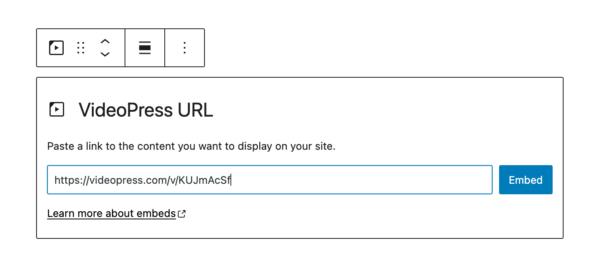

**More options**

These controls give you the option to copy, duplicate, and edit your block as HTML.

> [!NOTE]
> [Read about these and other settings.](../block-editor/more-options.md)

## Block settings

Besides the **Advanced** section, the VideoPress embed has only one setting in the **Block Settings** sidebar.

**Media**

Via the **Media Settings**, you can control the behavior of your post embed when viewed from a smaller device, like on a phone screen.

The Toggle switch turns on or off the resize functionality for smaller devices. The default setting is “on” or blue.

**Off:** This embed may not preserve its aspect ratio when the browser is resized. In the **Off** position, the toggle switch is gray.

**On:** This embed will preserve its aspect ratio when the browser is resized. The toggle switch turns blue in the **On** position.

**Advanced**

The following Advanced settings options are available: HTML Anchor, Additional CSS Class(es), Additional CSS, and Styles.

> [!NOTE]
> [Learn more about advanced settings.](../block-editor/advanced-settings-overview.md)

## Changelog

-   Updated 2026-06-29
    -   Linked to advanced settings
-   Updated 2022-11-25
    -   Removed redundant content
    -   Aligned images for mobile view
    -   Added alt text to images
-   Updated “More Options” sections: replaced screenshot and added text for “Move to” and “Copy”
-   Updated 2020-08-19
    -   Replaced “More Options” – new screenshot
    -   Added “Move To” and “Copy” section under More Options
-   Updated 2020-08-11
    -   Screenshots as per WordPress 5.5
    -   Embedded VideoPress video
-   Created 2020-07-27
