# WordPress embed

[Go back to the list of **Blocks**](../block-editor/blocks-list.md)

With the WordPress Embed block, you can embed WordPress posts into your posts and pages. You don’t need a WordPress account to be able to use it. You can only embed public posts, though.

**An Example:**

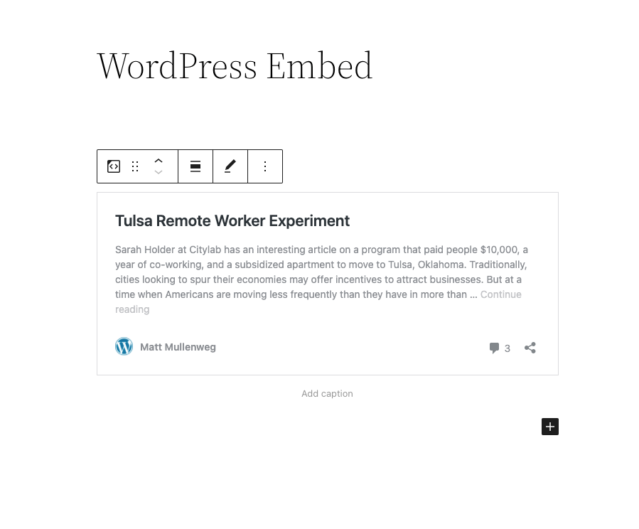

**Steps to embed a WordPress Post**

1.  **You need to find the URL of the Post.**

Find the URL of the WordPress post you want to embed in your page. Copy the link of that post from the search bar.

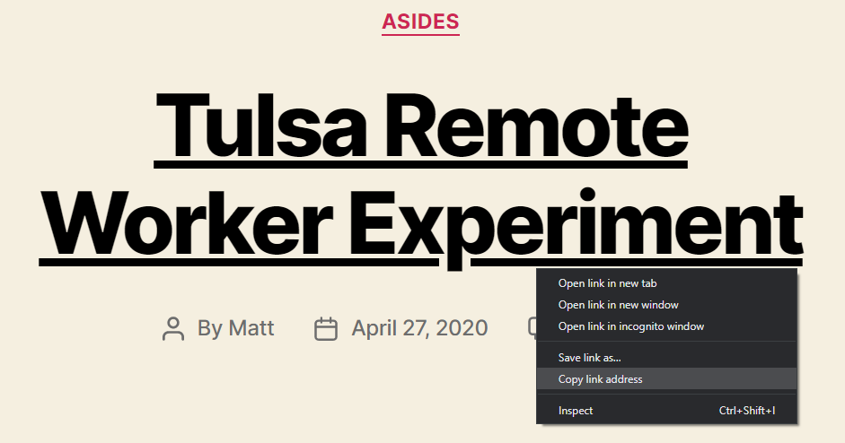

2.  **Go to your post or page**
3.  **Add the WordPress block**

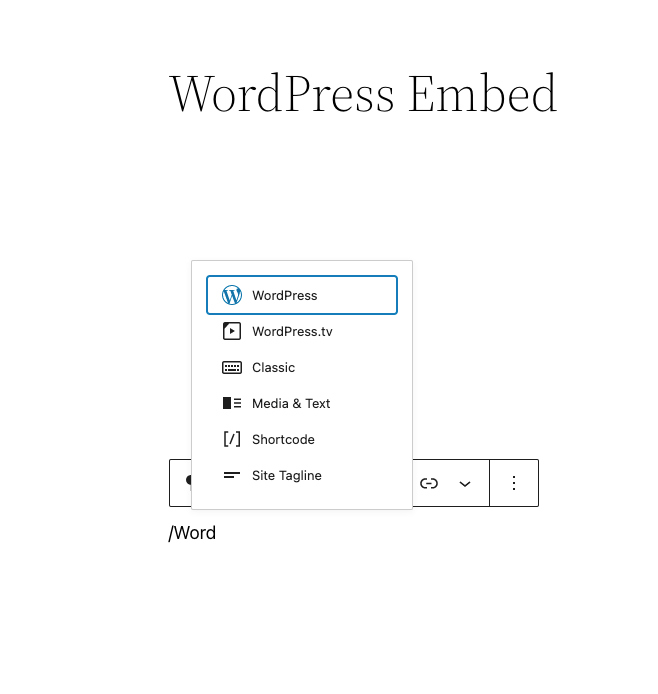

> [!NOTE]
> [Detailed instructions on adding blocks](../block-editor/adding-a-new-block.md)

4.  **Paste the link into the text box and click the “Embed” button**

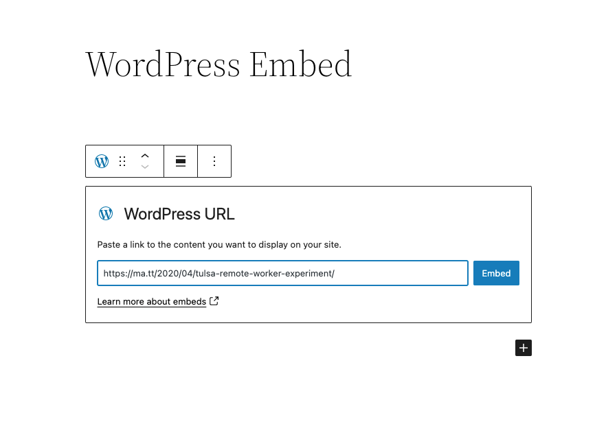

If it’s a link that can be successfully embedded you will see a preview in your editor.

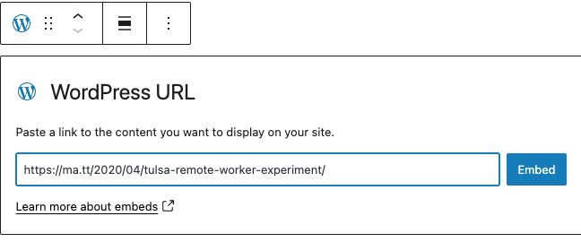

If you’re using a link that cannot be embedded, the block shows a message, “*Sorry, this content could not be embedded.*”

You will have two choices: Try again with a different URL or convert it to a link.

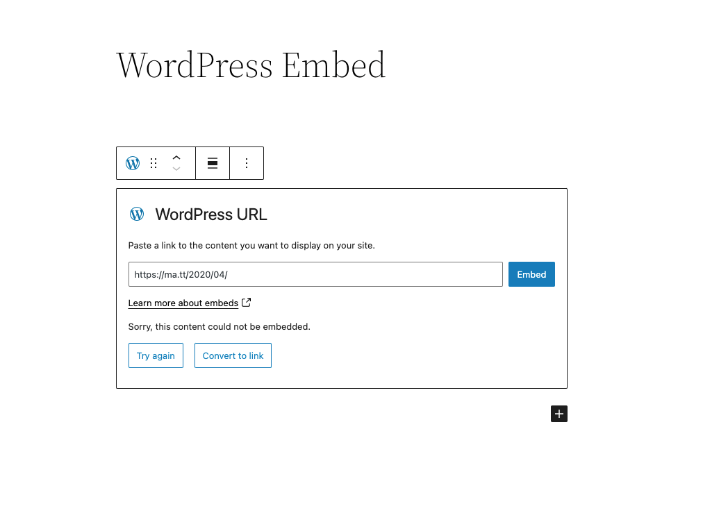

**6. Click on “Preview” to see how it will look on the front-end.**

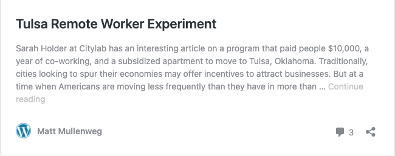

## Block Toolbar

Besides the Mover and Drag & Drop Handle, the Block Toolbar for the WordPress embed shows four buttons:

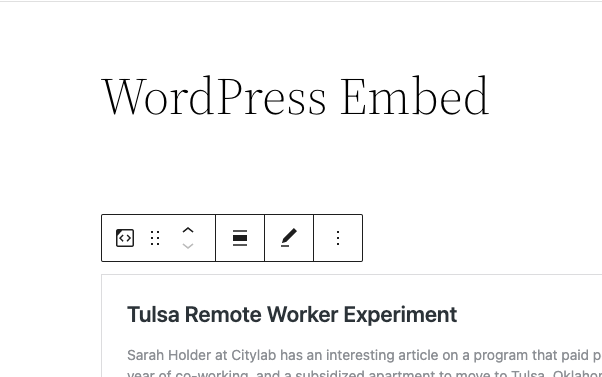

-   Transform to
-   Change alignment
-   Edit URL, and
-   More Options.

**Transform to**:

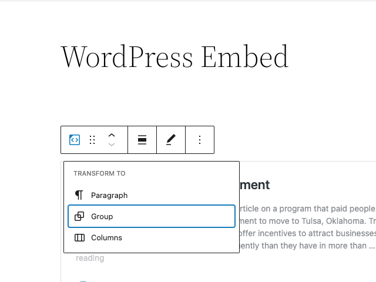

You can transform a WordPress embed to a Group. This would give you the ability to change the background color around the WordPress embed.

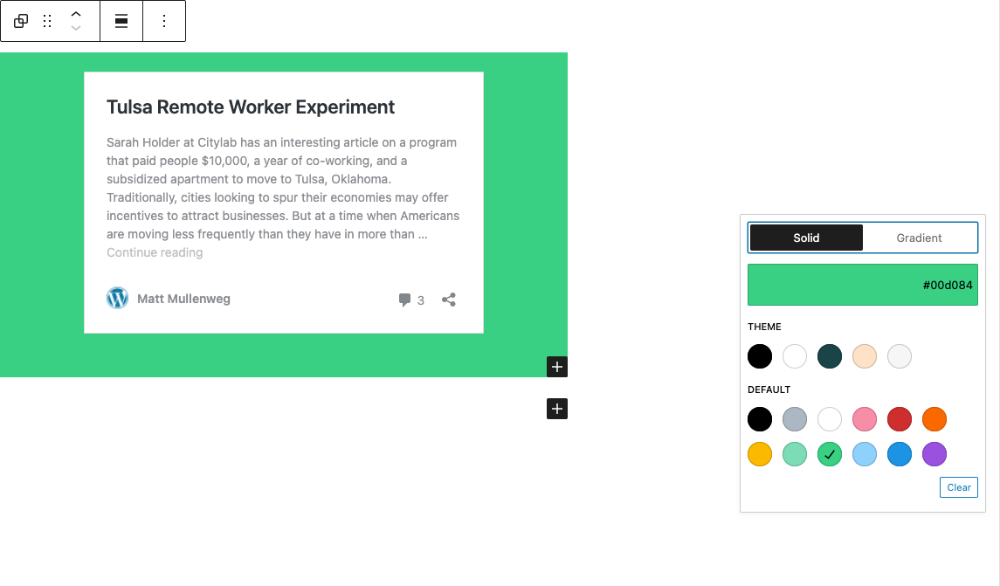

*Editor view of an WordPress Embed as a group with Color Settings controls*

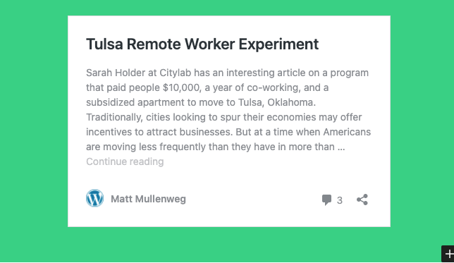

*WordPress Embed with a green background.*

**Change Alignment**

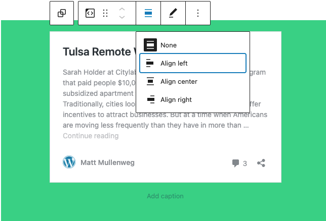

-   **Align left** – Make the WordPress post left aligned
-   **Align center** – Make the WordPress post alignment centered
-   **Align right** – Make the  WordPress post align right

**Edit URL**

Via the edit URL, you can change the WordPress Embed URL in the embed block. Overwrite the existing URL and click on the “Embed” Button.

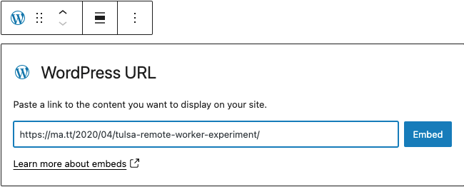

**More Options**

> [!NOTE]
> [Read about these and other settings.](../block-editor/more-options.md)

## Block Settings

### Media Settings

Via the *Media Settings* you can control the behavior of your post embed when viewed from a smaller device, like on a phone screen.

The Toggle switch turns on or off the resize functionality for smaller devices. The default setting is “on” or blue.

**“Off:”** This embed may not preserve its aspect ratio when the browser is resized. In the off position the toggle switch is gray.

**“On:”** This embed will preserve its aspect ratio when the browser is resized. The toggle switch turns blue in the “On” position.

**Advanced**

The following Advanced settings options are available: HTML Anchor, Additional CSS Class(es), Additional CSS, and Styles.

> [!NOTE]
> [Learn more about advanced settings.](../block-editor/advanced-settings-overview.md)

## Changelog

-   Updated 2026-06-29
    -   Linked to advanced settings
-   Updated 2022-11-26
    -   Removed redundant content
    -   Added alt text to images
-   Updated 2022-04-19 – new screenshots
-   Updated 2020-08-18
    -   Replaced “More Options” – new screenshot
    -   Added “Move To” and “Copy” section under More Options
-   Created 2020-05-25
