# YouTube embed

[Go back to the list of **Blocks**](../block-editor/blocks-list.md)

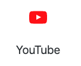

Using the YouTube Embed block you can include a YouTube video into your post/page with play buttons, so your visitor can stay on your site to watch it.

You don’t need a YouTube account to embed a video.

Not all videos can be shared this way, though. The publisher needs to “Allow Embedding” in the settings of the video and some publishers restrict the countries, where videos can be shared.

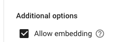

*This setting can be found YouTube Studio:   Edit Video > More Options > Check “Allow embedding*

Non-personal identifying viewing data will be shared with YouTube and the publisher of the video. *Please consult the [privacy policies and information](https://support.google.com/policies/answer/9664901) on YouTube if your site is visited by children.*

**Six Steps to embed a YouTube Video in your post or page**

1.  Find your video on YouTube.com, and copy the URL of the video from the browser bar

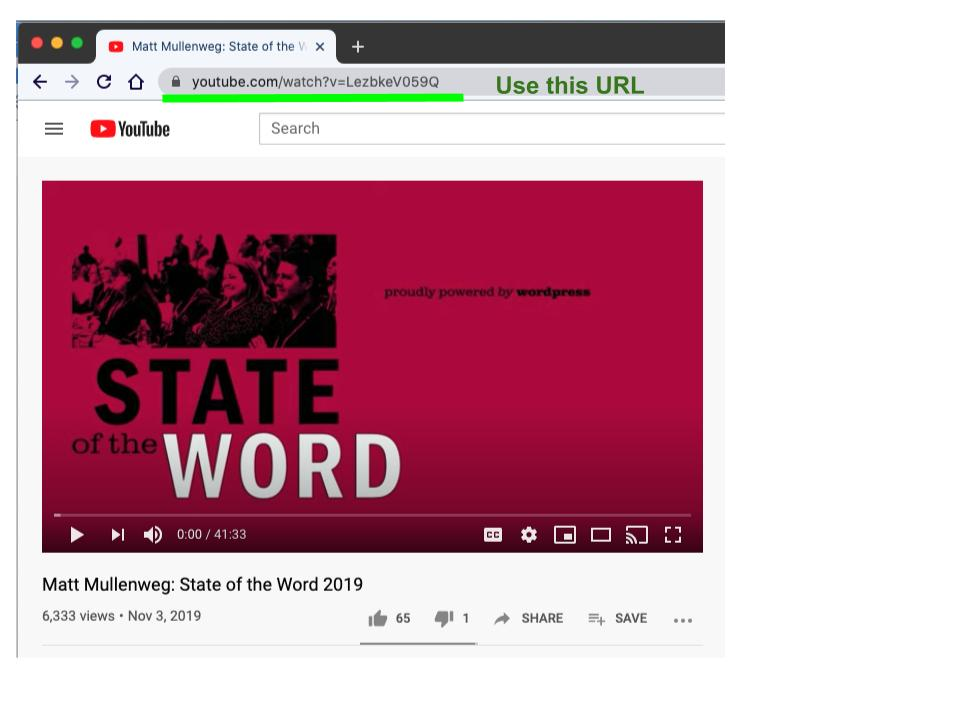

2.  **Add a YouTube Embed block to your post.**

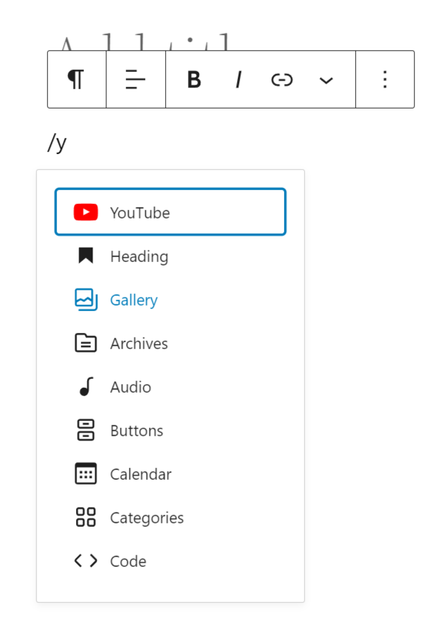

*Adding a block via the “Slash” command from an empty row*

> [!NOTE]
> [Detailed instructions on adding blocks](../block-editor/adding-a-new-block.md)

3.  **Paste the YouTube URL** from Step 1
4.  **Click on the “Embed” Button**

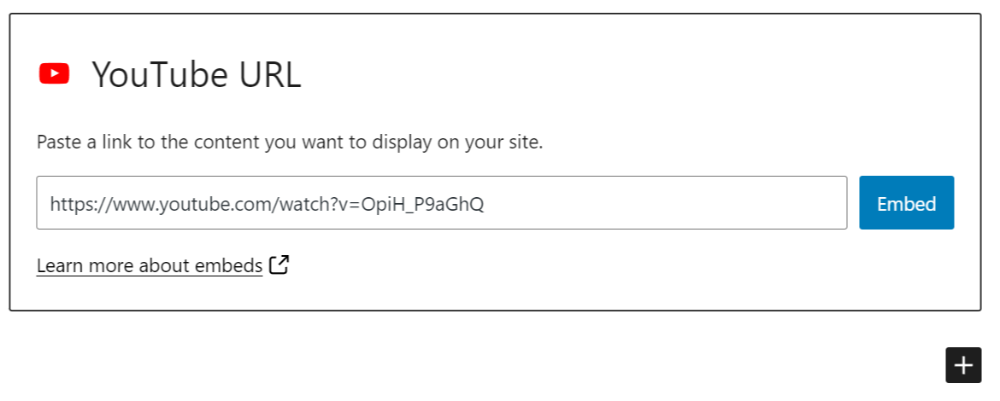

5.  **You see the YouTube video in your editor.**

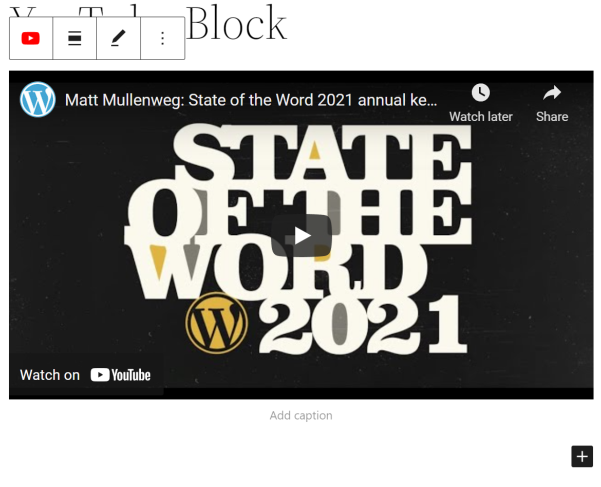

*After Embed of a YouTube video*

6.  **Clicking on Preview**, will show you the display on the front end of your page.

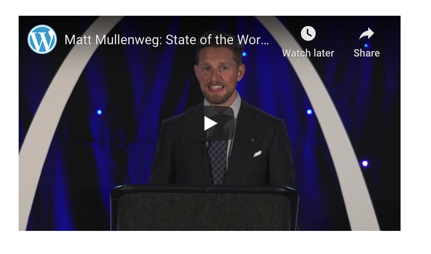

## Embed other YouTube links

### Playlist

A playlist URL can be embedded and the first video of the list shows in the embed box, with additional navigation for the playlist in the top right corner.

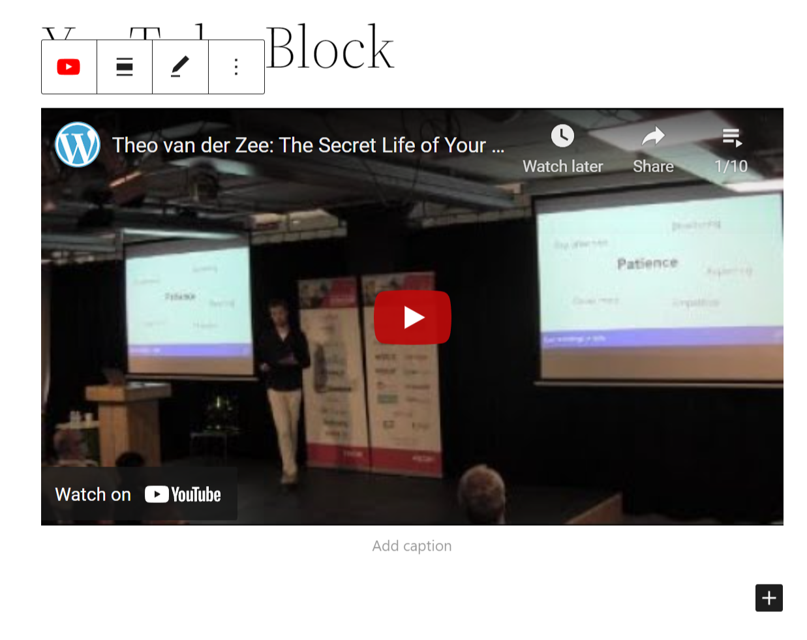

### Live Streams

YouTube Live stream URLs are supported in the form of `youtube.com/live/videocode`

### Unsupported URLs

Not all YouTube links can be used for an embed. When an URL is used that is not suited for embedding, the Block editor offers you two options: to try a different URL or convert the current URL into a Text link.

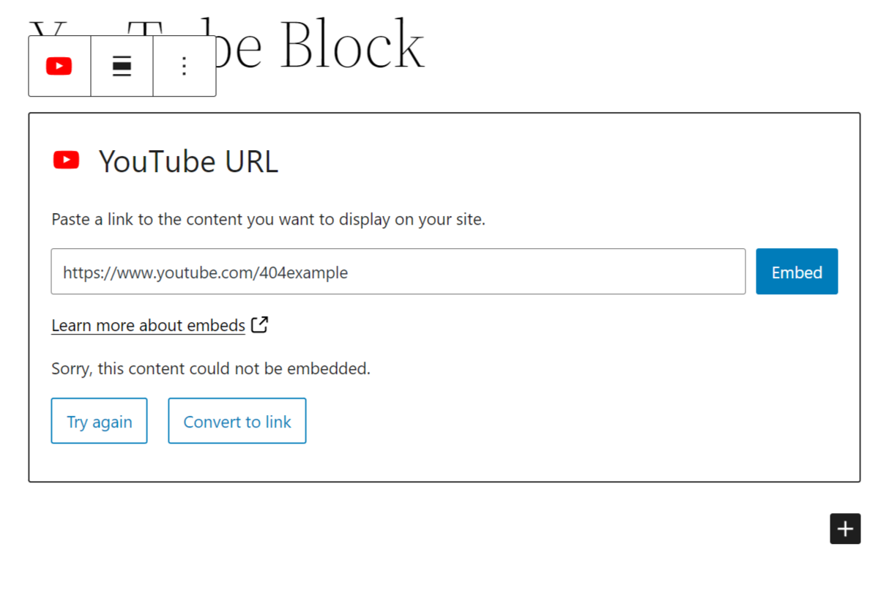

## Block Toolbar

Next to the YouTube icon is the “Drag & Drop Handle”. This can be used to drag your block to another section of your page.

Next to this is the “Mover”. Up and Down options are presented.

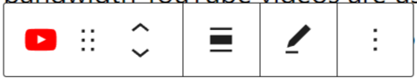

*YouTube block toolbar*

**Change Alignment**

After the first separator line you have the “Change alignment” tool.

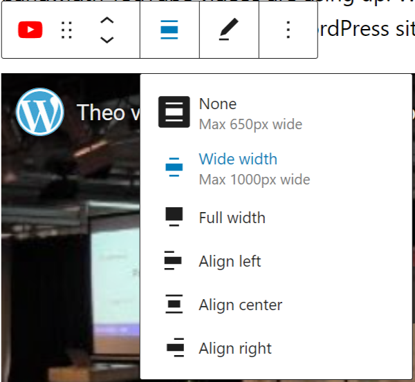

*Change alignment option – YouTube Block*

The alignment has variable options depending on your theme.

-   **None – Default alignment option.**
-   **Wide width – Increase the width of the post beyond the content size.**
-   **Full width – Extend the block to cover the full width of the screen.**
-   **Align left – Make the block left-aligned.**
-   **Align center – Make the block alignment centered.**
-   **Align right – Make the block right aligned.**

“Wide width” and “Full width” alignment need to be enabled by the Theme of your site.

**Edit URL**

Clicking on the Edit button will bring up the view for adjusting your URL for the Video Embed.

Via the edit URL, you can change the YouTube Embed URL in the embed block. Overwrite the existing URL and click on the “Embed” button on the right.

**More Options**

These controls give you the option to copy, duplicate, and edit your block as HTML.

> [!NOTE]
> [Read about these and other settings.](../block-editor/more-options.md)

## Block Settings

Besides the “Advanced” section, the YouTube embed has only one setting in the “Block Settings” sidebar: Media Settings.

### Media Settings

Via the *Media Settings* you can control the behavior of your post embed when viewed from a smaller device, like on a phone screen.

The Toggle switch turns on or off the resize functionality for smaller devices. The default setting is “on” or blue.

**“Off:”** This embed may not preserve its aspect ratio when the browser is resized. In the off position the toggle switch is gray.

**“On:”** This embed will preserve its aspect ratio when the browser is resized. The toggle switch turns blue in the “On” position.

**Advanced**

For a YouTube embed, there are default CSS classes to allow for responsive handling of the embed when viewed on smaller devices like mobile phones. For more information on how these classes work and what your theme needs to support them, see [Responsive embedded content](https://developer.wordpress.org/block-editor/how-to-guides/themes/theme-support/#responsive-embedded-content) in the Block Editor Handbook.

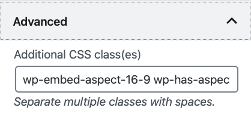

*The advanced section lets you add a CSS class to your block.*

The following Advanced settings options are available: HTML Anchor, Additional CSS Class(es), Additional CSS, and Styles.

> [!NOTE]
> [Learn more about advanced settings.](../block-editor/advanced-settings-overview.md)

## Changelog

-   Updated 2026-06-29
    -   Linked to advanced settings
-   Updated 2023-08-24
    -   Added Live Streams section
-   Updated 2022-11-23
    -   Removed redundant data
    -   added alt text on some images
    -   aligned images for mobile view
-   Updated 2022-02-04
    -   Change Screenshots to 5.9
    -   Removed the group area from toolbar options
    -   Updated the flow of the document to represent what is in the toolbar
    -   Updated labels for more settings to fit 5.9
-   Updated 2020-08-18
    -   Replaced “More Options” – new screenshot
    -   Added “Move To” and “Copy” section under More Options
-   Updated 2020-05-26
    -   Fixed some typos
-   Created 2020-04-21
