# File block

[Go back to the list of Blocks](../block-editor/blocks-list.md)

The File block allows you to add a link to the downloadable files on your website.

<video controls preload="metadata" src="https://wordpress.org/documentation/files/2019/03/Kapture-2026-03-02-at-21.16.47.mp4"></video>

## Add a File block

1.  To add a File block, use the **Block Inserter** (+), or you can type `/file` in a new paragraph block and press enter.

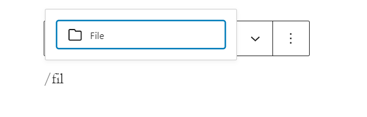

> [!NOTE]
> [Detailed instructions on adding blocks](../block-editor/adding-a-new-block.md)

2.  To add a file, you can use the upload button to upload your files directly from your computer, or you can click **Media Library** to add files from your media library.

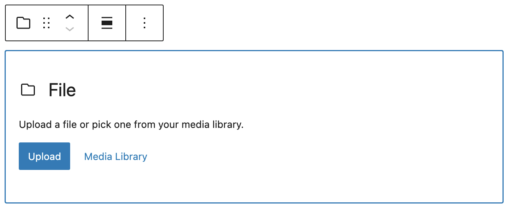

After you add a file, you can edit the file name by typing inside the rectangle. You can click **Replace** to replace the file and upload another one. You can click **Copy URL** to copy the URL of the file.

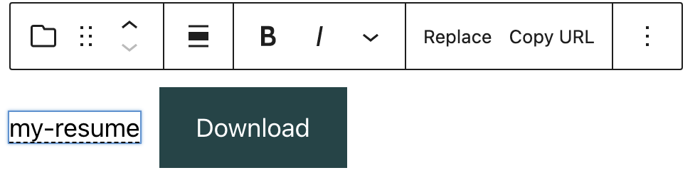

If you try to upload an unsupported file, you will see an error notification at the bottom-left corner of the screen.

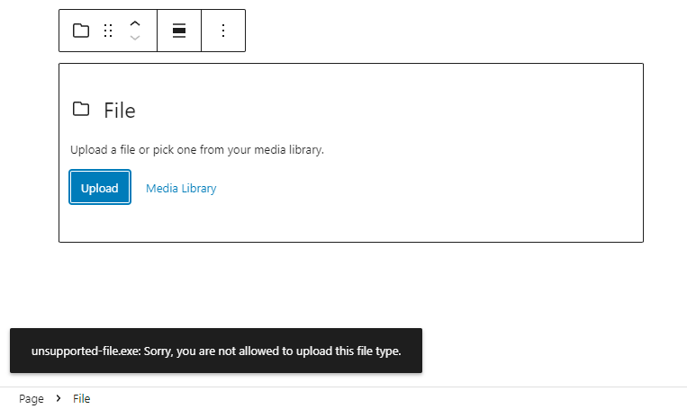

3\. Content-Only Editing Support

The **File block** supports **content-only editing**, allowing editors to update the block’s inner content—such as the file name and download button text—without modifying its structure or settings.

<video controls preload="metadata" src="https://wordpress.org/documentation/files/2019/03/file-content-editing.mp4"></video>

Key Features:

-   Available when using **Write mode** in the Site Editor.
-   Enables quick updates to file content in locked templates or sections.
-   Matches behavior of other media blocks like the Image block.

### User roles and capabilities

Some elements of the File block are only available to certain user roles. By default, only Administrators, Editors and Authors can upload a file using the file block. [Learn more about WordPress user roles and capabilities.](../../support-guides/dashboard/roles-and-capabilities.md)

## Block toolbar

Every block comes with unique toolbar icons and block-specific user controls that allow you to manipulate the block right in the editor.

The File block has seven buttons:

-   Transform to
-   Drag icon
-   Move handles
-   Change alignment
-   Replace
-   Copy URL
-   More options

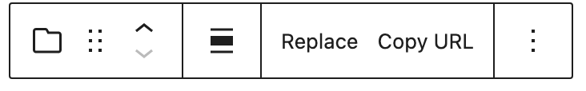

**Transform to:**

The **Transform** button allows you to convert the File block into other block types while preserving its content.

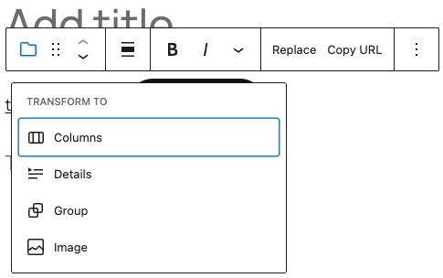

*Transform tool in the File block*

-   **Image** – Convert the file block into an image block if suitable.
-   **Columns** – Place the file within a multi-column layout.
-   **Details** – Wrap the file in a collapsible details/summary block.
-   **Group** – Group the file with other blocks for shared styling.

**Drag icon**

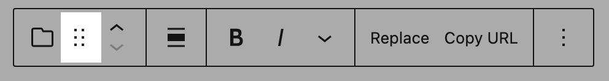

To drag and drop the block to a new location on the page template, click and hold the rectangle of dots, then drag to the new location. The blue separator line indicates where the block will be placed. Release the left mouse button when you find the new location to place the block.

**Move handles**

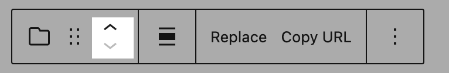

The up and down arrow icons can be used to move a block up and down on the page.

> [!NOTE]
> [Get more information about moving a block within the editor.](../block-editor/moving-blocks.md)

**Change Alignment**

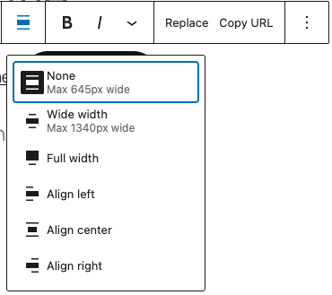

*Change alignment in the File block*

Using the alignment drop-down from the toolbar, you can align the file block to the left, make it center-aligned, or align it to the right. You can also make the File block wide width and full width.

### Replace

Using the Replace button, you can replace your file by uploading a new one from your device or adding another one from your media library.

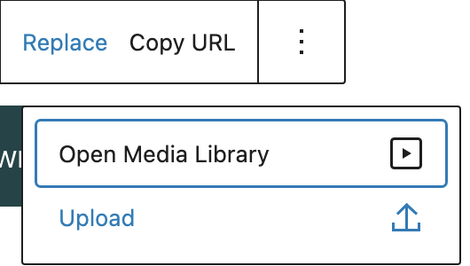

### Copy URL

Click Copy URL to copy the URL of the file to your clipboard. You will see a message on the bottom left corner of your browser saying the URL has been copied.

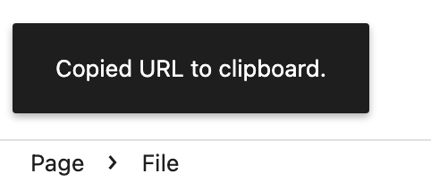

### Bold & Italic

Use the “Bold” option or “Ctrl+B” / “Cmd+B” on your keyboard to bold it, which is usually heavier than the surrounding text.

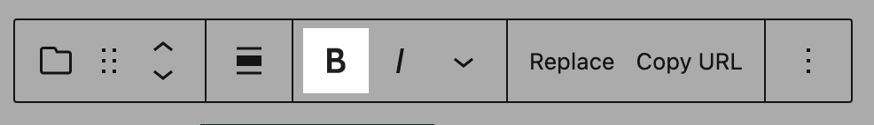

Use the “Italic” option or “Ctrl+I” / “Cmd+I” on your keyboard to italicize it, which usually appears slanted to the right.

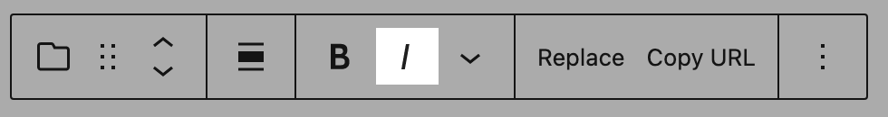

### More rich text controls

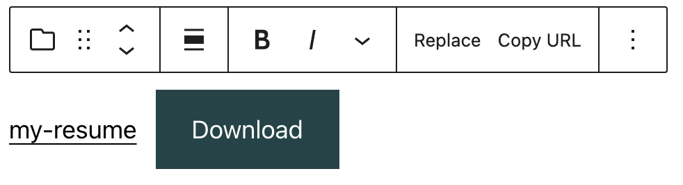

The drop-down menu to the right of the italic button contains a range of additional rich text editing options such as highlighting, inline code, strikethrough, and more.

> [!NOTE]
> [Read about more rich text editing options.](../block-editor/more-text-editing-overview.md)

### More options

The [More options menu](../block-editor/more-options.md) represented by **three vertical dots on the far right of the toolbar** gives you more features such as the ability to duplicate, remove, or edit your block as HTML.

> [!NOTE]
> [Read about these and other settings.](../block-editor/more-options.md)

## Block settings

Every block has specific options in the editor sidebar in addition to the options found in the block toolbar. If you do not see the sidebar, simply click the **cog** icon next to the **Publish** or **Update** button.

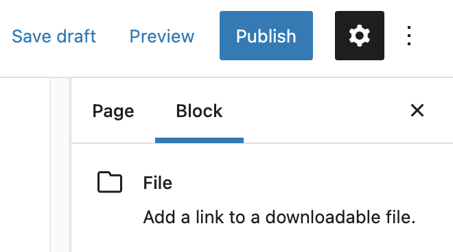

The File block offers the following settings

### Settings

You can choose whether to link to the media file directly or a separate attachment page by using the drop-down menu. If you want the media file/attachment page to open in a new tab, enable the **Open in a new tab** button.

The File block comes with a **Download** button that can be toggled on and off using the **Show download button**.

By toggling it off, the file name will appear as a link.

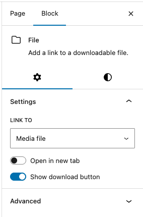

*Settings Sidebar for the File block*

If you upload a PDF file, you’ll see a PDF settings section on the block settings.

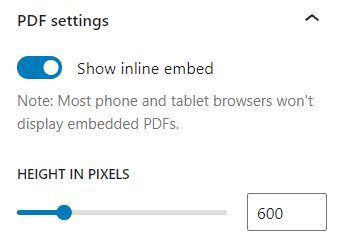

You can embed PDF on your page or post by enabling the **Show inline embed** option. When it’s enabled, you’ll see the **height in pixels** setting that lets you adjust the PDF display by using the slider or entering a value in pixels.

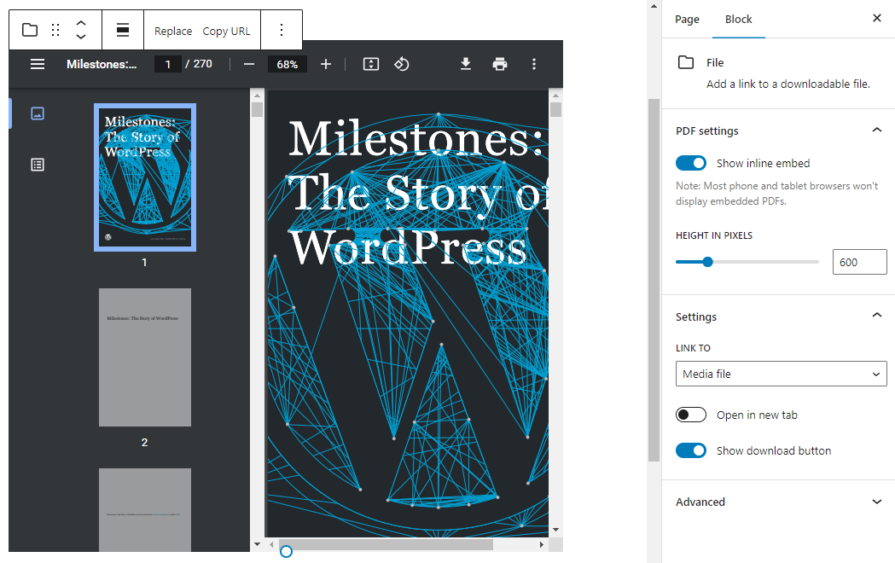

### Styles

The Styles tab allows you to customize the appearance of the File block.

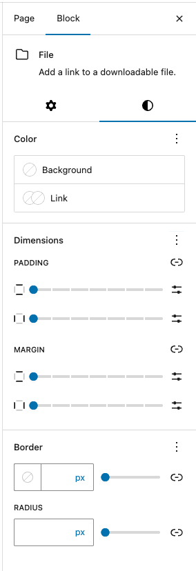

*Styles Sidebar for the File block*

### Color

Text and background colors can be set on a per-block basis, allowing you to call attention to important content. Using the Color settings, you can customize the block by adding text, background, and link colors.

> [!NOTE]
> [See this guide for more information about changing colors.](../block-editor/colors-settings-overview.md)

### Dimensions

The File block provides various options to adjust its dimensions, such as width and height, allowing you to customize the text layout to ensure visual consistency.

> [!NOTE]
> For details refer to this support article: [Dimension settings overview](../block-editor/dimension-controls-overview.md)

### Border

The File block provides border settings options to add border color, width, and radius.

> [!NOTE]
> For details refer to this support article: [Border settings overview](../block-editor/border-settings-overview.md)

### Advanced

The File block provides the following Advanced settings options: HTML Anchor, Additional CSS Class(es), Additional CSS, and Styles.

> [!NOTE]
> [Learn more about advanced settings](../block-editor/advanced-settings-overview.md)

## Changelog

-   Updated 2026-05-25 (props to @kjoyner @awetz583)
    -   Updated “Advanced” section to refer to new overview page
-   2026-03-02 (props to @markusmai @nith53 @jyolsna @wowashuwow @awetz583)
    -   Added user roles and capabilities section
    -   Updated more rich text controls
    -   Updated video
-   2025-04-29 (props to [@karthickmurugan](https://profiles.wordpress.org/karthickmurugan/))
    -   Add Content-only editing support section.
    -   Update screenshots to 6.8 version.
    -   Update Transform to section.
-   Updated 2023-08-13
    -   Updated More Options
-   Updated 2022-11-16
    -   Updating screenshots, video and content for 6.1, added info for PDF settings
-   Updated 2022-06-21
    -   Updated content and screenshots for 6.0
    -   Added ALT Tags for images
-   Updated 2022-06-07
    -   Add video for 6.0
-   Updated 2020-09-19
    -   Updated new block toolbar features
    -   Updated new block settings features
    -   Updated 5.5 screenshots
-   Updated 2020-06-18
    -   Added ‘Link back to blocks’ to the top of the page
    -   Converted the ‘Advance’ reusable block to a regular block
    -   Added the ‘Changelog’
-   Created 2019-03-07
