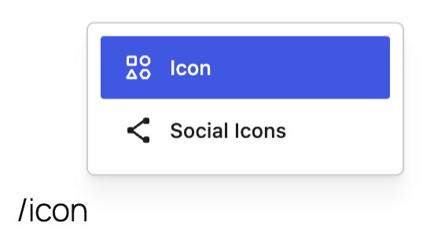
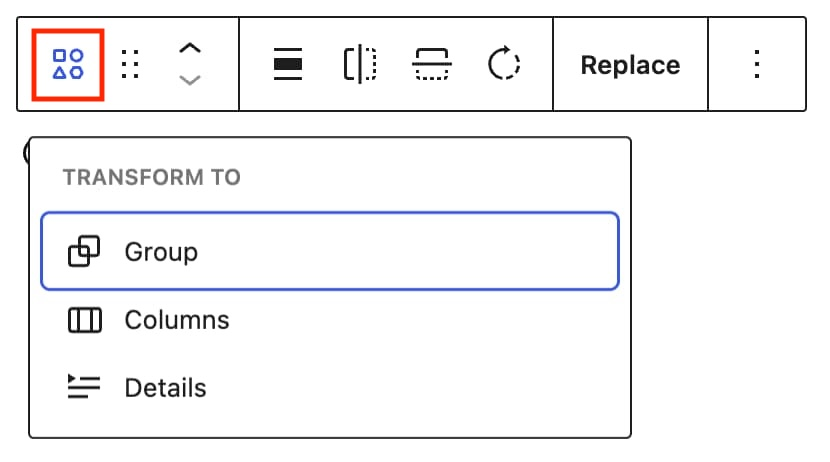
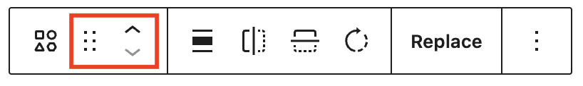
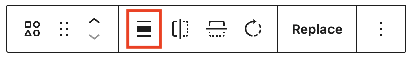
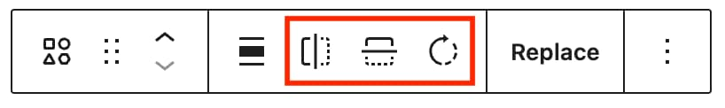
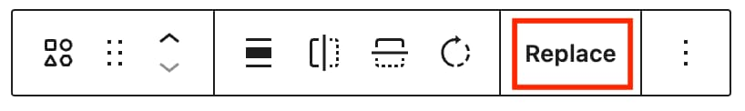
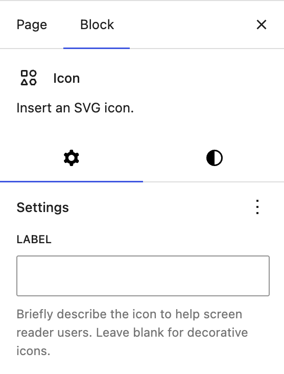

# Icon block

[Go back to the list of Blocks](../block-editor/blocks-list.md)

The Icon block lets you easily add icons to your pages, posts, templates, and template parts. Icons can be resized without losing quality and support custom colors for both the icon and its background.

<!-- VideoPress embed (iframe removed): https://videopress.com/embed/p53kL5Ma -->

https://videopress.com/v/p53kL5Ma

## Add an Icon block

To add an Icon block, open the Block Inserter tool by clicking the Block Inserter + icon in the top toolbar. Look for the Icon block by using the search bar to find the right block to add. Then, click the icon to insert the Icon block into the editor.

Alternatively, click the Block Inserter (+) icon in the editor, then choose the Icon block after searching for it in the pop-up window.

You can also use a (/) slash command by typing `/icon` in the editor.

## Block toolbar

Each block has its own block-specific controls that allow you to manipulate the block right in the editor. If you hover over the buttons, tooltips will show what each button does.

### Transform to

Click on the Transform button to convert the Icon block into a Columns, Details, or Group block.

### Block moving tools

The block-moving tools allow you to move the block in the editor. Use the six dots icon to drag and drop the block and place it anywhere on the page. Alternatively, click on the up and down arrows to move the block up or down.

> [!NOTE]
> [Get more information about moving a block within the editor](../block-editor/moving-blocks.md)

### Align

Use the change alignment tool to align the Icon block. Choose one of the following options:

-   **None –** removes any alignment setting.
-   **Align left –** aligns the block left.
-   **Align center –** aligns the block to the center.
-   **Align right –** aligns the block right.

### Flip horizontal, Flip vertical and Rotate

Use these controls in the block toolbar or settings sidebar to adjust the orientation of your icon.

### Replace

Select **Replace** to choose a different icon from the library.

### More options

The More options menu represented by three vertical dots on the far right of the toolbar gives you more features such as the ability to duplicate or remove the block.

> [!NOTE]
> [Read about these and other settings](../block-editor/more-options.md)

## Block settings

Every block has specific options in the editor sidebar in addition to the options found in the block toolbar. If you don’t see the sidebar, click on the **Settings** button next to the Save/Publish button.

The Icon block settings panel is divided into two tabs – **Settings**, and **Styles**.

### Settings

When you select the Accordion block **Settings tab**, represented by a gear icon, you will see the following settings in the sidebar:

#### Label

Add a label to briefly describe the icon to help screen reader users or leave blank for decorative icons.

#### Advanced

The Icon block provides the following Advanced settings options: HTML Anchor, Additional CSS Class(es), Additional CSS, and Styles.

> [!NOTE]
> [Learn more about advanced settings](../block-editor/advanced-settings-overview.md)

### Styles

When you click on the **Styles tab**, represented by a half-filled circle, within the Block Settings sidebar, you will see the following options:

#### Color

The Icon block provides Color settings options to change the text and background colors.

> [!NOTE]
> [See this guide for more information about changing colors](../block-editor/colors-settings-overview.md)

#### Dimensions

The Icon block provides dimension settings options to change width, padding, and margin size.

> [!NOTE]
> [Learn more about dimension controls](../block-editor/dimension-controls-overview.md)

#### Border

The Icon block provides border settings options to add border color, width, and radius.

> [!NOTE]
> [Learn more about border settings](../block-editor/border-settings-overview.md)

## Changelog

-   Updated 2026-08-20 (props @awetz573 @milana_cap)
    -   Updated screenshots and recording for 7.1
    -   Added Flip horizontal, Flip vertical and Rotate to block toolbar
-   Created 2026-05-20 (props @awetz583 @moltilearn8)
