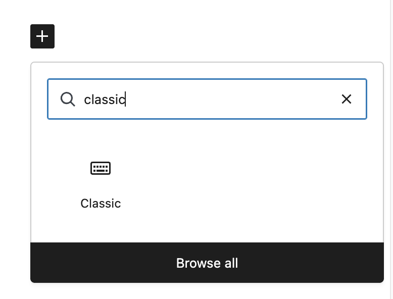
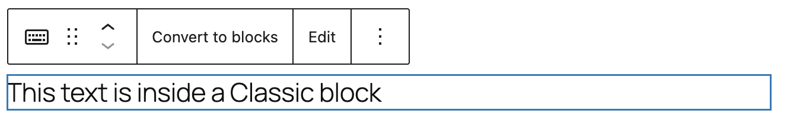
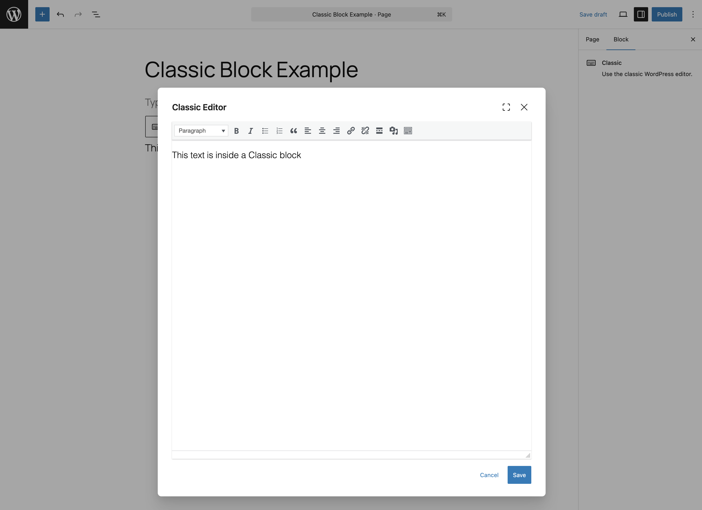

# Classic block

[Go back to the list of Blocks](../block-editor/blocks-list.md)

The Classic block looks just like the classic editor, but it’s in block form. Custom TinyMCE buttons are found in this block.

## Add a Classic block

To add a Classic block, open the Block Inserter tool by clicking the Block Inserter + icon in the top toolbar. Look for the Classic block by using the search bar to find the right block to add. Then, click the icon to insert the Classic block into the editor.

Alternatively, click the Block Inserter (+) icon in the editor, then choose the Classic block after searching for it in the pop-up window.

You can also use a (/) slash command by typing `/classic` in the editor.

> [!NOTE]
> [Read detailed instructions on adding blocks.](../block-editor/adding-a-new-block.md)

## Block toolbar

Each block has its own block-specific controls that allow you to manipulate the block right in the editor.

### Convert to blocks

Selecting this option will convert the content to blocks.

### More options

These controls give you the option to copy, duplicate, and edit your block as HTML.

> [!NOTE]
> [Read about these and other settings.](../block-editor/more-options.md)

### Classic Editor toolbar

Once you [add the block](../../support-guides/dashboard/wordpress-block-editor.md#adding-a-block), you can edit the text you add as you would in the classic visual editor, using the tools provided.

## Block settings

While most blocks have specific options in the editor sidebar in addition to the options found in the block toolbar, the classic block does not have any additional options.

## Changelog

-   Reviewed 2026-08-19 (props @estelaris)
    -   WP 7.1 reviewed the messaging in migration and availability instructions but reverted to original so nothing changed.
-   Updated 2026-02-09 (props to @katmoody @awetz583)
    -   Updated how to add block text
    -   Updated screenshots
-   Updated 2025-12-08
    -   Reviewed the capitalization of the block name, changed all instances of classical block to Classical block
-   Updated 2023-06-08
    -   Minor design changes for accessibility and addition of ‘back to list of blocks’ link at top.
-   Updated 2023-03-31
    -   Updated screenshot of the block
    -   Added a link to the More Options overview.
-   Updated 2020-12-1
    -   Added Changelog
-   Updated: 2020-11-27
    -   screenshot of toolbar
-   Updated 2019-11-27
    -   added video
-   Created 2019-03-07
