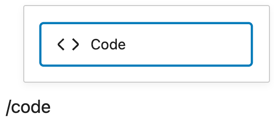
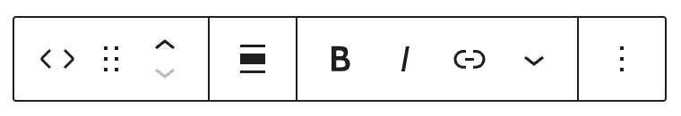
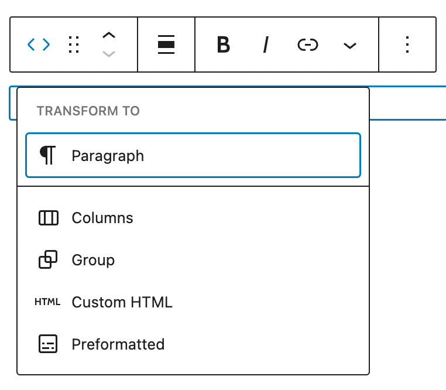
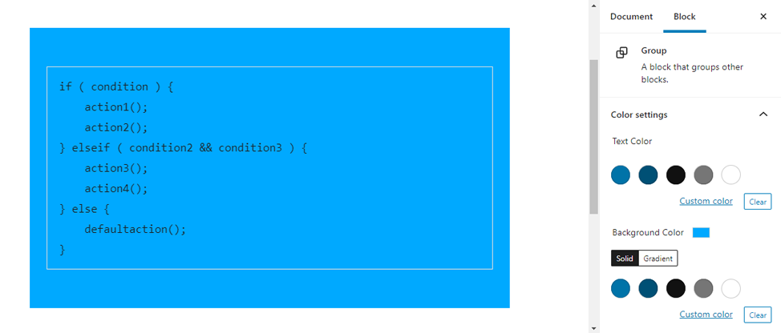
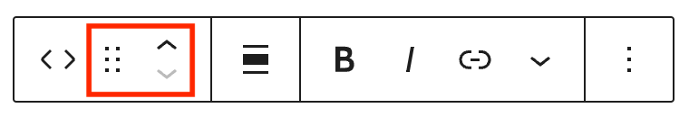
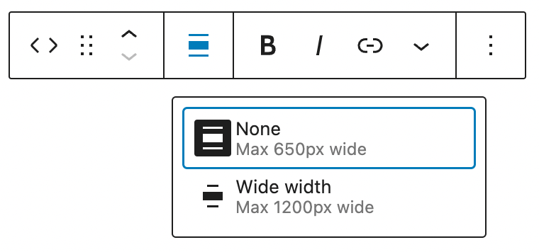
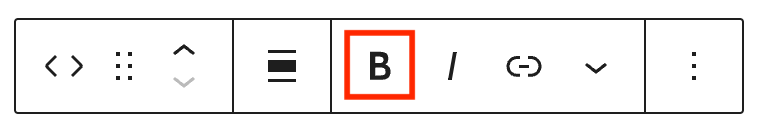
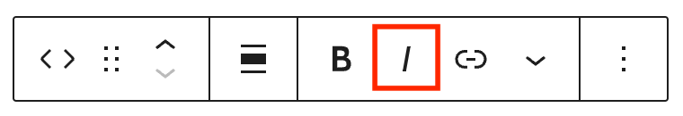
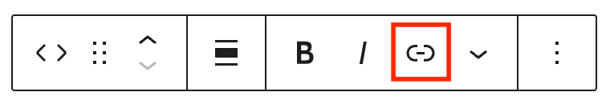
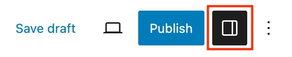

# Code block

[Go back to the list of **Blocks**](../block-editor/blocks-list.md)

**Code** block lets you add and display code snippets for others to view.

**Code** block example:

```
if ( condition ) {
    action1();
    action2();
} elseif ( condition2 && condition3 ) {
    action3();
    action4();
} else {
    defaultaction();
}
```

## Add a Code block

To add the **Code** block, open the block inserter by clicking the (**+**) icon on the upper left corner of the editor. After that, look for **Code** using the search bar and click it to insert the block into the editor.

<video controls preload="metadata" src="https://wordpress.org/documentation/files/2024/03/257921530-6fa51096-f087-49c8-841d-231d24914eca.mp4"></video>

*A demonstration to add and use code block*

Alternatively, you can type `/code` on the editor to insert the **Code** block manually.



> [!NOTE]
> [Detailed instructions on adding blocks](../block-editor/adding-a-new-block.md)

## Block toolbar

Most blocks have their own block-specific controls that allow you to manipulate the block right in the editor.

The **Code** Block shows the following buttons:

-   Transform to
-   Moving handles
-   Bold
-   Italic
-   Link
-   More Rich Text controls
-   More options



### Transform to

The Transform to button lets you change the **Code** block into a *Paragraph*, *Columns*, *Group*, *Custom HTML* or *Preformatted blocks*.



Transforming the **Code** block into *Group* will give you the ability to change the background color around the code.



### Moving handles

The dotted icons can be used to drag and drop a block to the place of your choosing. The up and down arrow icons can be used to shift a block up and down in your document.



> [!NOTE]
> [Get more information about moving a block within the editor.](../block-editor/moving-blocks.md)

### Change alignment



The *change alignment* tool lets you align the **Code** block within the content. You can choose one of the following alignment options:

**None:** Leaves the block alignment as is.

**Wide width:** Increase the block’s width beyond the content size.

### Bold



You can select the text in the **Code** block and use the *Bold* option or **Ctrl+B** / **Cmd+B** on your keyboard to bold it, which is usually heavier than the surrounding text.

### Italic



You can select the text in the **Code** block and use the *Italic* option or **Ctrl+I** / **Cmd+I** on your keyboard to italicize it, which usually appears slanted to the right.

### Link



Use the link icon to hyperlink the highlighted text inside the **Code** block.

> [!NOTE]
> [Read about more link editing options.](../block-editor/link-editing.md)

### More rich text options

The drop-down menu to the left of the [More options menu](../block-editor/more-options.md) contains a range of additional rich text editing options such as highlighting, inline code, strikethrough, and more.

> [!NOTE]
> [Read about more rich text editing options.](../block-editor/more-text-editing-overview.md)

### More options

The Options menu represented by three vertical dots on the far right of the toolbar gives you more features such as the ability to duplicate or remove the block.

> [!NOTE]
> [Read about these and other settings.](../block-editor/more-text-editing-overview.md)

## Block settings

The block settings panel contains customization options specific to the block. To open it, select the block and click the **Settings** button next to the **Publish** button.



### Color

The **Code** block provides color settings options to change the text and background colors.

> [!NOTE]
> For details, refer to this support article: [Color settings overview](../block-editor/colors-settings-overview.md)

### Typography

The **Code** block provides typography settings to change the font family, appearance, line height, letter spacing, decoration, letter case, and font size.

> [!NOTE]
> For details, refer to this support article: [Typography settings overview](../block-editor/typography-settings-overview.md)

### Dimensions

The **Code** block provides dimension settings options to add padding and margin.

> [!NOTE]
> For details, refer to this support article: [Dimension settings overview](../block-editor/dimension-controls-overview.md)

### Border

The **Code** block provides border settings options to add border color, width, and radius.

> [!NOTE]
> For details, refer to this support article: [Border settings overview](../block-editor/border-settings-overview.md)

### Advanced

The Code block provides the following Advanced settings options: HTML Anchor, Additional CSS Class(es), Additional CSS, and Styles.

> [!NOTE]
> [Learn more about advanced settings](../block-editor/advanced-settings-overview.md)

## Changelog

-   Updated 2026-05-25 (props to @kjoyner @awetz583)
    -   Updated “Advanced” section to refer to new overview page
-   Updated 2026-03-01
    -   Updated block name from italic to bold (props katmoody, rollybueno)
    -   Monospaced when referrencing `/code` block (props katmoody, rollybueno)
    -   Add a section heading on how to add a Code block (props katmoody, rollybueno)
-   Updated 2025-12-08
    -   Changed the capitalization in the title to Code block.
-   Updated 2024-03-26
    -   Add wide align support
    -   Update videos and screenshots for 6.3
-   Updated 2023-08-09
    -   Replaced the link section with short summary linking to new dedicated page.
-   Updated 2023-06-08
    -   Replaced “More rich text options” section with short summary linking to new dedicated page for rich text editing options.
-   Updated 2023-06-02
    -   Screenshots for 6.2
    -   Revised formatting
    -   Added transform to paragraph support
-   Updated 2021-02-27
    -   Added Typography option
-   Updated 2020-09-13
    -   Screenshots and video as per WordPress 5.5
    -   Added feature changes in Block Toolbar
    -   Added feature changes in Block Settings
-   Created 2019-03-07
