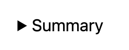
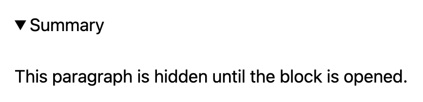
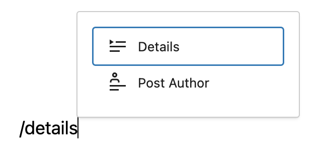
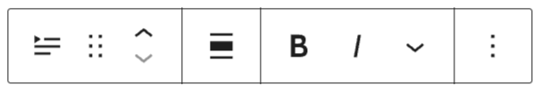
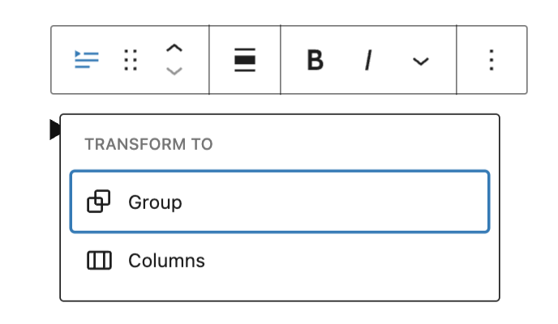
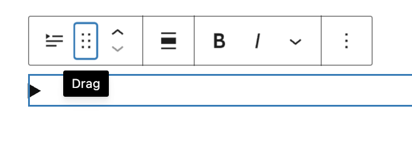
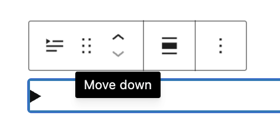
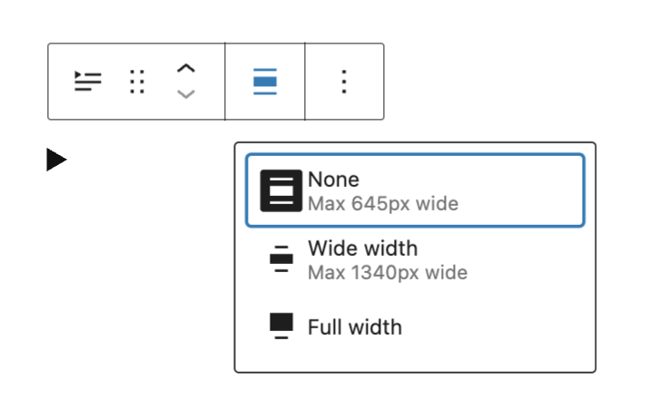
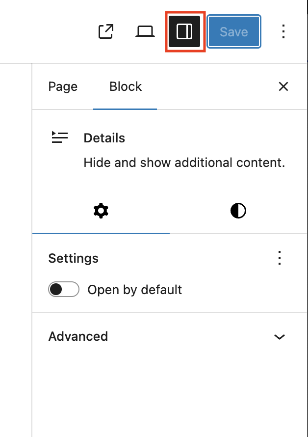
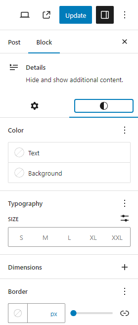

# Details block

[Go to the list of Blocks](../block-editor/blocks-list.md)

The Details block displays a text summary and an arrow button: When you click on the text or the button, the block opens and reveals additional content on the page.

This block provides a way to show or hide content on your site. This can be useful on faq pages, showing /hiding detailed event information etc.

The Summary is customizable by selecting the “Write summary…” placeholder text and adding your own text. By default, the block uses the summary content as its label, similar to how the Heading block works.

The additional content blocks that you place inside the Details block that are hidden until you click on the summary text or the button. Because the content is hidden until you open the block, it is referred to as “hidden content”.

<video controls preload="metadata" src="https://wordpress.org/documentation/files/2023/08/details-summary-name-6.8.mp4"></video>

**Closed state:**

**Open state:**

## Add a Details block

To add a Details block, click on the **Block Inserter** (+)  and select the Details block. 
You can also type <kbd>/details</kbd> and hit <kbd>enter</kbd> in a new paragraph block to add one quickly.

*Using the slash inserter*

<video controls preload="metadata" src="https://wordpress.org/documentation/files/2023/08/details-block.mov"></video>

## Block toolbar

Every block comes with unique toolbar icons and block-specific user controls that allow you to manipulate the block right in the editor.

The Details block shows five buttons in the block toolbar:

-   Transform to
-   Drag icon
-   Move arrows
-   Change alignment
-   More rich text controls
-   More options

### Transform to

Click on the transform button to place the block inside a group or columns block.

### Drag

To drag and drop the block to a new location on the page template, click and hold the rectangle of dots, then drag to the new location. The blue separator line indicates where the block will be placed. Release the left mouse button when you find the new location to place the block.

### Move

The up and down arrow icons can be used to move the block up and down on the page.

> [!NOTE]
> [Get more information about moving a block within the Editor.](../theme-blocks/site-logo-block.md)

### Change alignment

Change the alignment of the block to none, wide, or full width.

### More rich text options

The drop-down menu to the left of the [More options menu](../block-editor/more-options.md) contains a range of additional rich text editing options such as highlighting, inline code, strikethrough, and more.

> [!NOTE]
> [Read about more rich text editing options.](../block-editor/more-text-editing-overview.md)

### More options

The [More Options menu](../block-editor/more-options.md) represented by three vertical dots on the far right of the toolbar gives you more features such as the ability to duplicate or remove your block.

> [!NOTE]
> [Read about these and other settings.](../block-editor/more-options.md)

## Block settings

The block settings panel contains customization options specific to the block. To open it, select the block and click the Settings button next to the Publish or Save button.

### Open by default

Enabling this option keeps the block open and the hidden content will be disaplay until closed.

### Advanced

The Details block provides the following Advanced settings options: HTML anchor, Additional CSS Class(es), Additional CSS, Name attribute, Styles, and Allowed blocks.

Use the **Name attribute** setting to group related Details blocks together. Details blocks with the same name attribute work like an accordion: opening one closes the others in that group.

For example, if **Summary 1** and **Summary 2** both use the name attribute `faq`, opening one will close the other. If **Summary 3** uses a different name attribute, it will open and close independently.

Leave this field blank if you want each Details block to open and close on its own.

> [!NOTE]
> [Learn more about advanced settings](../block-editor/advanced-settings-overview.md)

## Styles

### Color

The block provides dimension settings options to add text, background, and link color.

> [!NOTE]
> [See this guide for more information about changing colors.](../block-editor/colors-settings-overview.md)

### Typography

The block provides typography settings to change the font family, appearance, line height, letter spacing, decoration, letter case, and font size.

> [!NOTE]
> [Get more details about changing typography settings.](../block-editor/typography-settings-overview.md)

### Dimensions

The block provides dimension settings options to add padding and margin.

> [!NOTE]
> For details refer to this support article: [Dimension settings overview](../block-editor/dimension-controls-overview.md)

### Border

The block provides border settings options to add border color, style, width, and radius.

> [!NOTE]
> For details refer to this support article: [Border settings overview](../block-editor/border-settings-overview.md)

## Changelog

-   Updated 2026-05-25 (props @kjoyner @awetz583)
    -   Updated “Advanced” section to refer to new overview page
-   2026-02-17 (props to @awetz583)
    -   Added heading for add a block
    -   Updated advanced screenshots and added information for Manage allowed blocks setting
    -   Updated heading case and size
-   2025-12-02
    -   Added rich text options for 6.9. Props @annezazu.
-   2024-07-05
    -   Added name attribute in advanced settings for 6.8
-   2024-06-13 Updated video to 6.5 version
-   2023-12-05 Headings case resolved
-   Created 2023-08-08
