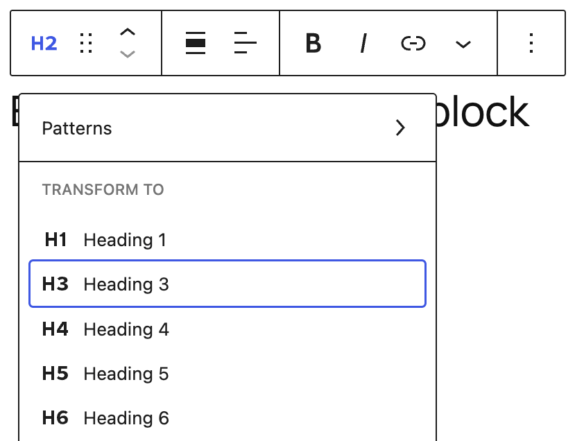
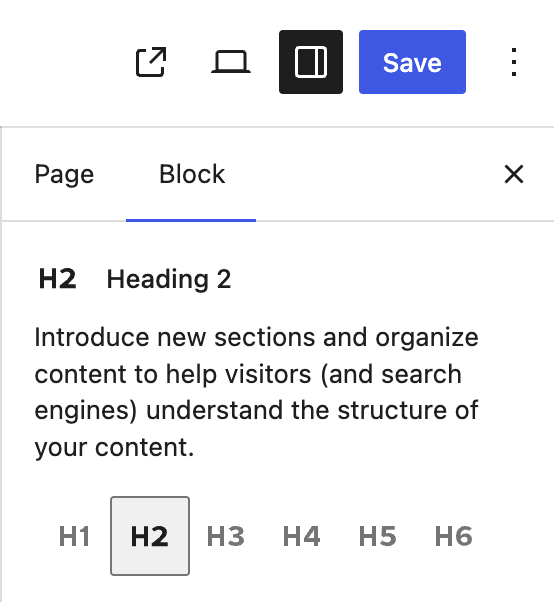
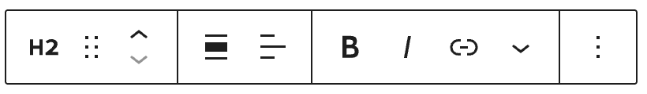
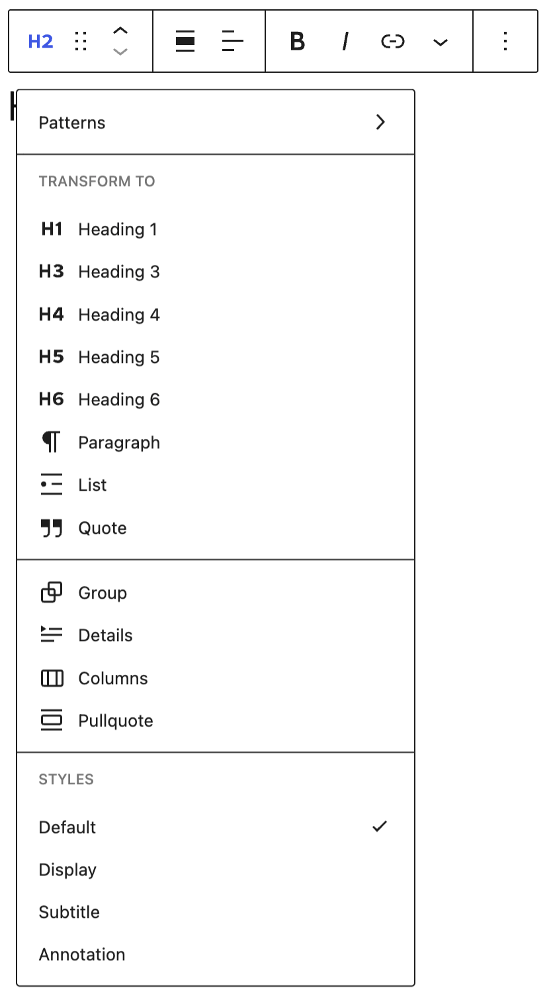
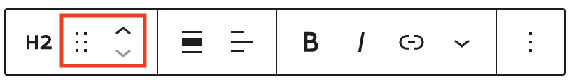
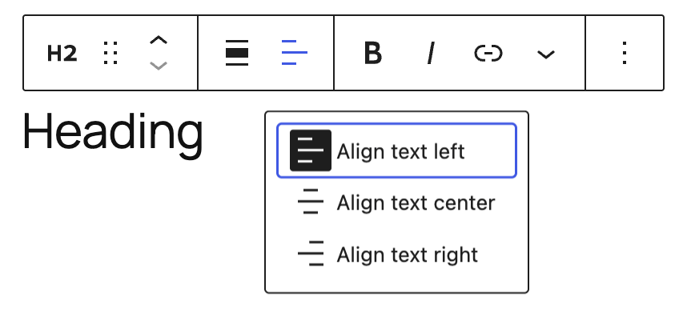
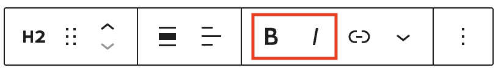
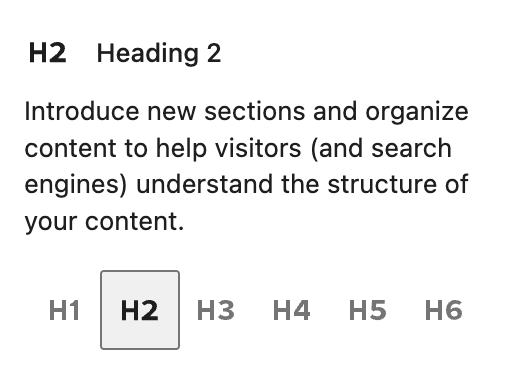
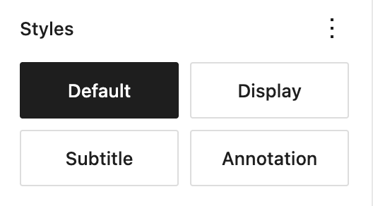

# Heading block

[Go back to the list of Blocks](../block-editor/blocks-list.md)

Headings help to introduce new sections and organize the content on the page. They make your website more readable by humans and search engines.

<video controls preload="metadata" src="https://wordpress.org/documentation/files/2019/03/heading-block-video.mp4" poster="../../assets/images/2019/03/heading-video-poster.jpg"></video>

> [!NOTE]
> Use headings in order to make your page accessible. [View the Outline tab in the Document Overview](../../support-guides/dashboard/wordpress-block-editor.md#4-document-overview) to see your page headings.

## Add a Heading block

To add a heading, click on the **Block Inserter** (**+**). Alternatively, you can type `/heading` in a new paragraph block and press `enter`.

You can also add a Heading block with **H1** heading level by typing `/h1` in a new paragraph block followed by `enter`. Subsequent heading blocks can be added by typing `/h2`, `/h3`, `/h4`, `/h5`, `/h6` followed by `enter`.

You can also add a Heading block by using a `#` shortcut at the start of a new line, then pressing space. For example:

-   Type ## followed by a space to add an H2 heading.
-   Type ### followed by a space to add an H3 heading.
-   Add more # symbols for lower heading levels, up to H6.

In most cases, the page title is used as the &lt;h1> tag, with subsequent Heading blocks added as H2, H3, and so on. This may vary depending on the theme or page template you’re using.

> [!NOTE]
> [Detailed instructions on adding blocks](../block-editor/adding-a-new-block.md)

## Changing Heading block levels

To change the heading level for a Heading block already on your post or page, click on the Transform button on the block toolbar and choose the new heading level.

You can also change heading levels by using the buttons in the Block settings panel. Your current heading level will appear selected and you can select a different one to change it.

## Block toolbar

Each block has its own block-specific controls that allow you to customize the block right in the editor.  If you hover over the buttons, tooltips will show what each button does.

### Transform to

When you click on the **Transform** button you can convert the Heading block into Patterns with headings if they exist. The Heading block transform options are: Heading levels 1-6, Paragraph, List, Quote, Group, Details, Columns, and Pullquote. Available styles may include Default, Display, Subtitle, and Annotation.

### Block moving tools

The block-moving tools allow you to move the block in the editor. Use the six dots icon to drag and drop the block and place it anywhere on the page. Alternatively, click on the up and down arrows to move the block up or down.

> [!NOTE]
> [Get more information about moving a block within the editor](../block-editor/moving-blocks.md)

### Align

Using the align drop-down from the toolbar, you can make the Heading block wide width or full width. The wide-width and the full-width align options are only available if your theme supports them.

### Text alignment

Using the align text drop-down from the toolbar, you are able to align the heading text to the left, make it center-aligned or orient it to the right.

### Bold and italics

The Bold and Italics formatting options are used to customize the text in the Heading block. You can also use keyboard shortcuts to enable these text formatting:

-   **Ctrl + B** or **Command + B** to bold the text.
-   **Ctrl + I** or **Command + I** to italicize the text.

### Link

Use the link icon to insert a hyperlink to the highlighted heading text.

> [!NOTE]
> [Read about more link editing options](../block-editor/link-editing.md)

### More rich text options

The drop-down menu to the left of the [More options menu](../block-editor/more-options.md) contains a range of additional rich text editing options such as highlighting, inline code, strikethrough, and more.

> [!NOTE]
> [Read about more rich text editing options](../block-editor/more-text-editing-overview.md)

### More options

These controls give you the option to copy, duplicate, and edit your block as HTML.

> [!NOTE]
> [Read about these and other settings](../block-editor/more-options.md)

## Block settings

Every block has specific options in the editor sidebar in addition to the options found in the block toolbar. If you do not see the sidebar, click on the **Settings button** next to the Save/Publish button.

### Change heading level

Select the buttons for H1, H2, H3, H4, H5 or H6 to easily change the heading level for an existing block.

### Styles

Select buttons to quickly apply a style to your Heading block. Options may differ depending on your theme.

### Color

The Heading block provides Color settings options to change the text and background colors.

> [!NOTE]
> [See this guide for more information about changing colors](../block-editor/colors-settings-overview.md)

### Typography

Typography settings allow you to adjust the Font size, Appearance, Line height, Letter spacing, Decoration, Orientation, Letter Case and Fit text.

> [!NOTE]
> [Get more details about changing typography settings](../block-editor/typography-settings-overview.md)

### Dimensions

The Heading block provides dimension settings options to change padding and margin size.

> [!NOTE]
> [Learn more about dimension controls.](../block-editor/dimension-controls-overview.md)

### Border

The Heading block provides border settings options to add border color, width, and radius.

> [!NOTE]
> [Learn more about border settings.](../block-editor/border-settings-overview.md)

### Advanced

The Heading block provides the following Advanced settings options: HTML Anchor, Additional CSS Class(es), Additional CSS, and Styles.

> [!NOTE]
> [Learn more about advanced settings](../block-editor/advanced-settings-overview.md)

## Changelog

-   Updated 2026-05-20 (props to @awetz583 @kjoyner @helika)
    -   Updated information, screenshots and video for 7.0
    -   Linked to Advanced settings page
    -   Updated stretchy heading references to fit text
-   Updated 2026-02-15
    -   Added screenshot of the Dimensions panel (padding and margin) to the documentation. (updated by @rollybueno)
    -   Added border settings screenshot to document border width and radius controls. (@ndiego, @karthick-murugan, updated by @rollybueno)
-   Updated 2025-11-27
    -   Adds information about stretchy heading to transform section.
-   Updated 2023-03-07
    -   Added missing ALT tag for text alignment image
-   Updated 2023-08-09
    -   Replaced the link section with short summary linking to new dedicated page.
-   Updated 2023-06-08
    -   Replaced “More rich text options” section with short summary linking to new dedicated page for rich text editing options.
-   Updated 2022-06-22
    -   Updated content and screenshots for 6.0
    -   Added ALT tags for the images
-   Updated 2022-02-04
    -   Added further update for WP 5.9
-   Updated 2021-02-28
    -   Added images and updated for WP 5.7
-   Updated 2020-08-27
    -   Added images for WP 5.5
-   Updated 2020-06-18
    -   Added ‘Link back to blocks’ to the top of the page
    -   Added the ‘Changelog’
-   Created 2019-03-07
