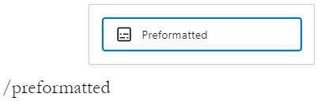
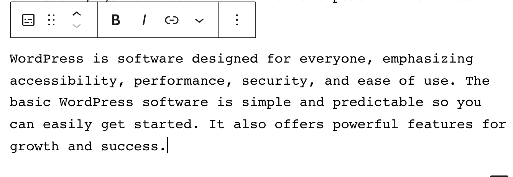
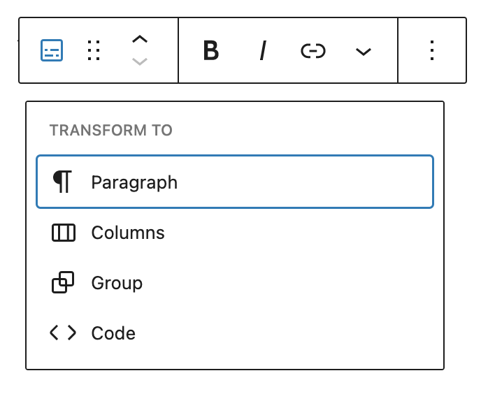
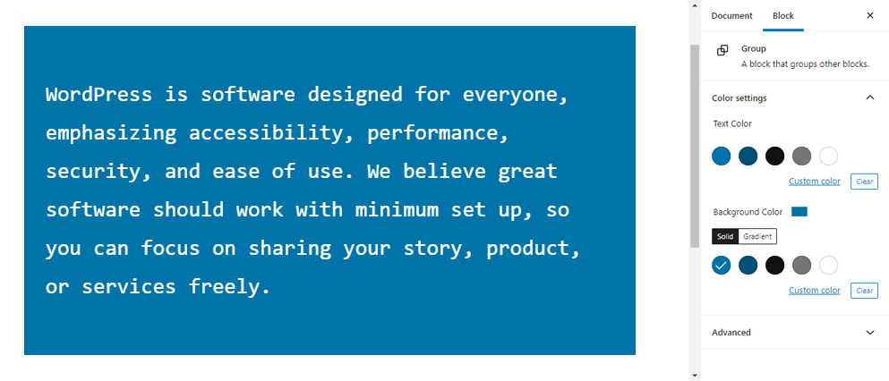
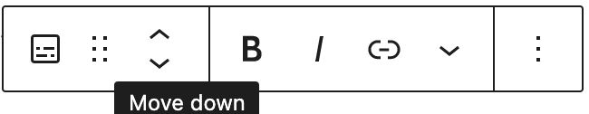
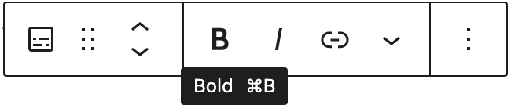
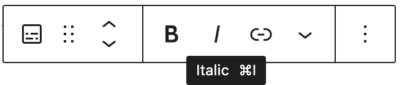
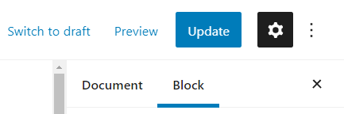
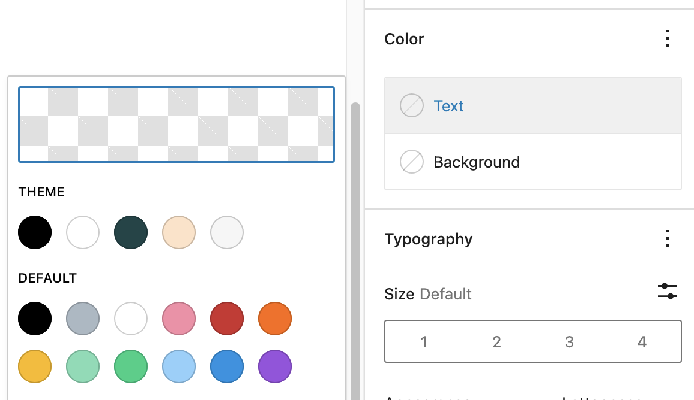
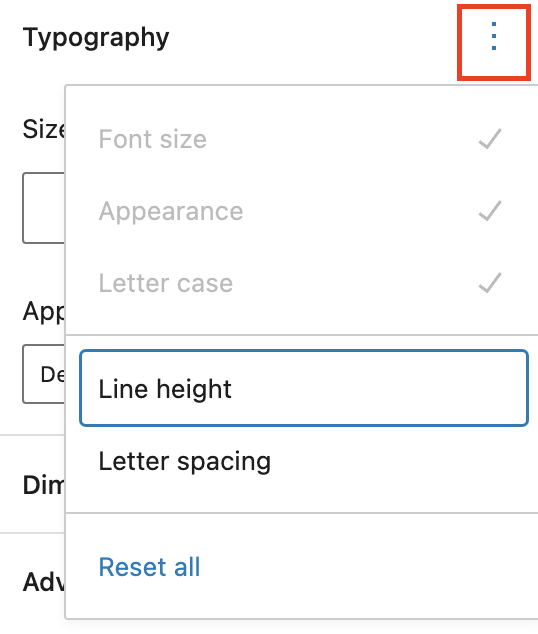

# Preformatted block

[Go back to the list of **Blocks**](../block-editor/blocks-list.md)

If you wish to add text to a post or page that is displayed exactly as you type it, the Preformatted block is for you.

## Add a Preformatted block

You can create one by clicking the **Block Inserter** icon.

You can also type `/preformatted` and hit the enter key in an empty paragraph block to quickly create one.

> [!NOTE]
> [Detailed instructions on adding blocks](../block-editor/adding-a-new-block.md)

<video controls preload="metadata" src="https://wordpress.org/documentation/files/2019/03/Preformatted-block-demo-5.9-1.mov"></video>

The Preformatted block shares a lot of similarities with the Paragraph block and the Code block. Think of it as a hybrid of the two.

Like Paragraph block, the Preformatted block is intended primarily to display text. Unlike the Paragraph block, though, the Preformatted block keeps any spacing or line breaks exactly as they are entered.

Similar to the Code block, the Preformatted block is displayed in a monospace font, making it easy to keep text perfectly aligned. However, the Preformatted block also includes styling and the ability to add hyperlinks (described below) that a Code block doesn’t have.

## Block toolbar

Every block comes with unique toolbar icons and block specific user controls that allow you to manipulate the block right in the editor.

The **Preformatted Block** shows the standard eight buttons:

-   Change block type or style
-   Drag
-   Moving handles
-   Bold
-   Italic
-   Hyperlink
-   More rich text controls
-   More options

### Change block type or style

You can transform the Preformatted block into Paragraph block, Columns block, Code block, or Group. The Group would give you the ability to change the background color around the Preformatted block.

_Editor view of **Preformatted Block** as a group with **Color settings** controls_

### Moving handles

The up and down arrow icons can be used to shift a block up and down in your document.

Detailed instructions on moving a block within the editor can be found [here](../block-editor/moving-blocks.md).

### Bold

You can select the text of the block and use the **Bold** option or **Ctrl+B** / **Cmd+B** on your keyboard to bold it, which is usually heavier than the surrounding text.

### Italic

You can select the text of the block and use the **Italic** option or **Ctrl+I** / **Cmd+I** on your keyboard to italicize it, which usually appears slanted to the right.

### Hyperlink

You can select the text of the block and use the **Hyperlink** option.

> [!NOTE]
> [Read about more link editing options.](../block-editor/link-editing.md)

### More rich text options

The drop-down menu to the left of the [More options menu](../block-editor/more-options.md) contains a range of additional rich text editing options such as highlighting, inline code, strikethrough, and more.

> [!NOTE]
> [Read about more rich text editing options.](../block-editor/more-text-editing-overview.md)

### More options

The Options menu represented by three vertical dots on the far right of the toolbar gives you more features such as the ability to duplicate or remove the block.

> [!NOTE]
> [Read about these and other settings.](../block-editor/more-options.md)

## Block settings

Every block has specific options in the editor sidebar in addition to the options found in the block toolbar. *If you do not see the sidebar, click the ‘cog’ icon next to the Publish button.*

### Color

You can customize the text color, and background color, for the Heading block. *The color options available will vary based on the theme.*

*Color settings in the Heading block*

You can pick a color from the suggestions, or add a custom color using the color picker, or by adding a color code.

> [!NOTE]
> [See this guide for more information about changing colors.](../block-editor/colors-settings-overview.md)

### Typography

Typography settings allow you to adjust the Font size, Appearance, Letter case, Line height, and Letter spacing.

To access all the typography options click on the 3 dot button in the right corner of the Typography tab.

*Typography settings in the Heading block*

> [!NOTE]
> [Get more details about changing typography settings.](../block-editor/typography-settings-overview.md)

### Dimensions

This block provides various options to adjust its dimensions, such as width and height, allowing you to customize the text layout to ensure visual consistency.

> [!NOTE]
> For details refer to this support article: [Dimension settings overview](../block-editor/dimension-controls-overview.md)

### Border

The border settings add border color, width, and radius.

> [!NOTE]
> For details refer to this support article: [Border settings overview](../block-editor/border-settings-overview.md)

### Advanced

The Preformatted block provides the following Advanced settings options: HTML Anchor, Additional CSS Class(es), Additional CSS, and Styles.

> [!NOTE]
> [Learn more about advanced settings](../block-editor/advanced-settings-overview.md)

## Changelog

-   Updated 2026-05-25 (props to @kjoyner @awetz583)
    -   Updated “Advanced” section to refer to new overview page
-   Updated 2026-02-10 (props to @femkreations @ndiego @awetz583)
    -   Unbolded and sentence cased block name
    -   Added heading above how to add the block
    -   Added dimensions heading and link
    -   Added border heading and link
-   Updated 2023-08-09
    -   Replaced the link section with short summary linking to new dedicated page.
-   Updated 2023-06-08
    -   Replaced “More rich text options” section with short summary linking to new dedicated page for rich text editing options.
-   Updated 2022-02-04
    -   Screenshots and video as per WordPress 5.9
-   Updated 2020-10-25
    -   Screenshots and video as per WordPress 5.5
    -   Added feature changes in Block Toolbar
    -   Added feature changes in Block Settings
    -   Added “Go back to the list of Blocks” to the top of the page
-   Created 2019-03-07
