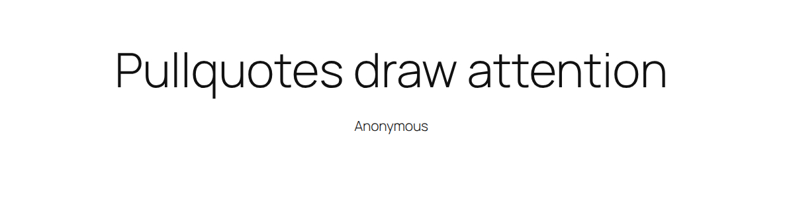
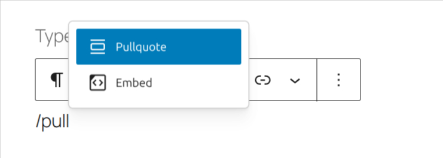
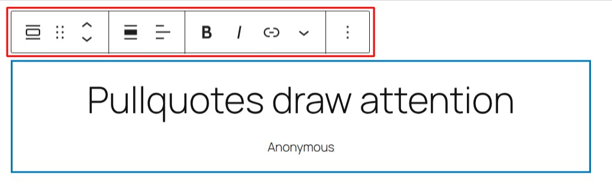
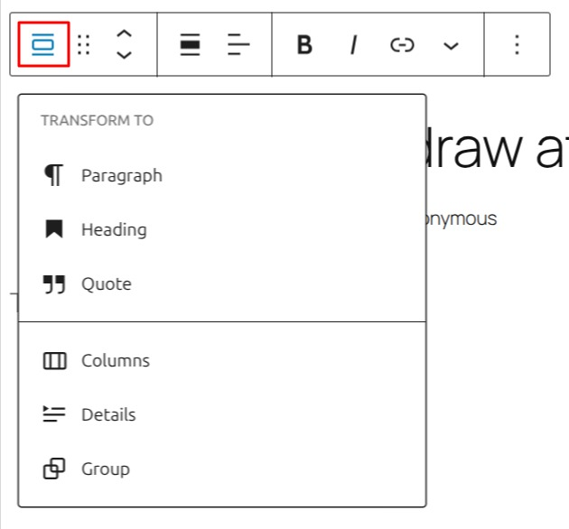
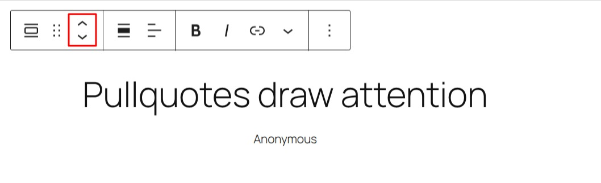
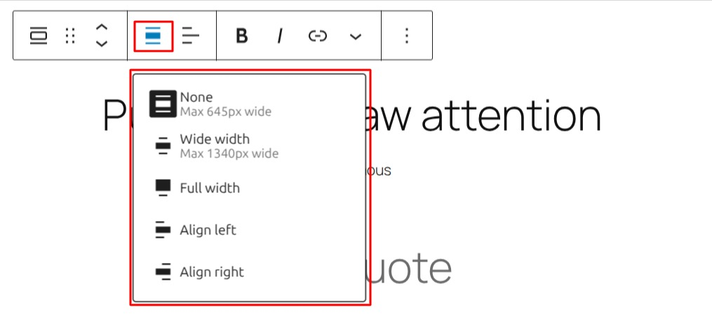
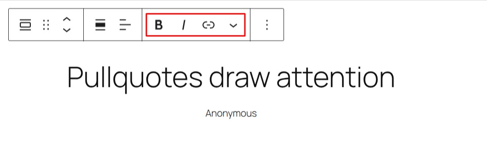

# Pullquote block

[Go back to the list of **Blocks**](../block-editor/blocks-list.md)

If you want to add emphasis to a piece of text in your post or page, the pullquote block can quickly and easily make short snippets look beautiful.

*Pullquotes are like blockquotes but designed to draw attention.*

To add one, click the Block Inserter icon when editing your post or page.

You can also quickly add one by typing `/pullquote` in a blank paragraph block and then hitting the enter key.

> [!NOTE]
> *Detailed instructions on adding blocks can be found [here](../block-editor/adding-a-new-block.md).*

In this video, you can see how you can use the pullquote block and the different settings to modify how your pullquote will appear.

<video controls preload="metadata" src="https://wordpress.org/documentation/files/2019/03/playground.mp4"></video>

*How pullquote block works*

## Block toolbar

In order to reveal the block toolbar, you can click on the block and the toolbar will display.

Every block comes with unique toolbar icons and blocks specific user controls that allow you to manipulate the block right in the editor.

The pullquote block shows five standard buttons:

-   Transform to
-   Moving handles
-   Change alignment
-   Text Editing options (bold, italics, add a link, and drop-down for more text editing options)
-   More options

*The pullquote block has alignment and text formatting options.*

### Transform to

*The pullquote block can be transformed into other, related blocks.*

When you click on the “Transform” button you can convert the pullquote block into another block type, using the existing content.

You can transform the pullquote block into a “Paragraph” block, “Group” block, “Quote” block, “List” block, or “Heading” block. The “Group” would give you the ability to change the background color around the Quote.

### Block-moving tools

*The movement handles are displayed as 2 arrow icons.*

The up and down arrow icons can be used to move a block up and down in your document.

> [!NOTE]
> [Get more information about moving a block within the Editor](../block-editor/moving-blocks.md).

### Change alignment

*Block toolbar with the drop-down for alignment.*

You can align the pullquote block itself to the left, right, and none (= center) from the toolbar. When using the left or right alignment, you can put another block beside the *pullquote block*.

The pullquote block also has a Wide and Full width alignment that is useful for creating unique headers and widescreen effects. *These two options are only available if your Theme supports these alignments.*

### Text editing options

**Bold and italics**

Used quite frequently, bold and italics formatting have their own buttons on the Toolbar. The shortcuts are CTRL+b (or Command+B) for bold and CTRL+i (or Command+i) for italics.

**Insert hyperlinks**

Use the chain link icon to insert a hyperlink to your highlighted text.

> [!NOTE]
> [Read about more link editing options.](../block-editor/link-editing.md)

### More rich text options

The drop-down menu to the left of the [More options menu](../block-editor/more-options.md) contains a range of additional rich text editing options such as highlighting, inline code, strikethrough, and more.

> [!NOTE]
> [Read about more rich text editing options.](../block-editor/more-text-editing-overview.md)

### More options

The Options menu represented by three vertical dots on the far right of the toolbar gives you more features such as the ability to duplicate or remove the block.

> [!NOTE]
> [Read about these and other settings.](../block-editor/more-options.md)

## Block settings

Every block has specific options in the editor sidebar in addition to the options found in the block toolbar. *If you do not see the sidebar, click the cog icon next to the Publish button.*

### Typography

The pullqoute provides typography settings to change the font family, appearance, line height, letter spacing, decoration, letter case, and font size.

> [!NOTE]
> For details refer to this support article: [Typography settings overview](../block-editor/typography-settings-overview.md)

### Background

The Background settings allow you to customize the appearance of supported blocks using background images, colors, and gradients.

> [!NOTE]
> For details, refer to the [Background Settings Overview](../block-editor/background-settings-overview.md).

### Dimensions

The option to control block spacing and padding is enabled for the block.

> [!NOTE]
> [Learn more about dimension controls.](../block-editor/dimension-controls-overview.md)

### Border

The pullqoute block provides border settings options to add border color, width, and radius.

> [!NOTE]
> For details refer to this support article: [Border settings overview](../block-editor/border-settings-overview.md)

### Elements

The Elements settings allow you to customize the appearance of link.

### Advanced

The Pullquote block provides the following Advanced settings options: HTML Anchor, Additional CSS Class(es), Additional CSS, and Styles.

> [!NOTE]
> [Learn more about advanced settings](../block-editor/advanced-settings-overview.md)

## Changelog

-   Updated 2026-09-06 (props @atachibana)
    -   Rearrange the Styles sections for WordPress 7.1 and add explanatory text.
-   Updated 2026-05-25 (props to @kjoyner @awetz583)
    -   Updated “Advanced” section to refer to new overview page
-   Updated 2025-02-27 (props @milana_cap)
    -   Updated video to 6.9
-   Updated 2025-02-16 (props @milana_cap)
    -   [Overhaul](https://github.com/WordPress/Documentation-Issue-Tracker/issues/2138) for the article.
    -   Updated screenshots to 6.9.
    -   Add ALT texts to all images.
    -   Remove Styles section and screenshots as the new version doesn’t have it.
    -   Unstyle all bold and italics instances of blocks names.
    -   Edit all headings from title to sentence case.
-   Updated 2023-08-09
    -   Replaced the link section with short summary linking to new dedicated page.
-   Updated 2023-06-08
    -   Replaced “More rich text options” section with short summary linking to new dedicated page for rich text editing options.
-   Updated 2023-05-16
    -   Content and screenshots updated for 6.2
-   Updated 2022-02-04
    -   All screenshots have been changed for WordPress v5.9
    -   New video tutorial
    -   Modifying the block name in the post to respect a single spelling: “pullquote”
-   Updated 2020-09-28
    -   Updated the block toolbar
    -   Updated the block settings
    -   Updated 5.5 screenshots
    -   Added the changelog
-   Created 2019-03-07
