# Comments Pagination block

[Go to the List of Blocks](../block-editor/blocks-list.md)

The *Comments Pagination* block is part of the Comments block that displays paginated navigation to the previous or next comment sections. 
By default, a *Comments Pagination* block is included when you insert a Comments block. However, you can still add this block manually.

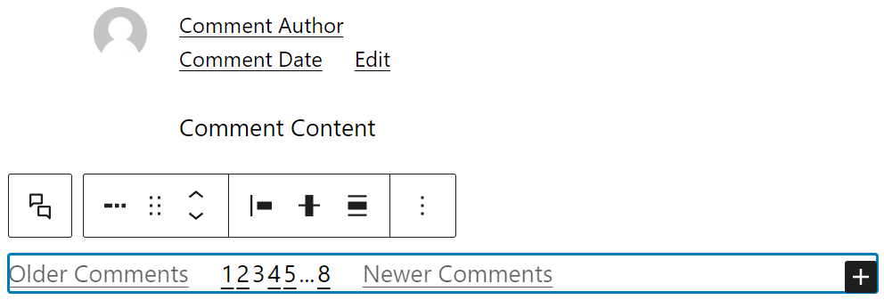

> [!NOTE]
> You can only insert the *Comments Pagination block* inside a Comments block.

To add the block, select the Comments block and hover your mouse over a blank space. Click the (+) icon to open the block inserter pop-up window. Look for the *Comments Pagination* block using the search bar and click on the block icon to add it to the Comments block.

Alternatively, add a Paragraph block within the Comments block and type /comments-pagination to insert the *Comments Pagination* block.

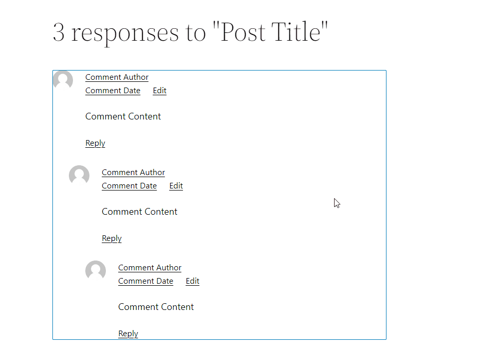

> [!NOTE]
> [Detailed instructions on adding blocks](../block-editor/adding-a-new-block.md)

## Block toolbar

The *block toolbar* contains tools to customize each block on the editor quickly. The *Comments Pagination* block has the following tools:

### Select comments block

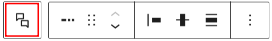

The Select Comments tool lets highlight the *Comment Pagination*’s parent block, which is the Comments block.

### Transform to

You can transform a *Comment Pagination block* into a Columns, or a Group block.

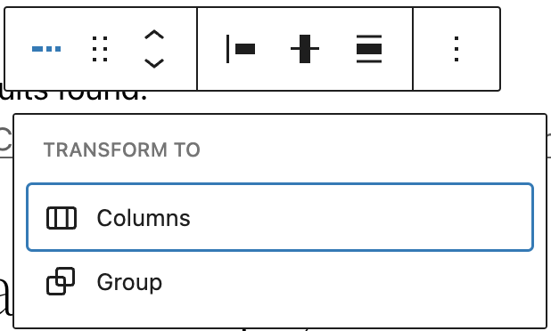

### Block-moving tools

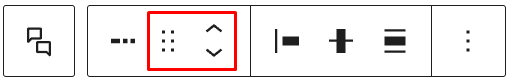

The block-moving tools allow you to move the block up and down the editor. Use the six dots icon to drag and drop the *Comments Pagination* block and place it anywhere on the Comments block. Alternatively, click on the up and down arrows to move the block up or down.

> [!NOTE]
> [Get more information about moving a block within the editor.](../block-editor/moving-blocks.md)

### Change items justification

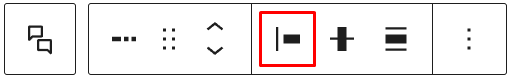

The *change items justification* tool lets you change the horizontal placement of the items inside the *Comment Pagination* block. There are four options to choose from:

-   *Justify items left* will move the items towards the left side of the block.
-   *Justify items center* will move the items towards the center of the block.
-   *Justify items right* will move the items towards the right side of the block.
-   *Space between items* will distribute all items across the block and automatically adjust the space between them.

### Change vertical alignment

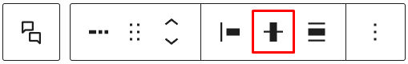

The *change vertical alignment* tool lets you choose the vertical position of the items inside the *Comments Pagination* block. You can choose between top, middle, and bottom vertical alignment.

### Change alignment

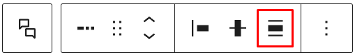

Unlike the previous alignment tools, the *change alignment* tool is used for the *Comments Pagination* block’s position inside the Comments block. Choose one of the following block alignment options:

-   None
-   Align left
-   Align center
-   Align right

### More options

These controls give you the option to copy, duplicate, and edit your block as HTML.

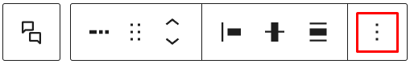

> [!NOTE]
> [Read about these and other settings.](../block-editor/more-options.md)

## Block settings

The block settings panel contains customization options specific to the block. To open it, select the block and click the cog icon next to the Publish button.

Here are the options for the *Comments Pagination* block:

### Layout

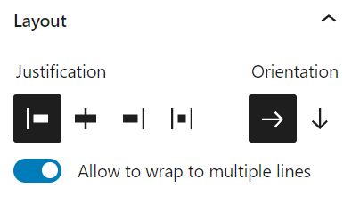

In the layout section, you will find the following customization options:

-   *Justification* settings are similar to the tools in the block toolbar.
-   *Orientation* lets you choose to display the pagination items horizontally or vertically.
-   *Allow to wrap to multiple lines* toggle button lets you display the pagination items in multiple lines when needed.

### Settings

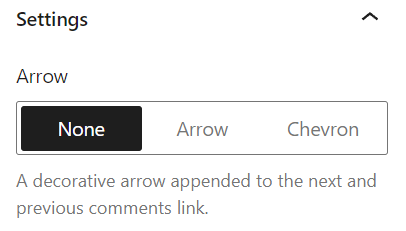

The settings section shows three options for a decorative arrow to the next and previous comments link. Here are the options:

-   None
-   Arrow
-   Chevron

### Color

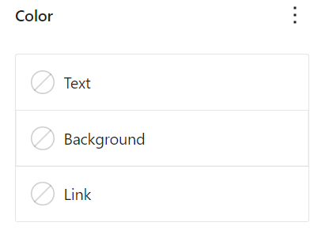

The color section lets you customize the text, background, and link color for the Comments Pagination block. Click on any of the options to change the color, and a pop-up to pick a color will appear. Choose from the default color or click the upper rectangle area to pick a custom color using the color picker.

> [!NOTE]
> [Read about these and other settings.](../block-editor/more-options.md)

### Typography

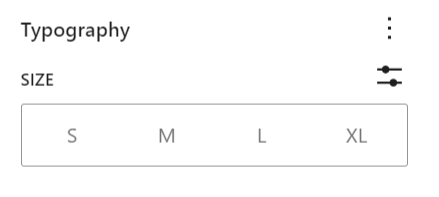

The Typography settings enable you to customize the font and text appearance of the content within the *Comments Pagination* block. The settings have various options, such as font size, font style, font family, and letter spacing.

> [!NOTE]
> [Learn more about the Typography settings.](../block-editor/typography-settings-overview.md)

### Advanced

The following Advanced settings options are available: HTML Anchor, Additional CSS Class(es), Additional CSS, and Styles.

> [!NOTE]
> [Learn more about advanced settings.](../block-editor/advanced-settings-overview.md)

## Comments Pagination inner blocks

The *Comments Pagination* block consists of the following three inner blocks (which can’t be inserted on their own):

-   Comments Previous Page block
-   Comments Page Numbers block
-   Comments Next Page block

The Comments Previous Page block displays the previous posts page link.

The Comments Page Numbers block displays a list of page numbers for pagination.

The Comments Next Page block displays the next posts page link.

All these blocks are located inside a Comments block and lets you customize the appearance of the pagination.

### Block toolbar

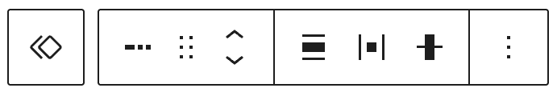

The block toolbar for all the *Comments Pagination* inner blocks – Comments Previous Page, Comments Page Numbers, and Comments Next Page contains the tools to customize each block.

#### Block-moving tools

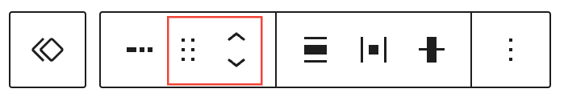

Use the block-moving tools to move the block up and down inside the editor. Use the six dots icon to drag and drop the block and reposition it anywhere on the editor. Alternatively, click on the up and down arrows to move the block up or down the editor.

#### More options

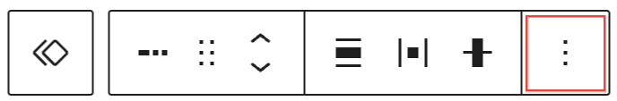

Page Numbers, Next Page and Previous page blocks share the same functionality for more block options button. Click on the three dots icon to show more options and a drop-down menu will appear.

### Block settings

The block settings panel contains customization options specific to the block. To open it, select the block and click the **Settings** panel icon next to the **Publish** or **Update** button.

Here are the options for the *Comments Pagination* inner blocks.

#### Color

The *Comments Pagination* inner blocks – Comments Previous Page, Comments Page Numbers, and Comments Next Page provides color settings option to add background color.

For details refer to this support article: [Color settings overview](../block-editor/colors-settings-overview.md)

#### Typography

The *Comments Pagination* inner blocks – Comments Previous Page, Comments Page Numbers, and Comments Next Page provides typography settings to change the font family, appearance, line height, letter spacing, decoration, letter case, and font size.

For details refer to this support article: [Typography settings overview](../block-editor/typography-settings-overview.md)

#### Advanced

The **Advanced** tab lets you add CSS class(es) to your block. This will allow you to write custom CSS and styles for the block.

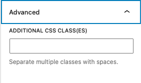

*Advanced option in the selected Block*

## Changelog

-   Updated 2026-06-29
    -   Linked to advanced settings
-   Updated 2024-01-23
    -   Updated content for WordPress 6.4
    -   Fixed block names
    -   Added a new section for Comments Pagination inner blocks
-   Created 2022-08-02
