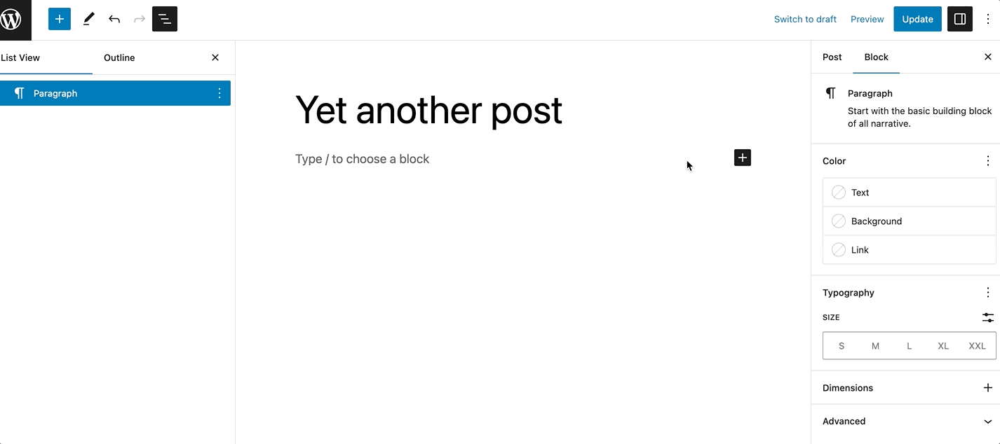
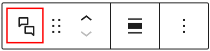
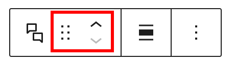
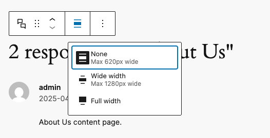
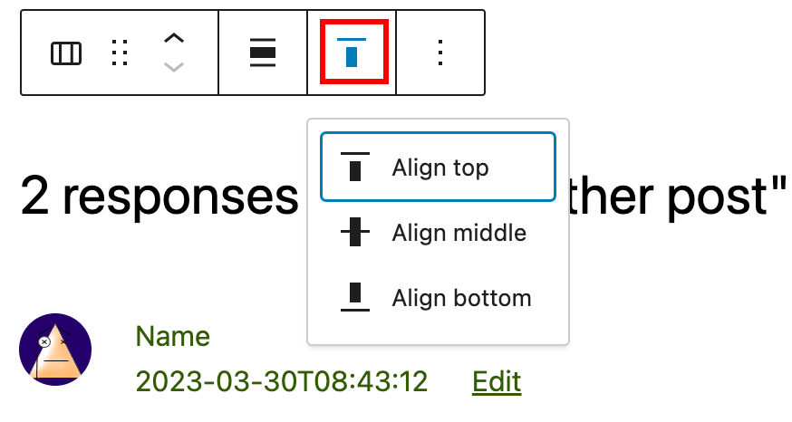
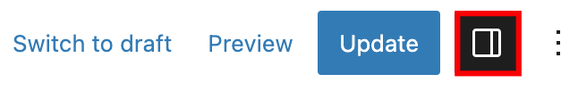
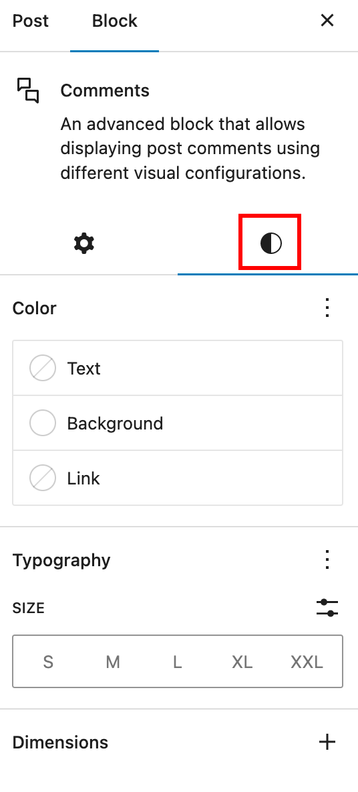

# Comments block

[Go to the list of Blocks](../block-editor/blocks-list.md)

The *Comments* block is an advanced block that displays post comments with various visual configurations. It contains multiple blocks to show comments, such as [Comments Title](comments-title-block.md), [Comment Template](comment-template-block.md), [Comment Pagination](comment-pagination-block.md), and [Post Comments Form](post-comments-form-block.md). With the Comments block, adding a comment section to your posts becomes effortless.

To add the *Comments* block, open the block inserter by clicking the (**+**) icon on the upper left corner of the editor. After that, look for Comments using the search bar and click it to insert the block into the editor.

Alternatively, you can type <kbd>/comments</kbd>on the editor to insert the *Comments* block manually.

> [!NOTE]
> Detailed instructions on adding blocks can be found [here](../block-editor/adding-a-new-block.md).

## Block toolbar

Most blocks have their own block-specific controls that allow you to manipulate the block right in the editor.

The *Comments Block* shows the following buttons:

-   Transform to
-   Moving handles
-   Change alignment
-   More options

### Transform to

The Transform to button lets you change the *Comments* block into a Columns or a Group block.

### Moving handles

The dotted icons can be used to drag and drop a block to the place of your choosing. The up and down arrow icons can be used to shift a block up and down in your document.

> [!NOTE]
> [Get more information about moving a block within the editor.](../block-editor/moving-blocks.md)

### Change alignment

You can modify the alignment of the *Comments* block using this tool. Click on the icon and select one of the following alignment options:

-   **None**
-   **Wide width** – Increase the width of the block beyond the content size.
-   **Full width** – Extend the block to cover the full width of the screen.

When you transform the *Comments* block into a Columns block, the toolbar will show an additional tool called Change vertical alignment with three options:

-   **Align top** – makes the block top-aligned.
-   **Align middle** – lets you align the block to the center.
-   **Align bottom** – makes the block right-aligned.

## Options

The **Options** button on a block toolbar gives you more features to customize the block.

> [!NOTE]
> [Read about these and other settings.](../block-editor/more-options.md)

## Block settings

The block settings panel contains customization options specific to the block. To open it, select the block and click the *Settings* button next to the *Publish* button.

It’s possible to change the *Color*, *Typography,* and *Dimensions* settings. To access them, open the *Styles* section:

### Color

The *Comments* block provides color settings options to change the text and background colors.

> [!NOTE]
> For details, refer to this support article: [Color settings overview](../block-editor/colors-settings-overview.md)

### Typography

The *Comments* block provides typography settings to change the font family, appearance, line height, letter spacing, decoration, letter case, and font size.

> [!NOTE]
> For details, refer to this support article: [Typography settings overview](../block-editor/typography-settings-overview.md)

### Dimensions

The *Comments* block provides dimension settings options to add padding and margin.

> [!NOTE]
> For details, refer to this support article: [Dimension settings overview](../block-editor/dimension-controls-overview.md)

### Border

The *paragraph* block provides border settings options to add border color, width, and radius.

> [!NOTE]
> For details refer to this support article: [Border settings overview](../block-editor/border-settings-overview.md)

### Advanced

The following Advanced settings options are available: HTML Anchor, Additional CSS Class(es), Additional CSS, HTML Element, and Styles.

> [!NOTE]
> [Learn more about advanced settings.](../block-editor/advanced-settings-overview.md)

## Changelog

-   Updated 2026-06-29
    -   Linked to advanced settings
-   Updated 2025-04-15 (props to [@karthickmurugan](https://profiles.wordpress.org/karthickmurugan/))
    -   Updated screenshots for 6.8
    -   Add border support
-   Updated 2023-05-09
    -   Updated for WordPress 6.2 update
-   Updated 2023-03-07
    -   Fixed the link to Comment Pagination block page
-   Updated 2023-01-10
    -   Added dimension settings
-   Created 2023-01-04
