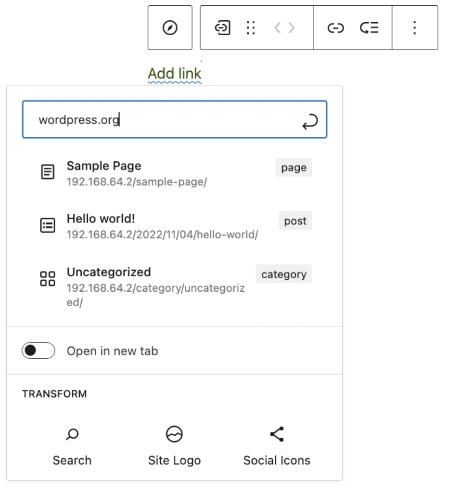
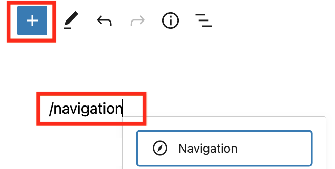
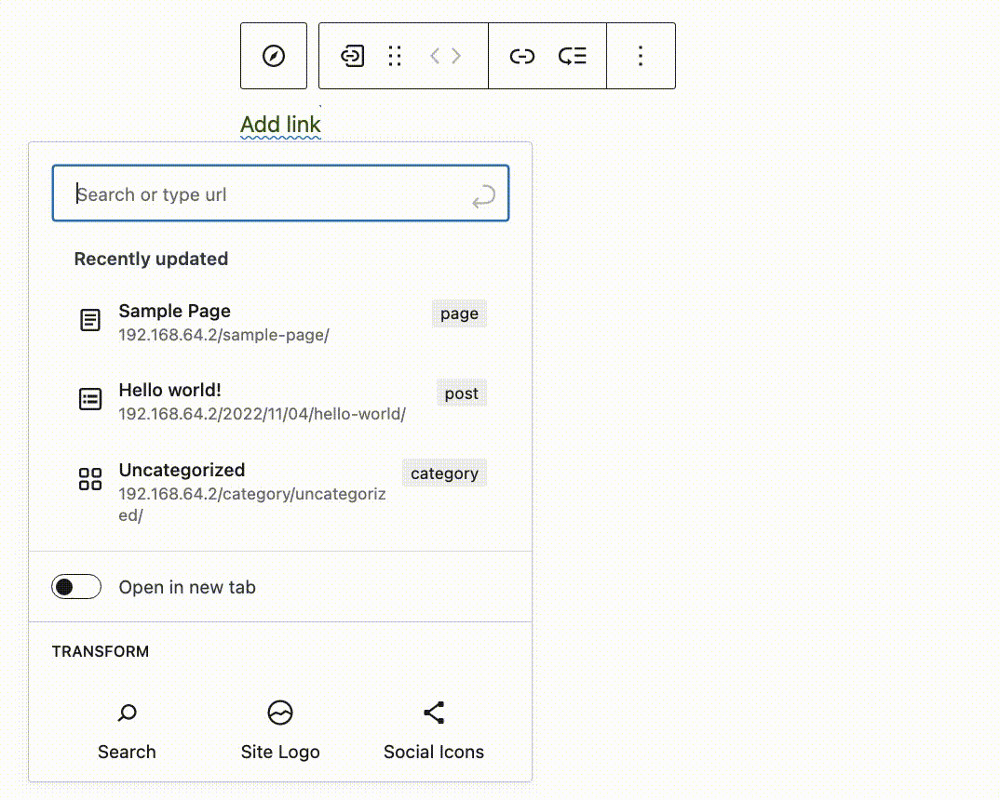
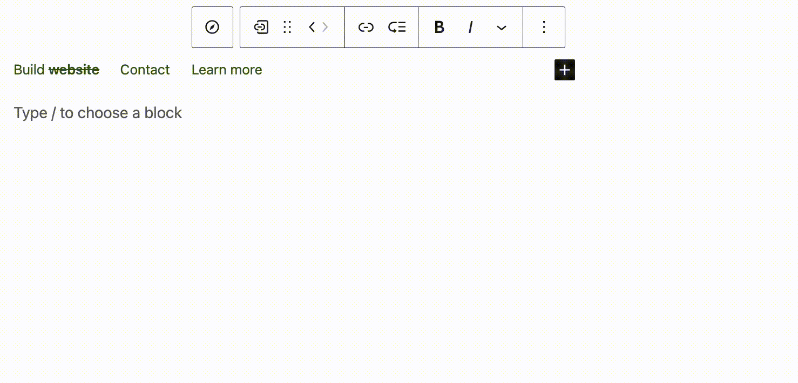
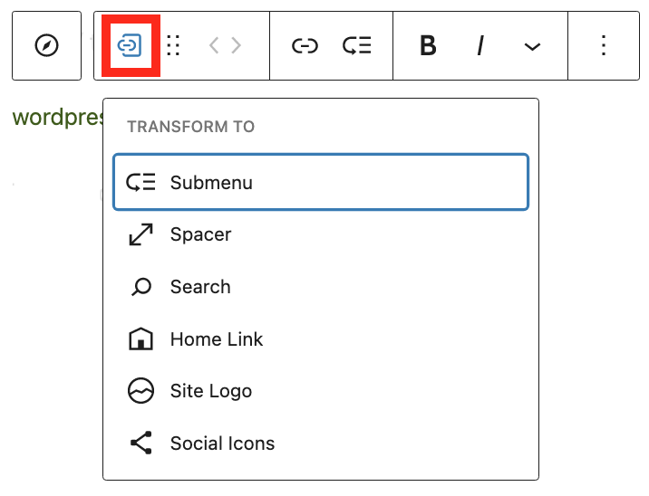
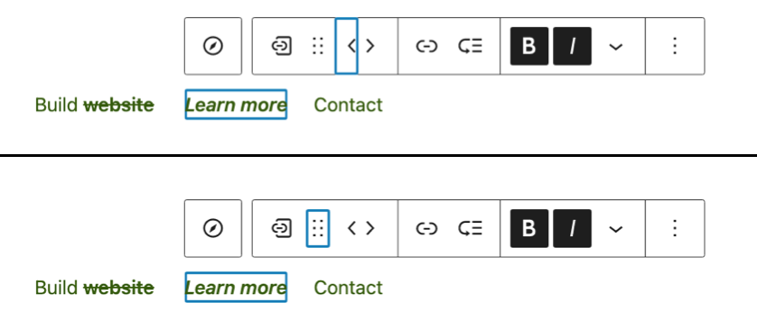
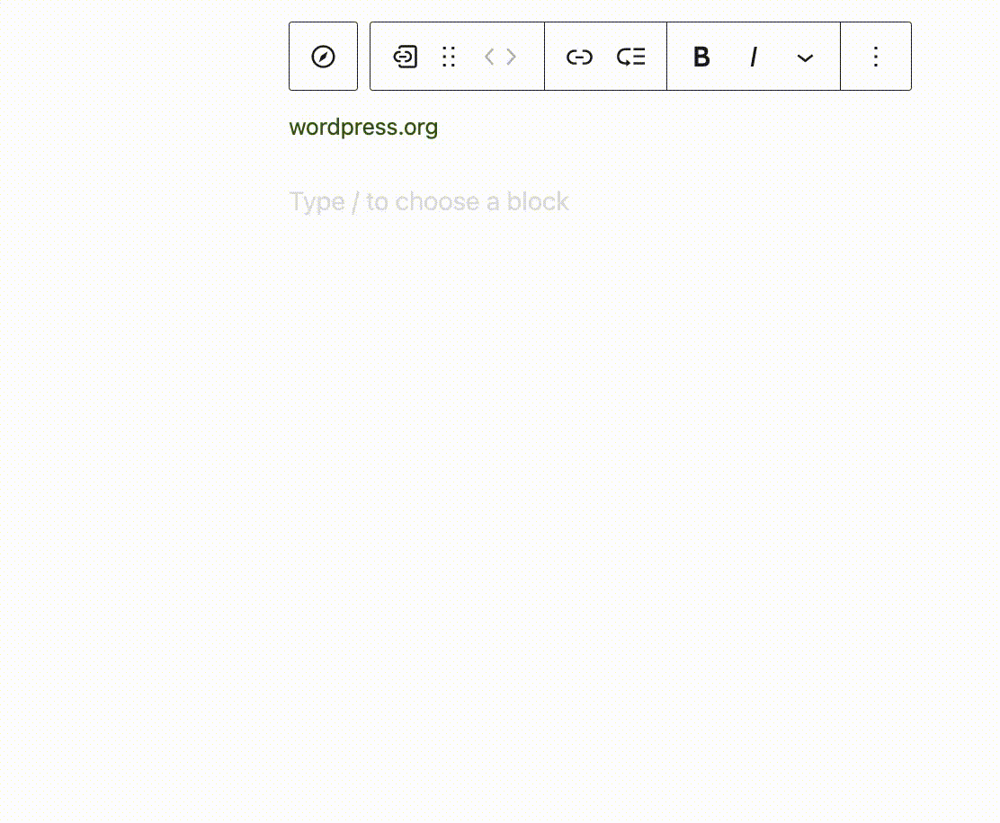
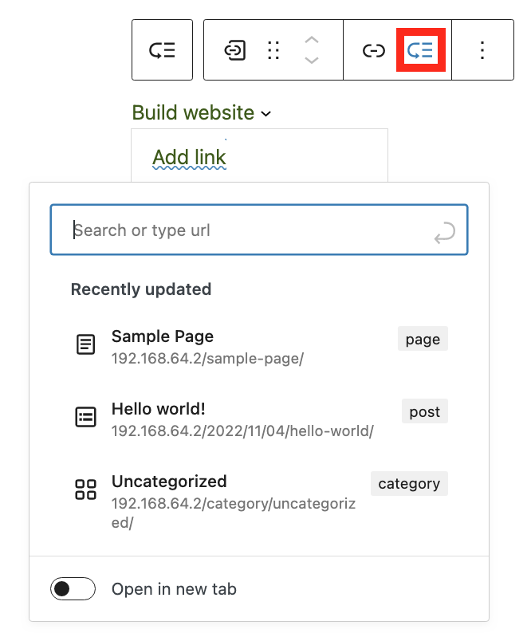
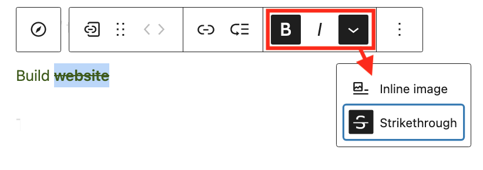

# Custom Link block

[Go back to the list of **Blocks**](../block-editor/blocks-list.md)

The Custom Link block allows you to embed a link, page, category, or another item in your Navigation section.

To add a Custom Link block, you must first add the Navigation block by clicking the **Block inserter** (+) icon or typing `/navigation` in the editor.

The Add link field will appear after adding a Navigation block. Type your URL or select from recent pages you used or created on WordPress. Hit enter to save the link.

You can insert multiple Custom Link blocks in one **Navigation** section. Hit enter after editing one link, and a new Add link field will appear. Every Custom Link block can have a separate link and text settings.

> [!NOTE]
> Detailed instructions on adding blocks can be found [here](../block-editor/adding-a-new-block.md).

## Block toolbar

Each block has its own toolbar, which contains unique controls that let you customize or configure the block. The *Custom Link* block has the following options on its toolbar:

### Transform to

You can transform your Custom Link block to:

-   Submenu, turning your link into a wrapped links list
-   [Spacer](../design-blocks/spacer-block.md) for dividing multiple links with an empty block
-   [Search](../widget-blocks/search-block.md), creating a search bar
-   Home link, linking to homepage of your website
-   [Site logo](site-logo-block.md) for adding your site logo
-   [Social icons](../widget-blocks/social-icons.md) for embedding buttons that lead to a selected social media platform

### Block moving tools

You can reorder Custom Link blocks inside a **Navigation** section. Use the toolbar to move the items left and right or drag them to a new position.

For more information, explore the [Navigation block](navigation-block.md).

### Link tool

The **Link** tool lets you edit your custom link block. You can edit title and custom URL and decide whether you want to open the link in a new tab.

### Adding submenu to a Custom Link block

The next icon lets you build a submenu, where you can add links to a drop-down list.

### Text formatting

Basic **Text formatting** is available for all Custom Link blocks. Select your title (or a part of it) to make it Bold, Italic, or Strikethrough, or turn it into an Inline image to cover your link with an illustration.

### More options

The **Options** section opens block settings and a button to move to the parent Navigation field section to update it. You can also copy, duplicate, lock, or remove your Custom Link. Like everywhere in the WordPress editor, you can undo actions using the **Ctrl+Z** (or **Command+Z** on macOS).

> [!NOTE]
> Details about **More options** can be found in this [support article](../block-editor/more-options.md).

## Block settings

Each link has its **Block settings** you can access by clicking the **settings** button on the upper-right corner of the editor or via **Options** in the toolbar.

### Link settings

**Link settings** section contains the following options:

-   **Description** to display with your link if the selected theme includes that option.
-   **Link title** to provide more information about the link for search engine optimization. Leave this field empty if you want the title used in URL settings to stay.
-   **Link rel** to specify how your external link is related to the page you’re working on and if its authority should be higher than your website’s.

Refer to the [Navigation block documentation](https://wordpress.com/support/full-site-editing/theme-blocks/navigation-block/#link-settings) for more information.

### Typography

The Custom Link block provides typography settings to change the font family, appearance, line height, letter spacing, decoration, letter case, and font size.

> [!NOTE]
> For details refer to this support article: [Typography settings overview](../block-editor/typography-settings-overview.md)

### Advanced

The Custom Link block provides the following Advanced settings options: HTML anchor, Additional CSS Class(es), Additional CSS, and Styles.

> [!NOTE]
> [Learn more about advanced settings](../block-editor/advanced-settings-overview.md)

## Changelog

-   Updated 2026-05-25 (props @kjoyner @awetz583)
    -   Updated “Advanced” section to refer to new overview page
-   2023-07-25
    -   Fix broken image URLs
-   Created 2022-12-11
