# Navigation block

The Navigation block allows you to edit your site’s navigation menu, including its structure and design.

Each menu item in a Navigation block is also a block. Standard block operations are available through the block toolbar, settings sidebar, keyboard shortcuts, and other editor tools.

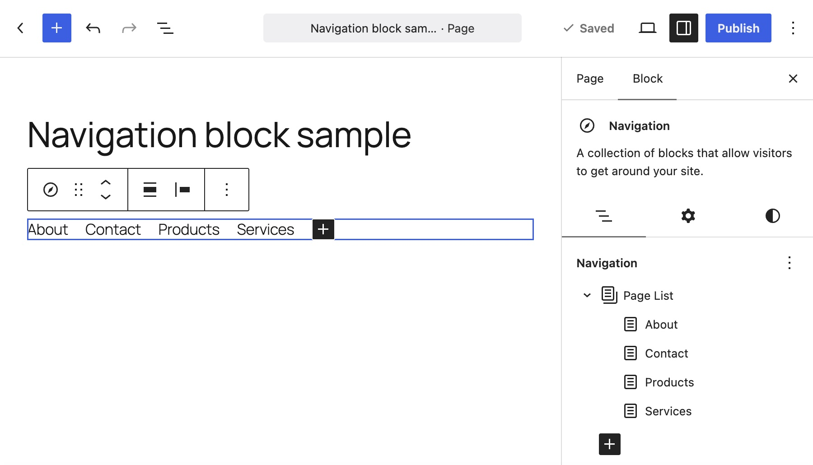

## Add a Navigation block

To add a Navigation block, open the block inserter and select the Navigation block. You can also type /navigation in a new paragraph and press Enter to add the block quickly.

> [!NOTE]
> [Detailed instructions on adding blocks](../block-editor/adding-a-new-block.md)

### Initial view of the Navigation block

When you add a Navigation block for the first time and do not have an existing menu, it starts with a Page List block. The Page List block automatically displays your published pages and adds newly published pages to the menu.

> [!NOTE]
> You can create and manage multiple menus on your site. Each Navigation block displays one selected menu at a time. If you already have other menus, a Navigation block will load it. You can switch to one of them or create a blank menu. For more information, see Menu options below.

### Before customizing a menu

To add, remove, or reorder individual menu items, first select Edit. This converts the Page List block into individual Page Link blocks. After the conversion, newly published pages are no longer added to the menu automatically. To customize the menu:

1.  Select the Navigation block.
2.  Select the Page List block by clicking any menu items.
3.  Click Edit in the block toolbar.
4.  Click Edit of the popup dialog.

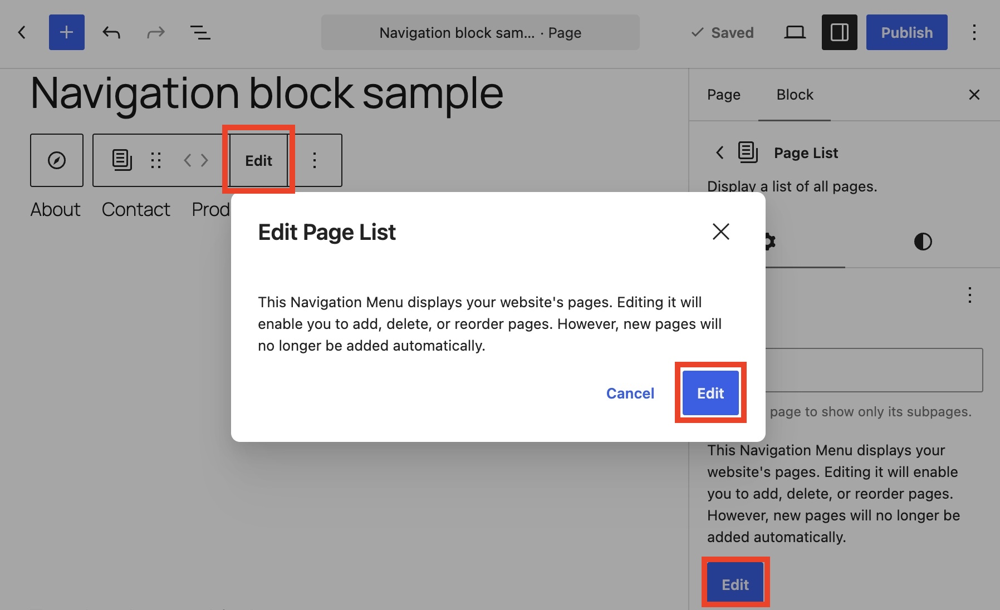

## Customize a menu

### Customize existing menu items

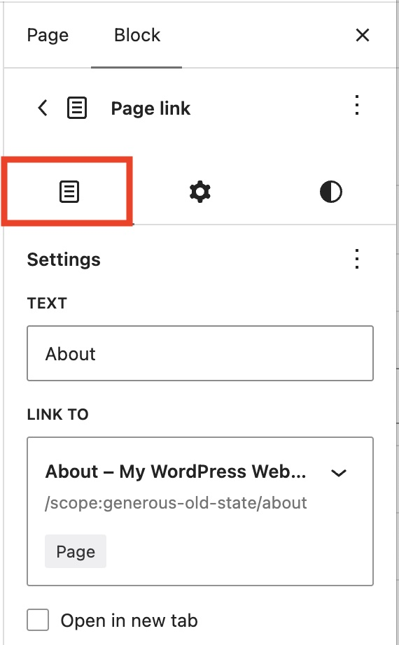

*Content tab in the Page Link block’s setting sidebar*

After selecting Edit, you can customize individual menu items.

1.  Select the menu item you want to customize.
2.  Open the Content tab in the settings sidebar and update the available settings:

-   **Text**: Change the label displayed in the menu.
-   **Link to**: Select a page or enter any URL.
-   **Open in new tab**: Choose whether the link opens in a new browser tab.
-   **Edit**: Open the linked page for editing.
-   **View**: Open the linked page.
-   **Description**: Add text that may be displayed in the menu if the active theme supports link descriptions.
-   **Rel attributes**: Specify the relationship between the current page and the linked resource.

You can also use the Advanced and Styles tabs to customize the selected menu item as like as common blocks.

### Reorder menu items

1.  Select the menu item you want to move.
2.  Click Move up or Move down in the block toolbar.

Alternatively, drag and drop the menu item into a new position in the List View in the settings sidebar.

<!-- VideoPress embed (iframe removed): https://videopress.com/embed/8uCgy1fb -->

https://videopress.com/v/8uCgy1fb

> [!NOTE]
> The following procedures use the block toolbar. The same actions can also be performed from the List View in the settings sidebar.

### Add an existing page as a menu item

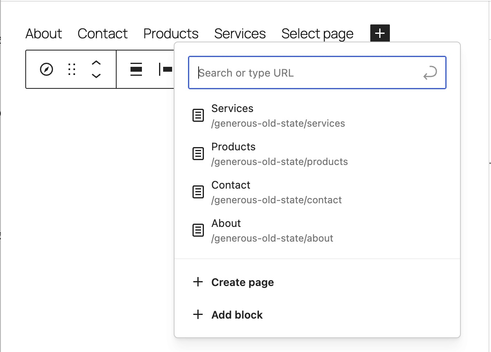

*Add page popup*

1.  Click + (Add page) in the Navigation block or in the List View in the settings sidebar. 
    Tip: When you move the pointer between menu items, a + icon appears so that you can insert a new menu item at that position.
2.  Enter part of the page title, then select the page.

### Add a new page as a menu item

You can create a new blank page while editing the menu, then add content to the page later.

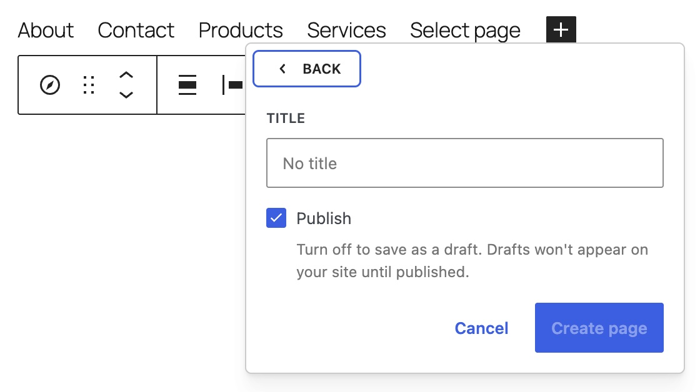

*Create page*

1.  Click + (Add page) in the Navigation block or in the List View in the settings sidebar.
2.  Click Create page.
3.  Enter the page title.
4.  Turn off Publish if you do not want to publish the page immediately.
5.  Click Create page.

### Add a custom link as a menu item

1.  Click + (Add page) in the Navigation block or in the List View in the settings sidebar.
2.  Click Add block.
3.  Select the Custom Link block.
4.  Enter the URL and press Enter.

### Add a submenu item

To add a submenu under an existing menu item:

1.  Select the menu item.
2.  Click Add submenu in the block toolbar.
3.  Select a page, enter a URL, or click Add block.

To create a new submenu:

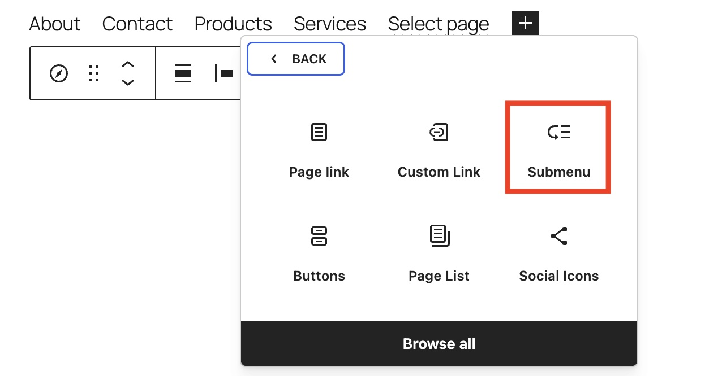

*Submenu block*

1.  Click + (Add page) in the Navigation block or in the List View in the settings sidebar.
2.  Click Add block.
3.  Select the Submenu block.
4.  Select a page, enter a URL, or click Add block. Alternatively, press Escape to close the dialog and enter the submenu label.

To add menu items to the submenu:

1.  Click the down arrow for the submenu item.
2.  Click + (Add page) in the submenu.
3.  Add a Page Link, Custom Link, Submenu, or another supported block.

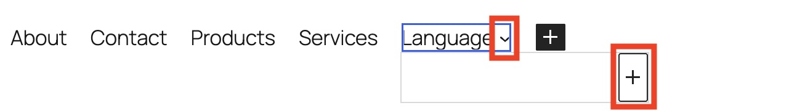

*Editing submenu*

### Delete a menu item

You can delete a menu item like any other block.

1.  Select the menu item.
2.  Open Options in the block toolbar and select Delete.

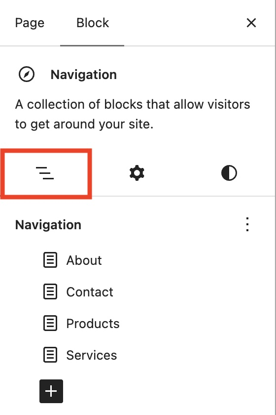

*List View*

## Block settings

Every block has specific options in the editor sidebar in addition to the options found in the block toolbar. If you do not see the sidebar, click the Settings button next to the Save or Publish button.

### List View

In the List View, you can drag and drop menu items to reorder them. You can also create a submenu by dragging an item beneath another menu item and slightly to the right.

Menus and menu items have their own options.

#### Menu options

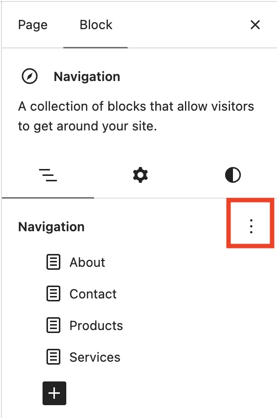

*Menu’s Options*

Click Options (the vertical three-dot icon) on the right of menu name to access the following menu actions:

-   **Menus**: Switch between existing menus.
-   **Import classic menus**: Convert an existing classic menu for use with the block editor. This option appears only when classic menus are available.
-   **Create new menu**: Create a new blank menu.

#### Menu item options

When you hover over a menu item, the Options button appears on its right. You can move, add, remove, or otherwise manage the item, just as you would in the editor canvas.

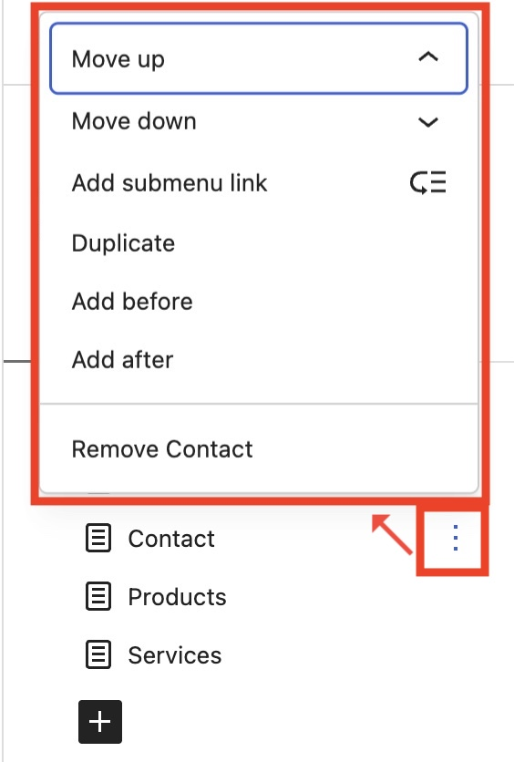

*menu items Options and its list*

### Settings

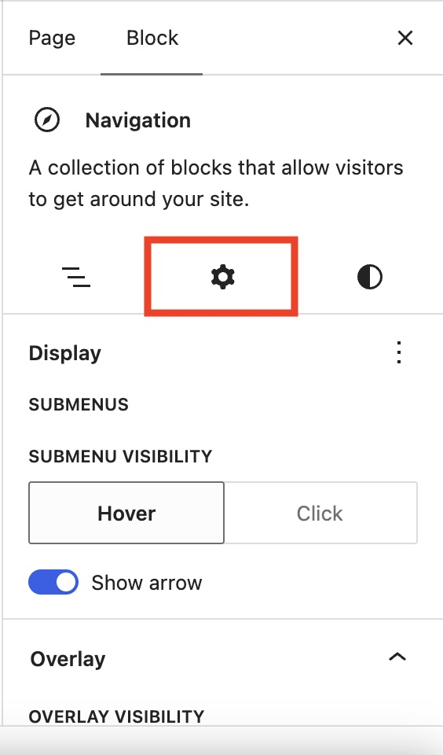

*Settings tab and Display section*

Use the Settings tab to control how the menu and its submenus are displayed, including their behavior on mobile devices.

#### Display

-   **Submenu visibility**: Choose how submenus open.
    -   **Hover**: Open the submenu when a visitor points to the menu item.
    -   **Click**: Open the submenu when a visitor clicks the menu item.
-   **Show arrow**: Display an arrow next to menu items that contain a submenu.

### Overlay

-   **Overlay visibility**: Control whether the menu is collapsed into a menu icon.
    -   **Off**: Never collapse the menu. All menu item labels remain visible.
    -   **Mobile**: Display a menu icon on smaller screens. Visitors can select the icon to view the full menu.
    -   **Always**: Display the menu icon at every screen size.

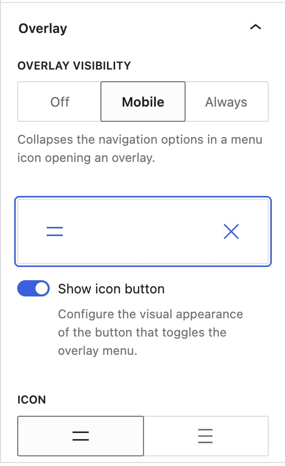

*Overlay section*

When you select Mobile or Always, a menu icon preview appears. Select the preview to display the available options.

-   **Show icon button**: Turn this off to display the text labels “Menu” and “Close” instead of icons.
-   **Icon**: Select the icon style.

### Overlay template

You can customize the dialog that opens when a visitor selects the menu button. By default, the overlay displays a vertical list of menu items. To customize it:

1.  Click Create overlay in the Overlay template section.
2.  The overlay template opens in the editor. Customize the mobile menu as needed. In the example below, a predefined design is selected from the Design section in the settings sidebar.
3.  Click Save.
4.  Click Back at the top of the editor.

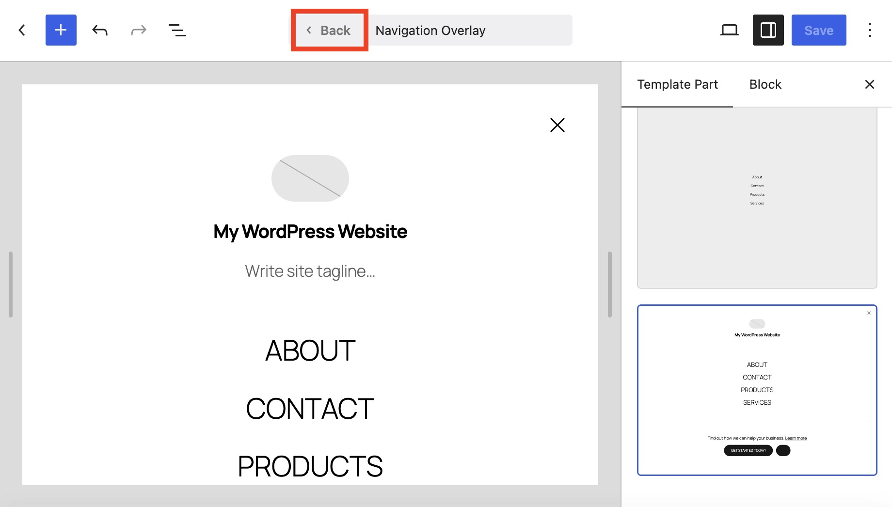

The following video demonstrates the default mobile menu and a customized mobile menu created using an overlay template.

<!-- VideoPress embed (iframe removed): https://videopress.com/embed/JD5opVK7 -->

https://videopress.com/v/JD5opVK7

### Advanced

In the Menu name section, you can manage the currently selected menu.

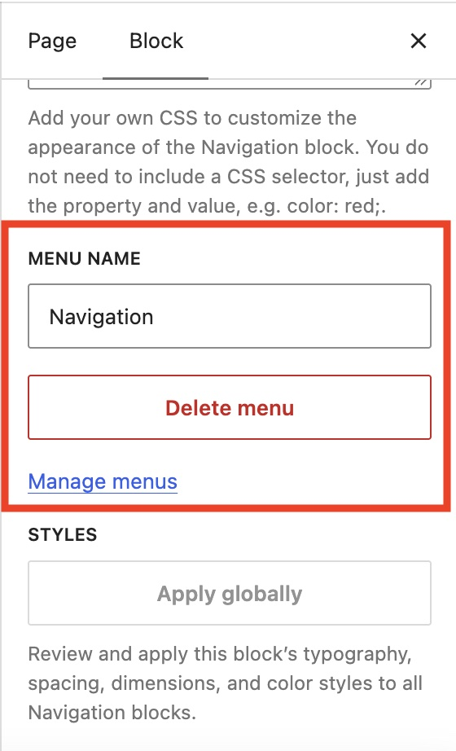

*Menu name section*

-   **Menu name**: Rename the current menu.
-   **Delete menu**: Delete the current menu. This does not delete any pages, posts, or other content linked from the menu.
-   **Manage menus**: View, create, and update the menus used on your site.

The following Advanced settings are also available: HTML Anchor, Additional CSS Class(es), Additional CSS, and Styles.

> [!NOTE]
> [Learn more about advanced settings](../block-editor/advanced-settings-overview.md)

### Styles

#### Typography

This block provides typography settings for changing the font family, size, appearance, line height, letter spacing, and other typography options.

> [!NOTE]
> [Learn more about typography settings.](../block-editor/typography-settings-overview.md)

### Color

The Navigation block provides color settings for changing menu and submenu text and background colors.

> [!NOTE]
> [Learn more about color settings.](../block-editor/colors-settings-overview.md)

#### Laout

This block provides layout settings for changing the justification and orientation of menu items.

> [!NOTE]
> [Learn more about laout settings.](../appearance/layout-settings-overview.md)

#### Dimensions

This block provides dimension settings for changing the spacing between menu items.

> [!NOTE]
> [Learn more about dimension settings.](../block-editor/dimension-controls-overview.md)

## Changelog

-   Updated 2026-09-27 (props @atachibana)
    -   Overhauled for WordPress 7.1
-   Updated 2026-05-25 (props @kjoyner @awetz583)
    -   Updated “Advanced” section to refer to new overview page
-   Update 2025-12-02 (props @annezazu)
    -   Removed all GIFs and replaced with images or videos.
    -   Added in information about publishing a page when adding a new page to the menu.
    -   Updated adding new blocks section to include more recent information.
-   Update 2025-11-10 (props @karthickmurugan)
    -   Add menu name in the List View next to the Navigation block
    -   Add clearable option to color picker
    -   Supports all non-interactive formats
    -   Add missing ALT description (@milana_cap)
    -   Change formatting for some sections to improve readability (@milana_cap)
-   **Updated 2023**-03-28
    -   Updated the article to match the current state in WordPress 6.2
-   **Updated** 2023-02-17
    -   Updated the Block Configuration section
    -   Updated some screenshots
-   **Created** 2022-01-05
